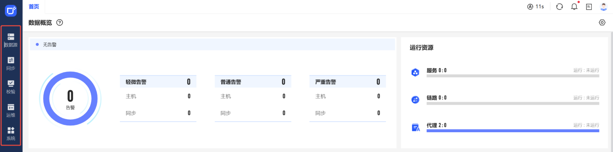
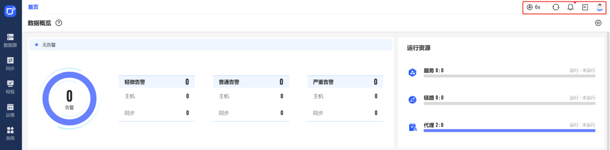
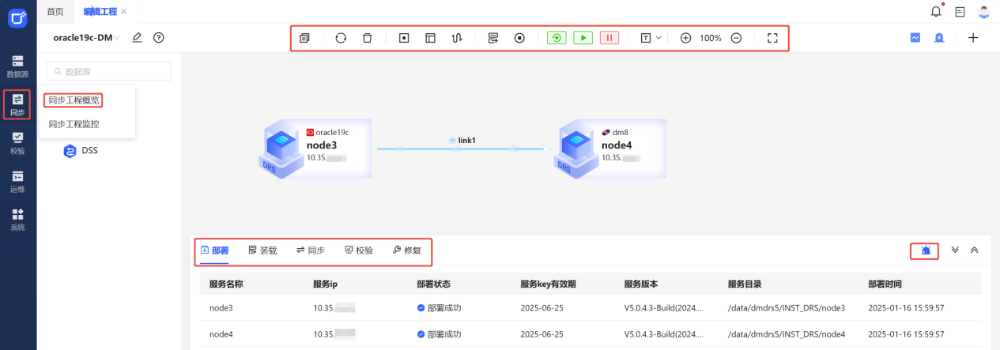
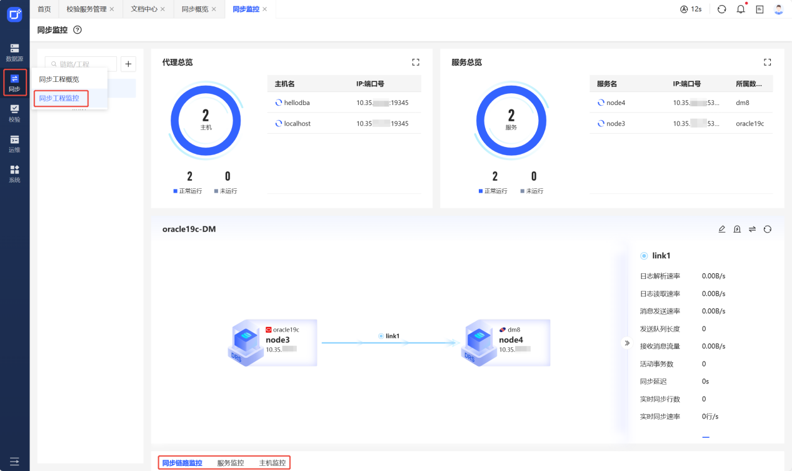
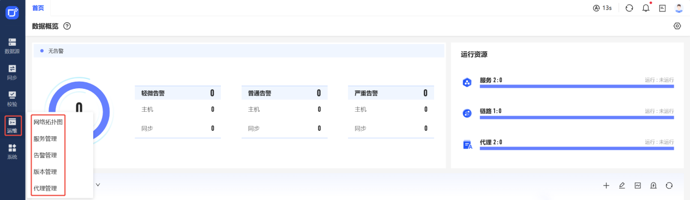
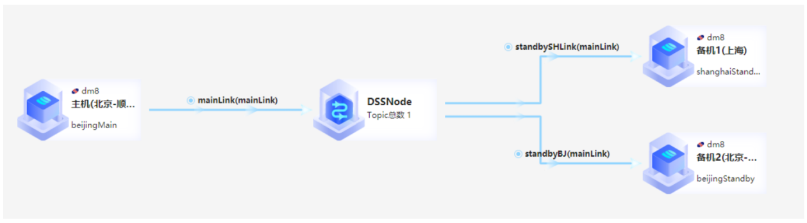
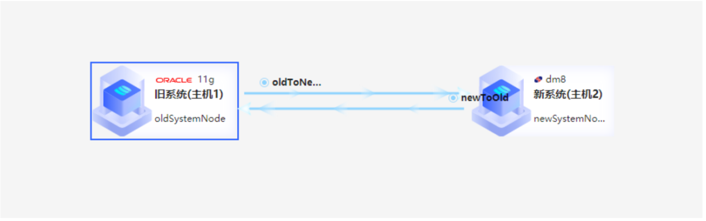
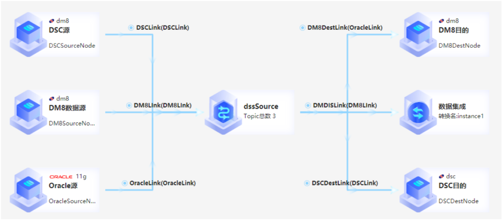

## 一、前言

达梦数据融合管理平台（DMDFM）是达梦为解决大型数据复制、数据集成项目的管理运维问题而推出的一款集安装配置、设计管理、监控运维于一体的软件。使用 DMDFM 可以快速安装配置达梦数据复制软件（DMDRS）、达梦数据集成软件（DMDIS）以及达梦数据校验软件（DMDVS），支持各种复杂拓扑结构同步链路的拖拽设计，支持监控大量的数据链路，极大地提升大型项目的实施和运维效率。

## 二、系统架构

DMDFM 平台采用当前主流的前后端分离框架，整个系统分为访问层、展现层、业务层、代理层四部分，系统架构如下图所示。

## 三、产品架构

为了方便用户更直观地搭建各种复杂数据同步链路，DMDFM 以数据源为中心，采用拖拽式的可视化数据链路设计器，只需配置简单的基本参数即可快速搭建数据同步链路。DMDFM 以工程为单位进行多个同步链路的集中管理、监控和运维，方便用户根据业务情况对同步链路进行分组管理。本章将从导航栏、标签栏、工程结构、监控结构和运维结构五个方面进行介绍，让用户更清晰的了解 DMDFM 的产品架构。

### 3.1 导航栏

DMDFM 的导航栏在页面的最左侧，导航栏主要包含“数据源”、“同步”、“校验”、“运维”和“系统”五大模块。

- “数据源”包含“数据源管理”。
- “同步”中包含“同步工程概览”和“同步工程监控”。
- “校验”包含“校验服务管理”、“校验任务管理”和“修复任务管理”。
- “运维”包含“网络拓扑图”、“告警管理”和“版本管理”。
- “系统”包含“角色管理”、“用户管理”、“审计信息管理”和“系统参数管理”。

### 3.2 标签栏

DMDFM 的标签栏主要包含“页面标签”、“通知中心”、“文档中心”和“用户信息”四部分。

- “页面标签”主要是在 DMDFM 打开的子页面的标签，每个子页面只会形成一个标签，右键“页面标签”提供“刷新”、“关闭其他”和“关闭所有”三个功能。
- “通知中心”主要为资源对象的“告警通知”、“异常通知”和“操作通知”，在“通知中心”中会显示最新的 10 条“告警通知”和最新的 10 条“异常通知”，并且提供“历史记录”按钮链接到“通知中心”的历史页面和标记“全部已读”的按钮。
- “文档中心”主要为 DMDFM 的帮助手册和用户手册。
- “用户信息”主要为当前登录用户的相关信息等。

### 3.3 工程结构

DMDFM 可以对同步链路进行分组，一个组可以包含多个同步链路，平台将组定义为工程，一个工程可以包含如下内容。

- 一个同步链路由拓扑图源节点、拓扑图目的节点和连接线组成，同步链路也叫拓扑图。
- 一个同步工程可以包含多个同步链路。
- 同步工程包含数据源管理。
- 在同步工程中可以进行服务的安装、字典的装载、数据的装载和数据的同步。
- 拓扑图节点上可以进行数据源配置、服务配置和模块配置的查看与编辑。
- 拓扑图节点上可以进行节点服务的启停、删除、控制台等运维操作。
- 同步链路线上可以进行同步映射的配置查看与编辑，可以启动/停止同步。
- 同步工程可以对同步链路数据进行校验和修复。

### 3.4 监控结构

DMDFM 中的监控分为“工程监控”和“链路监控”。

- “工程监控”是以当前同步工程为单位的监控。

同步链路监控：当前工程下全部的同步链路同步过程中的监控项。

服务监控：当前工程下包含的全部的服务进程资源占用情况的监控项。

主机监控：当前工程下包含的全部代理对应主机的负载监控项和磁盘使用监控。

- “链路监控”是以单条同步链路为单位的监控。

同步链路监控：当前同步链路同步过程中的监控项。

服务监控：当前同步链路涉及到的源服务和目的服务进程资源占用情况的监控项。

主机监控：当前同步链路涉及的源代理和目的代理对应主机的负载监控项和磁盘使用监控。

注意：

所有的监控项默认显示实时数据，可以通过设置时间，选择 7 天内的监控数据进行展示。

### 3.5 运维结构

DMDFM 的运维分为“网络拓扑图”、“告警管理”和“版本管理”三部分。

- “网络拓扑图”是以主机代理为单位的维度进行展示当前平台中包含的资源，其包含的对象为主机代理、服务和模块。依次展示了主机代理管理的服务，服务下包含的模块，在网络拓扑图中还可以进行如下的运维操作。

  （1）开启服务运维控制台；

  （2）查看服务的配置文件；

  （3）查看服务的日志；

  （5）远程部署代理和 DMDRS 等服务；

  （5）查看服务进程监控和主机负载与磁盘使用情况的监控。

注意：

开启服务运维控制台和查看服务的配置文件在拓扑图节点中的配置也可进行查看。

- “告警管理”中的告警以主机、服务和链路为对象单位，进行告警的设置、告警项和告警历史的查询。
- “版本管理”中主要对安装包进行管理，目前主要包含“代理版本管理”和“ DMDRS 版本管理”。

## 四、典型应用场景

为了用户更加了解达梦数据融合管理（DMDFM）平台搭建，本章会以部分典型应用场景来进行介绍。  
典型应用场景如下：

- 数据灾备场景
- 柔性迁移场景
- 数据集成场景

### 4.1 数据灾备

1、应用场景

DMDRS 采用分析事务日志的方式捕获数据变化的实时数据复制。使用 DMDRS 搭建数据备份系统，不需要对主机数据库进行复杂配置，对主机数据库系统性能几乎无影响，同时备机也可以对外提供只读服务，从而提高应用系统的整体性能。相比于各种数据库内置的备份方案，使用 DMDRS 的灵活性更高，主库和备考可以采用不同版本的数据库，因此可以采用统一的方案对企业内各种不同的数据库进行备份，降低企业的管理和运维成本，同时异构备份的特点可以提升安全性，进一步降低后续攻击行为对生产系统造成破坏的可能。

2、拓扑图展示

示例场景以主机在顺义，备机分为 2 个，备机 1 在上海，备机 2 在北京-大兴，通过 DSS 流存储来将数据同步到备机中，以此来搭建示例链路。仅以此场景作为参照，用户可根据实际应用场景进行链路搭建。

### 4.2 柔性迁移

1、应用场景

柔性迁移场景适用于在系统升级替代过程中，首先在不中断业务的情况下完成老系统向新系统的数据迁移和实时同步，然后进行系统切割，完成新系统的上线，同时实现反向数据同步，使得老系统作为备份系统继续运行一段时间，直到新系统完全稳定后，老系统再停机下线。DMDRS 通过支持全量迁移和增量同步的无缝对接，完美支持平滑迁移场景，最大化减少系统升级替代时的业务中断时间，降低迁移风险。

2、拓扑图展示

示例场景以原系统为 Oracle，新系统为 DM8 为示例进行搭建。仅以此场景作为参照，用户可根据实际应用场景进行链路搭建。

### 4.3 数据集成

1、应用场景

当前，数据中台、数据仓库、数据中心等数据集成类项目对数据的实时性要求越来越高，DMDRS 可以很低的代价实现高性能亚秒级的数据复制，同时支持复制过程中数据的清洗转换，支持构建一对多，多对一，级联等各种复杂的拓扑结构，能够大幅度提升数据集成的实时性。DMDRS 也支持与 DMDIS、DMDFM 数据互通，组合使用，完成更为复杂的大型数据集成项目

2、拓扑图展示

示例场景以当前支持的数据源类型为示例，将其集成在同一拓扑图中。仅以此场景作为参照，用户可根据实际应用场景进行链路搭建。

