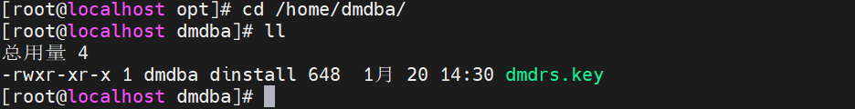
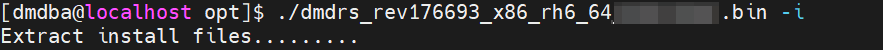
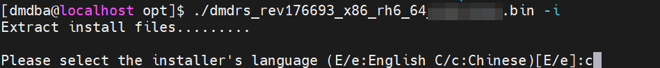
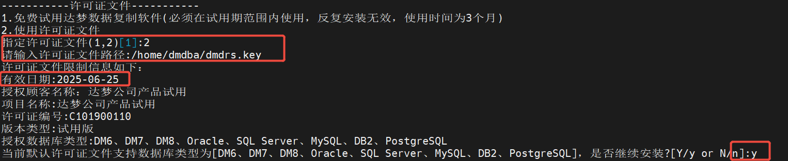
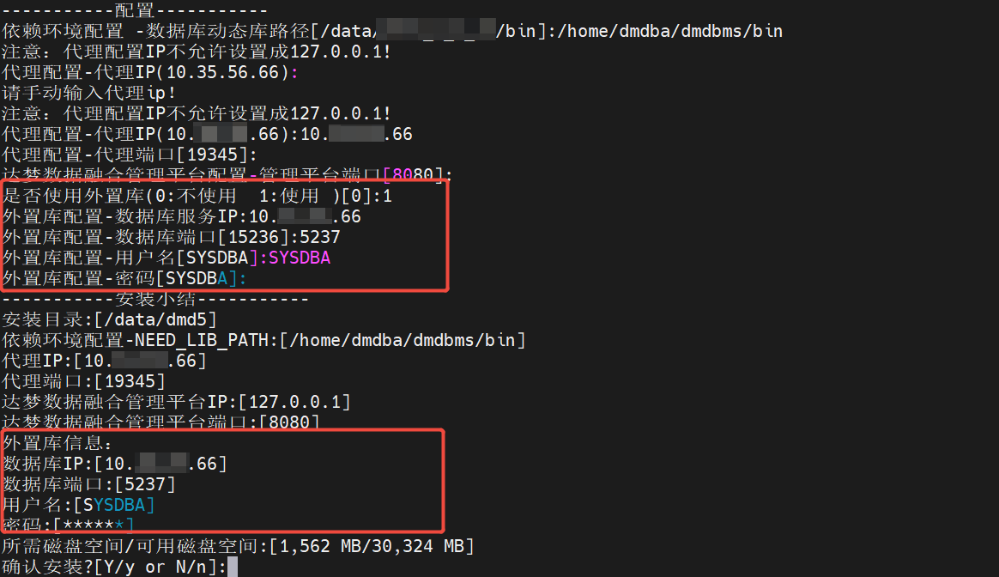
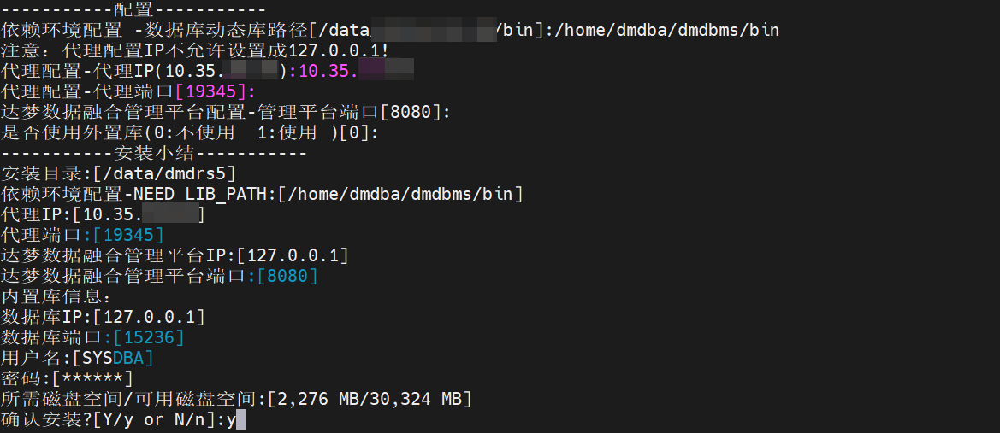
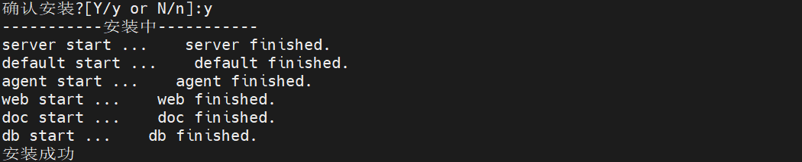
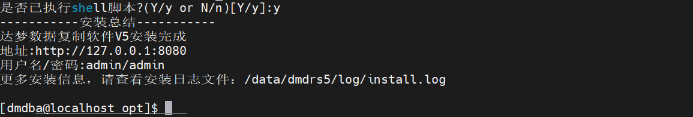
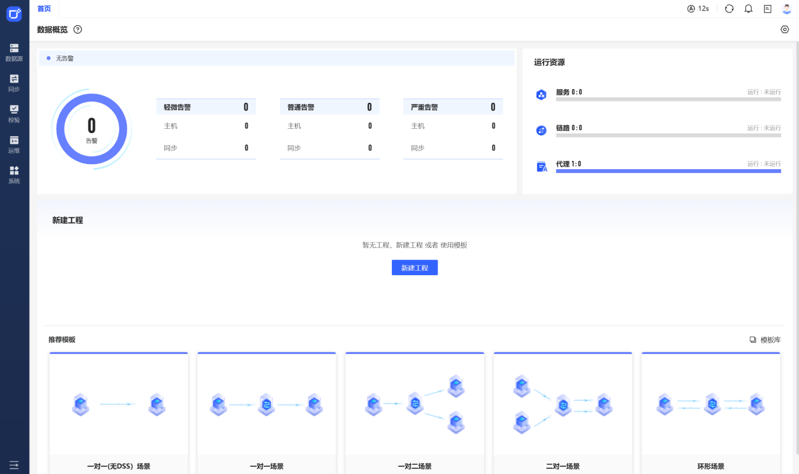

## 一、简介

达梦数据复制软件（简称 DMDRS ）是一种用于同构数据库、异构数据库以及各种数据管理系统之间的数据复制软件。DMDRS 采用模块化的设计，通过灵活配置不同的功能模块，实现多功能的数据复制服务，以满足多种场景下的数据复制业务需求。

基于数据复制业务的应用场景，DMDRS 提供数据迁移、数据同步、数据分发和数据转换等功能，而且数据同步功能还支持一对一、双向、一对多、多对一、级联同步、环形同步和 DMDRS 主备等多种同步拓扑结构。  
根据实际的应用场景完成 DMDRS 的安装后，用户可以通过达梦数据融合管理平台（DMDFM）搭建 DMDRS 服务，也可以直接在服务器上搭建 DMDRS 服务。

## 二、运行环境

### 2.1 硬件环境

源端和目标 DMDRS：

1. 内存要求:

为了确保系统的流畅运行，至少需要 8GB 的内存空间，而推荐的配置是 16GB 或更高。源 DMDRS 对内存的需求主要取决于同时运行的并发任务数量。如果内存空间不足 8GB，您可以通过调整并发任务的线程数来减少源 DMDRS 对内存的需求。

2. 磁盘要求:

为了确保系统的顺畅运行，至少需要 50GB 的磁盘空间，但建议配置 100GB 或更多的磁盘空间。源 DMDRS 对磁盘空间的需求会根据不同的应用场景而变化，特别是在需要处理大规模查询、建表同步、大事务同步，以及启用大对象延时装载的情况下，建议至少配置 200GB 以上的磁盘空间。相关资源如下表所示：

| DMDRS 服务 | 内存要求 | 磁盘要求 |
| --- | --- | --- |
| 源端 DMDRS | 8-16GB | 至少 100GB |
| 目标端 DMDRS | 8-16GB | 至少 100GB |

### 2.2 软件环境

DMDRS 各服务支持的软件环境如下表所示。

| 环境项目 | 描述 |
| --- | --- |
| 操作系统 | 支持各类主流的操作系统。Windows：Windows XP 及以上版本。Linux：使用 2.6 及以上 Linux 内核的操作系统。如中标麒麟、优麒麟和 Red Hat 6。UNIX/类 UNIX：支持 AIX、 HP-UNIX 和 Solaris 等系统的主流版本。 |
| 源数据库类型及驱动 | DM8（单机、DSC、DPC）：DMDPI 驱动。 |
| 目标数据库类型及驱动 | DM8（单机、DSC、DPC）：DMDPI 驱动。Oracle 10g 及以上版本（单机、RAC）：OCI 驱动。MySQL 5.6 及以上版本：MySQL C API 驱动。Kafka 0.8.2 及以上版本：librdkafka 驱动。PostgreSQL 11 版本：ODBC 驱动。 |
| 网闸 | 支持开启网闸模式，可在网闸环境下运行。 |
| TCP/IP 协议 | 支持 TCP/IPv4 和 TCP/IPv6 协议。 |

## 三、安装前准备

### 3.1 用户及目录

#### 3.1.1 安装用户选择

为避免 DMDRS 在访问数据库文件时权限不足、环境变量错误等问题，建议源端与目的端在进行安装时选择对应的数据库的安装用户安装。例如：源端 Oracle 数据库安装用户为 oracle，则源 DMDRS 就使用 oracle 用户进行安装；目的端 DM 数据库安装用户为 dmdba，则目的 DMDRS 就使用 dmdba 用户进行安装。本文以在 DM 端使用 dmdba 用户部署 DMDRS 为例。

#### 3.1.2 创建安装目录

DMDRS 默认安装目录在 home 目录下，用户可根据需要是否自定义安装目录，本文以创建 DMDRS 安装目录为例。

```shell
[root@localhost /]# mkdir -p  /data/dmdrs5
[root@localhost /]# chown dmdba:dinstall -R /data/dmdrs5/
[root@localhost /]# chmod -R 755 /data/dmdrs5/
```

### 3.2 安装包及 key 文件

#### 3.2.1 创建安装目录

上传 DMDRS 安装包到 opt 目录，并修改权限，本文为以安装 dmdrs\_v5.0.0.03\*\*\* 为例。

```shell
[root@localhost opt]# chown dmdba:dinstall dmdrs_rev176693_x86_rh6_64***.bin
[root@localhost opt]# chmod -R 755 dmdrs_rev176693_x86_rh6_64***.bin
```

#### 3.2.2 配置 key 文件

将 DMDRS 的 key 文件上传并重命名为 dmdrs.key。

```shell
[root@localhost opt]# cp dmdrsC101900110.key dmdrs.key
```

修改 dmdrs.key 的用户及权限，并将 dmdrs.key 移动到 /home/dmdba 目录下。

```shell
[root@localhost opt]# chown dmdba:dinstall dmdrs.key
[root@localhost opt]# chmod -R 755 dmdrs.key
[root@localhost opt]# mv dmdrs.key /home/dmdba/
```



## 四、安装部署

### 4.1 启动安装程序

使用 dmdba 用户启动安装文件。



### 4.2 选择安装语言

DMDRS 有中文和英文安装，可选择对应的版本进行安装，这里以选择中文安装为例。



### 4.3 指定安装目录

DMDRS 默认安装在安装用户的 home 目录下，用户可自定义安装目录，本文选择已创建好的安装目录进行安装。


### 4.4 指定安装组件

DMDRS 安装时提供 2 个组件进行选择安装。

1. “达梦数据融合管理平台”：简称 DMDFM 是达梦为解决大型数据复制、数据集成项目的管理运维问题而推出的一款集安装配置、设计管理、监控运维于一体的软件。使用 DMDFM 可以快速安装配置达梦数据复制软件（DMDRS）、达梦数据集成软件（DMDIS）以及达梦数据校验软件（DMDVS），支持各种复杂拓扑结构同步链路的拖拽设计，支持监控大量的数据链路，极大地提升大型项目的实施和运维效率。
2. 代理：DMDFM 通过代理来进行管理、监控和实现各项功能。

如果 DMDFM 已在其它服务器安装，那么本服务器只需安装代理。例如：需要部署 Oracle 到 DM 的数据同步，在目的端 DM 服务器已部署了 DMDFM，那么在源端 Oracle 服务器上只需部署代理指定 DMDFM 的 IP 即可。本文以 2 个组件都安装为例。


### 4.5 指定许可证文件

在指定许可证文件时可选择免费试用或使用许可证文件。免费试用 DMDRS 时间为 3 个月且必须在试用期范围内使用，反复安装无效。本文以指定 dmdrs.key 文件为例。指定 dmdrs.key 路径后 key 文件有效则会显示 key 信息包括：有效日期、授权顾客名称、项目名称、许可证编号、版本类型、授权数据库类型等信息。



### 4.6 安装环境配置

1、依赖环境

DMDRS 会自动选择已安装好的 dm 数据库 bin 目录作为数据库动态库路径，用户也可自定义动态库路径，本文指定动态库路径为:/home/dmdba/dmdbms/bin

2、配置代理 IP 及端口

代理 ip 不允许设置为 127.0.0.1，可指定本机 IP，端口默认为 19345，也可指定其它端口。

3、达梦数据融合管理平台

达梦数据融合管理平台端口默认为 8080，也可指定其它端口。

4、外置库

可指定使用外置库，默认不使用外置库，使用内置库。

如果配置使用外置库需指定外置库 IP、端口、用户名及密码，如果连接失败则会报错，连接成功则会弹出“安装小结”示例截图如下：



本文以使用内置库为例，示例截图如下：



确认安装后安装程序开始安装 DMDRS。



### 4.7 配置服务

1、内置数据库

注册内置数据库系统服务，服务器发生重启后内置数据库自动重启。


2、达梦数据融合管理平台

注册内置数据库系统服务，服务器发生重启后达梦数据融合管理平台自动重启。


3、达梦数据融合管理平台代理服务

注册内置数据库系统服务，服务器发生重启后达梦数据融合管理平台代理自动重启。


4、注册服务

根据提示使用 root 用户执行脚本注册系统服务。


```
[root@localhost ~]#/data/dmdrs5/scripts/root/root_installer.sh
```

### 4.8 安装结束

服务注册成功后会自动启动，在安装窗口根据提示输入 Y 安装完成。可根据安装总结提示输入地址登录 DMDFM，地址 IP 需改为 DMDFM 部署机器 IP。



## 五、登录 DMDFM

输入 DMDFM 部署机器 IP 及端口进入登录界面，登录界面如下：


输入用户名及密码登录 DMDFM，首页如下：



登录成功，DMDRS 软件安装成功。