## 一、数据库安装目录

下图展示为 DM8 数据库目录。

/home/dmdba/dmdbms/bin 目录存放 DM 数据库的可执行文件，例如 disql 命令、dminit 命令、dmrman 工具等。

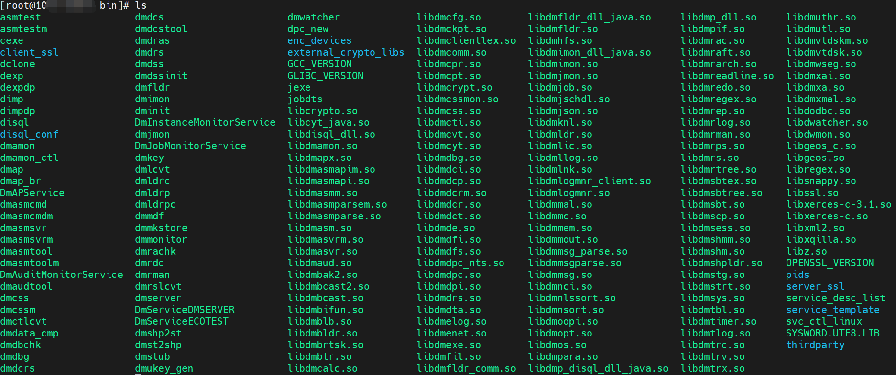

/home/dmdba/dmdbms/desktop/icons 存放 DM 数据库各个工具的桌面图标。

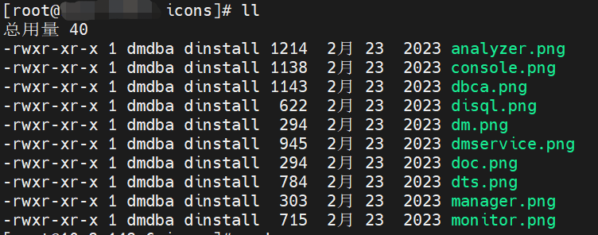

/home/dmdba/dmdbms/doc 存放 DM 数据库用户手册。

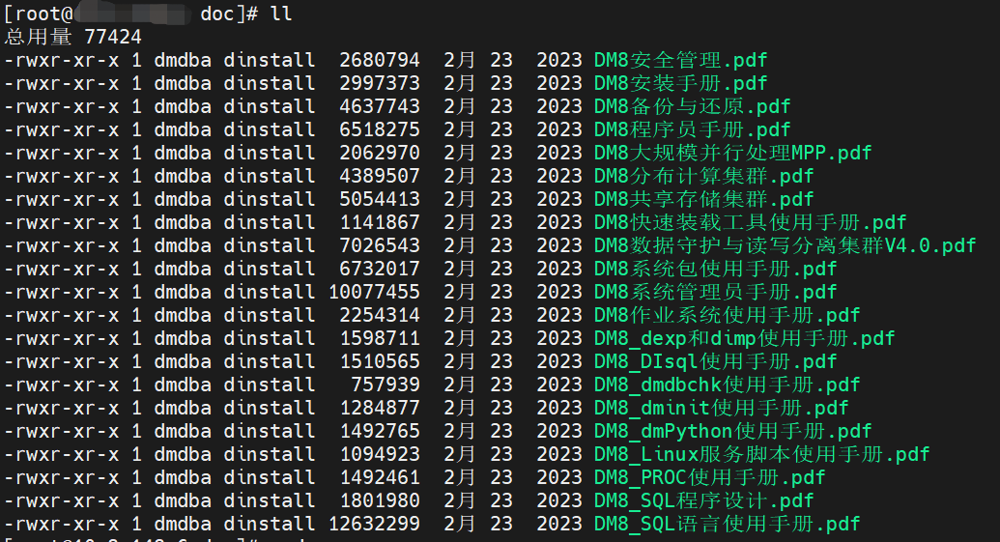

/home/dmdba/dmdbms/drivers 存放连接 DM 数据库的驱动文件。

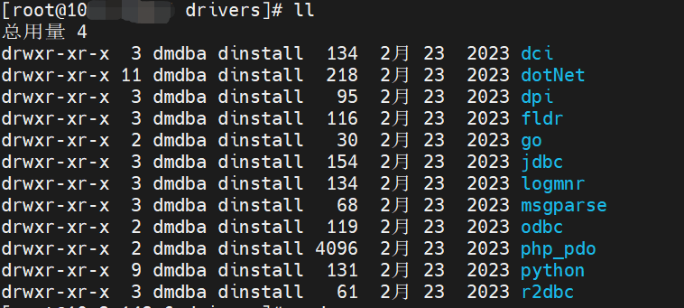

/home/dmdba/dmdbms/log 存放 DM 数据库日志，包括工具的日志、数据库日志、服务日志等。

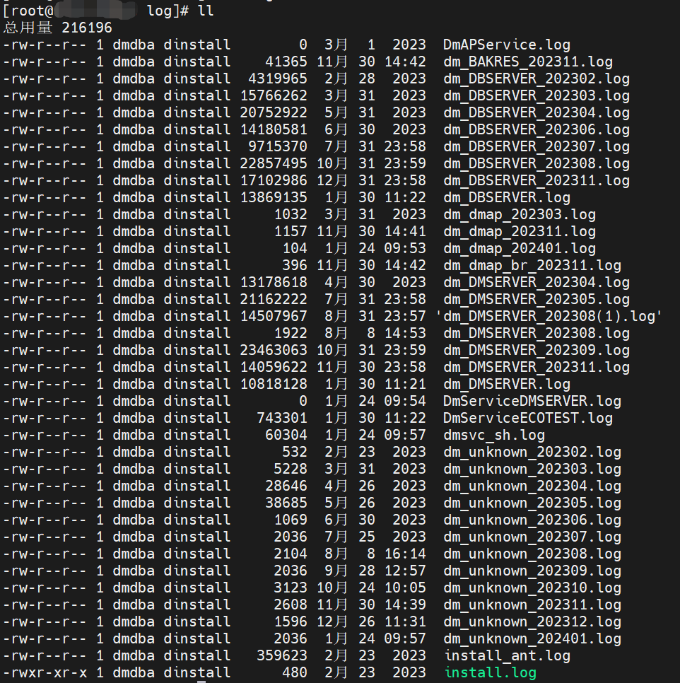

/home/dmdba/dmdbms/samples 存放 DM 数据库各类配置文件的示例文件。

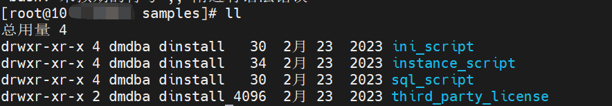

/home/dmdba/dmdbms/script/root 存放注册、注销 DM 数据库服务的工具，例如 dm\_service\_installer.sh 等。

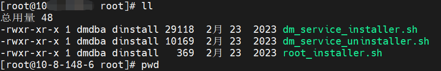

/home/dmdba/dmdbms/tool 存放 DM 数据库的各个工具，例如 manager 管理工具、dbca 数据库配置助手等。

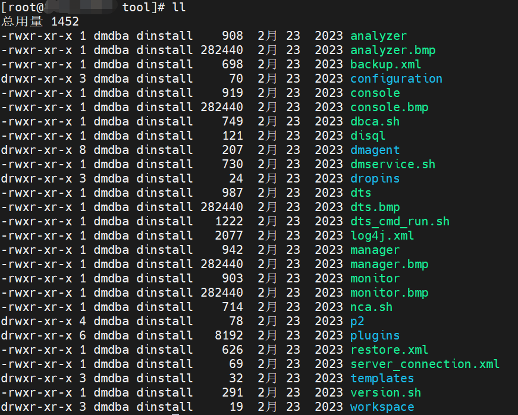

/home/dmdba/dmdbms/uninstall 目录存放卸载 DM 数据库的脚本。

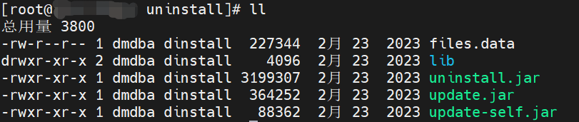

/home/dmdba/dmdbms/web 目录存放 DM 数据库 dem 工具的 web 环境。

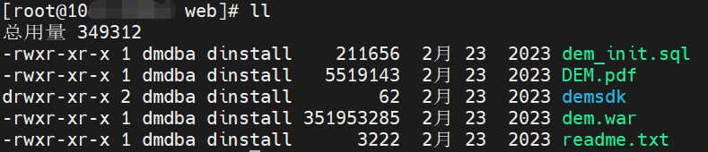

## 二、数据库实例目录

/dmdata/data 为数据库实例目录，该目录存放各个实例的文件。

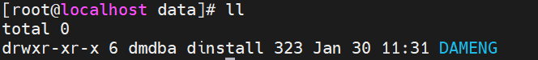

以实例 DAMENG 为例，该目录下存放 DAMENG 实例的配置文件 `*.ini、控制文件 dm.ctl、数据文件 *.DBF、日志文件 *.log` 等。

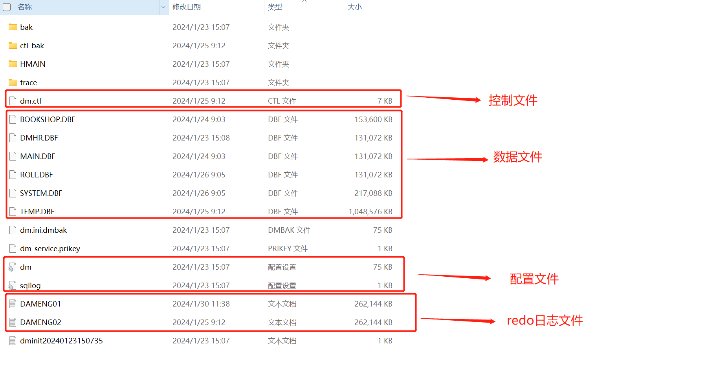