## 一、前言

DM 数据库在 Linux 环境下支持 **命令行安装** 和 **图形化安装** ，本章节将分别进行详细介绍。

## 二、挂载镜像

切换到 root 用户，将 DM 数据库的 iso 安装包保存在任意位置，例如 /opt 目录下，执行如下命令挂载镜像：

```
cd  /opt
mount -o loop dm8_20240116_x86_rh7_64.iso /mnt
```

## 三、命令行安装

切换至 dmdba 用户下，在 /mnt 目录下使用命令行安装数据库程序，依次执行以下命令安装 DM 数据库。

```
su - dmdba
cd /mnt
```

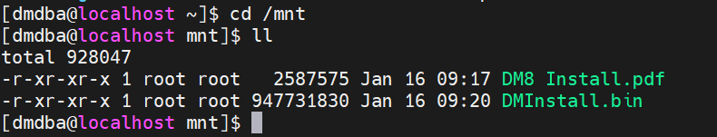

执行如下命令进行安装。

```shell
./DMInstall.bin -i
```

按需求选择安装语言，没有 key 文件选择 "n"，时区按需求选择一般选择 “21”，安装类型选择“1”，安装目录按实际情况配置，这里示例使用默认安装位置。

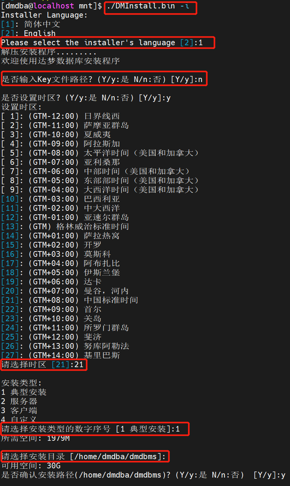

数据库安装大概 1~2 分钟，数据库安装完成后，显示如下界面。

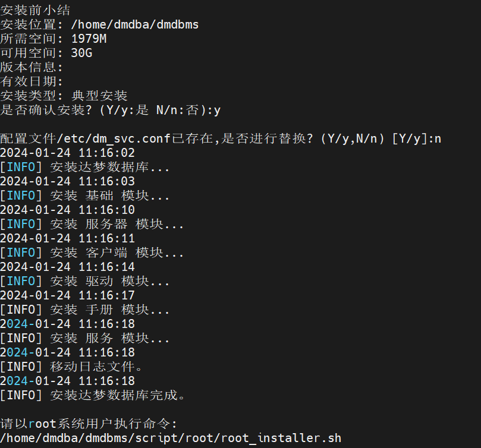

数据库安装完成后，需要切换至 root 用户执行上图中的命令 `/home/dmdba/dmdbms/script/root/root_installer.sh` 创建 DmAPService，否则会影响数据库备份。

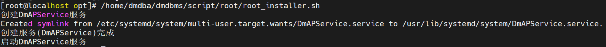

数据库安装完成后还需注册实例才能使用数据库，注册实例可参考 [配置实例](https://eco.dameng.com/document/dm/zh-cn/start/dm-instance-linux) 章节。

## 四、图形化安装

启用图形化安装界面前需要通过如下命令将图形界面权限放开：

```shell
[root@localhost mnt]# xhost +
access control disabled, clients can connect from any host
[root@localhost mnt]# echo $DISPLAY
[root@localhost mnt]# su - dmdba
Last login: 四 1月 25 16:41:51 CST 2024 on pts/1
[dmdba@localhost ~]$ export DISPLAY=:0.0
```

切换到 dmdba 用户，进入 /mnt 目录下，执行命令开始图形化安装。

```
[dmdba@localhost ~]$ cd /mnt
[dmdba@localhost mnt]$ ./DM
DM8 Install.pdf  DMInstall.bin  
[dmdba@localhost mnt]$ ./DMInstall.bin
```

> **注意**
> 
> 该方法为本地调用图形化界面，如果希望通过其它机器调用该图形化界面需设置 export DISPLAY=调用图形化机器的IP:0.0，例如，数据库安装机器 IP 为 10.10.12.25，需要在 IP 为 192.132.32.12 的机器上调用图形化界面，需要设置 export DISPLAY=192.132.32.12:0.0

若初始化图形界面失败，当前监视器窗口不支持图形界面，请进入安装文件所在文件夹并使用"./DMInstall.bin -i"进行命令行安装。

图形化界面启动成功后，将弹出【选择语言与时区】页面，默认为简体中文和中国标准时间。

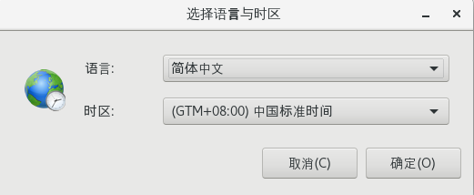

点击【确定】后，弹出 DM 数据库安装程序。

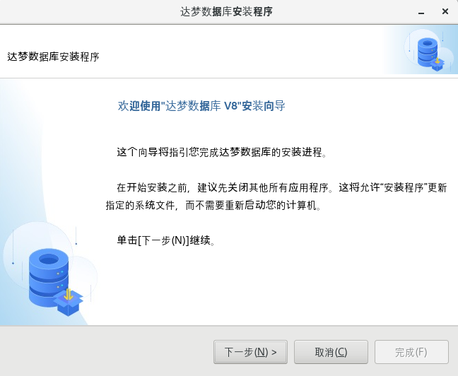

点击【下一步】后，为许可证协议页面，选择【接受】。

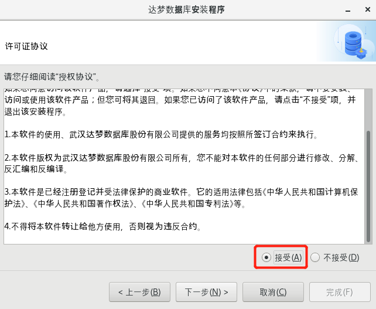

点击【下一步】后，弹出 key 文件页面，点击【浏览】选择【key 文件】，若 **没有 key 文件** 可以直接点击【下一步】，跳过该步骤。

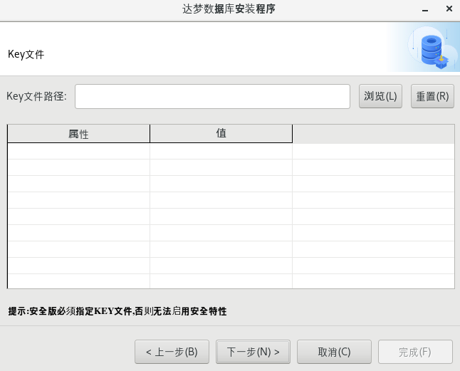

点击【下一步】后，弹出选择组件页面，建议选择 **典型安装** ，也可根据需要，选择服务器安装、客户端安装和自定义安装。

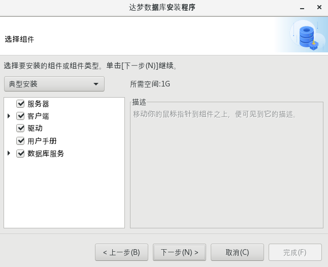

点击【下一步】后，弹出选择安装位置页面，可点击【浏览】选择安装位置，也可安装在默认路径下。

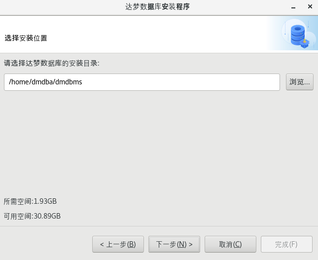

点击【下一步】后，弹出确认安装信息页面，检查安装信息是否准确，确认无误后点击【安装】。

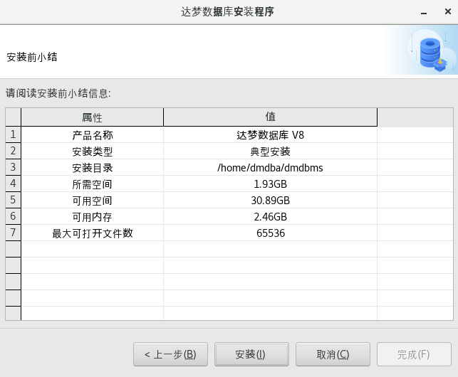

点击【安装】后，等待 1~2 分钟即可安装完成，安装完成后弹出执行配置脚本页面，按照页面要求执行该脚本即可。

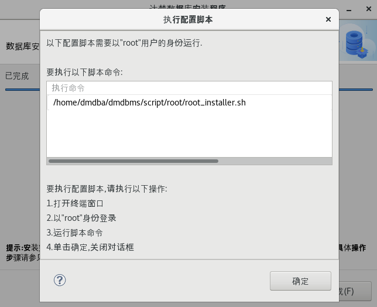

重新打开一个终端，切换到 root 用户，执行弹出页面中的脚本。

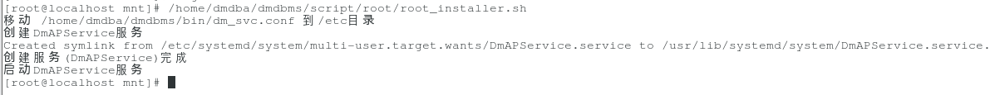

脚本执行完成后，点击执行配置脚本页面中的【完成】，弹出提示框，提示是否关闭窗口，选择是，提示数据库安装完成，再点击【完成】按钮，完成数据库安装。

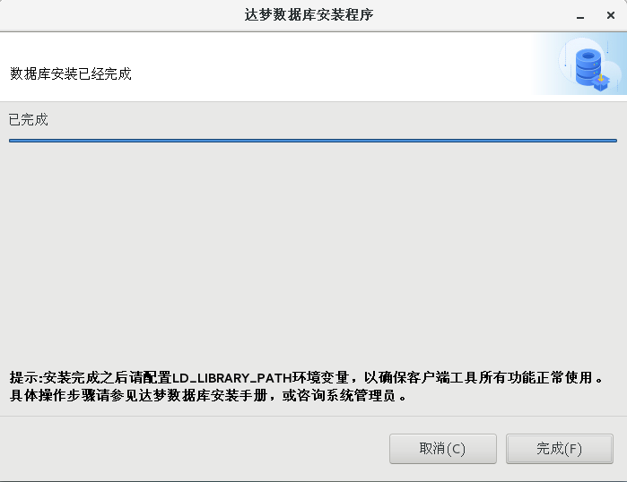

## 五、配置环境变量

切换到 root 用户进入 dmdba 用户的根目录下，配置对应的环境变量。DM\_HOME 变量和动态链接库文件的加载路径在程序安装成功后会自动导入。命令如下：

```
export PATH=$PATH:$DM_HOME/bin:$DM_HOME/tool
```

编辑.bash\_profile，使其最终效果如下图所示：

```
cd /home/dmdba/
```
```
vim .bash_profile
```

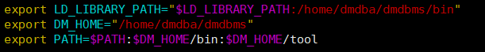

切换至 dmdba 用户下，执行以下命令，使环境变量生效。

```
su - dmdba
```
```
source .bash_profile
```

若需要主动打开配置助手，可使用 dmdba 用户配置实例，进入到 DM 数据库安装目录下的 tool 目录中，使用 `./dbca.sh` 命令打开数据库配置助手。

启用图形界面前需要通过如下方法将图形界面权限放开：

```shell
[root@localhost mnt]# xhost +
access control disabled, clients can connect from any host
[root@localhost mnt]# echo $DISPLAY
[root@localhost mnt]# su - dmdba
Last login: 四 1月 25 16:41:51 CST 2024 on pts/1
[dmdba@localhost ~]$ export DISPLAY=:0.0
```

进入 DM 安装目录下的 tool 目录，使用如下命令打开 DM 服务查看器，如下所示：

```
[dmdba@localhost ~]$ cd /home/dmdba/dmdbms/tool/
[dmdba@localhost tool]$ ll
[dmdba@localhost tool]$ ./dbca.sh
```