## 一、装载镜像文件

1. 选中下载好的安装包，右键点击装载。

2. 弹出安全警告后不用担心，请放心点击【打开】。

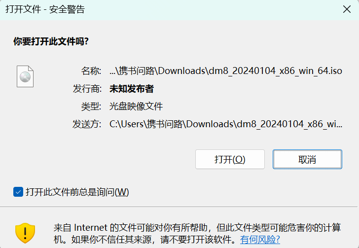

3. 挂载成功后会弹出安装程序 setup.exe

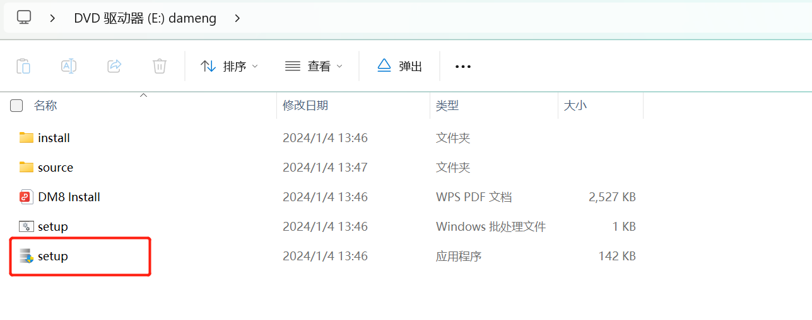

## 二、安装数据库

### 2.1 运行安装程序

双击运行安装程序 setup.exe，系统可能出现保护提示，阻止安装数据库，点击警告中的【更多信息】选择【仍要运行】即可开始安装。

### 2.2 选择语言与时区

双击运行【setup.exe】安装程序，根据系统配置选择相应语言与时区，点击【确定】按钮继续安装。如下图所示：

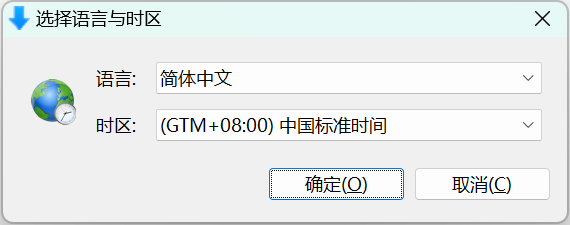

### 2.3 安装向导

点击【下一步】继续安装，如下图所示：

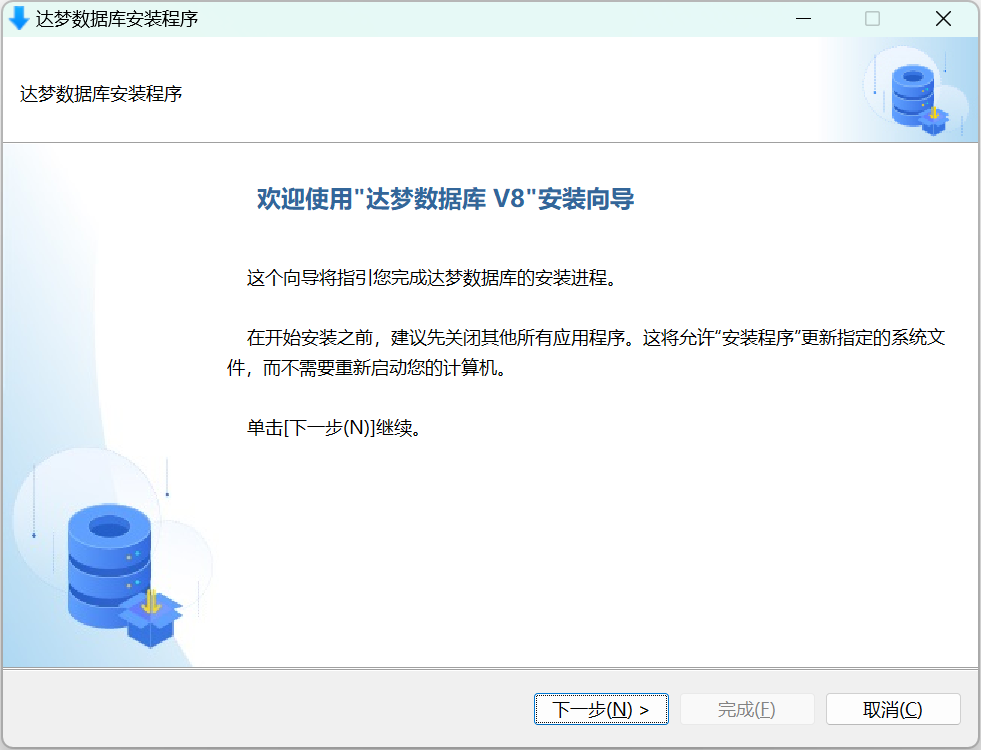

### 2.4 许可证协议

在安装和使用 DM 数据库之前，需要用户 **阅读并接受** 许可证协议，如下图所示：

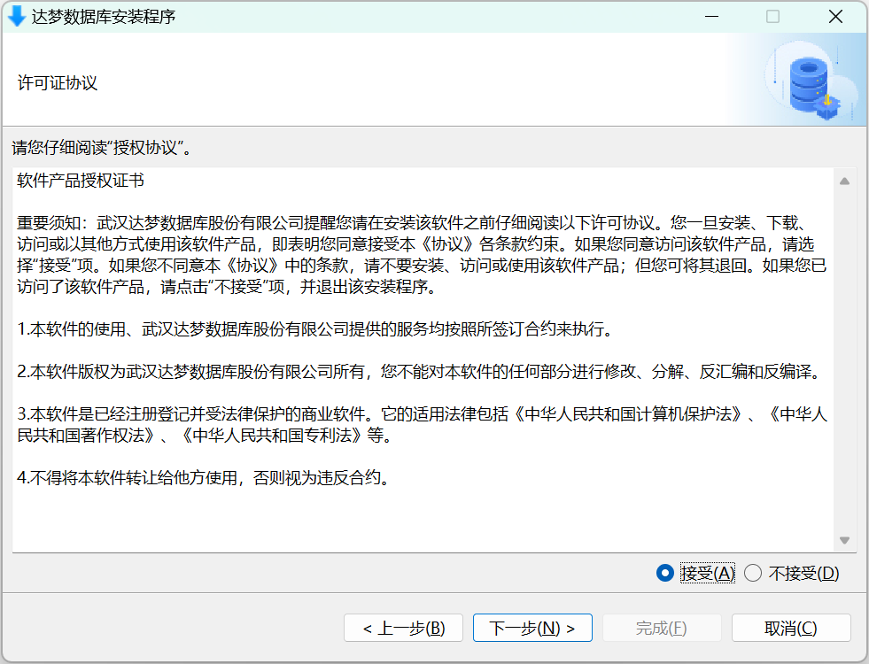

### 2.5 验证 Key 文件

验证 Key 文件环节可跳过，如果没有 Key 文件，点击【下一步】即可。如有则点击【浏览】按钮，选取 Key 文件，安装程序将自动验证 Key 文件合法性，点击【下一步】继续安装，如下图所示：

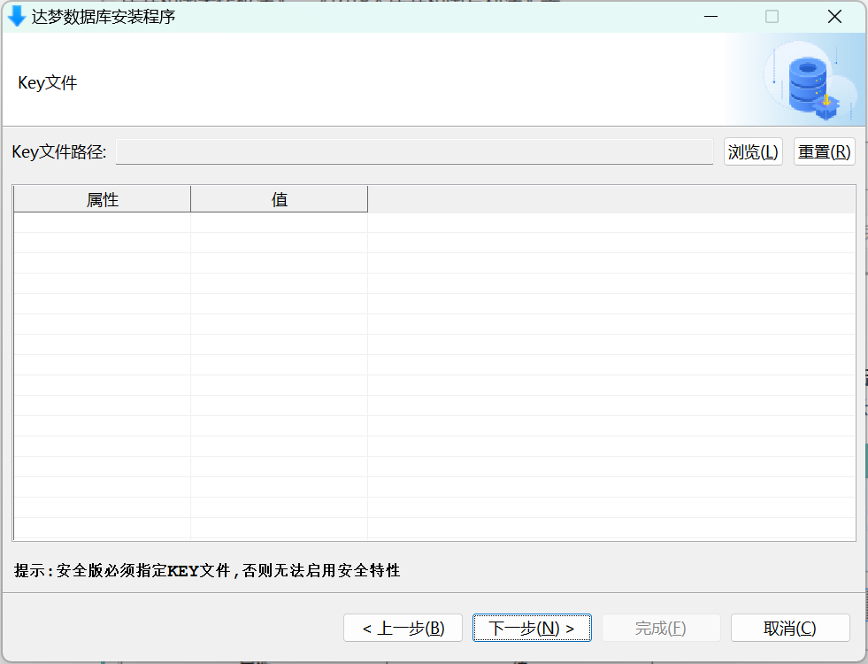

### 2.6 选择安装组件

DM 安装程序提供四种安装方式：“典型安装”、“服务器安装”、“客户端安装”和“自定义安装”， **此处建议选择【典型安装】** ，如下图所示：

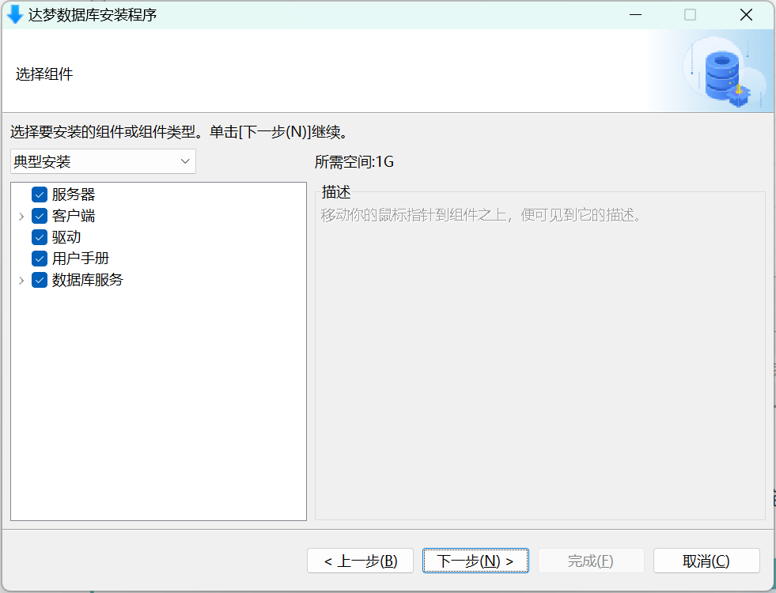

- 典型安装包括：服务器、客户端、驱动、用户手册、数据库服务。
- 服务器安装包括：服务器、驱动、用户手册、数据库服务。
- 客户端安装包括：客户端、驱动、用户手册。
- 自定义安装包括：用户根据需求勾选组件，可以是服务器、客户端、驱动、用户手册、数据库服务中的任意组合。

### 2.7 选择安装目录

DM 默认安装在 C:\\dmdbms 目录下， **不建议使用默认目录** ，改为其他任意盘符即可，以 D:\\dmdba\\dmdbms 为例，如下图所示：

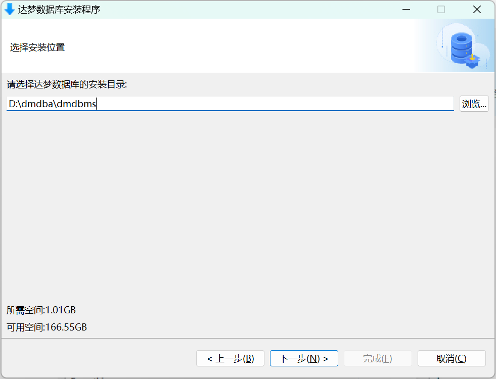

> **注意**
> 
> 安装路径里的目录名由英文字母、数字和下划线等组成，不建议使用包含空格和中文字符的路径等。

### 2.8 安装前小结

显示用户即将进行的数据库安装信息，例如产品名称、安装类型、安装目录、所需空间、可用空间、可用内存等信息，用户检查无误后点击【安装】按钮进行 DM 数据库的安装，如下图所示：

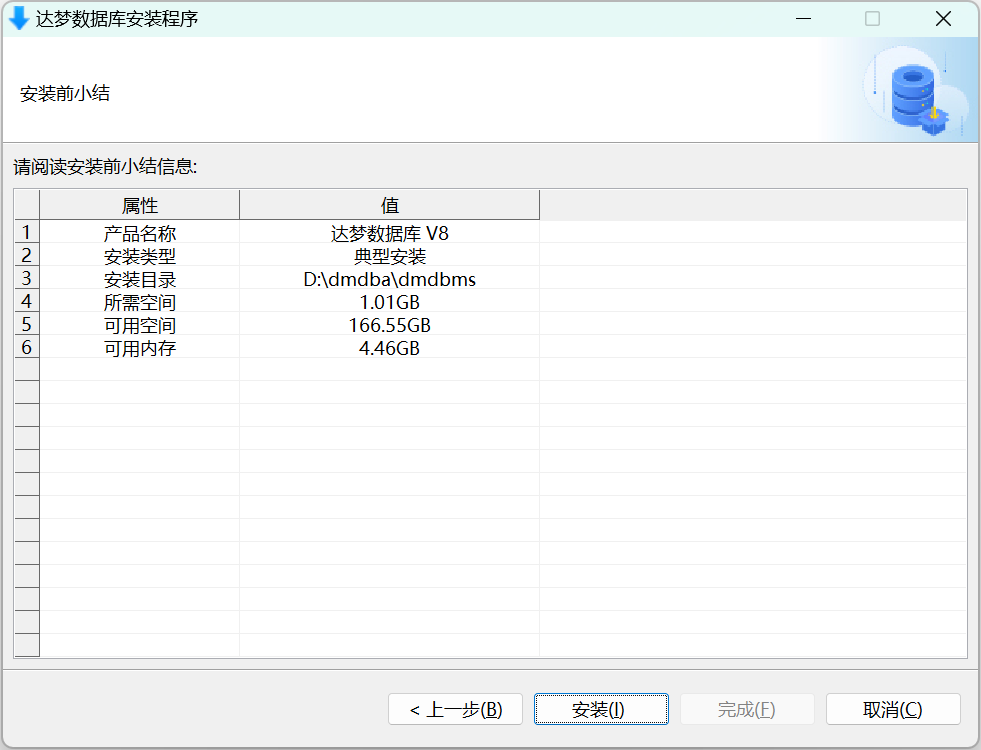

### 2.9 数据库安装

安装过程需耐心等待 1~2 分钟，如下图所示：

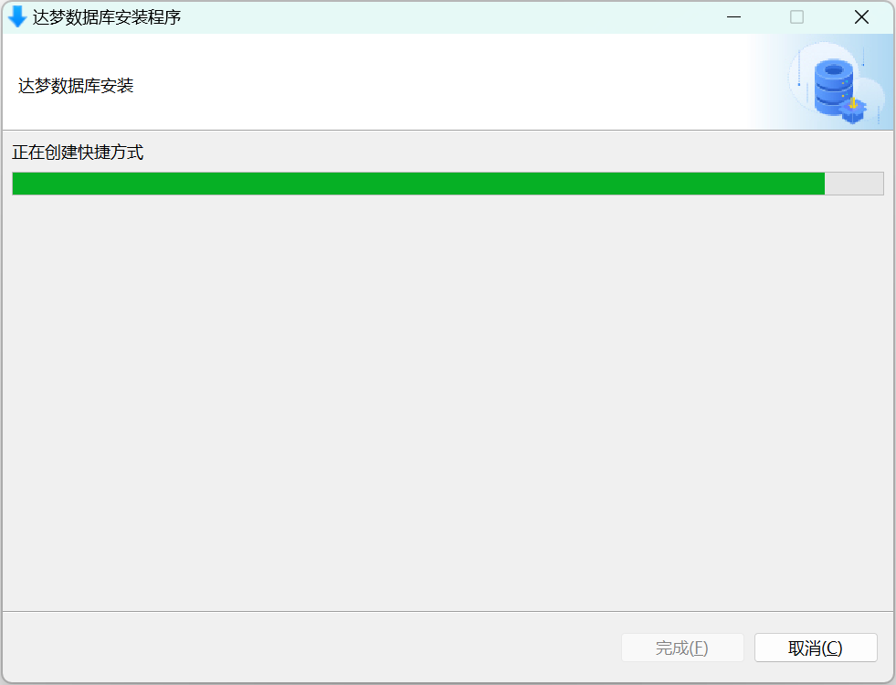

### 2.10 数据库安装完成

数据库安装完成后，选择【初始化】数据库，具体操作步骤详见 [配置实例](https://eco.dameng.com/document/dm/zh-cn/start/dm-install-windows) 。如下图所示：

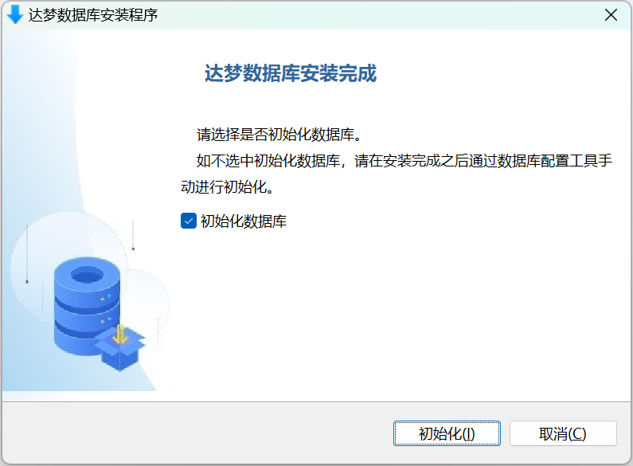