## 一、前言

DM 数据库在 Linux 环境支持命令行配置实例以及图形化配置实例，本章节将分别进行介绍。

## 二、命令行方式初始化实例

使用 dmdba 用户配置实例，进入到 DM 数据库安装目录下的 bin 目录中。

```shell
su - dmdba
cd /home/dmdba/dmdbms/bin
```

使用 dminit 命令初始化实例，dminit 命令可设置多种参数，可执行如下命令查看可配置参数。

```
./dminit help
```

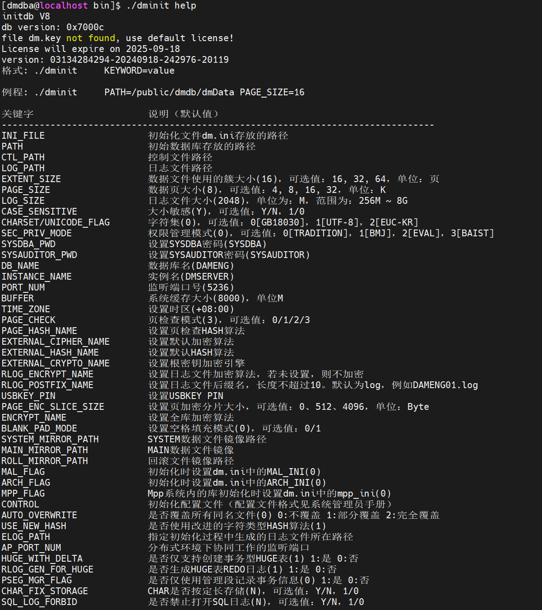

需要注意的是 **页大小 (page\_size)、簇大小 (extent\_size)、大小写敏感 (case\_sensitive)、字符集 (charset) 、空格填充模式 (BLANK\_PAD\_MODE) 、页检查模式（PAGE CHECK）** 等部分参数， **一旦确定无法修改** ，在初始化实例时确认需求后谨慎设置。

部分参数解释如下：

- page\_size：数据文件使用的页大小。取值范围 4、8、16、32，单位：KB。缺省值为 8。可选参数。选择的页大小越大，则 DM 支持的元组长度也越大，但同时空间利用率可能下降。数据库创建成功后无法再修改页大小，可通过系统函数 SF\_GET\_PAGE\_SIZE()获取系统的页大小。
- extent\_size：数据文件使用的簇大小，即每次分配新的段空间时连续的页数。取值范围 16、32、64。单位：页数。缺省值为 16。可选参数。数据库创建成功后无法再修改簇大小，可通过系统函数 SF\_GET\_EXTENT\_SIZE()获取系统的簇大小。
- case\_sensitive： 标识符大小写敏感。当大小写敏感时，小写的标识符应用""括起，否则被系统自动转换为大写；当大小写不敏感时，系统不会转换标识符的大小写，系统比较函数会将大写字母全部转为小写字母再进行比较。取值：Y、y、1 表示敏感；N、n、0 表示不敏感。缺省值为 Y。可选参数。此参数在数据库创建成功后无法修改，可通过系统函数 SF\_GET\_CASE\_SENSITIVE\_FLAG()或 CASE\_SENSITIVE()查询设置的参数值。
- charset：字符集选项。取值范围 0、1、2。0 代表 GB18030，1 代表 UTF-8，2 代表韩文字符集 EUC-KR。缺省值为 0。可选参数。此参数在数据库创建成功后无法修改，可通过系统函数 SF\_GET\_UNICODE\_FLAG()或 UNICODE()查询设置的参数值。
- BLANK\_PAD\_MODE：设置字符串比较时，结尾空格填充模式是否兼容 ORACLE。1：兼容；0：不兼容。缺省值为 0。可选参数。此参数在数据库创建成功后无法修改，可通过查询 V$PARAMETER 中的 BLANK\_PAD\_MODE 参数名查看此参数的设置值。
- PAGE\_CHECK：PAGE\_CHECK 为页检查模式。取值范围 0、1、2、3。0：禁用页校验；1：开启页校验并使用 CRC 校验；2：开启页校验并使用指定的 HASH 算法进行校验；3：开启页校验并使用快速 CRC 校验。缺省值为 3。可选参数。在数据库创建成功后无法修改。

更多 dminit 参数解释可参考达梦数据库安装目录下 doc 目录中《DM8\_dminit 使用手册》。

> **建议**
> 
> 在实际使用中，初始化参数完成后如需兼容其他数据库，建议提前在 dm.ini 中设置好 COMPATIBLE\_MODE 的参数值，便于更好的兼容其他数据库。参数说明：是否兼容其他数据库模式。0：不兼容，1：兼容 SQL92 标准，2：部分兼容 ORACLE，3：部分兼容 MS SQL SERVER，4：部分兼容 MYSQL，5：兼容 DM6，6：部分兼容 TERADATA，7：部分兼容 POSTGRES，8：部分兼容 DB2。 注：对 COMPATIBLE\_MODE 的修改会影响数据存储和操作结果，修改须慎重；具体可咨询达梦技术服务人员

如果需要附加实例存放路径。此处以初始化实例到 /dmdata/data 目录下为例（执行初始化命令前，需要使用 root 用户授予 /dmdata/data 目录相应权限，可以参考 [修改目录权限](https://eco.dameng.com/document/dm/zh-cn/start/install-dm-linux-prepare#%E7%9B%AE%E5%BD%95%E8%A7%84%E5%88%92) ），初始化命令如下：

```
./dminit path=/dmdata/data  SYSDBA_PWD=****** SYSAUDITOR_PWD=******
```

> **注意**
> 
> 用户在安装数据库初始化实例时，需设置数据库系统用户的密码，并保证一定的密码强度，以保障数据安全性。

也可以自定义初始化实例的参数，参考如下示例：

以下命令设置页大小为 32 KB，簇大小为 32 KB，大小写敏感，字符集为 utf\_8，数据库名为 DMTEST，实例名为 DBSERVER，端口为 5237，SYSDBA\_PWD 为 \*\*\*\*\*\*，SYSAUDITOR\_PWD 为 \*\*\*\*\*\*。SYSDBA\_PWD 和 SYSAUDITOR\_PWD 为配置数据库 SYSDBA 用户和 SYSAUDITOR 用户的登录密码，需要用户自定义配置，且需保证一定的密码强度。

```
./dminit path=/dmdata/data PAGE_SIZE=32 EXTENT_SIZE=32 CASE_SENSITIVE=y CHARSET=1 DB_NAME=DMTEST INSTANCE_NAME=DBSERVER PORT_NUM=5237 SYSDBA_PWD=******  SYSAUDITOR_PWD=******
```

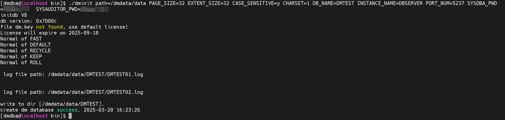

> **注意**
> 
> 如果此处自定义了初始化参数，在后面的注册服务和启动数据库等步骤中，请按实际的自定义参数进行操作。

## 三、图形化配置实例

使用图形化界面安装数据库安装完成后，会弹出选择是否初始化数据库页面，选择【初始化】。

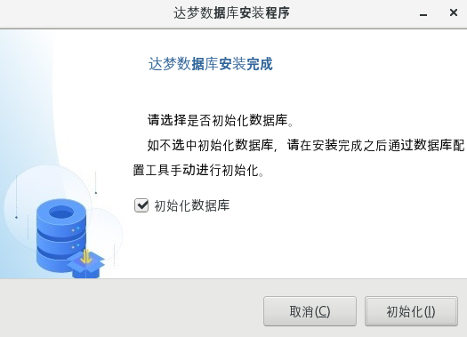

点击初始化后会弹出数据库配置助手，通过数据库配置助手便可以配置数据库。

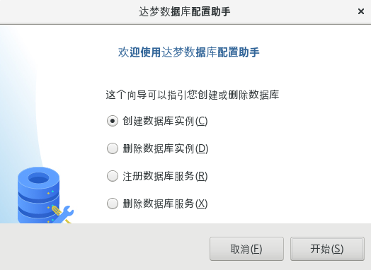

### 3.1 手动打开配置助手

若需要主动打开配置助手，可使用 dmdba 用户配置实例，进入到 DM 数据库安装目录下的 tool 目录中，使用 `./dbca.sh` 命令打开数据库配置助手。

启用图形界面前需要通过如下方法将图形界面权限放开：

```shell
[root@localhost mnt]# xhost +
access control disabled, clients can connect from any host
[root@localhost mnt]# echo $DISPLAY
[root@localhost mnt]# su - dmdba
Last login: 四 1月 25 16:41:51 CST 2024 on pts/1
[dmdba@localhost ~]$ export DISPLAY=:0.0
```

进入 DM 安装目录下的 tool 目录，使用如下命令打开 DM 数据库配置助手，如下所示：

```
[dmdba@localhost ~]$ cd /home/dmdba/dmdbms/tool/
[dmdba@localhost tool]$ ll
[dmdba@localhost tool]$ ./dbca.sh
```

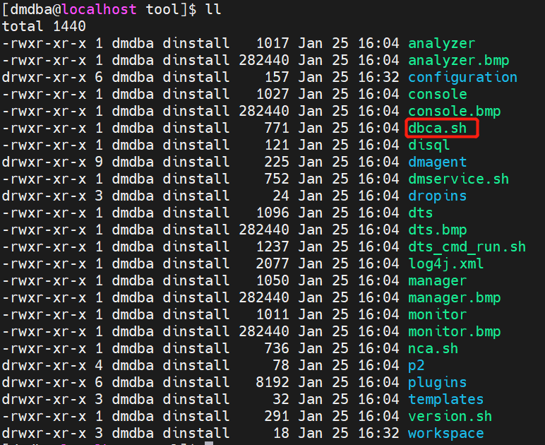

选择创建数据库实例，点击【开始】。


### 3.2 创建数据库模板

进入创建数据库页面的创建数据库模版页签，此处可以根据实际需求选择合适的数据库模板，一般建议选择【一般用途】其它保持默认即可，如下图所示：

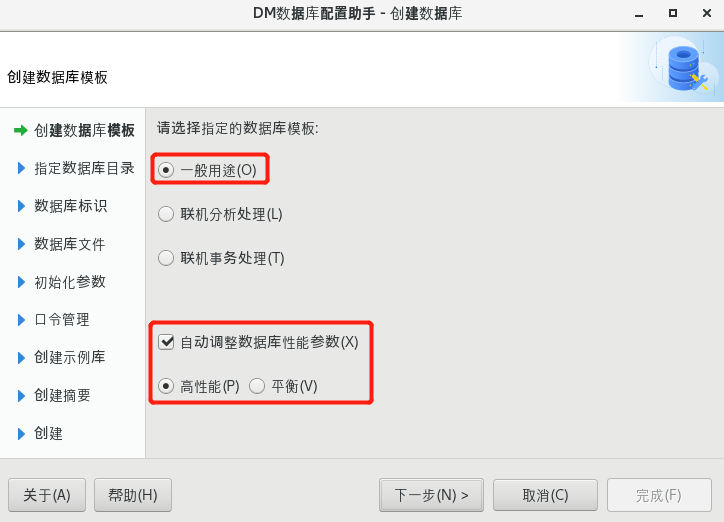

### 3.3 选择数据库实例目录

本例中数据库安装路径为 /dmdba/data，如下图所示：

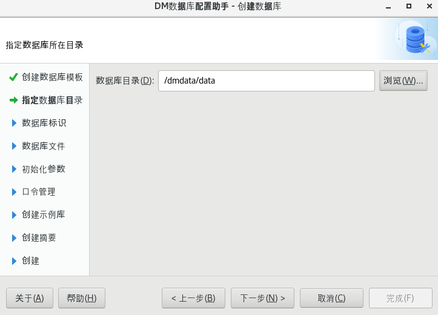

### 3.4 输入数据库标识

可自定义输入或保持默认数据库名称、实例名、端口号等参数，如下图所示：

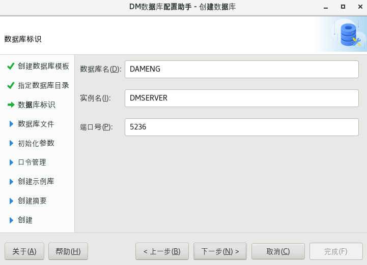

### 3.5 数据库文件所在位置

此处可选择自定义或保持默认配置路径，如下图所示：

控制文件：

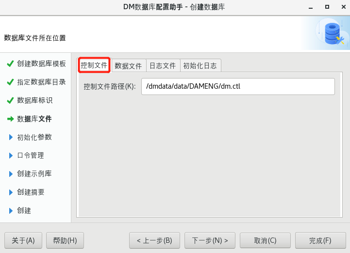

数据文件：

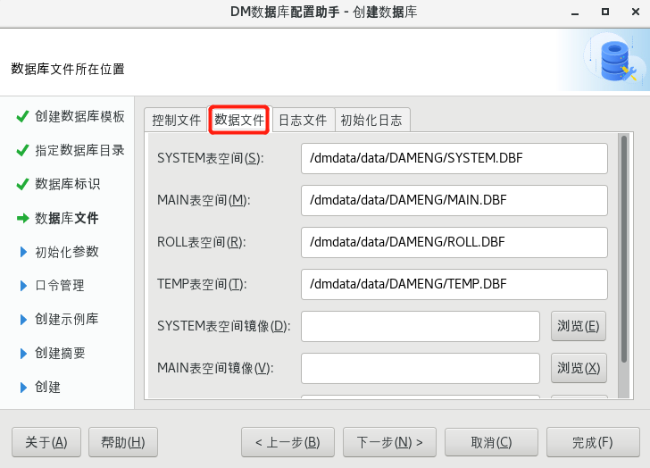

redo 日志文件：

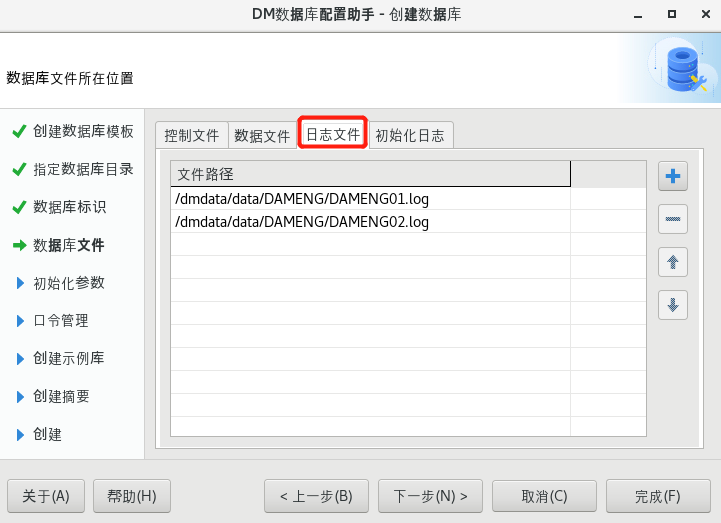

初始化日志：

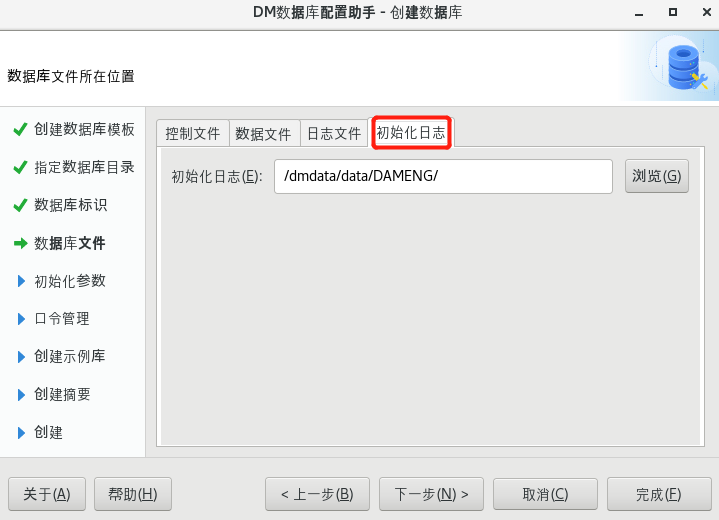

用户可通过选择或输入确定数据库控制文件、数据文件、日志文件、初始化日志等文件的所在位置，并可通过右侧功能按钮，对文件进行添加或删除。

### 3.6 数据库初始化参数

此处配置可根据实际需求进行配置，如下图所示：

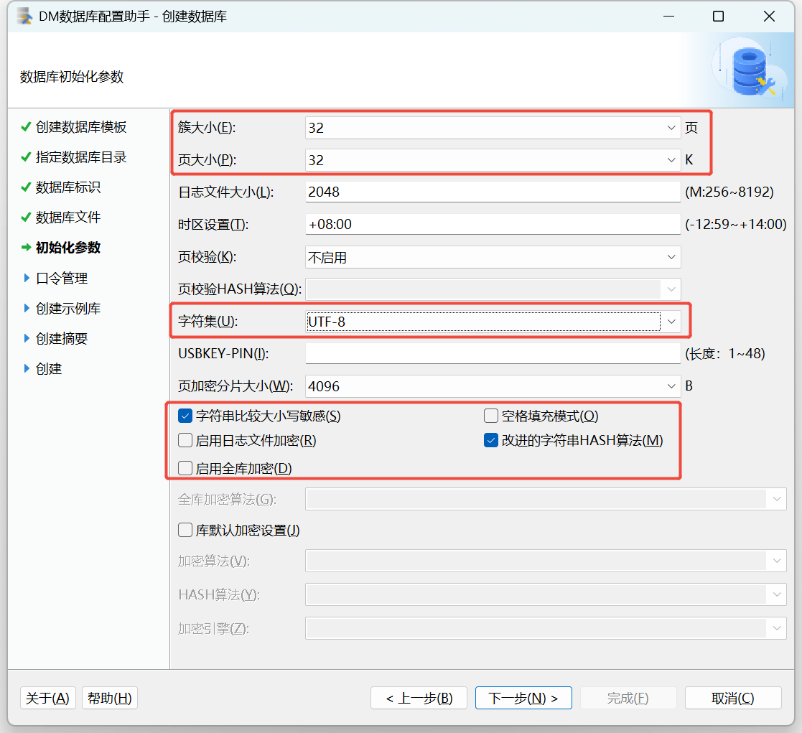

需要注意的是 **页大小 、簇大小 、大小写敏感 、字符集 、空格填充模式** 等部分参数， **一旦确定无法修改** ，需谨慎设置。

常见参数说明：

1. 数据文件使用的簇大小：默认值 16，可选值： 16、 32、 64，单位：页。
2. 数据页大小：默认值 8，可选值： 4、 8、 16、 32，单位： KB。
3. 日志文件大小：默认值 256，单位为： MB，范围为： 64 MB~2 GB。
4. 大小敏感：默认值 Y，可选值： Y/N， 1/0。
5. 字符集：默认值 0，可选值： 0\[GB18030\]， 1\[UTF-8\]， 2\[EUC-KR\]。

### 3.7 口令管理

**用户在安装数据库初始化实例时，需设置数据库系统用户的密码，并保证一定的密码强度，以保障数据安全性** ，如下图所示：

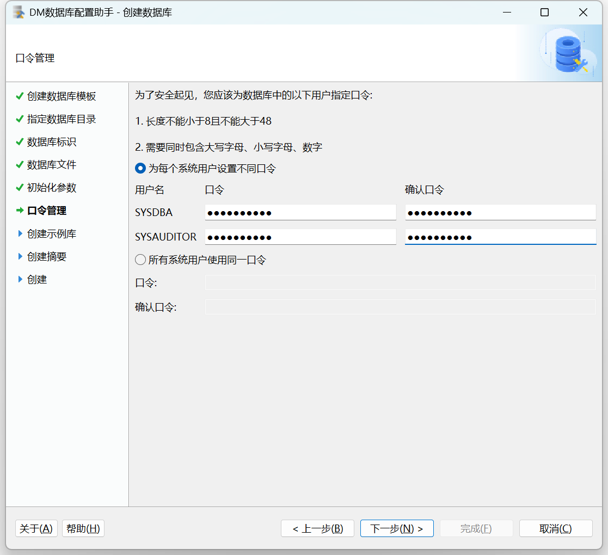

用户可输入 SYSDBA，SYSAUDITOR 的密码，如果安装版本为安全版，将会增加 SYSSSO 用户的密码修改。

### 3.8 选择创建示例库

此处建议勾选创建示例库 `BOOKSHOP` 或 `DMHR` ，作为测试环境，如下图所示：

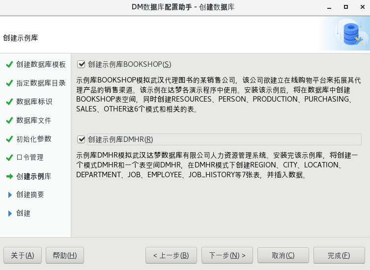

### 3.9 创建数据库摘要

在安装数据库之前，将显示用户通过数据库配置工具设置的相关参数。点击【完成】进行数据库实例的初始化工作，如下图所示：

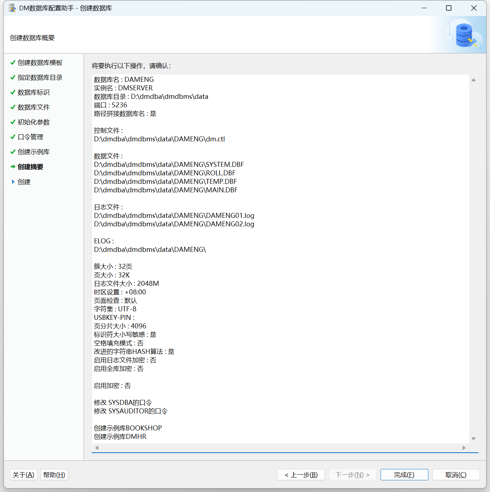

### 3.10 创建实例

点击【完成】，创建完成数据库实例后，按下图按提示执行脚本完成实例配置。

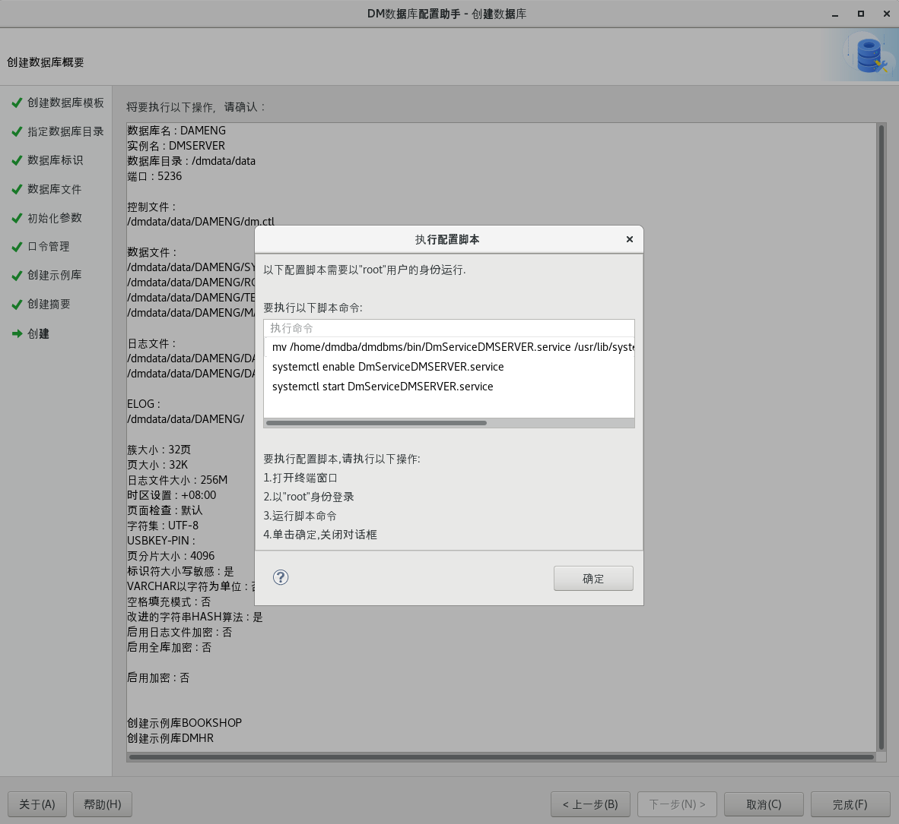

执行完成后会提示参数修改完成。

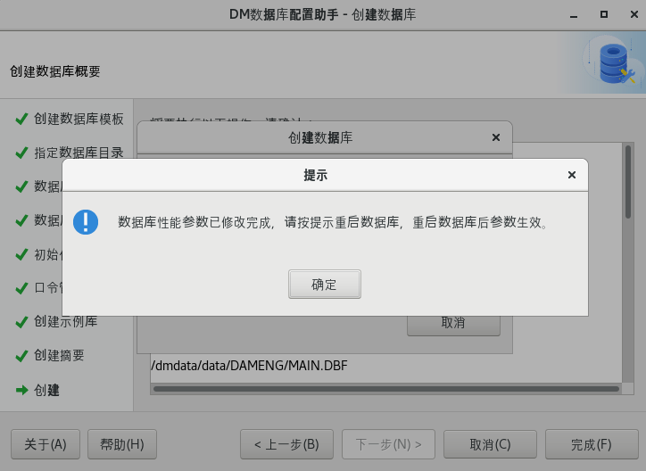

以 root 用户执行提示的脚本重启数据库使自动优化的参数生效。

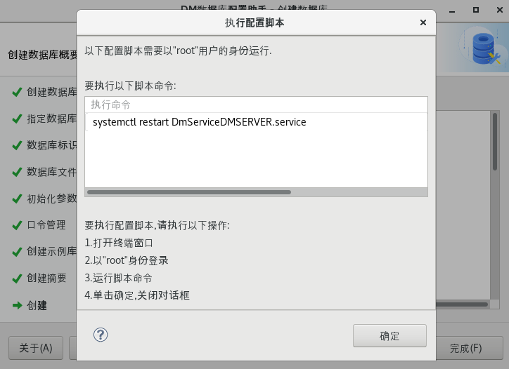

创建实例完成。

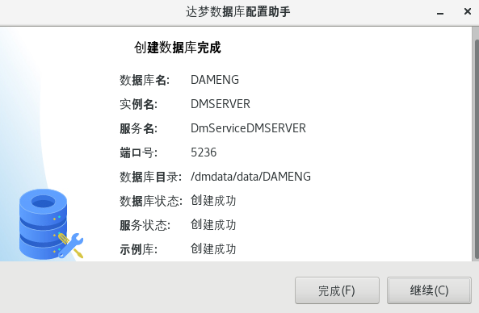

至此达梦数据库就可以开始使用了。