## 一、选择操作方式

此处选择【创建数据库实例】，点击【开始】进入下一步骤，如下图所示：

## 二、创建数据库模板

此处可以根据实际需求选择合适的数据库模板，一般建议选择【一般用途】其它保持默认即可，如下图所示：

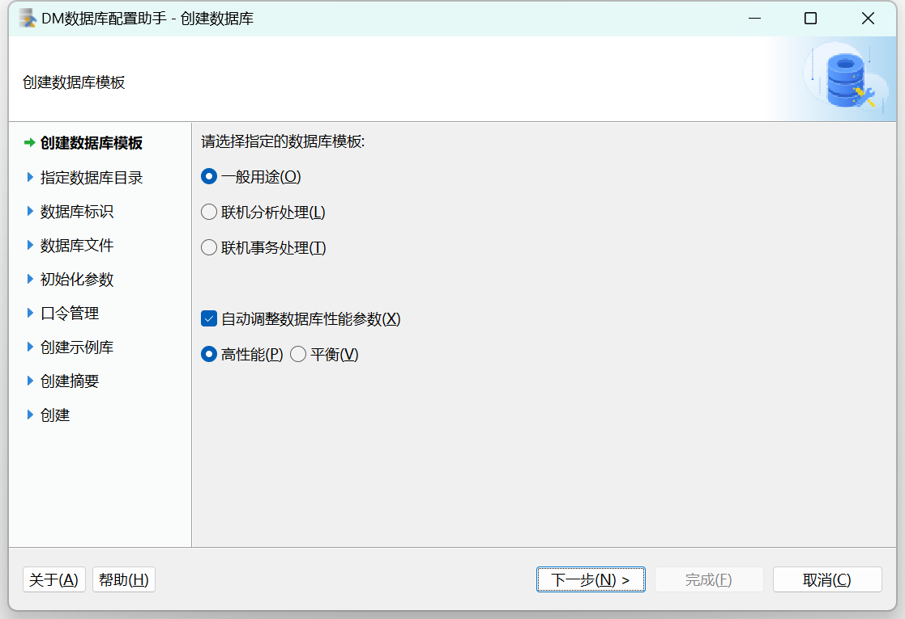

## 三、选择数据库实例目录

本例中数据库安装路径为 D:\\dmdba\\dmdbms\\data，如下图所示：

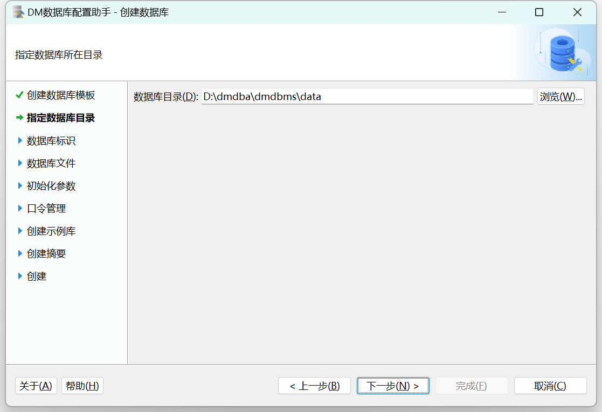

## 四、输入数据库标识

可自定义输入或保持默认数据库名称、实例名、端口号等参数，如下图所示：

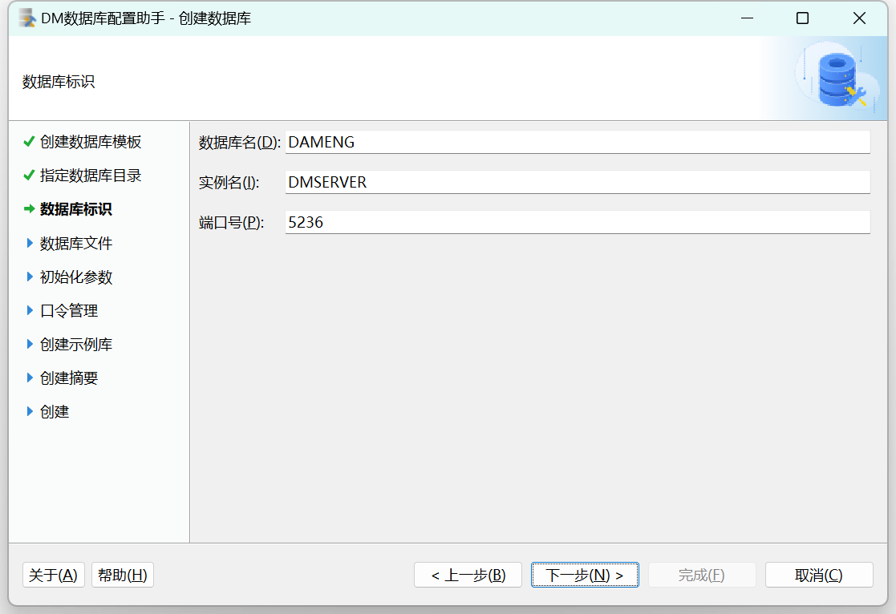

## 五、数据库文件所在位置

此处可选择自定义或保持默认配置路径，如下图所示：

控制文件：

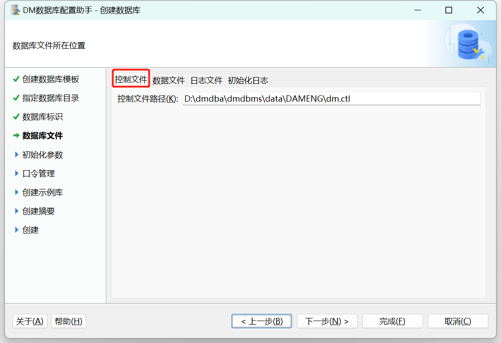

数据文件：

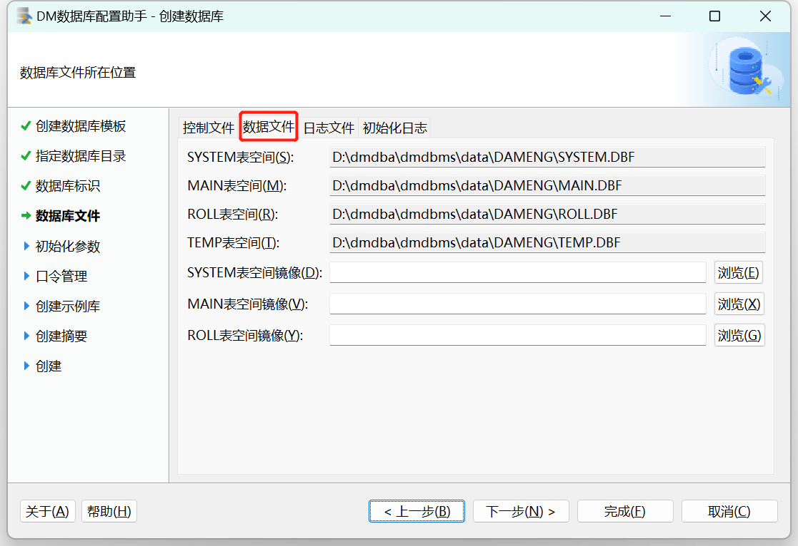

redo 日志文件：

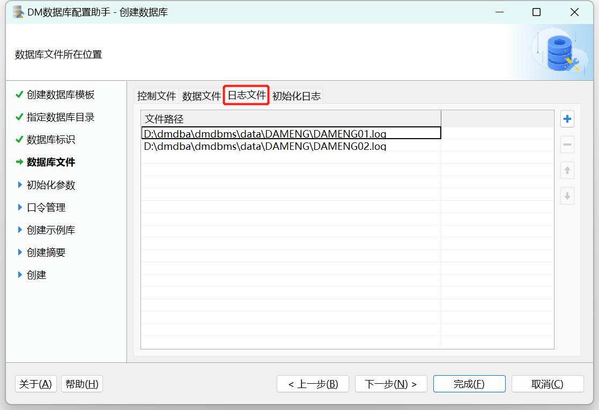

初始化日志：

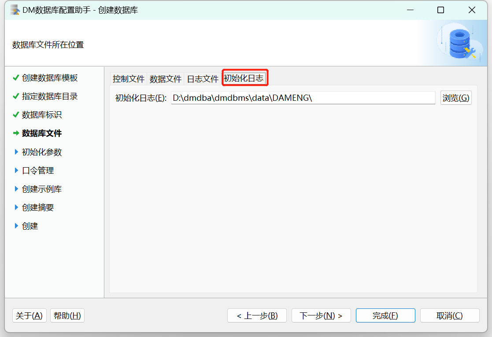

用户可通过选择或输入确定数据库控制文件、数据文件、日志文件、初始化日志等文件的所在位置，并可通过右侧功能按钮，对文件进行添加或删除。

## 六、数据库初始化参数

此处配置可根据实际需求进行配置，如下图所示：

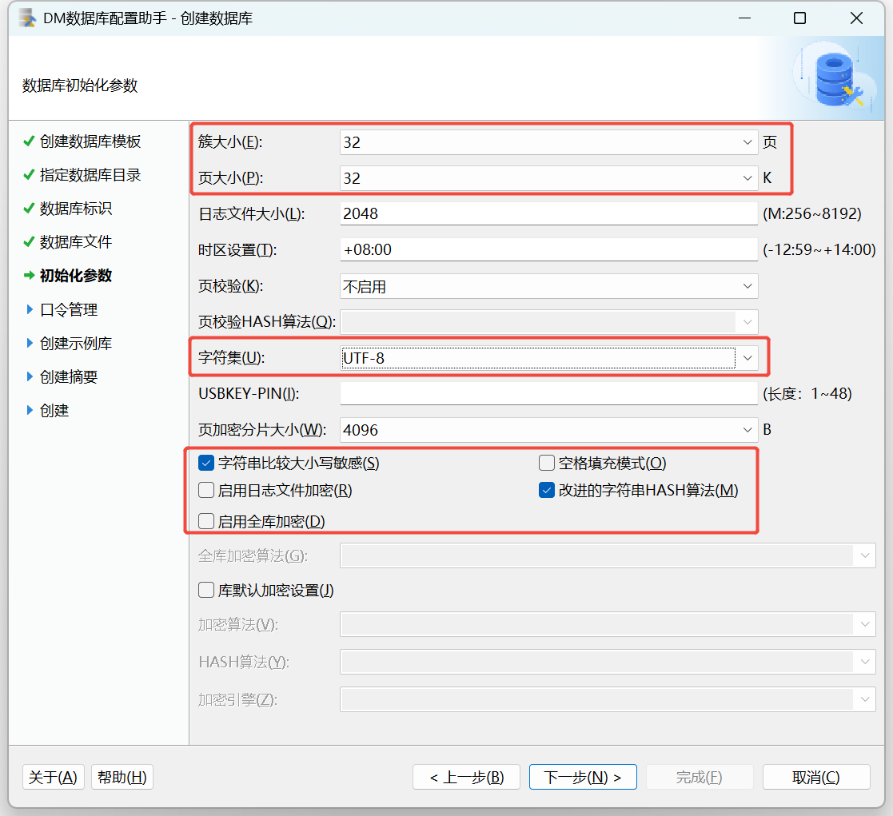

需要注意的是 **页大小 、簇大小 、大小写敏感 、字符集 、空格填充模式** 等部分参数， **一旦确定无法修改** ，需谨慎设置。

常见参数说明：

1. 数据文件使用的簇大小：默认值 16，可选值： 16、 32、 64，单位：页。
2. 数据页大小：默认值 8，可选值： 4、 8、 16、 32，单位： KB。
3. 日志文件大小：默认值 256，单位为： MB，范围为： 64 MB~2 GB。
4. 大小敏感：默认值 Y，可选值： Y/N， 1/0。
5. 字符集：默认值 0，可选值： 0\[GB18030\]， 1\[UTF-8\]， 2\[EUC-KR\]。

## 七、口令管理

**用户在数据库初始化实例时，需设置数据库系统用户的密码，并保证密码强度，以保障数据安全性** 。如下图所示：

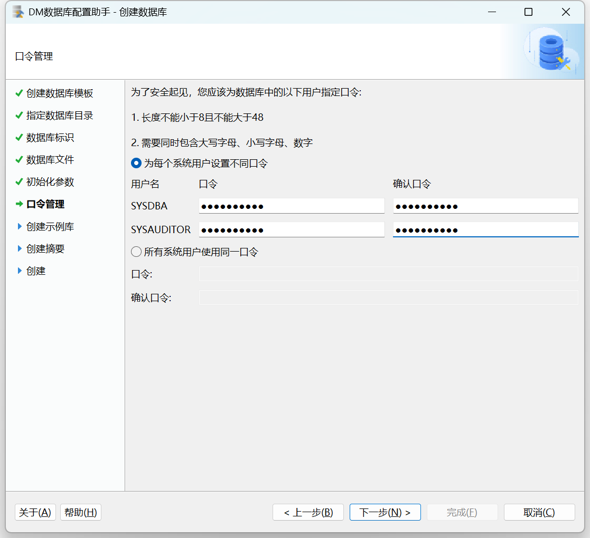

用户可输入 SYSDBA，SYSAUDITOR 的密码，如果安装版本为安全版，将会增加 SYSSSO 用户的密码修改。

## 八、选择创建示例库

此处建议勾选创建示例库 `BOOKSHOP` 或 `DMHR` ，作为测试环境，如下图所示：

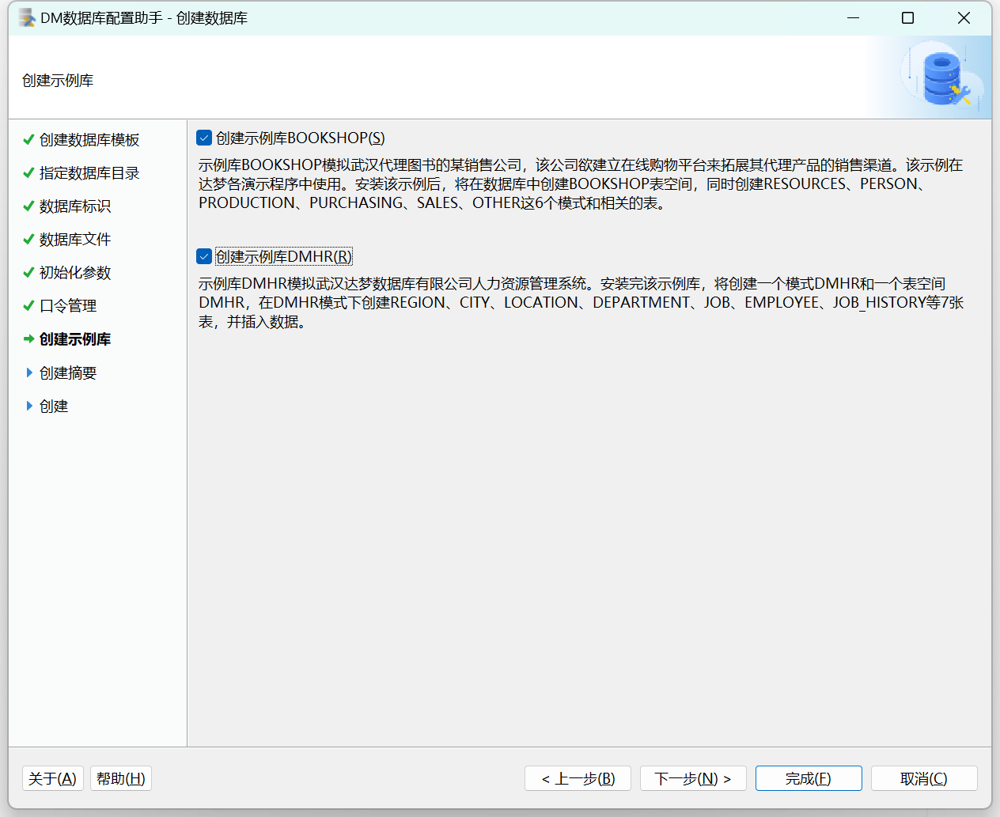

## 九、创建数据库摘要

在安装数据库之前，将显示用户通过数据库配置工具设置的相关参数。点击【完成】进行数据库实例的初始化工作，如下图所示：

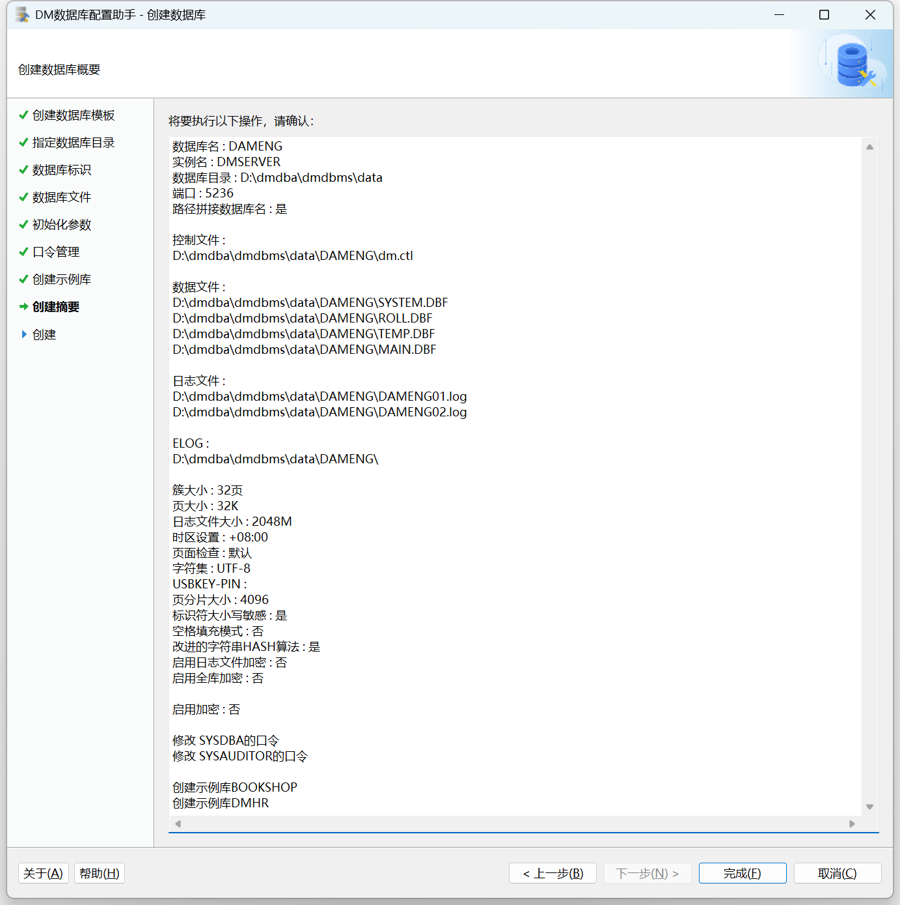

安装完成

安装完成后将弹出数据库相关参数及文件位置。点击【完成】即可，如下图所示：

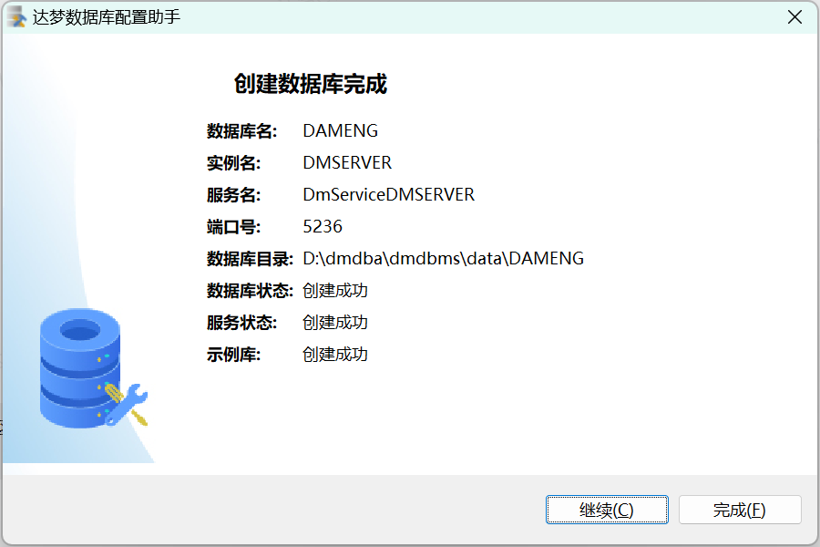