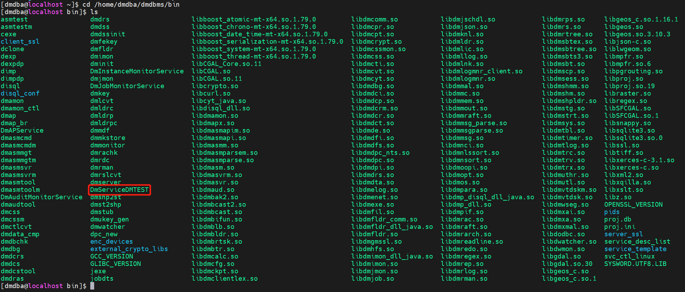
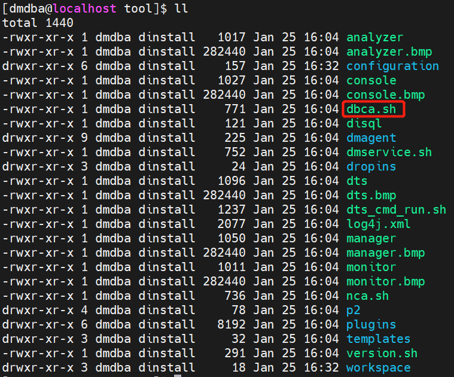
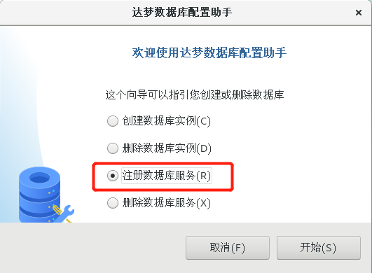
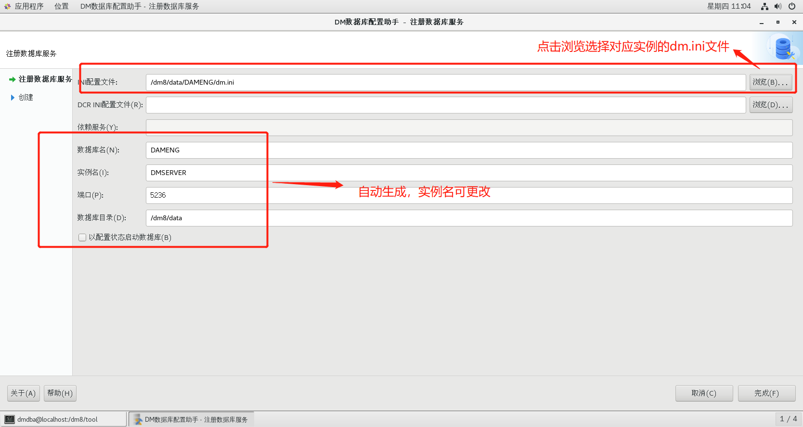
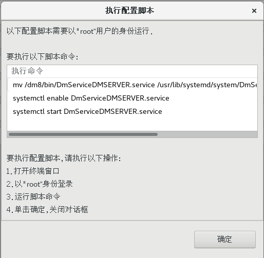
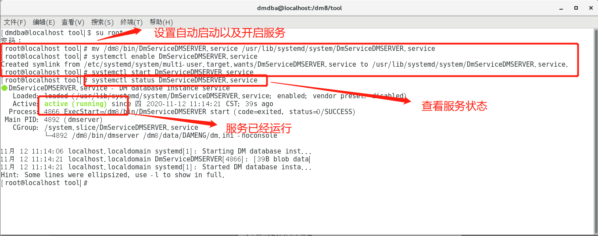

## 一、命令行注册服务

DM 提供了将 DM 服务脚本注册成操作系统服务的脚本，同时也提供了卸载操作系统服务的脚本。注册和卸载脚本文件所在目录为安装目录的“/script/root”子目录下。

注册服务脚本为 dm\_service\_installer.sh，用户可以使用注册服务脚本将服务脚本注册成为操作系统服务。注册服务需使用 root 用户进行注册，使用 root 用户进入数据库安装目录的 `/script/root` 下，如下所示：

```
cd /home/dmdba/dmdbms/script/root/
```

注册实例服务，如下所示：

```
./dm_service_installer.sh -t dmserver -dm_ini /dmdata/data/DMTEST/dm.ini -p DMTEST
```

部分参数说明：

| 标志 | 参数 | 说明 |
| --- | --- | --- |
| \-t | 服务类型 | 注册服务类型，支持一下服务类型：dmap、dmamon、dmserver、dmwatcher、dmmonitor、dmasmsvr、dmasmsvrm、dmcss、dmcssm。 |
| \-dm\_ini | INI 文件路径 | 指定服务所需要的 dm.ini 文件路径。 |
| \-p | 服务名后缀 | 指定服务名后缀，生成的操作系统服务名为“服务脚本模板名，称 + 服务名后缀”。此参数只针对 dmserver、dmwatcher、dmmonitor、dmasmsvr、dmasmsvrm、dmcss、dmcssm 服务脚本生效。 |

更多参数说明和脚本使用方法可参考数据库安装目录下 doc 目录中 《DM8\_Linux 服务脚本使用手册》。

进入数据安装目录下 bin 目录中可以看到已经注册好的服务 DmServiceDMTEST。

```
cd /home/dmdba/dmdbms/bin
ls
```



## 二、图形化注册服务

如果服务被删除可以通过 dbca 工具即 DM 数据库配置助手来重新注册服务。

启用图形界面前需要通过如下方法将图形界面权限放开：

```shell
[root@localhost mnt]# xhost +
access control disabled, clients can connect from any host
[root@localhost mnt]# echo $DISPLAY
[root@localhost mnt]# su - dmdba
Last login: 四 1月 25 16:41:51 CST 2024 on pts/1
[dmdba@localhost ~]$ export DISPLAY=:0.0
```

进入 DM 安装目录下的 tool 目录，使用如下命令打开达梦数据库配置助手，如下所示：

```
[dmdba@localhost ~]$ cd /home/dmdba/dmdbms/tool/
[dmdba@localhost tool]$ ll
[dmdba@localhost tool]$ ./dbca.sh
```



选择【注册数据库服务】，如下图所示：



单击【开始】，弹出注册数据库服务页面，如下图所示：



点击【完成】后，弹出执行配置脚本页面，按页面要求执行脚本即可，如下图所示：



执行脚本成功后，该实例已启动，如下图所示：

