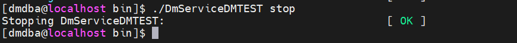
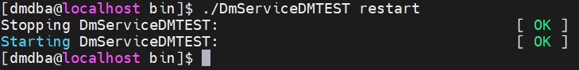
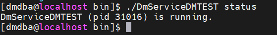
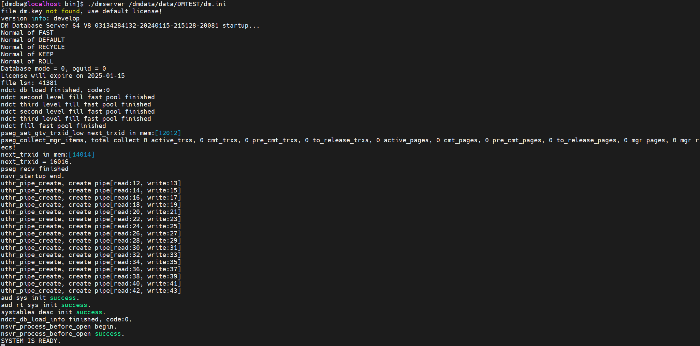
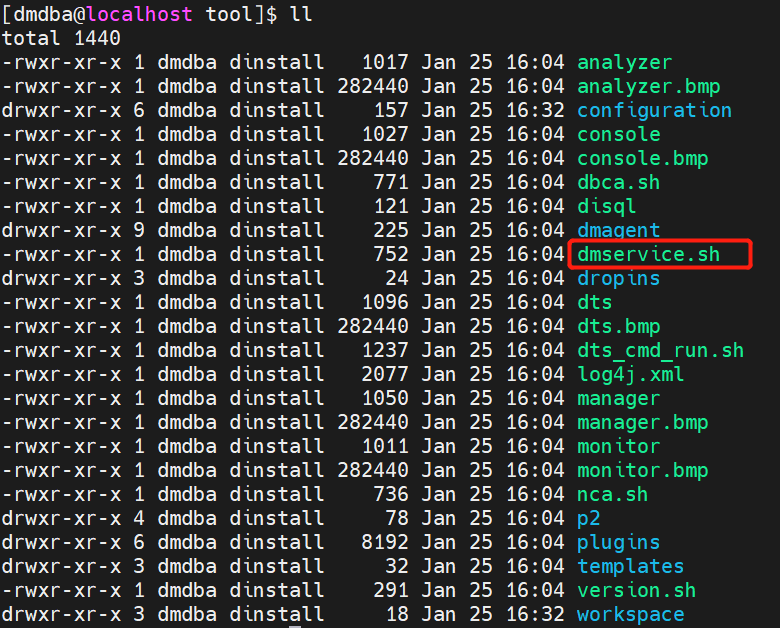
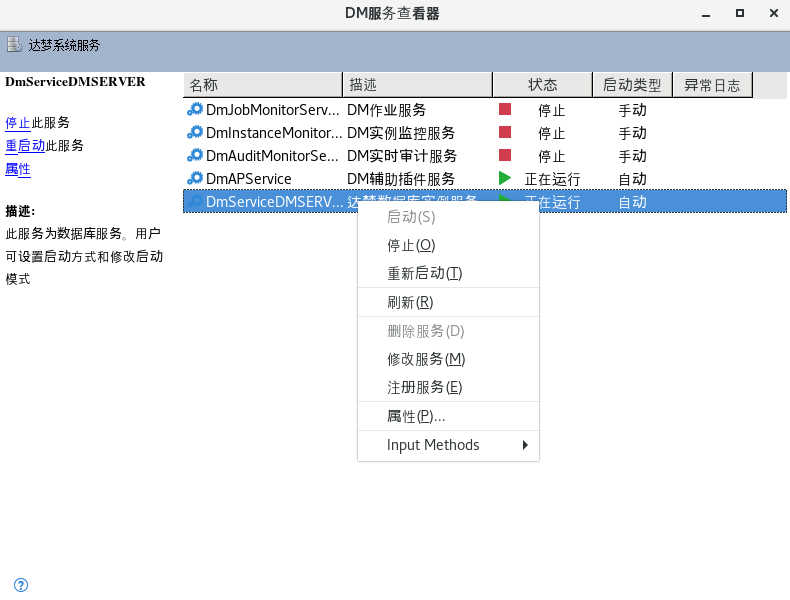

## 一、命令行启停数据库

### 1.1 服务名方式

服务注册成功后，启动数据库。

使用 dmdba 用户进入 DM 安装目录下的 bin 目录下，启动数据库，如下所示：

```shell
[dmdba@localhost ~]$ cd /home/dmdba/dmdbms/bin
[dmdba@localhost bin]$ ls
[dmdba@localhost bin]$ ./DmServiceDMTEST start
```

停止数据库

```shell
[dmdba@localhost bin]$ ./DmServiceDMTEST stop
```



重启数据库

```shell
[dmdba@localhost bin]$ ./DmServiceDMTEST restart
```



查看数据库状态，如下所示：

```
[dmdba@localhost bin]$ ./DmServiceDMTEST status
```



### 1.2 前台方式

前台方式启动数据库后如果启动界面会话关闭数据库也相应会关闭所以一般情况下建议采用服务的方式启动数据库。

dmdba 用户使用前台的方式启动数据库，进入 DM 安装目录下的 bin 目录下，命令如下：

```
[dmdba@localhost ~]$ cd /home/dmdba/dmdbms/bin
[dmdba@localhost bin]$ ls
[dmdba@localhost bin]$ ./dmserver /dmdata/data/DMTEST/dm.ini
```



该启动方式为前台启动，界面输出“SYSTEM IS READY”后表示前台启动成功，若想关闭数据库，输入 exit 退出即可。

## 二、图形化启停数据库

启用图形界面前需要通过如下方法将图形界面权限放开：

```shell
[root@localhost mnt]# xhost +
access control disabled, clients can connect from any host
[root@localhost mnt]# echo $DISPLAY
[root@localhost mnt]# su - dmdba
Last login: 四 1月 25 16:41:51 CST 2024 on pts/1
[dmdba@localhost ~]$ export DISPLAY=:0.0
```

进入 DM 安装目录下的 tool 目录，使用如下命令打开 DM 服务查看器，如下所示：

```
[dmdba@localhost ~]$ cd /home/dmdba/dmdbms/tool/
[dmdba@localhost tool]$ ll
[dmdba@localhost tool]$ ./dmservice.sh
```



可以通过【DM 服务查看器】查看到对应的 DM 服务，可选择【启动】或【停止】对应的服务，如下图所示：

