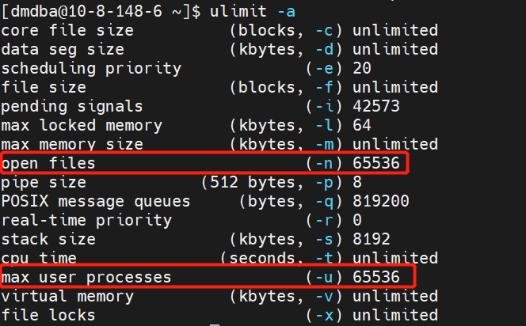

## 一、前言

用户在安装 DM 数据库之前需要检查或修改操作系统的配置，以保证 DM 数据库能够正确安装和运行。

本文演示环境如下：

| 操作系统 | CPU | 数据库 |
| --- | --- | --- |
| CentOS7 | x86\_64 架构 | dm8\_20240116\_x86\_rh7\_64 |

**信创环境安装部署也可以参考此篇文章，但需注意 CPU 和操作系统对应的 DM 数据库版本。**

## 二、新建 dmdba 用户

> **注意**
> 
> 安装前必须创建 dmdba 用户，禁止使用 root 用户安装数据库。

1. 创建用户所在的组，命令如下：
```
groupadd dinstall -g 2001
```
2. 创建用户，命令如下：
```
useradd  -G dinstall -m -d /home/dmdba -s /bin/bash -u 2001 dmdba
```
3. 修改用户密码，命令如下：
```
passwd dmdba
```

## 三、修改文件打开最大数

在 Linux、Solaris、AIX 和 HP-UNIX 等系统中，操作系统默认会对程序使用资源进行限制。如果不取消对应的限制，则数据库的性能将会受到影响。

永久修改和临时修改。

- 重启服务器后永久生效。

使用 root 用户打开 `/etc/security/limits.conf` 文件进行修改，命令如下：

```
vi /etc/security/limits.conf
```

在最后需要添加如下配置：

```
dmdba  soft      nice       0
dmdba  hard      nice       0
dmdba  soft      as         unlimited
dmdba  hard      as         unlimited
dmdba  soft      fsize      unlimited
dmdba  hard      fsize      unlimited
dmdba  soft      nproc      65536
dmdba  hard      nproc      65536
dmdba  soft      nofile     65536
dmdba  hard      nofile     65536
dmdba  soft      core       unlimited
dmdba  hard      core       unlimited
dmdba  soft      data       unlimited
dmdba  hard      data       unlimited
```

> **注意**
> 
> 修改配置文件后重启服务器生效。

切换到 dmdba 用户，查看是否生效，命令如下：

```
su - dmdba
```
```
ulimit -a
```

参数配置已生效。



- 设置参数临时生效

可使用 dmdba 用户执行如下命令，使设置临时生效：

```
ulimit -n 65536
ulimit -u 65536
```

> **建议**
> 
> 使用永久修改方式进行配置。

## 四、目录规划

1.可根据实际需求规划安装目录，本示例使用默认配置 DM 数据库安装在 /home/dmdba 文件夹下。

2.规划创建实例保存目录、归档保存目录、备份保存目录。

```shell
##实例保存目录
mkdir -p /dmdata/data 
##归档保存目录
mkdir -p /dmdata/arch
##备份保存目录
mkdir -p /dmdata/dmbak
```

> **注意**
> 
> 使用 root 用户建立文件夹，待 dmdba 用户建立完成后需将文件所有者更改为 dmdba 用户，否则无法安装到该目录下

## 五、修改目录权限

将新建的路径目录权限的用户修改为 dmdba，用户组修改为 dinstall。命令如下：

```
chown -R dmdba:dinstall /dmdata/data
chown -R dmdba:dinstall /dmdata/arch
chown -R dmdba:dinstall /dmdata/dmbak
```

给路径下的文件设置 755 权限。命令如下：

```
chmod -R 755 /dmdata/data
chmod -R 755 /dmdata/arch
chmod -R 755 /dmdata/dmbak
```