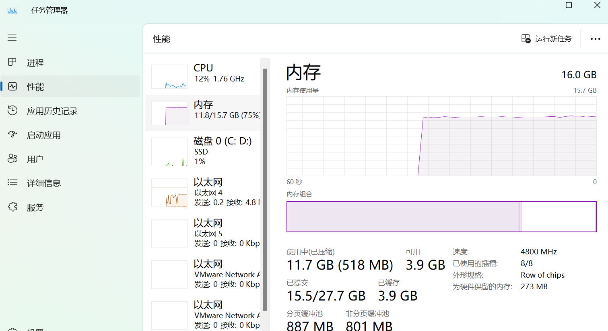

## 一、检查系统信息

用户在安装 DM 数据库前，需要检查当前操作系统的相关信息，确认 DM 数据库安装程序与当前操作系统匹配，以保证 DM 数据库能够正确安装和运行。

用户可以在终端通过 `Win+R` 打开运行窗口，输入 `cmd` ，打开命令行工具，输入 `systeminfo` 命令进行查询，如下图所示：

## 二、检查系统内存

为了保证 DM 数据库的正确安装和运行，要尽量保证操作系统至少 2 GB 以上的可用内存 (RAM)。如果可用内存过少，可能导致 DM 数据库安装或启动失败。

用户可以通过【任务管理器】查看可用内存，如下图所示：

## 三、检查存储空间

DM 完全安装需要至少 1 GB 以上的存储空间，用户需要提前规划好安装目录，预留足够的存储空间。数据库在安装完成后用户还需要注册数据库实例用来管理和保存数据，所以还需要规划好实例的保存路径，同时还需要规划好备份保存路径，评估数据量的大小为实例和备份文件预留足够的空间。