## 一、概述

SQLark 百灵连接是一款面向信创应用开发者的数据库开发和管理工具，由达梦数据历时三年自主研发。

SQLark 数据迁移功能，专注于提供 **全流程的异构数据库迁移服务** ，通过 **迁移评估** 和 **数据迁移** 两个环节和自动化语法解析，提前识别可能存在的改造工作，生成最佳迁移策略，一键迁移到目标数据库，最大化降低用户的数据库迁移成本。本文将提供详细的快速上手操作。

> 通过 PC 端访问 SQLark 官网 [www.sqlark.com](https://www.sqlark.com/?s=eco-com-pg-dm) ，即可下载安装 SQLark 最新客户端。

## 二、迁移流程

一次完整的数据库迁移流程，包括迁移评估和数据迁移两部分。SQLark 同时支持 **仅迁移评估** ，或 **跳过评估直接开始数据迁移** 环节，满足不同迁移场景需求。

- **[迁移评估](https://www.sqlark.com/docs/zh/v1/data-migration/migration-evaluation/connect-source-database.html)**

迁移评估环节通过分析 **源库对象** 、 **兼容性** 、 **大表、大字段表** 等迁移重难点情况，生成源库画像和迁移策略，评估本次迁移需要投入的工作量。

- **[迁移实施](https://www.sqlark.com/docs/zh/v1/data-migration/migration-implementation/connect-target-database.html)**

数据迁移环节提供 **一站式全自动迁移** ，基于迁移策略对数据库对象和表数据开展自动化迁移和语法转换，为迁移异常提供错误分析和修改建议，以 **任务管理** 的方式保障迁移工作完成。

## 三、快速上手

本文将以 PostgreSQL 迁移至达梦数据库为例，介绍五步完成数据迁移任务的流程。

### 3.1 连接源库和目的库

1. 在迁移首页，单击 **数据迁移** ，然后在页面中选择 **仅数据迁移** ，创建一个迁移任务。

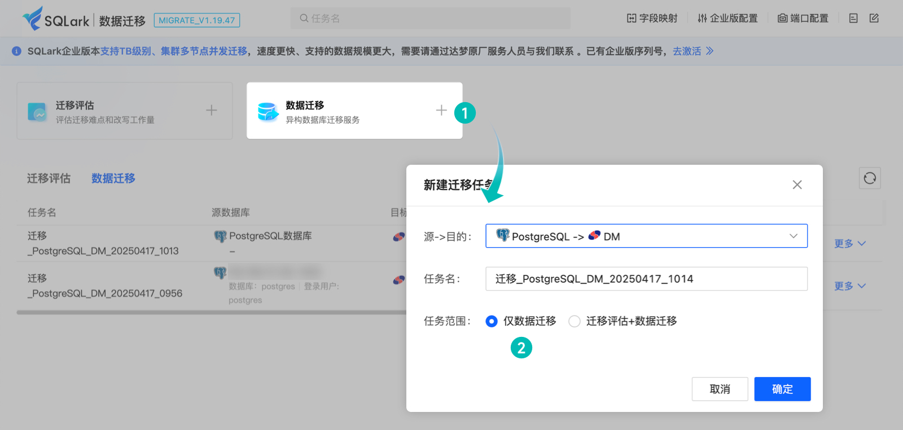

2. 根据页面提示，单击 **下拉菜单** ，从 SQLark 客户端导入需要迁移的源和目的数据源。

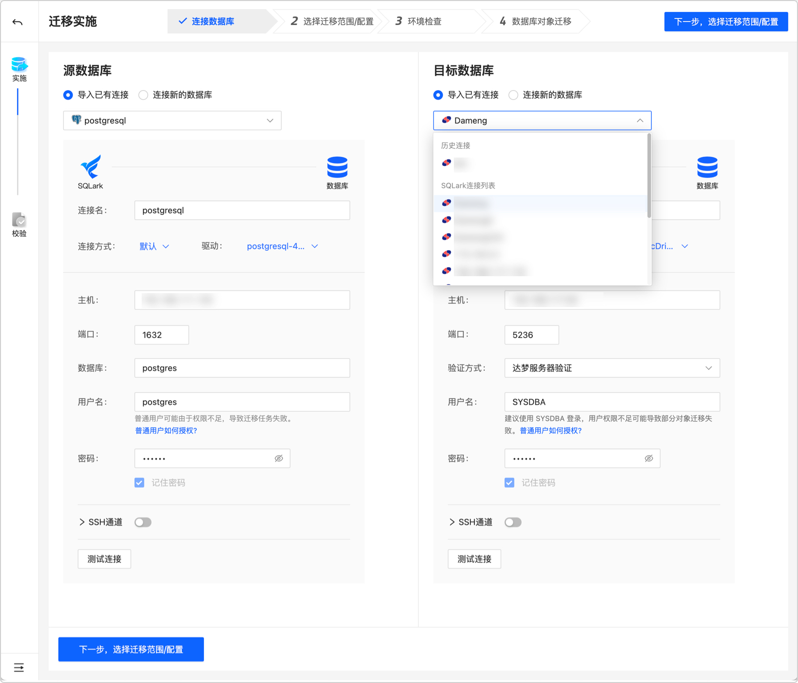

除了直接导入 SQLark 客户端已有连接，还可导入 **历史迁移任务的数据源** 、或者直接 **连接新的数据库** 。

### 3.2 选择迁移范围

勾选需要迁移的 **PostgreSQL 数据库** 对象，默认迁移范围为 **全量迁移** ，即可单击 **下一步，进行环境检查** 。

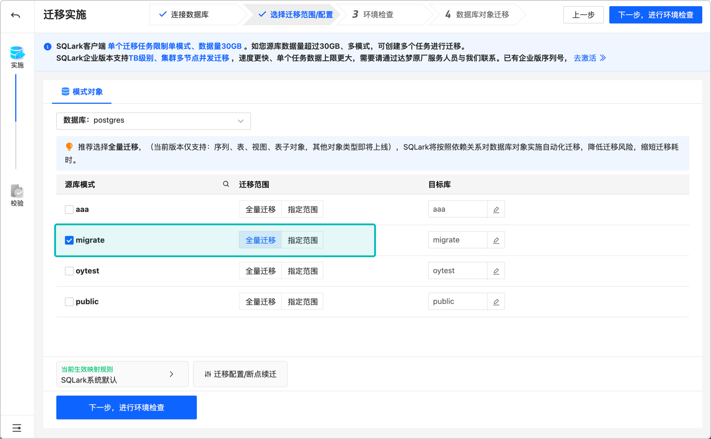

对于大型生产项目（TB 级别或以上），如果业务上需要不迁或者后迁部分大表，可以进行如下操作：

1. 从全量迁移切换到 **指定范围** ，单击表这栏的 **自定义选择** ，根据页面提示排序筛选出最大的表。
2. 单击该表的 **自定义范围** ，选择全部不迁或者只迁表结构后，单击 **确定** 即可保存迁移范围。

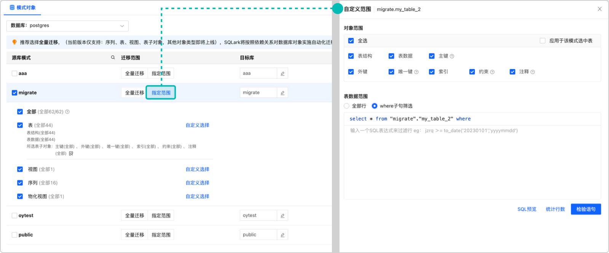

### 3.3 环境检查

1. 按照页面提示，确认并勾选 **目标库磁盘检查项** ，然后确认初始化参数项的全部检查结果为 **通过** ，即可单击 **下一步，开启数据迁移** 。

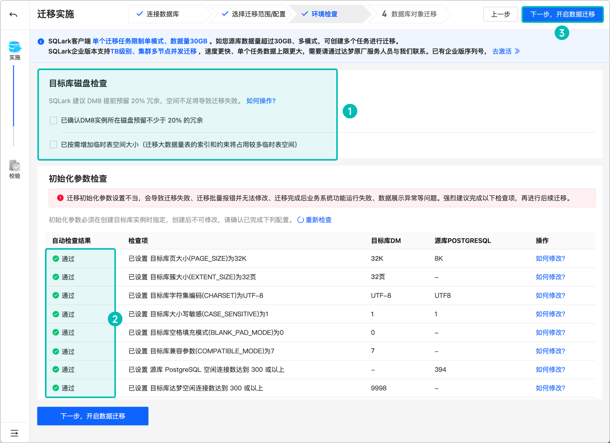

2. 对 **不通过/无法检测** 的参数项，可单击 **如何修改** ，按照页面提示进行查询和改写，然后单击 **重新检查** 。

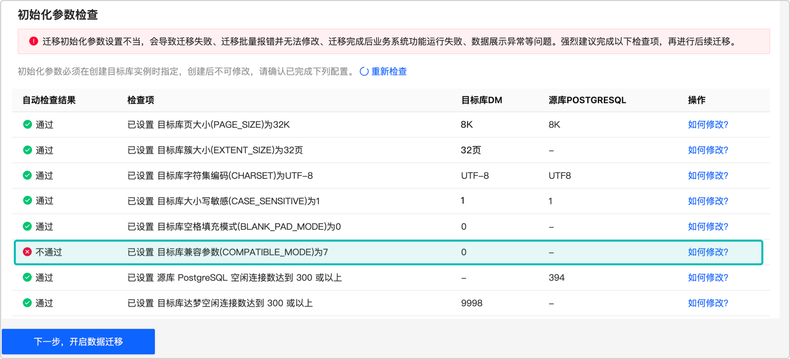

> **说明** ：强烈建议 **按照 SQLark 的环境建议检查** ，这一套设置经过达梦原厂专家认证，完成配置后基本可以规避 50% 以上的批量对象报错。
> 
> 注：如页面上部分检查项没通过，仍可点击 **下一步，进行启动迁移** 。SQLark 没有做强制要求，以免遇到特殊情况阻塞迁移。

### 3.4 自动化迁移

完成了环境检查后，前期配置工作完成，接下来等待 SQLark 进行全自动化迁移即可。

1. 浏览 **迁移概览** 页面，查看整个任务的实时进度。

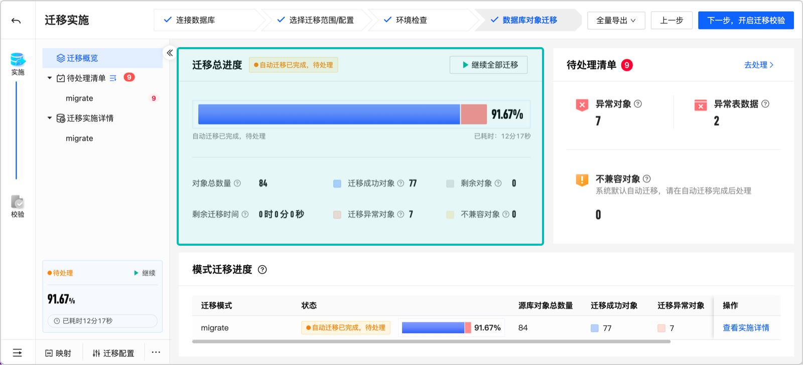

2. 单击首页单个数据库的 **查看实施详情** 。

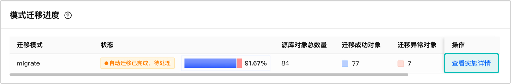

3. 根据页面提示，即可了解该数据库下每类、每个对象的迁移进度。

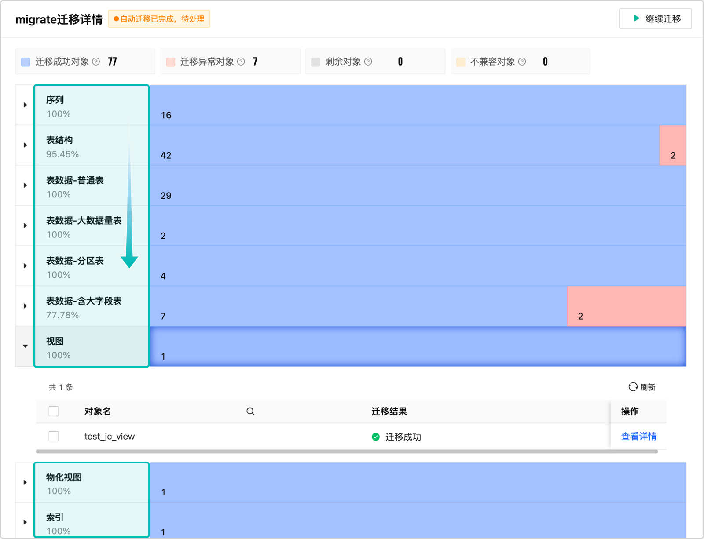

> 说明：SQLark 的自动化迁移策略源库达梦专家经验，可自动按照序列、自定义类型、表结构、视图、表数据、主键、索引等的最优顺序进行迁移，避免依赖关系导致的报错。整个迁移过程人工介入少、迁移成功率更高。

### 3.5 迁移校验

1. 当任务状态变成 **自动迁移已完成，待处理** 或者 **迁移已完成** ，即代表迁移已经完成，单击右上角的 **下一步，开启迁移校验** 。

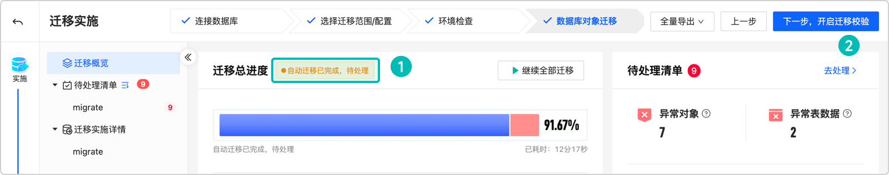

2. 单击 **校验概览** 页面的 **查看数据库校验详情** ，即可查看是否存在 PostgreSQL 和达梦数据库 **对象数量和表行数不一致** 的对象。

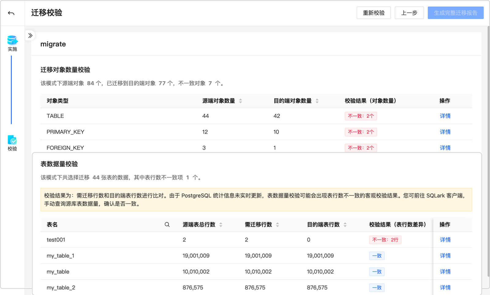

以上就是 SQLark 中完整迁移的全部流程。

**说明：**

- 快速上手跳过了 **迁移评估** 、 **报错对象改写** 等可选步骤，请参考 [迁移评估](https://www.sqlark.com/docs/zh/v1/data-migration/migration-evaluation/create-migration-task.html) 和 [迁移实施](https://www.sqlark.com/docs/zh/v1/data-migration/migration-implementation/create-migration-task.html) 查看具体章节内容。
- 如果迁移过程中有任何问题，可点击 [常见问题（FAQ）](https://www.sqlark.com/docs/zh/v1/data-migration/faq.html) 查看，或者到 [SQLark 社区](https://ask.sqlark.com/) 发帖交流。