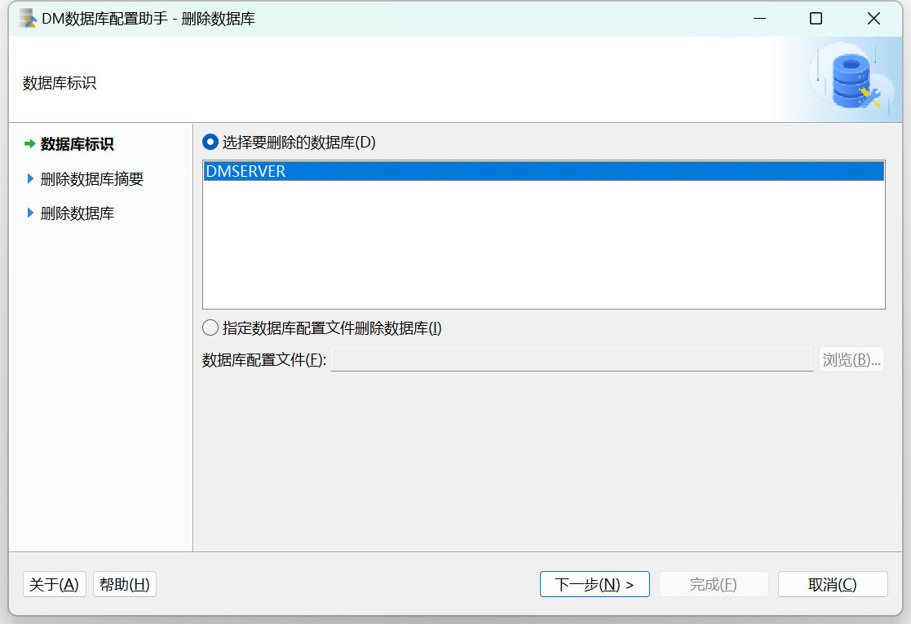
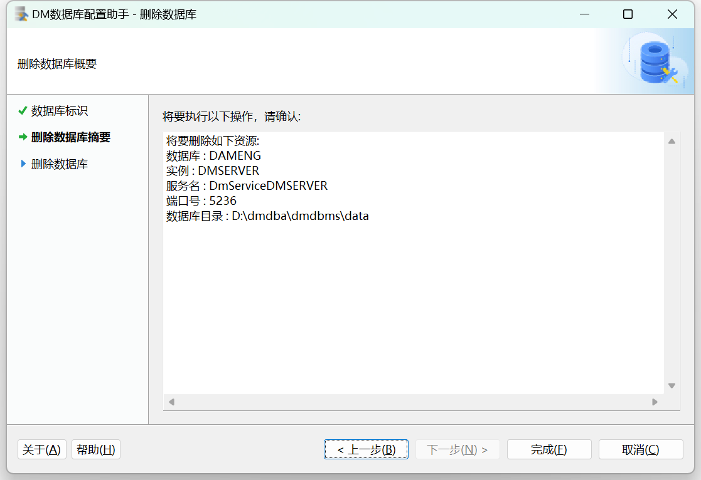
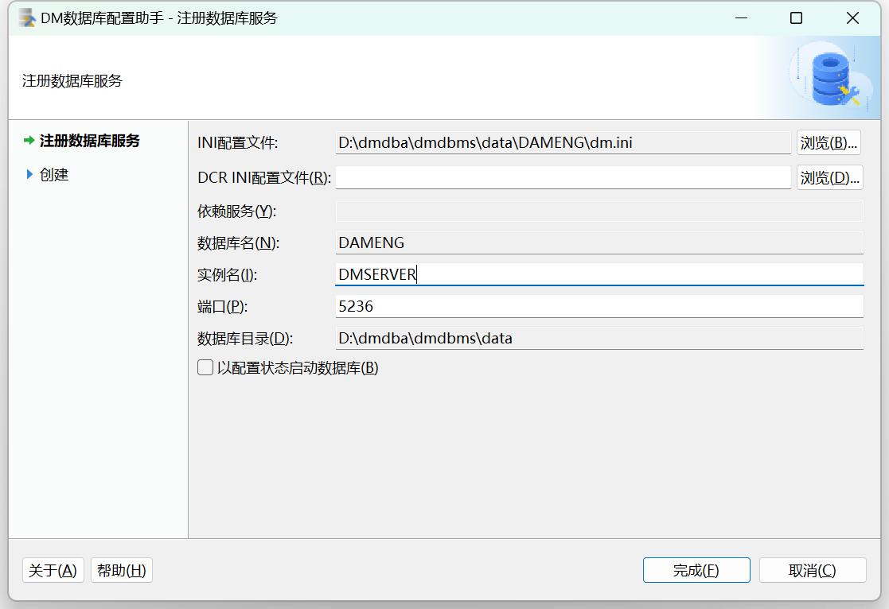
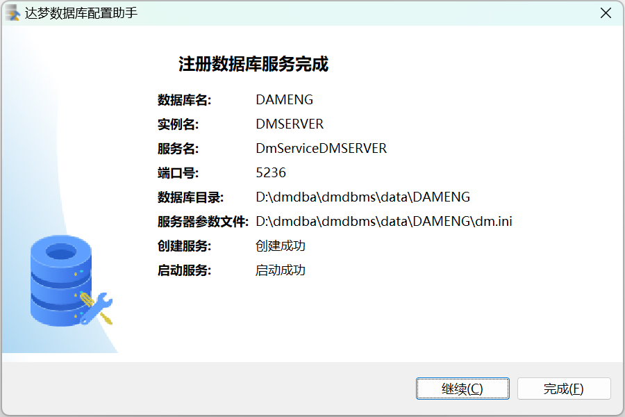
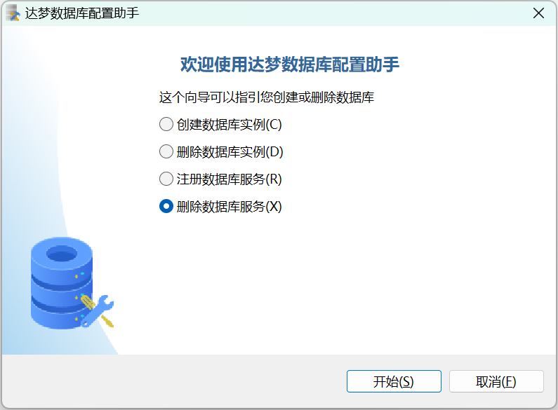
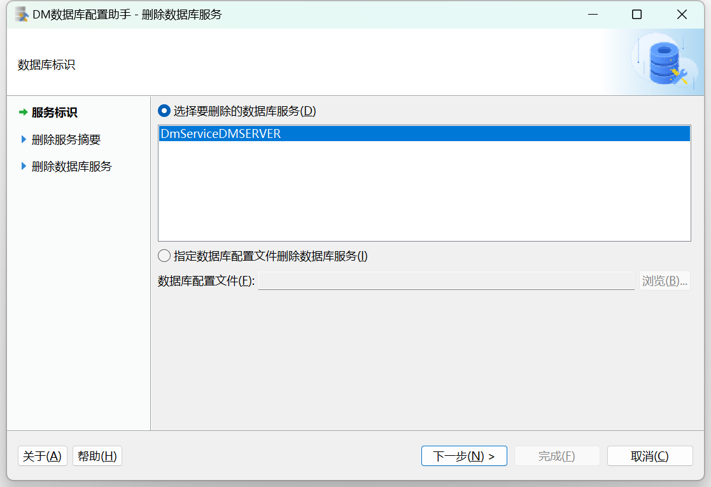
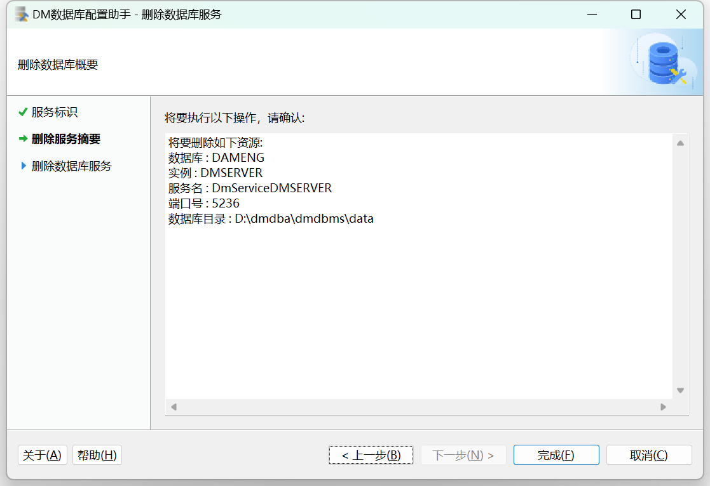
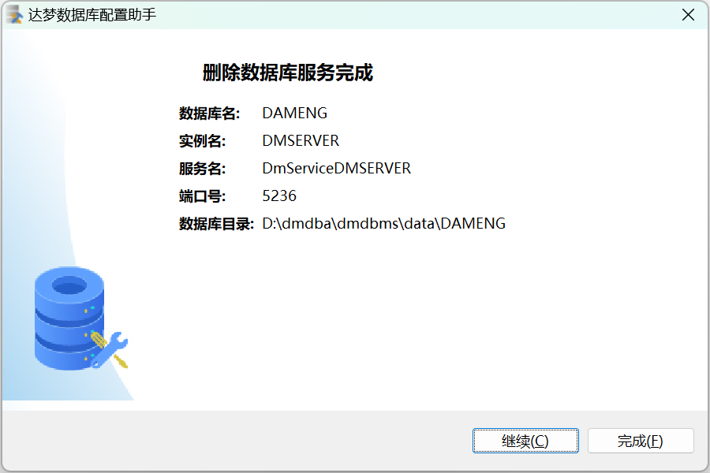

## 一、概述

数据库配置工具的图形界面在各个操作系统上保持一致，用户可通过数据库配置工具来设置数据库初始化的参数及属性。以下将介绍通过数据库配置助手进行 **创建数据库实例、删除数据库实例、注册数据库服务和删除数据库服务** 四种操作方式。

## 二、创建数据库实例

详细步骤请参见 [配置实例](dm-instance-windows.md) 章节。

## 三、删除数据库实例

1. 选择删除数据库选项，如下图所示：

2. 选择要删除的数据库，如下图所示：

3. 显示要删除的数据库摘要信息，点击【完成】按钮，删除数据库成功。如下图所示：

## 四、注册数据库服务

1. 选择【注册数据库服务】选项，点击【开始】，如下图所示：

2. 数据库服务的信息，填写完成后点击【完成】，如下图所示：

3. 注册数据库服务完成，点击【完成】，数据库服务注册完成。如下图所示：

## 五、删除数据库服务

1. 选择删除数据库选项，点击【开始】，如下图所示：

2. 选择要删除的数据库服务，点击【下一步】，如下图所示：

3. 显示要删除的数据库服务信息，点击【完成】，如下图所示：

> **注意**
> 
> 删除服务时需要先停止将要删除的服务，否则无法删除。

4. 显示删除成功，点击【完成】，数据库服务删除结束。如下图所示：

