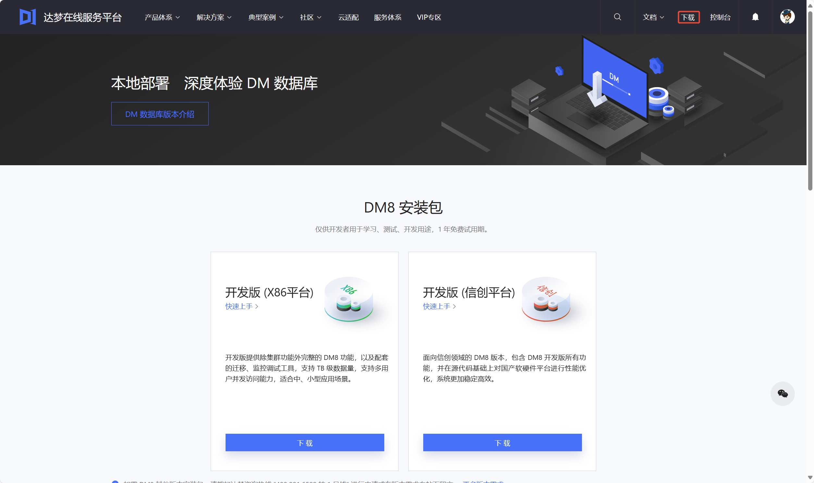
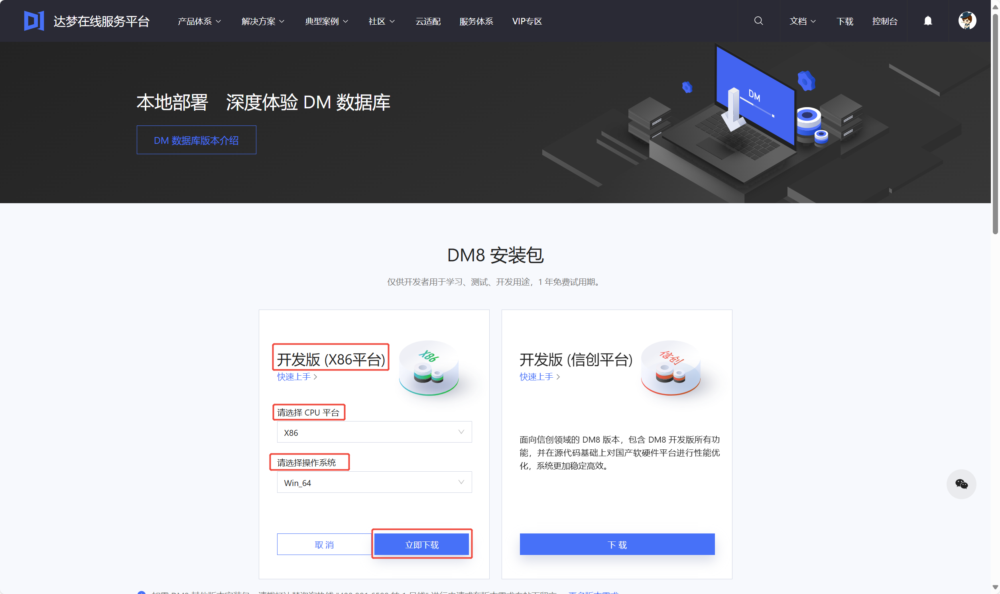
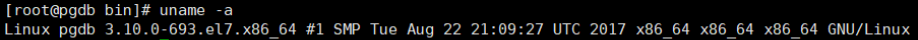

## 一、软件下载

达梦在线服务平台提供 **X86 平台** 和 **信创平台** 开发版下载，用户可根据系统环境自行选择下载。感谢您对 DM 数据库的支持。

DM 数据库下载方式如下：

1. 打开 [达梦在线服务平台](https://eco.dameng.com/) 。

2. 点击下载，选择合适的安装包进行下载，如下图所示：



3. 根据自己的操作系统和 CPU 类型选择相匹配的安装包进行下载。



> **注意**
> 
> 如果下载的数据库安装包对应的操作系统和 CPU 类型与安装机器的操作系统和 CPU 类型不匹配，在安装数据库时可能会失败。

## 二、软件申请

如果在线服务平台提供的版本无法满足需求，需其他平台下对应的安装包，可通过以下两种方式申请：

1. 拨打达梦咨询热线 400 991 6599 直接获取；
2. 联系项目对应的达梦商务人员获取。

例如：获取对应具体软硬件环境的数据库安装包。

1. Linux 中查询操作系统（内核）版本、CPU 架构，命令如下所示：
```shell
uname -a
```



2. 如上图所示，可申请 rh7，x86 版本数据库软件，如：dm8\_20240116\_x86\_rh7\_64.iso。

安装镜像文件说明：

以 iso 文件安装包为例，安装包命名规则如下：dm8\_20240116\_x86\_rh7\_64.iso。

```
dm8: 数据库大版本为 dm8
20240116: 数据库版本发布日期
x86: 安装包匹配的 CPU 架构
rh7: 安装包匹配的系统版本 (redhat 7)
64: 安装包匹配的系统的位数（64 位）
```