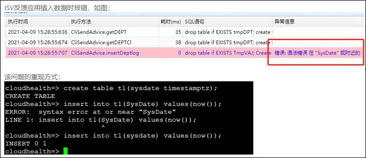

## 屏蔽数据库指定关键字符

## 1、问题现象



SQL语句使用大小写混合的“SysDate”，而关键字sysdate是小写。在进行关键字判断时未成功匹配，判断为关键字。

## 2、解决方案

在关键字屏蔽参数flatten\_keyword\_list添加带双引号的”SysDate”，如：

```
alter system set flatten_keyword_list='sysdate,"SysDate",audit';
```

修改后需要重新加载数据库，执行select pg\_reload\_conf();即可生效。