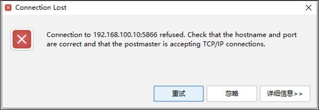
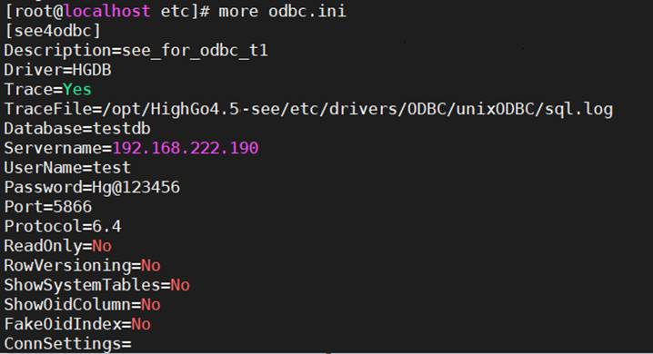
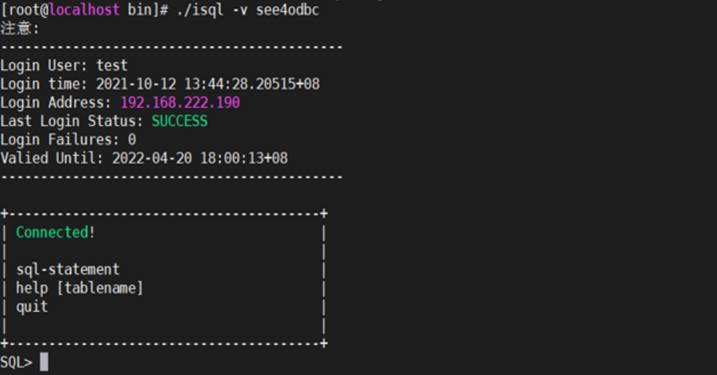
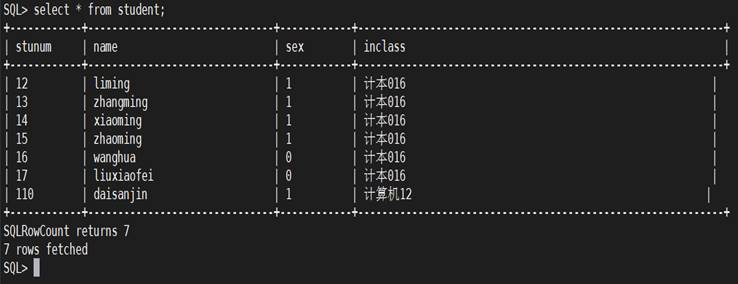

## ODBC连接报错Could not SQLConnect

## 1、问题现象

Centos7环境下ODBC连接HGDB报错Could not SQLConnect。

## 2、解决方案

### （1）配置ODBC

/opt/HighGo4.5-see/etc/drivers/ODBC/unixODBC/etc/目录，修改odbcinst.ini和odbc.ini文件。

odbcinst.ini文件内容如下：



odbc.ini文件内容如下：



### （2）测试连接

/opt/HighGo4.5-see/etc/drivers/ODBC/unixODBC/bin/目录，执行测试程序./isql -v see4odbc，执行结果如下：


报Could not SQLConnect错。

### （3）解决方法

添加环境变量：

```
export ODBCSYSINI=/opt/HighGo4.5-see/etc/drivers/ODBC/unixODBC/etc
```

再次执行测试程序./isql -v see4odbc，执行结果如下：



执行查询语句：

```
select * from student;
```

执行结果如下：



总结：需要添加环境变量：

```
ODBCSYSINI=/opt/HighGo4.5-see/etc/drivers/ODBC/unixODBC/etc
```