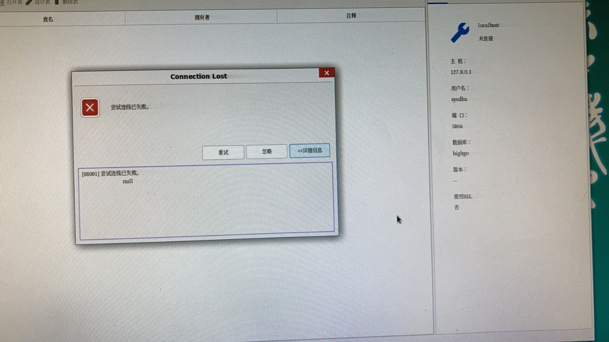
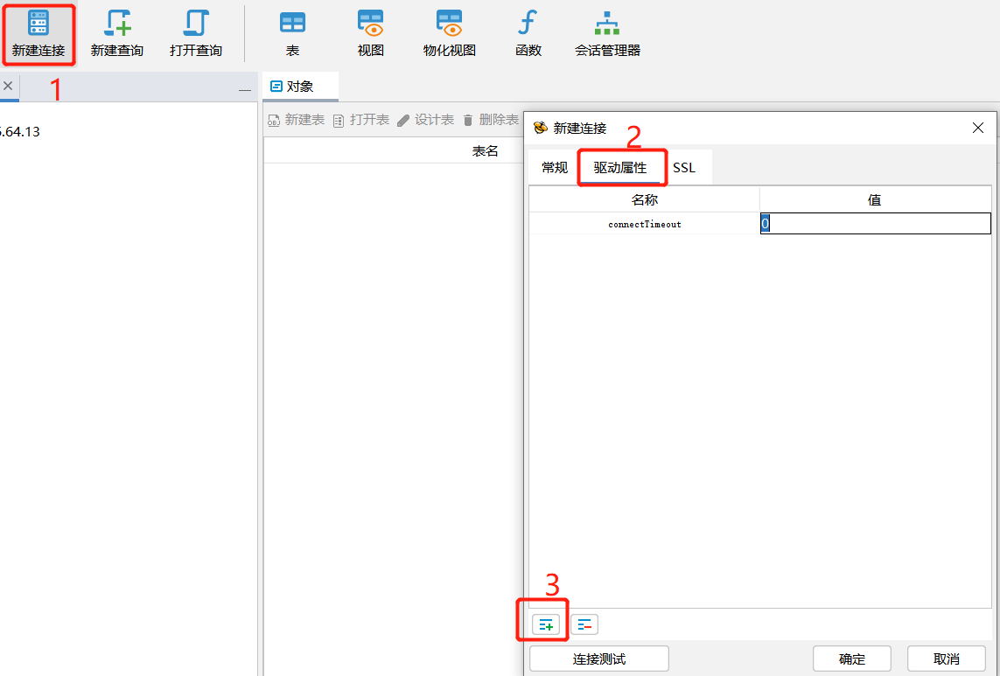

## hgdbdeveloper报错：尝试连接已失败

正常配置hgdbdeveloper相关信息后，点解连接报错：提示尝试连接已失败。可通过psql -h 方式正常连接。

## 1、问题原因

网络异常导致的连接超时的问题。

## 2、解决方案

连接时添加驱动参数connectTimeout=0。

具体操作步骤如下：

新建连接–选择驱动属性–点击左下角图标新增配置–名称一列键入connectTimeout，值一列键入0–点击确定–点击常规，输入数据库连接信息–点击确定。

