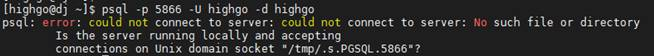
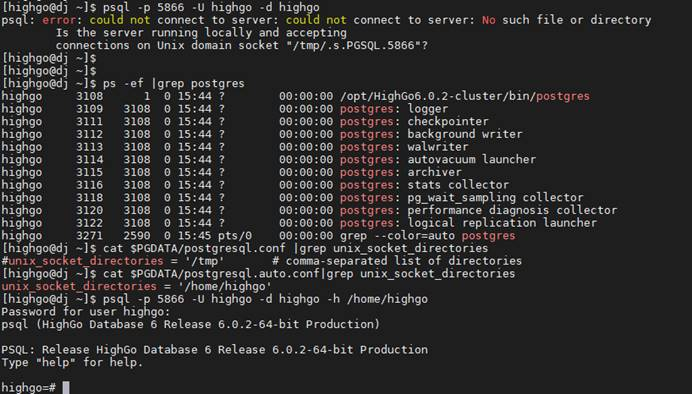
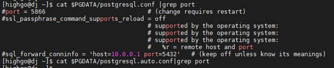

## psql连接数据库报错-could not connect to server No such file or directory

## 1、问题描述

使用psql连接数据库报错：



## 2、解决方案

### （1）首先确认数据库服务是否已经启动。

```
$ ps -ef |grep postgres highgo
```

若数据库服务正常，检查unix\_socket\_directories参数。

```
# su - highgo   $ cat $PGDATA/postgresql.conf  |grep unix_socket_directories   $ cat  $PGDATA/postgresql.auto.conf|grep unix_socket_directories
```

查看参数unix\_socket\_directories的值，若参数并非默认的“/tmp”目录，则连接数据库时需要添加“-h 目录”参数。

例如：



若依然报错，需要查看该目录下是否存在“.s.PGSQL.5866”文件，若不存在，查看数据库系统日志，分析具体原因。

### （2）若数据库服务正常，查看配置文件，端口号是否正确。

```
# su - highgo 

$ cat $PGDATA/postgresql.conf |grep port 

$ cat $PGDATA/postgresql.auto.conf|grep port ##查看参数port的值。
```

