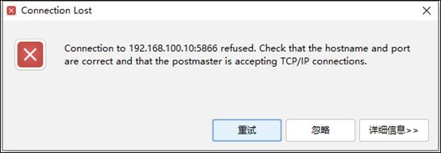
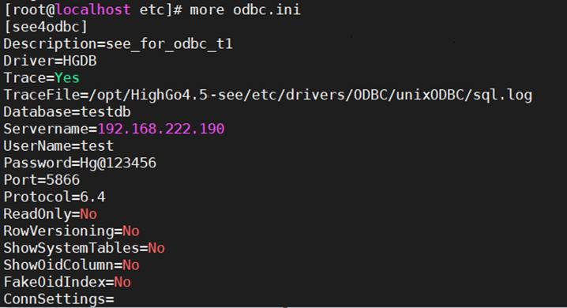
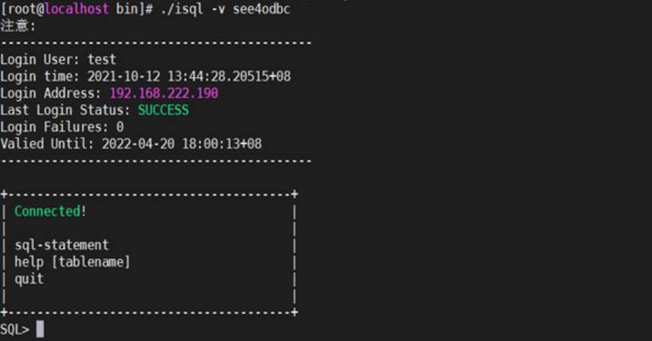
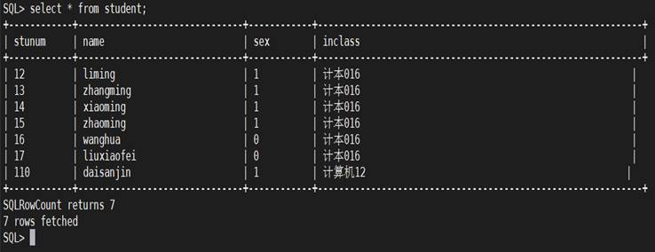

## 使用psql远程连接数据库报错：Connection refused和No route to host

## 1、问题现象

使用psql远程连接数据库报错：Connection refused和No route to host。

```
psql: could not connect to server: Connection refused
```



```
psql: could not connect to server:No route to host
```
```
[highgo@hgdb ~]$ psql -h 192.168.10.123 -p 5866

psql: could not connect to server: No route to host

Is the server running on host "192.168.10.123" and accepting TCP/IP connections on p ort 5866?
```

## 2、解决方案

### （1）首先确认数据库服务是否已经启动。



### （2）检查监听并查看IP地址是否正确。

```
# su - highgo  $ cat  $PGDATA/postgresql.conf|grep listen  $ cat  $PGDATA/postgresql.auto.conf |grep listen  $ cat  $PGDATA/postgresql.conf|grep port  $ cat $PGDATA/postgresql.auto.conf  |grep port
```

例如：

```
listen_addresses = '*'

port = 5866
```


### （3）查看pg\_hba.conf文件确定是否具有正确的配置。

```
su – highgo

cat $PGDATA/pg_hba.conf
```

例如：允许远程主机192.168.10.123无密码访问数据库的配置如下



