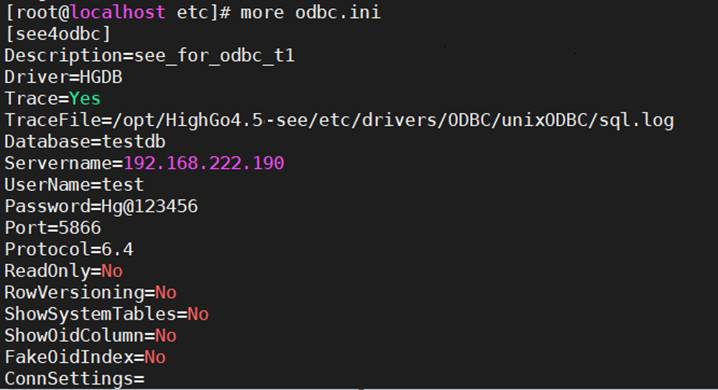
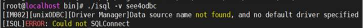
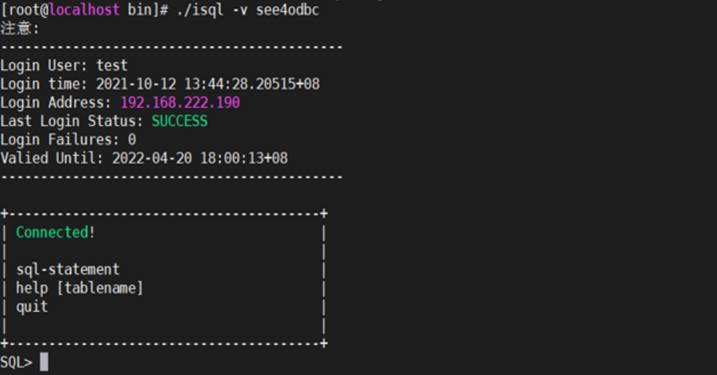

## 管理工具连接安全版数据库问题

## 1、问题现象

使用瀚高开发管理工具连接安全版数据库后，打开对应表报错：字段 c.relhasoids 不存在，位置：172。报错内容如下图所示：

## 2、解决方案

编辑连接信息，勾选“是HG安全版”选项，具体操作步骤如下所示：

1、右键点击连接，选择“编辑连接”选项。

2、在连接信息中勾选“是HG安全版”选项。

3、点击“确定”选项。如该连接已经打开，会提示：保存服务器信息必须关闭服务器连接。要关闭连接吗？点击“是”即可。

