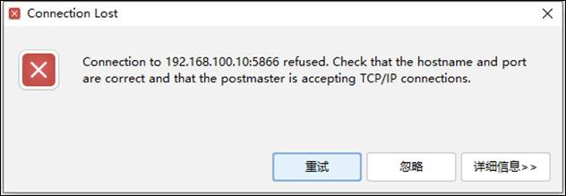

## 管理工具连接数据库提示被拒绝连接

## 1、问题现象

使用瀚高开发管理工具连接数据库时，提示如下错误信息：



## 2、解决方案

### （1）首先检查数据库状态是否正常。

### （2）检查网络，使用ping命令检查应用服务器与数据库服务器之间是否联通，方法：ping ip地址。

```
ping 192.192.192.192
```

### （3）检查端口，使用telnet命令检查端口是否开放，瀚高数据库端口为5866。方法：telnet ip地址 端口号

```
telnet 192.192.192.192 5866
```

### （4）检查配置文件，检查数据库data目录下的pg\_hba.conf文件是否开放应用服务器的IP地址。

```
vi /$PGDATA/pg_hba.conf  

host all all 192.192.192.192/32 md5  #仅开放192.192.192.192 地址  

host all all 0.0.0.0/0 md5 #开放所有地址
```

### （5）检查数据库监听，使用 show listen\_addresses；查看是否存在应用服务器的监听。

```
show listen_addresses; #查看监听  

alter system set  listen_addresses ='*'; #修改监听。*为监听所有
```

### （6）连接账号是否正常

1）是否正常创建，密码是否正确。

2）是否有权限。