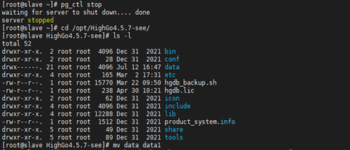

## 备库查询被中止

## 1、问题现象

部署流复制环境后，备库可提供只读操作，通常会将一些执行时间较长的分析任务、统计SQL跑在备库上，从而减轻主库压力，在备库上执行一些长时间SQL时，可能会出现以下错误并被中止：

```
ERROR: canceling statement due to conflict with recovery
DETAIL: User query might have needed to see row versions that must be removed.
```

根据报错信息，在备库上执行长时间查询过程中，由于此查询涉及的记录有可能在主库上被更新或删除，根据瀚高数据库的 mvcc 机制，更新或删除的数据不是立即从物理块上删除，而是之后 autovacuum 进程对老版本数据进行 vacuum，主库上对更新或删除数据的老版本进行 vacuum 后，从库上也会执行此操作，从而与从库当前查询产生冲突，导致查询被中断并抛出以上错误。

## 2、解决方案

通过配置参数可减少或避免这种查询取消的情况：

1. 可能与正在应用的WAL发生冲突，此查询若30秒没有执行完成则被中止，注意30秒不是备库上单个查询允许的最大执行时间，是指当备库上应用WAL时允许的最大WAL延迟应用时间，因此备库上查询的执行时间有可能达不到这个参数设置的值就被中止，此参数可设置成-1，表示当从库上的WAL应用进程与从库上执行的查询冲突时，WAL 应用进程一直等待直到从库查询执行完成。
2. hot\_standby\_feedback = on，默认情况下从库执行查询时并不会通知主库，设置此参数为on后从库执行查询时会通知主库，当从库执行查询过程中，主库不会清理从库需要的数据行老版本，因此备用服务器上的查询能够可靠地完成，查询不会被中止，这种方法同时也会导致主库上的表可能出现膨胀，主库表的膨胀程度与表上的写事务和从库上大查询的执行时间有关，此参数默认为off。

