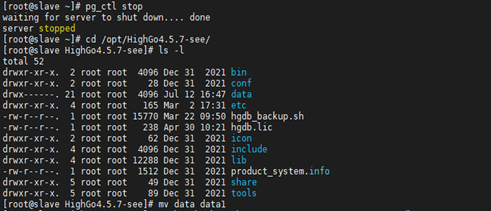
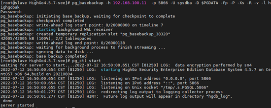

## 主库上WAL被覆盖导致备库不可用

## 1、问题现象

当一个异步流复制备库主机由于硬件故障，需要做一次停机硬件检测，停机检测之后再次启动备库，启动后报如下错误：

以上错误是指备库所需的WAL日志文件 000000010000000000000033 被清除。由于异步流复制备库关闭，在此期间主库无法将WAL日志流发送给备库，备库关闭期间产生的WAL保存在主库的WAL目录里，若主库的wal\_keep\_segments设置比较小，主库可能会覆盖并循环使用还没有发送给备库的WAL日志，若主库没有归档，这种情况只能重做备库，对于数据量较大的数据库，重做备库的时间会很长。

## 2、解决方案

### （1）流复制断开，先看进程是否存在，主库看wal sender，备库看receiver进程，发现都不存在，说明流复制已经断开。

### （2）查看备库最近错误日志，在 data 目录下的 hg\_log 目录，找到最近的相关报错日志，发现主库的wal 日志已经被移除。

### （3）流复制的备库是通过 wal receiver 进程获取相关的 wal 日志来进行应用达到主备的一致，因此主库上的 wal 日志被移除，备库无法继续进行应用相关 wal，所以流复制断开。

### （4）此种情况只能通过重做备库来恢复流复制，使用 pg\_basebackup 命令对备库进行重做，但需要注意，因为pg\_basebackup占用资源较大，若数据量较大，请选择在夜间业务不繁忙时重做备库。

### （5）先关闭备库并将 data 目录改为 data1。

```
[highgo@localhost 4.5]$ pg_ctl stop
[highgo@localhost 4.5]$ cd $PGHOME 
[highgo@localhost 4.5]$ mv data data1
```



### （6）重做备库，ip 改为主库相关 ip，目录改为备库相关目录。



### （7）此时备库已经重做，流复制已恢复。

三种方法应对上述情况：  
1）将主备库 wal\_keep\_segments 参数设置为较大值，从而保证$PGDATA/pg\_wal目录下留存较多的WAL日志，主库 WAL日志留存越多，允许备库宕机的时间越长，设置此参数时注意不要将pg\_wal目录撑满；

2）主库上开启归档，如没有足够的硬盘空间保留WAL归档，至少在备库停机维护时临时开启主库归档，这样当备库启动时，若所需的WAL被主库循环清理掉，至少可从归档里获取所需的WAL文件，这样比重做备库省时省力得多；

3）主库设置复制槽。设置复制槽之后流复制主库将获得备库的复制状态，即使备库宕机主库也可获得备库的复制状态。因此，当流复制备库宕机时，主库不会覆盖掉备库还没有接收的WAL。若备库停机时间太长，主库的pg\_wal目录将有可能被撑满，建议将pg\_wal目录单独放在大容量硬盘上。