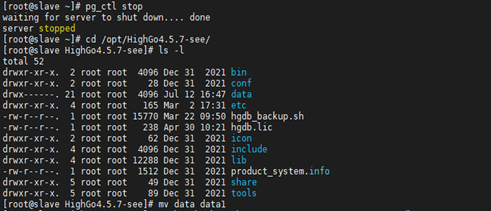
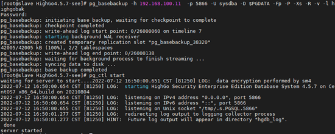
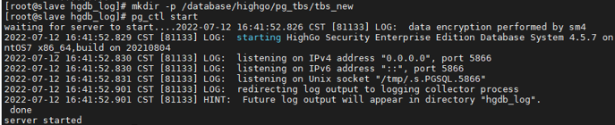

## 主库上创建表空间时备库宕机

## 1、问题现象

数据库中搭建流复制，在主库上创建表空间时备库宕机。

## 2、解决方案

若需要新增表空间，需要在备库创建完成之后再在主库上创建。

模拟这一案例，测试环境为一主一备异步流复制环境，hghost1为主库，hghost2为备库，计划在主库上新增 tbs\_new表空间，在主节点hghost1上创建表空间目录，如下所示：

此时，发现备库实例已经宕机，备库数据库错误日志如下所示：

错误日志提示表空间目录 data/highgo/pg\_tbs/tbs\_new 不存在，由于主库创建表空间时备库主机上没有创建相应的表空间目录，导致备库实例异常关闭，根据数据库日志提示，在备库上创建相应表空间目录，之后重启备库即可，如下所示：

通过查看备库数据库日志，主库上查询 WAL 发送进程，异步流复制环境已经恢复。

该案例属于流复制生产环境典型案例，因为在主库上创建表空间时，很容易忘记提前先在所有备库主机上创建表空间目录。生产系统维护操作实施前需提前做好做好数据库监控，如有异常及时处理并修复。