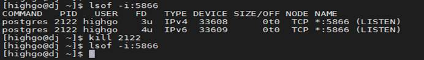

## 默认端口号占用

## 1、问题现象

数据库安装过程中会检查默认端口号（5866）是否被占用，若显示如下信息则为数据库默认端口号被占用：


中文含义：

验证失败，请核实您的输入。

验证错误：端口无效或使用更改!

## 2、解决方案

可通过以下任一方法解决此问题：

### （1）更改数据库端口号

```
[highgo@hgdb data]$ vi $PGDATA/postgresql.auto.conf
```

修改 port 值：

```
port = 5878
```

或使用命令语句进入管理员用户修改：

```
alter system set port = 5878;
```

修改该数据库参数重启数据库生效。

```
pg_ctl restart
```

### (2)kill占用5866端口进程

使用 lsof -i:5866 命令可查看5866端口被进程占用的情况：



使用kill命令结束5866端口所占用的进程，即可解决端口被占用的问题。注意：使用kill命令前需确定占用端口的程序被kill是否会影响业务。