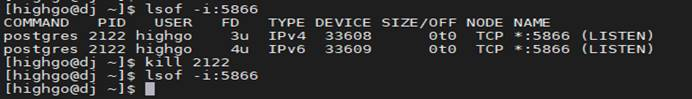
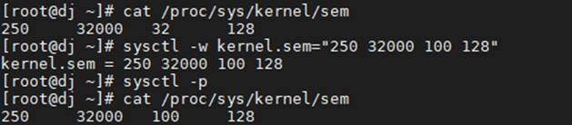

## 致命错误：无法创建信号量

## 1、问题现象

数据库启动时报错如下：


提示: 该错误信息不表示磁盘空间已经用完，导致该错误信息可能有如下两方面原因：

1）超过系统对于最大数量信号灯集合(由参数SEMMNI表示)；

2）对系统范围内最大可使用信号灯(由参数 SEMMNS 表示)的限制。

可通过增加这两个系统核心参数的值解决，也可通过降低PostgreSQL参数 max\_connections 的值来减少它所消耗的信号灯总数。

kernel.sem信号量是一种锁机制用于协调进程之间互斥的访问临界资源，以确保某种共享资源不被多个进程同时访问。数据库使用信号量来管理对操作系统资源的访问（比如内存共享段），若所有数据库进程所需的信号量不足，会导致数据库无法启动或者运行时出错。

## 2、解决方案

可通过以下任一方法解决此问题：

### （1）减小max\_connections大小

max\_connections 参数控制最大连接数；通过以下方式修改max\_connections：

```
[highgo@hgdb data]$ vi $PGDATA/postgresql.auto.conf
max_connections = 500
```

或使用命令语句进入管理员用户修改：

```
alter system set max_connections = 500;
```

修改该数据库参数重启数据库生效。

```
pg_ctl restart
```



### （2）调大内核配置 kernel.sem

```
[root@zeng ]# cat /proc/sys/kernel/sem

 250    32000  100  200
```

输出的4个值分别对应如下内核信号量参数：

```
semmsl 250 max semaphores per array每个信号量集中的最大信号量数。

semmns 32000 max semaphores system wide 整个系统中的最大信号量数。

semopm 100 max ops per semop call 调用单个信号集中最大信号数量。

semmni 200 max number of arrays 信号量集最大数。
```

通过以下系统命令修改：

