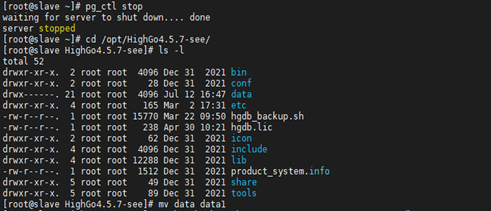

## 同步流复制备库启动报错

## 1、问题现象

在搭建同步流复制的standby库，启动备库时，数据库报错，报错信息如下：

```
[postgres@pghs ~]$ psql
psql: FATAL:  the database system is starting up
```

## 2、解决方案

出现此报错信息主要有以下两种情况：

1）备库未设置hot\_standby参数为on。

2）备库wal日志replay落后主库较长时间，备库需要重放wal日志去追赶主库状态。

### （1）针对第一种情况，处理方式如下：

将postgresql.conf中hot\_standby设置为on：

```
vi $PGDATA/postgresql.conf 
hot_standby = on
```

修改完成后重启数据库使该参数生效。

该错误并不是启动库的时候报错，而是连接报错。数据库本身是运行的，只不过一个备用服务可能没有启用hot\_standby参数，因此会阻止连接。

  

### （2）针对第二种情况，处理方式如下：

备库需要一定的时间去重放wal日志去追赶主库状态，等待即可。