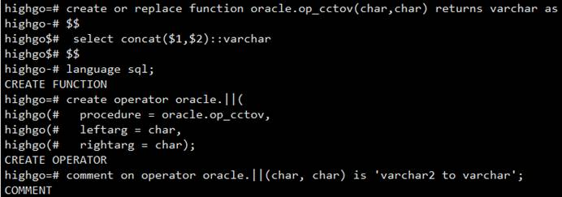

## Oracle兼容—添加||操作符

## 1、问题现象

开启oracle兼容后使用||拼接字符，两边是char类型，返回的结果是varchar2，而不是varchar。

## 2、解决方案

通过添加||操作符解决；

```
create or replace function  oracle.op_cctov(char,char) returns varchar as   
$$    
select concat($1,$2)::varchar   
$$  
language sql;  
create operator oracle.||(   
procedure = oracle.op_cctov,   
leftarg = char,   
rightarg = char);  
comment on operator  oracle.||(char, char) is 'varchar2 to varchar';
```

