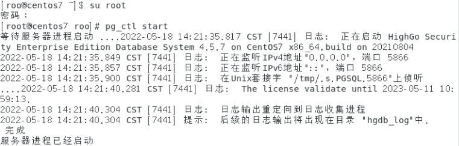

## 登录

1. 打开虚拟机终端，切换 root 用户，启动 pg\_ctl。
2. 通过 psql 登录 sysdba 用户、highgo 数据库。如果配置了环境变量，可以通过下面的命令进行登录。
```sql
su root

pg_ctl start

psql -U sysdba -d highgo
```



如果没有配置环境变量，将目录切换到数据库 /bin 目录下，执行以下语句：

```shell
cd /opt/HighGo4.5.7-see/bin

./pg_ctl start -D data

./psql highgo sysdba
```