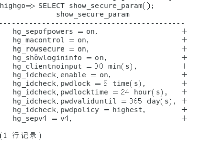
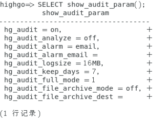

## 三权分立

瀚高数据库安全版实现了三权分立，对数据库系统管理员的权限实施了分离，使系统中不存超级管理员/超级用户和权限过高的角色和用户，降低安全隐患和风险。

数据库系统中存在相互独立、相互制约的系统管理员（SYSDBA）、安全保密管理员（SYSSSO）和安全审计员（SYSSAO）三个管理员角色。管理员的分工情况如下图所示。

| 管理员 | 身份 | 工作范围 |
| --- | --- | --- |
| SYSDBA | 系统管理员 | 主要负责系统运行维护和生成用户身份标识符 |
| SYSSSO | 安全保密管理员 | 主要负责用户权限设定、安全策略配置管理 |
| SYSSAO | 安全审计员 | 主要负责对数据库所有用户操作行为审计的策略设置和审计记录的查询与分析 |

下面从管理员角度介绍几个参数：

在查询/修改相关参数时，需要切换到相应的管理员用户，有关切换用户的语句将在下一节介绍。

**1.安全保密管理员 (SYSSSO)**

查看安全参数值：

```sql
SELECT show_secure_param();
```



详细的安全策略参数列表如下：

| 安全参数 | 子参数名 | 参数说明 |
| --- | --- | --- |
| hg\_sepofpowers |  | 三权分立功能开关，默认 on，开启三权功能；off 为关闭三权分立，关闭后即无安全功能。参数值重启生效。 |
| hg\_macontrol |  | 强制访问控制功能开关，默认 on，开启强制访问控制；参数值为 min，表示强访功能最小化，即只有自主访问控制功能。参数值重启生效。 |
| hg\_rowsecure |  | 行级强制访问功能开关。该参数只在 hg\_macontrol 为 on 时生效。参数值为 on\|off，on 为开启行级访问控制，off 为关闭行级访问控制，开启表级访问控制。默认为 off。参数值重启生效。 |
| hg\_showlogininfo |  | 登入信息显示开关。（管理工具和 psql 客户端，参数值为 on\|off，on 为开启功能，off 为关闭功能，默认 on。参数值动态生效。 |
| hg\_clientnoinput |  | session 不活动无操作自动断开的时间 (有事务运行则不会断开)。参数范围值为 0-1440 分钟；默认 30 分钟，设置为 0 则不限制。参数值重启生效。 备注：hg\_clientnoinput 受 hg\_idcheck.enable 开关控制。关闭 hg\_idcheck.enable 后，hg\_clientnoinput 参数不生效。 |
| hg\_idcheck.子参数名 |  |  |
|  | enable | 该参数相当于其他子参数的总开关。 默认值为 on，开启身份鉴别，其他子参数以默认值显示；off 为关闭身份鉴别，所有身份鉴别相关参数均不生效。参数值重启生效。 |
|  | pwdlock | 密码连续输入错误多少次后账户被锁，默认5次。参数范围值为 0-10 次, 设置为 0 表示不限制密码错误次数，重启后密码连续错误次数重新计算。参数值动态（不重启）生效。 |
|  | pwdlocktime | 密码连续错误次数超限被锁定的时间，默认 24 小时，参数范围值为 0-240 小时。设置为 0 则表示一直被锁定，但可以通过 syssso 解锁。参数值动态（不重启）生效。 |
|  | pwdvaliduntil | 参数功能为密码有效期，参数范围值为 0-365 天，默认 7 天，设置值为 0 表示不限制天数。参数值动态（不重启）生效。 |
|  | pwdpolicy | 参数有 low、medium、high、highest 四个参数值，设置为 low 时表示密码不受限制；设置为 medium 表示密码长度至少为 8 位，必须包含字母和数字；设置为 high 表示密码长度至少为8位，必须包含字母、数字和特殊字符。highest 包含常用密码、保留字、关键字等所有密码规则。默认为 highest 参数值动态（不重启）生效。 |
| hg\_sepv4 |  | 该选项的值可以为 v4 或者 v45。默认值为 v4，表示三权分立为 V4 版本。可设置为 v45，表示三权分立的版本为 V45 版本。 当 hg\_sepofpowers 为 on 时，此选项才 会生效。改变此选项的值后需要重启数据库生效。 |

安全保密管理员可以用 `select set_secure_param()` 函数来设置安全配置，第一个参数是要配置的参数名称，后边是要设置的值，两个参数全部都是字符串类型。

例如修改 hg\_idcheck.pwdvaliduntil参数为 0：

```sql
select set_secure_param('hg_idcheck.pwdvaliduntil','0');
```

**2.安全审计员（SYSSAO）**

查看当前的审计策略配置：

```sql
SELECT show_audit_param();
```



安全审计参数如下：

| 审计参数 | 参数说明 |
| --- | --- |
| hg\_audit | 审计总开关，默认为 on。 |
| hg\_audit\_analyze | 审计分析开关，on 表示需要检查用户配置的审计事件风险等级，并根据风险等级进行处理，off 表示只记录审计记录，而不处理风险等级，默认为 off。 |
| hg\_audit\_alarm | 审计告警方式，当前只支持 email 方式，即当需要进行审计告警时， 发送邮件到 hg\_audit\_alarm\_email 所配置的邮箱。 |
| hg\_audit\_alarm\_email | 审计告警邮箱。 |
| hg\_audit\_logsize | 生成的审计文件大小，可配置的范围为 16MB~1GB；默认为 16MB。 |
| hg\_audit\_keep\_days | hgaudit 目录下的审计记录文件所保存的时间(以天为单位)，若超过这个时间，相关文件将会被删除。 |
| hg\_audit\_full\_mode | 当没有足够的磁盘空间时的审计处理策略。可取值为 1,2。取值为 1 时：暂停审计，并发出告警；取值为 2 时：采取 1 的策略外，同时停止数据库服务。当一条审计日志写入磁盘失败后，就会认为当前磁盘空间不足，系统会自动发送邮件至审计告警邮箱，同时，审计日志里会记录给 xxx 邮箱发送一封邮件。 |
| hg\_audit\_file\_archive\_mode | 审计自动归档模式的开关，on 表示打开审计文件自动归档，审计归档进程扫描 hgaudit/audit\_archive\_ready 下的 ready 文件，把相应的审计日志文件归档到 hg\_audit\_file\_archive\_dest 指定的路径下。默认为 off。 |
| hg\_audit\_file\_archive\_dest | 审计归档路径，只支持绝对路径。设定的路径必须存在且数据库运行用户对其有写权限。 |

审计管理员可以用 `select set_audit_param()` 函数来设置审计配置，第一个参数是要配置的参数名称，后边是要设置的值，两个参数全部都是字符串类型。

例如修改 hg\_audit\_file\_archive\_mode 参数为 on：

```sql
select set_audit_param('hg_audit_file_archive_mode','on');
```