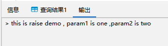

## 打印输出

可以通过 `RAISE` 来报告信息和抛出错误。

```sql
RAISE level 'format' [,expression [,...]];
```

level 表示消息级别（debug / log / info / notice / warning / exception），默认级别是 EXCEPTION，EXCEPTION 会抛出一个错误（通常会中止当前事务），其他级别仅仅是产生不同优先级的消息。format 消息内容用单引号括起来，format 是消息内容，其中使用 % 作为占位符，如果要在 format 中表示 % 本身，需写成 %% 。\[,expression \[,…\]\] 为 % 占位符的变量，依次用逗号排列。

例如写一个打印输出的函数，param1 和 param2 将替代 format 里面的两个%：

```sql
CREATE OR REPLACE FUNCTION raise_demo() RETURNS text AS 
$$
DECLARE 
    param1 text:= 'one';
    param2 text:= 'two';
BEGIN 
    RAISE NOTICE 'this is a raise demo, param1 is % ,param2 is %',param1,param2;
    RETURN param1;
END
$$
LANGUAGE plpgsql;S
```

查询结果如下：

```sql
highgo=# SELECT raise_demo();
注意:  this is a raise demo, param1 is one, param2 is two
 raise_demo 
------------
 one
(1 行记录)
```

