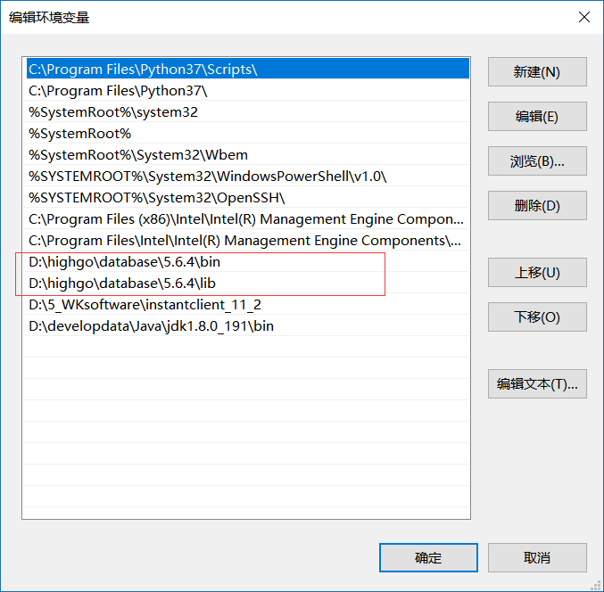

## windows平台下安装postgis

## 1、下载安装包

[http://download.osgeo.org/postgis/windows/](http://download.osgeo.org/postgis/windows/)

## 2、版本对应

HGDBV4对应PG9.5

HGDBV5对应PG10

版本一定要对应好，否则安装失败并提示版本不对应

## 3、环境变量

数据库安装完毕后一定要配置好环境变量，下面以HGDBV5.6.4为例：



注意：V5中LIB和PATH都要配置在PATH中

## 4、安装包格式

下载的gis安装包分为.zip和.exe两种格式

.exe：直接安装，指定到数据库的安装目录，例如：D:\\highgo\\database\\5.6.4

.zip：直接解压到指定目录，例如D:\\highgo\\database\\5.6.4

## 5、配置参数

以postgis-bundle-pg10-3.0.0x64.zip为例，解压到D:\\highgo\\database\\5.6.4

修改配置文件：makepostgisdb\_using\_extensions.bat

```
REM this is an example of how to create a new db and spatially enable it using CREATE EXTENSION

set PGPORT=5866
set PGHOST=localhost
set PGUSER=highgo
set PGPASSWORD=highgo123
set THEDB=postgis
set PGINSTALL=D:\highgo\database\5.6.4
set PGADMIN=%PGINSTALL%\hgdbadmin
set PGBIN=%PGINSTALL%\bin
set PGLIB=%PGINSTALL%\lib
set POSTGISVER=2.3          --此处可修改成对应gis版本
xcopy bin\*.* "%PGBIN%"
xcopy /I /S bin\postgisgui\* "%PGBIN%\postgisgui"
xcopy /I plugins.d\* "%PGADMIN%\plugins.d"
xcopy lib\*.* "%PGLIB%"
xcopy share\extension\*.* "%PGINSTALL%\share\extension"
xcopy /I /S share\contrib\*.* "%PGINSTALL%\share\contrib"
xcopy /I gdal-data "%PGINSTALL%\gdal-data"
"%PGBIN%\psql" -U "%PGUSER%" -c "CREATE DATABASE %THEDB%"
"%PGBIN%\psql" -U "%PGUSER%" -d "%THEDB%" -c "CREATE EXTENSION postgis;"
"%PGBIN%\psql" -U "%PGUSER%" -d "%THEDB%" -c "CREATE EXTENSION postgis_sfcgal;"
"%PGBIN%\psql" -U "%PGUSER%" -d "%THEDB%" -c "CREATE EXTENSION postgis_topology;"
"%PGBIN%\psql" -U "%PGUSER%" -d "%THEDB%" -c "CREATE EXTENSION address_standardizer;"
"%PGBIN%\psql" -U "%PGUSER%" -d "%THEDB%" -c "CREATE EXTENSION address_standardizer_data_us;"
"%PGBIN%\psql" -U "%PGUSER%" -d "%THEDB%" -c "CREATE EXTENSION fuzzystrmatch;"
"%PGBIN%\psql" -U "%PGUSER%" -d "%THEDB%" -c "CREATE EXTENSION postgis_tiger_geocoder;"

REM Uncomment the below line if this is a template database

REM "%PGBIN%\psql" -d "%THEDB%" -c "UPDATE pg_database SET datistemplate = true WHERE datname = '%THEDB%';GRANT ALL ON geometry_columns TO PUBLIC; GRANT ALL ON spatial_ref_sys TO PUBLIC"

pause
```

双机makepostgisdb\_using\_extensions.bat运行脚本，中间可能需要输入五次密码，运行完毕后退出

## 6、问题排查

如果有报错的话请重点检查：

1、安装版本是否一致

2、安装目录权限是否正确

3、配置文件是否填写正确