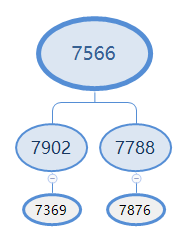

## HGDB中CTE（公共表表达式）的用法

Common table expression（公共表表达式）简称CTE，由SQL:1999标准引入，CTE可以看成是一个临时创建的视图，生命周期仅限于当前语境，一旦CTE被创建，可以将其当成一般的表，大部分基于表的操作都可以运用于CTE。

目前支持CTE的数据库有Teradata, DB2, Firebird, Microsoft SQL Server, Oracle (with recursion since 11g release 2), PostgreSQL (since 8.4), MariaDB (since 10.2), SQLite (since 3.8.3), HyperSQL and H2 (experimental), MySQL8.0。

### 1、下面是创建CTE的语法结构：

```
WITH expression_name (colum1,colum2,...,columN) 
AS
(
    CTE_query_definition
)
CTE_query_definition表示一个SELECT语句，它产生的结果集用于填充CTE。这个SELECT语句与定义视图时的SELECT语句一样，必须满足必要的条件。不能使用一个CTE（公共表表达式）来定义另一个CTE（公共表表达式）。如果CTE_query_definition有多个查询语句，必须使用UNION ALL,UNION,EXCEPT,或者INTERSECT其中的一个连接词来连接 
CTE可用于 
   1.创建递归查询 
   2.在同一语句中多次引用生成的表 
   3.减少子查询和表变量，提高执行效率 
CTE优点： 
   1.使用 CTE 可以提高可读性和轻松维护复杂查询。同时，一般情况CTE要比表变量的效率高。
   2.可以用来定义一个SQL片断，该SQL片断会被整个SQL语句用到。有时为了提高SQL语句的可读性，也会用在UNION ALL的不同部分，作为提供数据的部分。
```

## 2、普通用法示例

```
WITH cte_emp as 
(SELECT * from emp where empno=7566)
SELECT * from cte_emp;
```

### –可以写多个CTE,使用逗号分隔

```
WITH cte_emp as
(SELECT * from emp where empno=7566),
cte_dept as 
(select * from dept)
SELECT * from cte_emp,cte_dept 
where cte_emp.deptno=cte_dept.deptno;
```

## 3、递归CTE

### –在HGDB使用递归CTE，需要添加关键词RECURSIVE，并列出每列的名称

```
WITH RECURSIVE cte_emp(empno,ename,job,mgr,hiredate,sal,comm,deptno) as 
( SELECT * from emp where empno=7566
union all
select emp.empno,emp.ename,emp.job,emp.mgr,emp.hiredate,emp.sal,emp.comm,emp.deptno from emp,cte_emp 
where emp.mgr=cte_emp.empno
)
select * from cte_emp;
```

### –查询结果如下

```
empno | ename | job | mgr | hiredate | sal | comm | deptno
-------+-------+---------+------+------------+---------+------+--------
  7566 | JONES | MANAGER | 7839 | 1981-04-02 | 2975.00 | | 20
  7902 | FORD | ANALYST | 7566 | 1981-12-03 | 3000.00 | | 20
  7788 | SCOTT | ANALYST | 7566 | 1987-04-19 | 3000.00 | | 20
  7876 | ADAMS | CLERK | 7788 | 1987-05-23 | 1100.00 | | 20
  7369 | SMITH | CLERK | 7902 | 1980-12-17 | 800.00 | | 20
(5 行记录)
```

上面查询的是在7566管理下的人员，查询结果结构图如下：



通过上图可以明白查询时获取数据的过程，“SELECT \* from emp where empno=7566”获取7566的资料，然后根据“emp.mgr=cte\_emp.empno”查询7566管理的人员7902和7788，重复“emp.mgr=cte\_emp.empno”过程，获取7902和7788管理的人员7369和7876，因为7369和7876没有管理的员工，递归过程到此结束。