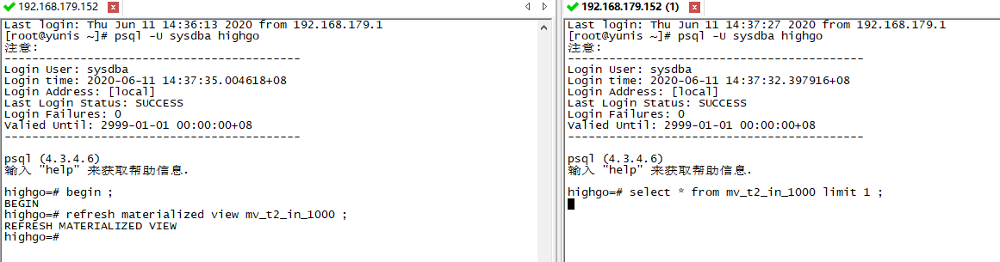
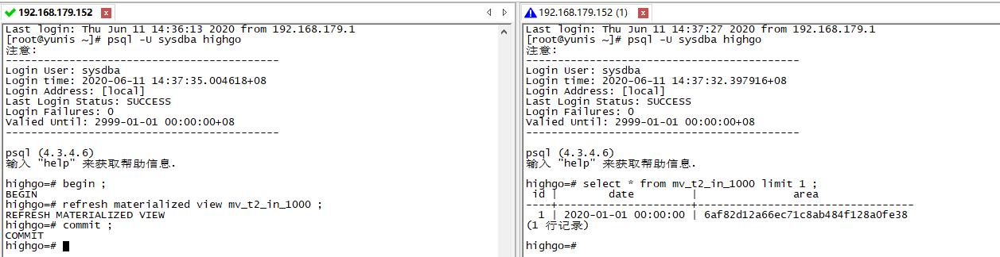
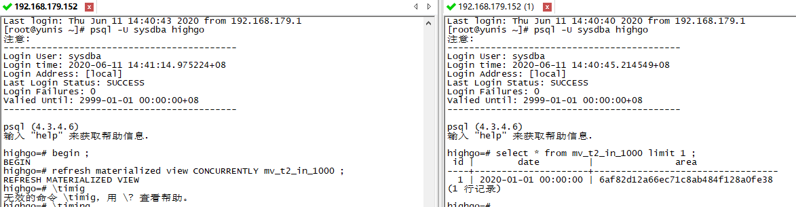
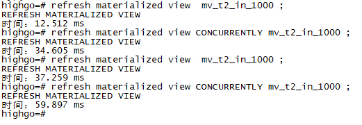

## 搭建本地物化视图

PostgreSQL 从 9.3 版本开始有物化视图.9.3版本的物化视图只支持全量刷新,9.4 版本之后支持增量刷新

下面简单介绍一下如何在 HGDB 上搭建本地物化视图

## 1、在数据库中创建测试数据

```
highgo=# create table text2 (id serial primary key , date timestamp, area text );
CREATE TABLE
highgo=# insert into text2 (date,area) select a, md5(a::text) from generate_series('2020-01-01'::date,'2020-12-31'::date,'300 seconds') as a;
INSERT 0 105121
```

## 2、创建物化视图

```
highgo=# create  materialized view mv_t2_in_1000 as select * from text2 where id < 1000 with no data;
CREATE MATERIALIZED VIEW

--此处查看没有数据所以会报错,使用 refresh 将数据刷新至物化视图中
highgo=# select count (*) from mv_t2_in_1000 ;
错误:  物化视图 "mv_t2_in_1000"未被初始化
提示:  使用命令 REFRESH MATERIALIZED VIEW.
highgo=# refresh materialized view mv_t2_in_1000 ;
REFRESH MATERIALIZED VIEW
highgo=# select count (*) from mv_t2_in_1000 ;
 count 
-------
   999
(1 行记录)

--查看物化视图是如何定义出来的
highgo=# select * from pg_matviews ;
 schemaname |  matviewname  | matviewowner | tablespace | hasindexes | ispopulated |   definition         
------------+---------------+--------------+------------+------------+-------------+----------------------------
 public | mv_t2_in_1000 | sysdba |            | f     | t    |    SELECT text2.id,         +
      |          |     |            |      |      |     text2.date,           +
      |          |     |            |      |      |     text2.area            +
      |          |     |            |      |      |    FROM text2             +
      |          |     |            |      |      |   WHERE (text2.id < 1000);
(1 行记录)
```

## 3、在物化视图上创建唯一索引

```
highgo=# create unique index idx_mvv_t2_in_1000 on mv_t2_in_1000 (id );
CREATE INDEX

highgo=# select * from pg_matviews ;
 schemaname |  matviewname  | matviewowner | tablespace | hasindexes | ispopulated |   definition         
------------+---------------+--------------+------------+------------+-------------+----------------------------
 public | mv_t2_in_1000 | sysdba |            | t     | t    |    SELECT text2.id,         +
      |          |     |            |      |      |     text2.date,           + 
      |          |     |            |      |      |     text2.area            +
      |          |     |            |      |      |    FROM text2             +
      |          |     |            |      |      |   WHERE (text2.id < 1000);
(1 行记录)

--可以看到在 hashindexes 一栏中变成了 t

--PS:不可以在物化视图上创建约束
highgo=# alter materialized view  add constraint pk_mv_t2_in_1000 primary key(id);
错误:  语法错误 在 "constraint" 或附近的
第1行alter materialized view  add constraint pk_mv_t2_in_1000 pri...
```

## 4、查看物化视图数据

```
highgo=# select * from mv_t2_in_1000 limit 1;
 id |        date         |               area               
----+---------------------+----------------------------------
  1 | 2020-01-01 00:00:00 | 6af82d12a66ec71c8ab484f128a0fe38
(1 行记录)

highgo=# select count(*) from mv_t2_in_1000;
 count 
-------
   999
(1 行记录)
```

## 5、物化视图刷新数据

### (1)全量刷新



可以发现全量刷新时会阻塞查询操作



事务提交后,被 hang 住的查询语句才会查询出结果

### (2)增量刷新



可以看出增量刷新不会使查询语句 hang 住

### (3) 增量刷新和全量刷新对比



增量刷新耗费的时间要比全量刷新多,且数据量越大,时间差别越大(全量刷新越快,增量刷新越慢)