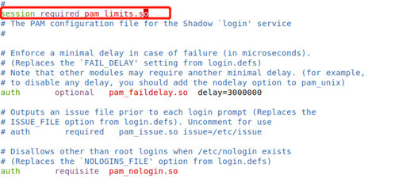

## 企业版单机-通用机部署手册

## 一、 实施过程

### 1\. 前期准备

#### 1.1 安装包检查

检查确认操作系统版本及cpu架构：

（1）Redhat系/银河麒麟v10/UOS20系操作系统举例如下：（国产环境可通过“右键我的电脑—属性”查看）

```
# cat /etc/*release
# lscpu
```

（2）银河麒麟v10操作系统可通过nkvers命令确认是否为银河麒麟v10sp1或v10sp2版本；如无输出结果，则为银河麒麟v10版本。

（3）使用如下命令确认操作系统支持哪种管理器，便于判断使用rpm包还是deb包：

```
# rpm --version
# dpkg --version
```

（4）其他linux系列的操作系统依据实际情况判断即可。

**注意：安装前请确保使用的介质与实际环境一致，不同环境之间安装包不通用；如无版本强制要求，应选择符合合约约定的大版本下最新已发布的小版本+最新补丁集作为部署版本。  
如前期已有适配的版本，建议按适配版本实施。**

安装包名称举例如下：

【瀚高数据库安装包】hgdb6.0.4-cluster-xxx-xxx64-xxxxxxxx.rpm  
或hgdb6.0.4-cluster-xxx-xxx64-xxxxxxxx.deb

#### 1.2 配置主机名

Redhat系/银河麒麟v10/UOS20系操作系统参考如下：  
设置命令：

```
# hostnamectl set-hostname  <主机名>
```

建议为不同的数据库服务器配置唯一的主机名，并在/etc/hosts文件中添加各节点IP及主机名信息。  
命名方式可参考如下：yyxtdb01（应用系统名称+db+序号）。不得超过16个字符；不包含特殊字符，禁止使用下划线。  
针对主机名设置银河麒麟厂家答复如下：

举例如下：

```
# cat /etc/hosts
…
192.168.197.11 xxdb01
192.168.197.12 xxdb02
192.168.197.13 xxdb03
```

#### 1.3 服务器之间网络检查

确保各节点之间网卡支持千兆及以上网络  
Redhat系/银河麒麟v10/UOS20系操作系统参考命令如下：（将如下网卡名称ens33替换为实际名称）

```
[root@xxdb01 ~]# ethtool ens33
Settings for ens33:
        Supported ports: [ TP ]
        Supported link modes:   10baseT/Half 10baseT/Full 
                                100baseT/Half 100baseT/Full 
                                1000baseT/Full 
        Supported pause frame use: No
        Supports auto-negotiation: Yes
        Supported FEC modes: Not reported
        Advertised link modes:  10baseT/Half 10baseT/Full 
                                100baseT/Half 100baseT/Full 
                                1000baseT/Full 
        Advertised pause frame use: No
        Advertised auto-negotiation: Yes
        Advertised FEC modes: Not reported
        Speed: 1000Mb/s
        Duplex: Full
        Port: Twisted Pair
        PHYAD: 0
        Transceiver: internal
        Auto-negotiation: on
        MDI-X: off (auto)
        Supports Wake-on: d
        Wake-on: d
        Current message level: 0x00000007 (7)
                               drv probe link
        Link detected: yes
```

各节点之间测试网络传输速度，注意要测试双向的网络传输速度，命令如下：  
结果小于50mb/s具有一定风险

```
# scp local_file remote_username@remote_ip:remote_folder
```

#### 1.4 数据库服务器文件系统目录要求

建议如下配置，数据库安装目录、数据目录、归档目录、备份目录单独划分，可减少磁盘IO争用、提升性能，亦可防止所有文件放在一起因备份文件较大进而引起空间爆满造成的数据库hang住现象。

| 文件系统名称 | 要求大小 | 用途 |
| --- | --- | --- |
| / | \>50G |  |
| /tmp | \>10G |  |
| /home | \>20G |  |
| swap | \>32G |  |
| /opt | \>100G | 数据库安装目录 |
| /data | 根据应用数据量及增长规划提供。 | 数据存储目录 |
| /hgdbarch | 根据应用业务量评估；建议500G以上 | 归档日志目录 |
| /hgdbbackup | 数据目录的3倍以上 | 数据备份 |
| 如无独立大盘作为数据存储目录，应及时和客户反馈并让其协调存储工程师挂载存储，非必要情况工程师不能擅自挂载存储。 |  |  |

磁盘性能检查：举例如下（测试后将生成的测试文件删除）：

（1）模拟数据库读写小数据来测试硬盘的IO，命令如下：

```
# dd if=/dev/zero of=/opt/test bs=32k count=20k oflag=dsync
20480+0 records in
20480+0 records out
671088640 bytes (671 MB, 640 MiB) copied, 18.2872 s, 36.7 MB/s
```

如结果低于20MB/s，则说明磁盘性能偏差，需建议客户方协调硬件工程师检查；否则将可能会系统整体性能造成较大的影响。

（2）模拟大文件写入来测试硬盘的IO，命令如下：

```
[root@db ~]#  dd if=/dev/zero of=/opt/test bs=8192k count=100 oflag=dsync
100+0 records in
100+0 records out
838860800 bytes (839 MB) copied, 8.88575 s, 315 MB/s
```

如结果低于200MB/s，则说明磁盘性能偏差，需建议客户方协调硬件工程师检查；否则将可能会系统整体性能造成较大的影响。  
注意：务必不要把if和of的值写反，否则有数据清除的风险。

#### 1.5 数据库服务器内存CPU要求

如为测试环境，则无硬性要求。  
如为生产环境，建议内存大于32GB，逻辑CPU个数大于8颗，具体需依据实际业务场景及硬件配置等综合判断。

#### 1.6 操作系统rpm包依赖安装

目前HGDB中所需的操作系统依赖包，均已打包在数据库及集群组件的安装包中，无特殊需求无需单独安装。

#### 1.7 关闭avahi-daemon及NetworkManager服务

操作系统avahi-daemon可能会影响集群正常通信，建议关闭。  
Redhat系/银河麒麟v10/UOS20系操作系统举例如下：

```
# systemctl stop avahi-daemon
# systemctl disable avahi-daemon
# systemctl stop  NetworkManager.service
# systemctl disable NetworkManager.service
# systemctl status  NetworkManager.service
```

#### 1.8 调整limits.conf

每台服务器使用root用户进行操作  
Redhat系/银河麒麟v10/UOS20系操作系统举例如下：  
修改/etc/security/limits.conf 配置文件，增加如下内容：

```
vi /etc/security/limits.conf
#For HGDB
*               soft    stack     unlimited
*               hard    stack     unlimited
*               soft    nproc     unlimited
*               hard    nproc     unlimited
*               soft    nofile    1048576
*               hard    nofile    1048576
*               soft    memlock   unlimited
*               hard    memlock   unlimited
#End for HGDB
```

编辑vi /etc/pam.d/login 文件，添加一行配置：session required pam\_limits.so，如图，保存退出重启服务。（部分操作系统默认含有此行，可不添加）



修改完成后验证：

```
# ulimit -a
SBWHC_PG1:~ # ulimit -a
core file size          (blocks, -c) unlimited
data seg size           (kbytes, -d) unlimited
scheduling priority             (-e) 0
file size               (blocks, -f) unlimited
pending signals                 (-i) 127575
max locked memory       (kbytes, -l) 64
max memory size         (kbytes, -m) unlimited
open files                      (-n) 131072
pipe size            (512 bytes, -p) 8
POSIX message queues     (bytes, -q) 819200
real-time priority              (-r) 0
stack size              (kbytes, -s) 10240
cpu time               (seconds, -t) unlimited
max user processes              (-u) 131072
virtual memory          (kbytes, -v) unlimited
file locks                      (-x) unlimited
```

#### 1.9 防火墙配置

Redhat系/银河麒麟V10操作系统修改方式如下：  
\*关闭防火墙【需经客户同意】

```
# systemctl status firewalld.service
# systemctl stop firewalld.service
# systemctl disable firewalld.service
```

关闭selinux：

```
# sed -i "s/SELINUX=enforcing/SELINUX=disabled/g" /etc/selinux/config
# setenforce 0
# cat /etc/selinux/config | grep SELINUX=disabled
# getenforce
```

如有特殊要求，无法完全关闭防火墙，则开放数据库所需的端口（各节点均开），如下：

```
firewall-cmd --permanent --add-port=5866/tcp
firewall-cmd --add-port=5866/tcp
```

UOS20操作系统使用如下命令禁用防火墙并禁止开机自启：

```
root@highgo:~# systemctl stop ufw.service 
root@highgo:~# systemctl disable ufw.service 
Synchronizing state of ufw.service with SysV service script with /lib/systemd/systemd-sysv-install.
Executing: /lib/systemd/systemd-sysv-install disable ufw
或者
root@highgo:~# ufw disable
Firewall stopped and disabled on system startup
```

#### 1.10 配置环境变量

一般数据库节点除配置数据库的环境变量外，还需配置hac及etcd的相关环境变量，示例如下：(如下参数中的路径依据实际情况修改)

```
[root@xxdb01 ~]# vi /opt/HighGo6.0.4-cluster/etc/highgodb.env
export PGDATA=/data/highgo/data  #修改PGDATA变量
[root@xxdb01 ~]# cat  ~/.bash_profile
# .bash_profile

# Get the aliases and functions
if [ -f ~/.bashrc ]; then
    . ~/.bashrc
fi

# User specific environment and startup programs

PATH=$PATH:$HOME/bin

export PATH
source /opt/HighGo6.0.4-cluster/etc/highgodb.env
#如遇到找不到数据库lib问题，可设置LD_LIBRARY_PATH变量
export LD_LIBRARY_PATH=/opt/HighGo6.0.4-cluster/lib:/usr/lib64:$LD_LIBRARY_PATH
```

#### 1.11 集群服务器之间时间同步要求

根据客户标准设置OS时区，国内通常为东八区”Asia/Shanghai”.  
Redhat系/银河麒麟V10/UOS20操作系统参考如下：  
使用命令”timedatectl”查看和修改OS时区。  
查看OS时区：

```
# timedatectl status
      Local time: Thu 2022-04-28 10:36:41 CST
  Universal time: Thu 2022-04-28 02:36:41 UTC
        RTC time: Thu 2022-04-28 02:36:41
       Time zone: Asia/Shanghai (CST, +0800)
 Network time on: no
NTP synchronized: yes
 RTC in local TZ: no
```

修改OS时区：

```
# timedatectl set-timezone "Asia/Shanghai"
```

修改OS时间:

```
[root@xxdb01 ~]# date -s '20200928 11:07:00'
```

## 2\. 安装过程

### 2.1 安装各软件包

验证安装包MD5值：

```
[root@xxdb01 ~]# md5sum  hgdb6.0.4-cluster-xxx-xxx64-xxxxxxxx.rpm
```

查看生成的MD5值，若与MD5文件中一致，则可继续进行下面的操作，若不一致则建议重新上传并检验。

RPM包安装：

```
[root@xxdb01 highgo]# rpm -ivh  hgdb6.0.4-cluster-xxx-x86-64-xxxxxxxx.rpm
```

可选项：

```
--nodeps 忽略依赖包进行安装
--force    强制安装
```

DEB包安装：

```
# dpkg -i XXXX.deb
```

查看安装后的状态：

```
#dpkg -l | grep hgdb
```

**注意：如安装包选择错误或因其他原因需卸载重装，命令参考如下：**  
RPM包卸载

```
# rpm -e XXX.rpm
```

**注意：卸载之前需确认数据库进程是否关闭**

DEB包卸载

```
# dpkg  -r xxx.deb
```

**注意：卸载之前需确认数据库进程是否关闭**

### 2.2 配置数据库

#### 2.2.1 初始化数据库

```
[highgo@xxdb01 etcd]# initdb  -D /data/highgo/data
属于此数据库系统的文件宿主为用户 "highgo".
此用户也必须为服务器进程的宿主.
数据库簇将使用本地化语言 "zh_CN.UTF-8"进行初始化.
默认的数据库编码已经相应的设置为 "UTF8".
initdb: could not find suitable text search configuration for locale "zh_CN.UTF-8"
缺省的文本搜索配置将会被设置到"simple"

禁止为数据页生成校验和.
Data encryption is disabled.

输入新的超级用户口令:
再输入一遍:

创建目录 /data/highgo/data ... 成功
正在创建子目录 ... 成功
选择动态共享内存实现 ......posix
选择默认最大联接数 (max_connections) ... 100
选择默认共享缓冲区大小 (shared_buffers) ... 128MB
selecting default time zone ... PRC
创建配置文件 ... 成功
正在运行自举脚本 ...成功
正在执行自举后初始化 ...成功
同步数据到磁盘...成功

initdb: 警告: enabling "md5" authentication for local connections
你可以通过编辑 pg_hba.conf 更改或你下次
执行 initdb 时使用 -A或者--auth-local和--auth-host选项.

成功。您现在可以用下面的命令开启数据库服务器：

pg_ctl -D /data/highgo/data -l 日志文件 start
```

#### 2.2.2 数据库参数配置

以下参数配置请根据实际情况自行调整。

```
vi  $PGDATA/postgresql.auto.conf 
listen_addresses = '*'
max_connections = '800'   --最大连接数，请根据实际情况配置，不可设置过高。
shared_buffers = '16GB'
checkpoint_completion_target = '0.8'
log_destination = 'csvlog'
logging_collector = 'on'
log_directory = '/data/highgo/hgdb_log'
log_filename = 'highgodb_%d.log'
log_rotation_age = '1d'
log_rotation_size = '0'
log_truncate_on_rotation = 'on'
log_statement = 'mod'   --日志等级，mod可记录dml语句，但占用空间较大。
log_connections = 'on'
log_disconnections = 'on'
checkpoint_timeout = '45min'
temp_buffers = '16MB'
work_mem = '8MB'  --数据库会话计算进程内存值，不可设置过高，防止OOM。
maintenance_work_mem = '2GB'
min_wal_size = '512MB'
max_wal_size = '4096MB'
effective_cache_size = '10GB'
archive_mode = 'on'
archive_timeout = '45min'
archive_command = ' cp %p /hgbakdata/hgbak/archive/%f'
log_line_prefix = '%m [%p] %a %u %d %r %h'
compatible_db = 'oracle' --开启oracle兼容
hot_standby = ‘on’
max_wal_senders=10
wal_level= ‘replica’ --WAL日志等级，也可设置为logical
max_replication_slots = ‘10’
wal_keep_segments = ‘50’

vi $PGDATA/pg_hba.conf
添加以下内容：
host all all  0.0.0.0/0  md5
host  replication  all  0.0.0.0/0  md5

上述参数修改完成后重启数据库使其生效
pg_ctl restart 

创建复制槽
select * from pg_create_physical_replication_slot('standby-1');
```

#### 2.2.3 添加软连接

```
ln -s /data/highgo/data   /opt/HighGo6.0.4-cluster/data
```

#### 2.2.4 开机自启

**注：因打包问题可能部分包自启服务名称为hgdb-cluster-6.x.x，请根据现场实际情况进行替换。**

```
systemctl  enable  hgdb-enterprise-6.0.4 
mv /opt/HighGo6.0.4-cluster/etc/hgdb-enterprise-6.0.4 /opt/HighGo6.0.4-cluster/etc/hgdb-enterprise-6.0.4-bak
ln -s /opt/HighGo6.0.4-cluster/etc/hgdb-enterprise-6.0.4.single /opt/HighGo6.0.4-cluster/etc/hgdb-enterprise-6.0.4
```

## 3\. 安装postgis

此项在与地理信息相关的业务系统中使用的可能性较大，若无此类需求可不安装此组件。

### 3.1 安装postgis包

```
[root@xxdb01 ~]#  rpm -ivh postgis3.0-6.0.4-cluster-centos7-x86-64-20220127.rpm
```

### 3.2 创建postgis扩展

```
[highgo@node1 ~]$ psql -U highgo -d highgo
psql (HighGo Database 6 Release 6.0.4-64-bit Production)

PSQL: Release HighGo Database 6 Release 6.0.4-64-bit Production
Type "help" for help.

highgo=# create extension postgis;
ERROR:  could not load library "/opt/HighGo6.0.4-cluster/lib/postgresql/postgis-3.so": libgeos_c.so.1: cannot open shared object file: No such file or directory
highgo=# \q
[highgo@node1 ~]$ export LD_LIBRARY_PATH=/opt/HighGo6.0.4-cluster/lib
[highgo@node1 ~]$ pg_ctl restart
[highgo@node1 ~]$ psql -U highgo -d highgo
psql (HighGo Database 6 Release 6.0.4-64-bit Production)

PSQL: Release HighGo Database 6 Release 6.0.4-64-bit Production
Type "help" for help.

highgo=# create extension postgis;
CREATE EXTENSION
highgo=# \dx
                                                         List of installed extensions
     Name      | Version  |       Schema       |                                          Description                                          
---------------+----------+--------------------+-----------------------------------------------------------------------------------------------
 mysqlface     | 1.0      | public             | administrative functions for PostgreSQL
 orafce        | 3.9      | public             | Functions and operators that emulate a subset of functions and packages from the Oracle RDBMS
 passwordcheck | 1.0      | information_schema | passwordcheck
 plpgsql       | 1.0      | pg_catalog         | PL/pgSQL procedural language
 postgis       | 3.1.0dev | public             | PostGIS geometry and geography spatial types and functions
(5 rows)
```

## 4\. 测试开发管理工具

如现场环境有开发管理工具则需打开新建连接进行测试确保工具正常使用

示例如下：

### 4.1 新建连接

![Image[2].png](https://highgo.com/document/images/way/assets1.3/Image2.png)

![Image[3].png](https://highgo.com/document/images/way/assets1.3/Image3.png)

### 4.2 执行测试sql

![Image[4].png](https://highgo.com/document/images/way/assets1.3/Image4.png)

![Image[5].png](https://highgo.com/document/images/way/assets1.3/Image5.png)

## 5\. license激活

注意：  
1\. 激活license之前一定要确认本次实施要求是测试license还是永久license

### 5.1 数据库启动时会显示剩余时间

```
日志:  00000:  This is a trial edition, validate until 2023-09-28 16:09:09, database will not be able to start up after that time,please apply an official license by that time.
```

### 5.2 上传license并复制到data目录修改名称为hgdb.lic

```
[highgo@xxdb01 uplaod]# cp hgdb.lic /opt/HighGo6.0.4-cluster/data/hgdb.lic
```

### 5.3 激活

```
[highgo@xxdb01 data]$ pg_ctl reload
server signaled
日志:  00000: 接收到 SIGHUP, 重载配置文件
日志:  00000: 注意 :检测到授权文件已更改，该license为试用版授权，有效期截止到2023-09-28 16:09:09
```

### 5.4 检查license，确认激活成功

```
[highgo@xxdb01 data]$ check_lic -D $PGDATA
############## HIGHGODB LICENSE ###################
License status:Normal
License validity:2023-09-28
Database Version:Highgo Database6.0.4 Trail Edition
###################################################
```

## 6\. 备库执行数据库克隆

### 6.1 pg\_basebackup拷贝data

```
pg_basebackup -h  主库ip  -U highgo -D /data/highgo/data -Fp -Xs -R -P -v
```

### 6.2 修改参数

```
vi  $PGDATA/postgresql.auto.conf
primary_slot_name ='standby-1'
```

###6.3 启动备库

```
pg_ctl start
```

### 6.4 查看流复制状态

```
select * from pg_stat_replication;
```

### 6.5 添加软连接

```
ln -s /data/highgo/data   /opt/HighGo6.0.4-cluster/data
```

### 6.6 开机自启

**注：因打包问题可能部分包自启服务名称为hgdb-cluster-6.x.x，请根据现场实际情况进行替换。**

```
systemctl  enable  hgdb-enterprise-6.0.4 
mv /opt/HighGo6.0.4-cluster/etc/hgdb-enterprise-6.0.4 /opt/HighGo6.0.4-cluster/etc/hgdb-enterprise-6.0.4-bak
ln -s /opt/HighGo6.0.4-cluster/etc/hgdb-enterprise-6.0.4.single /opt/HighGo6.0.4-cluster/etc/hgdb-enterprise-6.0.4
```

## 7\. 数据库自动备份部署（所有节点均需配置）

备份方式请参考最新版的“瀚高数据库备份手册”。