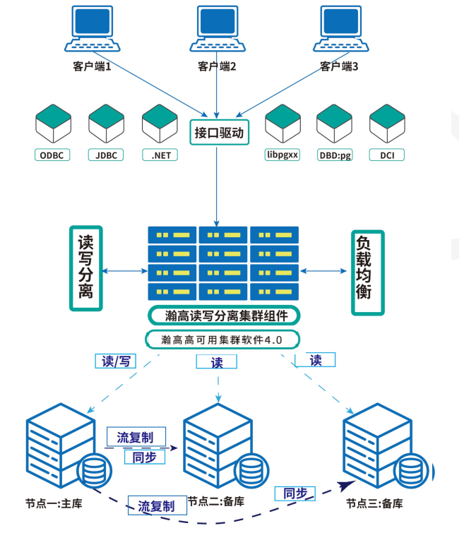
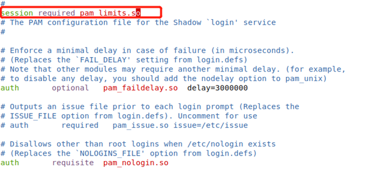
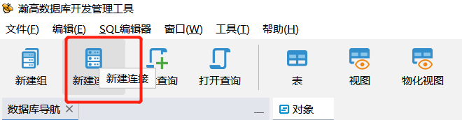
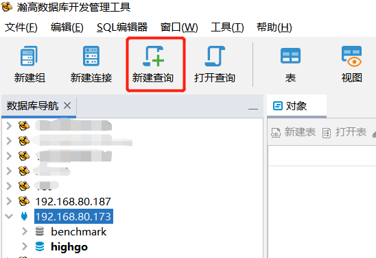

## 瀚高数据库安全版集群(hghac2.0版本+hgproxy)-通用机部署手册

## 一、 集群架构



### 1\. 集群各组件及其功能

zookeeper/etcd:分布式键值存储系统，具有提供分布式独享锁和选举的功能。zookeeper支持选举的功能为Java版，etcd基于Go语言实现。

hghac：数据库集群管理软件。可通过参数文件来配置自动初始化数据库、搭建流复制、指定zookeeper/etcd节点等。通过api接口连接到分布式存储系统中（zookeeper/etcd），向其插入键值记录、主备信息、连接信息等；通过zookeeper/etcd对其他节点进行心跳检测；在数据库主备切换或恢复时读取zookeeper/etcd中存储的主备信息来判断各节点状态。

hgproxy：瀚高数据库中间件。中间件处于服务器和客户端的中间层，可以通过客户端连接proxy访问HighGoDB。客户单连接proxy就如同直接连接数据库服务器一样，而proxy连接后端服务器就如同客户端连接服务器一样。Proxy现在提供的主要功能包括客户端连接负载的均衡、SQL语句的读写分离。

### 2\. 各组件常用端口

| 组件名称 | hgproxy | zookeeper | etcd | hghac | HGDB |
| --- | --- | --- | --- | --- | --- |
| 常用（默认）端口 | 5888 | 2181、2888、3888 | 2379、2380 | 8008 | 5866 |

## 二、 实施过程

### 1\. 节点分配

| IP（举例） | 192.168.197.11 | 192.168.197.12 | 192.168.197.13 |
| --- | --- | --- | --- |
| 角色 | 数据库主库、proxy节点 | 数据库备库、proxy节点 | 数据库备库、proxy节点 |
| 使用的组件 | etcd、hgdb、hghac、hgproxy | etcd、hgdb、hghac、hgproxy | etcd、hgdb、hghac、hgproxy |

### 2\. 前期准备

此项中内容如无特别说明，需在所有节点配置/执行。

#### 2.1 安装包检查

检查确认操作系统版本及cpu架构：

（1）Redhat系/银河麒麟v10/UOS20系操作系统举例如下：（国产环境可通过“右键我的电脑—属性”查看）

```
# cat /etc/*release
# lscpu
```

（2）银河麒麟v10操作系统可通过nkvers命令确认是否为银河麒麟v10sp1或v10sp2版本；如无输出结果，则为银河麒麟v10版本。

（3）使用如下命令确认操作系统支持哪种管理器，便于判断使用rpm包还是deb包：

```
# rpm --version
# dpkg --version
```

（4）其他linux系列的操作系统依据实际情况判断即可。

**注意：安装前请确保使用的介质与实际环境一致，不同环境之间安装包不通用；如无版本强制要求，应选择符合合约约定的大版本下最新已发布的小版本+最新补丁集作为部署版本。  
如前期已有适配的版本，建议按适配版本实施。**

通用机环境下hgdb/hghac/hgproxy均为独立的安装包.

安装包名称举例如下：

【瀚高数据库安装包】hgdb6.0.4-enterprise-xxx-xxx64-xxxxxxxx.rpm  
或hgdb6.0.4-enterprise-xxx-xxx64-xxxxxxxx.deb

【HGHAC安装包】hghac-2.1.4.1.ky10.aarch64-20230117.rpm

【HGPROXY安装包】hgproxy-4.0.13-0db7e9b.xxx64.rpm

#### 2.2 配置主机名

Redhat系/银河麒麟v10/UOS20系操作系统参考如下：

设置命令：

```
# hostnamectl set-hostname  <主机名>
```

建议为不同的数据库服务器配置唯一的主机名，并在/etc/hosts文件中添加各节点IP及主机名信息。

命名方式可参考如下：yyxtdb01（应用系统名称+db+序号）。不得超过16个字符；不包含特殊字符，禁止使用下划线。

举例如下：

```
# cat /etc/hosts
…
192.168.197.11 xxdb01
192.168.197.12 xxdb02
192.168.197.13 xxdb03
```

#### 2.3 服务器之间网络检查

确保各节点之间网卡支持千兆及以上网络

Redhat系/银河麒麟v10/UOS20系操作系统参考命令如下：（将如下网卡名称ens33替换为实际名称）

```
[root@xxdb01 ~]# ethtool ens33
Settings for ens33:
        Supported ports: [ TP ]
        Supported link modes:   10baseT/Half 10baseT/Full 
                                100baseT/Half 100baseT/Full 
                                1000baseT/Full 
        Supported pause frame use: No
        Supports auto-negotiation: Yes
        Supported FEC modes: Not reported
        Advertised link modes:  10baseT/Half 10baseT/Full 
                                100baseT/Half 100baseT/Full 
                                1000baseT/Full 
        Advertised pause frame use: No
        Advertised auto-negotiation: Yes
        Advertised FEC modes: Not reported
        Speed: 1000Mb/s
        Duplex: Full
        Port: Twisted Pair
        PHYAD: 0
        Transceiver: internal
        Auto-negotiation: on
        MDI-X: off (auto)
        Supports Wake-on: d
        Wake-on: d
        Current message level: 0x00000007 (7)
                               drv probe link
        Link detected: yes
```

各节点之间测试网络传输速度，注意要测试双向的网络传输速度，命令如下：  
结果小于50mb/s具有一定风险

```
# scp local_file remote_username@remote_ip:remote_folder
```

#### 2.4 数据库服务器文件系统目录要求

建议如下配置，数据库安装目录、数据目录、归档目录、备份目录单独划分，可减少磁盘IO争用、提升性能，亦可防止所有文件放在一起因备份文件较大进而引起空间爆满造成的数据库hang住现象。

| 文件系统名称 | 要求大小 | 用途 |
| --- | --- | --- |
| / | \>50G |  |
| /tmp | \>10G |  |
| /home | \>20G |  |
| swap | \>32G |  |
| /opt | \>100G | 数据库安装目录 |
| /hgdbdata | 根据应用数据量及增长规划提供。 | 数据存储目录 |
| /hgdbarch | 根据应用业务量评估；建议500G以上 | 归档日志目录 |
| /hgdbbackup | 数据目录的3倍以上 | 数据备份 |

如无独立大盘作为数据存储目录，应及时和客户反馈并让其协调存储工程师挂载存储，非必要情况工程师不能擅自挂载存储。

磁盘性能检查：

举例如下（测试后将生成的测试文件删除）：

（1）模拟数据库读写小数据来测试硬盘的IO，命令如下：

```
# dd if=/dev/zero of=/opt/test bs=32k count=20k oflag=dsync
20480+0 records in
20480+0 records out
671088640 bytes (671 MB, 640 MiB) copied, 18.2872 s, 36.7 MB/s
```

如结果低于20MB/s，则说明磁盘性能偏差，需建议客户方协调硬件工程师检查；否则将可能会系统整体性能造成较大的影响。

（2）模拟大文件写入来测试硬盘的IO，命令如下：

```
[root@db ~]#  dd if=/dev/zero of=/opt/test bs=8192k count=100 oflag=dsync
100+0 records in
100+0 records out
838860800 bytes (839 MB) copied, 8.88575 s, 315 MB/s
```

如结果低于200MB/s，则说明磁盘性能偏差，需建议客户方协调硬件工程师检查；否则将可能会系统整体性能造成较大的影响。

**注意：务必不要把if和of的值写反，否则有数据清除的风险。**

#### 2.5 数据库服务器内存CPU要求

如为测试环境，则无硬性要求。

如为生产环境，建议内存大于32GB，逻辑CPU个数大于8颗，具体需依据实际业务场景及硬件配置等综合判断。

#### 2.6 操作系统rpm包依赖安装

目前HGDB中所需的操作系统依赖包，均已打包在数据库及集群组件的安装包中，无特殊需求无需单独安装。

#### 2.7 关闭avahi-daemon及NetworkManager服务

操作系统avahi-daemon可能会影响集群正常通信，建议关闭。

Redhat系/银河麒麟v10/UOS20系操作系统举例如下：

```
# systemctl stop avahi-daemon
# systemctl disable avahi-daemon
# systemctl stop  NetworkManager.service
# systemctl disable NetworkManager.service
# systemctl status  NetworkManager.service
```

#### 2.8 调整limits.conf

每台服务器使用root用户进行操作

Redhat系/银河麒麟v10/UOS20系操作系统举例如下：

修改/etc/security/limits.conf 配置文件，增加如下内容：

```
vi /etc/security/limits.conf
#For HGDB
*               soft    stack     unlimited
*               hard    stack     unlimited
*               soft    nproc     unlimited
*               hard    nproc     unlimited
*               soft    nofile    1048576
*               hard    nofile    1048576
*               soft    memlock   unlimited
*               hard    memlock   unlimited
#End for HGDB
```

编辑vi /etc/pam.d/login 文件，添加一行配置：session required pam\_limits.so，如图，保存退出重启服务。（部分操作系统默认含有此行，可不添加）



修改完成后验证：

```
# ulimit -a
SBWHC_PG1:~ # ulimit -a
core file size          (blocks, -c) unlimited
data seg size           (kbytes, -d) unlimited
scheduling priority             (-e) 0
file size               (blocks, -f) unlimited
pending signals                 (-i) 127575
max locked memory       (kbytes, -l) 64
max memory size         (kbytes, -m) unlimited
open files                      (-n) 131072
pipe size            (512 bytes, -p) 8
POSIX message queues     (bytes, -q) 819200
real-time priority              (-r) 0
stack size              (kbytes, -s) 10240
cpu time               (seconds, -t) unlimited
max user processes              (-u) 131072
virtual memory          (kbytes, -v) unlimited
file locks                      (-x) unlimited
```

#### 2.9 防火墙配置

Redhat系/银河麒麟V10操作系统修改方式如下：

```
*关闭防火墙【需经客户同意】
# systemctl status firewalld.service
# systemctl stop firewalld.service
# systemctl disable firewalld.service
```

关闭selinux：

```
# sed -i "s/SELINUX=enforcing/SELINUX=disabled/g" /etc/selinux/config
# setenforce 0
# cat /etc/selinux/config | grep SELINUX=disabled
# getenforce
```

如有特殊要求，无法完全关闭防火墙，则开放HAC集群所需的端口（各节点均开），如下：  
开放etcd端口：

```
firewall-cmd --permanent --add-port=2379/tcp
firewall-cmd --add-port=2379/tcp
firewall-cmd --permanent --add-port=2380/tcp
firewall-cmd --add-port=2380/tcp
```

开放数据库端口：

```
firewall-cmd --permanent --add-port=5866/tcp
firewall-cmd --add-port=5866/tcp
```

开放hghac端口：

```
firewall-cmd --permanent --add-port=8008/tcp
firewall-cmd --add-port=8008/tcp
```

开放hgproxy端口：

```
firewall-cmd --permanent --add-port=5888/tcp
firewall-cmd --add-port=5888/tcp
```

UOS20操作系统使用如下命令禁用防火墙并禁止开机自启：

```
root@highgo:~# systemctl stop ufw.service 
root@highgo:~# systemctl disable ufw.service 
Synchronizing state of ufw.service with SysV service script with /lib/systemd/systemd-sysv-install.
Executing: /lib/systemd/systemd-sysv-install disable ufw
或者
root@highgo:~# ufw disable
Firewall stopped and disabled on system startup
```

#### 2.10 配置环境变量

一般数据库节点除配置数据库的环境变量外，还需配置hac及etcd的相关环境变量，示例如下：(如下参数中的路径依据实际情况修改)

```
[root@xxdb01 ~]# vi /opt/HighGo4.5.7-see/etc/highgodb.env
export PGDATA=/data/highgo/data  #修改PGDATA变量
[root@xxdb01 ~]# cat  ~/.bash_profile
# .bash_profile

# Get the aliases and functions
if [ -f ~/.bashrc ]; then
    . ~/.bashrc
fi

# User specific environment and startup programs

PATH=$PATH:$HOME/bin

export PATH
source /opt/HighGo4.5.7-see/etc/highgodb.env
export PATH=$PATH:/usr/local/hghac/etcd:/usr/local/hghac/    
export PATRONICTL_CONFIG_FILE=/usr/local/hghac/hac/hghac.yml
export ETCDCTL_ENDPOINTS=http://192.168.197.11:2379,http:// 192.168.197.12:2379,http: //192.168.197.13:2379
#如遇到找不到数据库lib问题，可设置LD_LIBRARY_PATH变量
export LD_LIBRARY_PATH=/opt/HighGo4.5.7-see/lib:/usr/lib64:$LD_LIBRARY_PATH
```

#### 2.11 集群服务器之间时间同步要求

根据客户标准设置OS时区，国内通常为东八区”Asia/Shanghai”.

Redhat系/银河麒麟V10/UOS20操作系统参考如下：

使用命令”timedatectl”查看和修改OS时区。

查看OS时区：

```
# timedatectl status
      Local time: Thu 2022-04-28 10:36:41 CST
  Universal time: Thu 2022-04-28 02:36:41 UTC
        RTC time: Thu 2022-04-28 02:36:41
       Time zone: Asia/Shanghai (CST, +0800)
 Network time on: no
NTP synchronized: yes
 RTC in local TZ: no
```

修改OS时区：

```
# timedatectl set-timezone "Asia/Shanghai"
```

修改OS时间:

```
[root@xxdb01 ~]# date -s '20200928 11:07:00'
```

风险说明：如若集群节点间时间差别较大，则可能导致集群状态异常或集群无法启动。建议集群个节点之间配置时钟同步，配置专用时间服务器；如无单独的时间服务器，可在集群各节点间配置NTP时间同步，并确保时间同步服务能够开机自启。

该项需操作系统厂家工程师完成。

### 3\. 安装过程

整个的安装过程可分为以下步骤：

1. 安装软件包，根据实际情况在每个节点上安装对应安装包
2. 配置etcd或zookeeper，组建Etcd或zookeeper集群
3. 主库初始化数据库
4. 配置主库hghac并启动
5. 待主库hghac状态正常后配置备库hghac并启动
6. 待hghac集群状态正常后配置hgproxy并启动
7. 验证hgproxy正常后根据实际情况各节点启动对应组建自启服务

#### 3.1 安装各软件包

（本步骤各节点均需操作）

验证安装包MD5值：

```
[root@xxdb01 ~]# md5sum  hgdb6.0.4-enterprise-xxx-xxx64-xxxxxxxx.rpm
```

查看生成的MD5值，若与MD5文件中一致，则可继续进行下面的操作，若不一致则建议重新上传并检验。

RPM包安装：

```
[root@xxdb01 highgo]# rpm -ivh hgdb6.0.4-enterprise-xxx-xxx64-xxxxxxxx.rpm
[root@xxdb01 highgo]# rpm -ivh hghac-2.1.4.1.ky10.aarch64-20230117.rpm
[root@xxdb01 highgo]# rpm -ivh hgproxy-4.0.13-0db7e9b.xxx64.rpm
```

可选项：

```
--nodeps 忽略依赖包进行安装
--force    强制安装
```

DEB包安装：

```
# dpkg -i XXXX.deb
```

查看安装后的状态：

```
#dpkg -l | grep hgdb
```

注意：如安装包选择错误或因其他原因需卸载重装，命令参考如下：  
RPM包卸载

```
# rpm -e XXX.rpm
```

注意：卸载之前需确认数据库进程是否关闭

DEB包卸载

```
# dpkg  -r xxx.deb
```

注意：卸载之前需确认数据库进程是否关闭

#### 3.2 配置并启动ETCD

Tips:需将etcd各节点一块启动，验证状态正常后再配置hgahc

##### 3.2.1 修改etcd.yml文件

需修改/usr/local/hghac/etcd/etcd.yml里的内容，修改内容如下：

```
# This is the configuration file for the etcd server.

# Human-readable name for this member.
name: 'etcd_01'                             ##etcd实例名称,最好用主机名或IP进行区分

# Path to the data directory.
data-dir: /usr/local/hghac/etcd/etcd01     ##etcd数据保存目录；data目录绝对地址

# Path to the dedicated wal directory.
wal-dir:

# Number of committed transactions to trigger a snapshot to disk.
snapshot-count: 10000

# Time (in milliseconds) of a heartbeat interval.
heartbeat-interval: 100                    ##检测间隔的时间（毫秒）

# Time (in milliseconds) for an election to timeout.
election-timeout: 1000                       ##超时时间（毫秒）

# Raise alarms when backend size exceeds the given quota. 0 means use the
# default quota.
quota-backend-bytes: 0

# List of comma separated URLs to listen on for peer traffic.
listen-peer-urls: http://192.168.197.11:2380    ##本member侧使用，用于监听其他member发送信息的地址

# List of comma separated URLs to listen on for client traffic.
listen-client-urls: http://192.168.197.11:2379,http://127.0.0.1:2379   ##本member侧使用，用于监听etcd客户端发送信息的地址，填写127.0.0.1方便使用etcdctl工具

# Maximum number of snapshot files to retain (0 is unlimited).
max-snapshots: 5

# Maximum number of wal files to retain (0 is unlimited).
max-wals: 5

# Comma-separated white list of origins for CORS (cross-origin resource sharing).
cors:

# List of this member's peer URLs to advertise to the rest of the cluster.
# The URLs needed to be a comma-separated list.
initial-advertise-peer-urls: http://192.168.197.11:2380   ##其他member使用，其他member通过该地址与本member交互信息。该参数的value一定要同时在–initial-cluster参数中存在

# List of this member's client URLs to advertise to the public.
# The URLs needed to be a comma-separated list.
advertise-client-urls: http://192.168.197.11:2379   ##etcd客户端使用，客户端通过该地址与本member交互信息

# Discovery URL used to bootstrap the cluster.
discovery:

# Valid values include 'exit', 'proxy'
discovery-fallback: 'proxy'

# HTTP proxy to use for traffic to discovery service.
discovery-proxy:

# DNS domain used to bootstrap initial cluster.
discovery-srv:

# Initial cluster configuration for bootstrapping.
initial-cluster: etcd_01=http://192.168.197.11:2380,etcd_02=http://192.168.197.12:2380,etcd_03=http://192.168.197.13:2380
 ## 初始集群成员列表 
# Initial cluster token for the etcd cluster during bootstrap.
initial-cluster-token: 'etcd-cluster'

# Initial cluster state ('new' or 'existing').
initial-cluster-state: 'new'     ##指示本次是否为新建集群

# Reject reconfiguration requests that would cause quorum loss.
strict-reconfig-check: false

# Accept etcd V2 client requests
enable-v2: true             ##接受etcd V2客户端请求

# Enable runtime profiling data via HTTP server
enable-pprof: true

# Valid values include 'on', 'readonly', 'off'
proxy: 'off'

# Time (in milliseconds) an endpoint will be held in a failed state.
proxy-failure-wait: 5000

# Time (in milliseconds) of the endpoints refresh interval.
proxy-refresh-interval: 30000

# Time (in milliseconds) for a dial to timeout.
proxy-dial-timeout: 1000

# Time (in milliseconds) for a write to timeout.
proxy-write-timeout: 5000

# Time (in milliseconds) for a read to timeout.
proxy-read-timeout: 0

client-transport-security:
  # DEPRECATED: Path to the client server TLS CA file.
  ca-file:

  # Path to the client server TLS cert file.
  cert-file:

  # Path to the client server TLS key file.
  key-file:

  # Enable client cert authentication.
  client-cert-auth: false

  # Path to the client server TLS trusted CA cert file.
  trusted-ca-file:

  # Client TLS using generated certificates
  auto-tls: false

peer-transport-security:
  # DEPRECATED: Path to the peer server TLS CA file.
  ca-file:

  # Path to the peer server TLS cert file.
  cert-file:

  # Path to the peer server TLS key file.
  key-file:

  # Enable peer client cert authentication.
  peer-client-cert-auth: false

  # Path to the peer server TLS trusted CA cert file.
  trusted-ca-file:

  # Peer TLS using generated certificates.
  auto-tls: false

# Enable debug-level logging for etcd.
debug: false

# Specify a particular log level for each etcd package (eg: 'etcdmain=CRITICAL,etcdserver=DEBUG'.
log-package-levels:

# Specify 'stdout' or 'stderr' to skip journald logging even when running under systemd.
log-output: default

# Force to create a new one member cluster.
force-new-cluster: false
```

  
各节点配置信息如下

192.168.197.11：

```
# This is the configuration file for the etcd server.

# Human-readable name for this member.
name: 'etcd_01'                             ##etcd实例名称,最好用主机名或IP进行区分

# Path to the data directory.
data-dir: /usr/local/hghac/etcd/etcd01     ##etcd数据保存目录；data目录绝对地址

# Path to the dedicated wal directory.
wal-dir:

# Number of committed transactions to trigger a snapshot to disk.
snapshot-count: 10000

# Time (in milliseconds) of a heartbeat interval.
heartbeat-interval: 100                    ##检测间隔的时间（毫秒）

# Time (in milliseconds) for an election to timeout.
election-timeout: 1000                       ##超时时间（毫秒）

# Raise alarms when backend size exceeds the given quota. 0 means use the
# default quota.
quota-backend-bytes: 0

# List of comma separated URLs to listen on for peer traffic.
listen-peer-urls: http://192.168.197.11:2380    ##本member侧使用，用于监听其他member发送信息的地址

# List of comma separated URLs to listen on for client traffic.
listen-client-urls: http://192.168.197.11:2379,http://127.0.0.1:2379   ##本member侧使用，用于监听etcd客户端发送信息的地址，填写127.0.0.1方便使用etcdctl工具

# Maximum number of snapshot files to retain (0 is unlimited).
max-snapshots: 5

# Maximum number of wal files to retain (0 is unlimited).
max-wals: 5

# Comma-separated white list of origins for CORS (cross-origin resource sharing).
cors:

# List of this member's peer URLs to advertise to the rest of the cluster.
# The URLs needed to be a comma-separated list.
initial-advertise-peer-urls: http://192.168.197.11:2380   ##其他member使用，其他member通过该地址与本member交互信息。该参数的value一定要同时在–initial-cluster参数中存在

# List of this member's client URLs to advertise to the public.
# The URLs needed to be a comma-separated list.
advertise-client-urls: http://192.168.197.11:2379   ##etcd客户端使用，客户端通过该地址与本member交互信息

# Discovery URL used to bootstrap the cluster.
discovery:

# Valid values include 'exit', 'proxy'
discovery-fallback: 'proxy'

# HTTP proxy to use for traffic to discovery service.
discovery-proxy:

# DNS domain used to bootstrap initial cluster.
discovery-srv:

# Initial cluster configuration for bootstrapping.
initial-cluster: etcd_01=http://192.168.197.11:2380,etcd_02=http://192.168.197.12:2380,etcd_03=http://192.168.197.13:2380
 ## 初始集群成员列表 
# Initial cluster token for the etcd cluster during bootstrap.
initial-cluster-token: 'etcd-cluster'

# Initial cluster state ('new' or 'existing').
initial-cluster-state: 'new'     ##指示本次是否为新建集群

# Reject reconfiguration requests that would cause quorum loss.
strict-reconfig-check: false

# Accept etcd V2 client requests
enable-v2: true             ##接受etcd V2客户端请求

# Enable runtime profiling data via HTTP server
enable-pprof: true

# Valid values include 'on', 'readonly', 'off'
proxy: 'off'

# Time (in milliseconds) an endpoint will be held in a failed state.
proxy-failure-wait: 5000

# Time (in milliseconds) of the endpoints refresh interval.
proxy-refresh-interval: 30000

# Time (in milliseconds) for a dial to timeout.
proxy-dial-timeout: 1000

# Time (in milliseconds) for a write to timeout.
proxy-write-timeout: 5000

# Time (in milliseconds) for a read to timeout.
proxy-read-timeout: 0

client-transport-security:
  # DEPRECATED: Path to the client server TLS CA file.
  ca-file:

  # Path to the client server TLS cert file.
  cert-file:

  # Path to the client server TLS key file.
  key-file:

  # Enable client cert authentication.
  client-cert-auth: false

  # Path to the client server TLS trusted CA cert file.
  trusted-ca-file:

  # Client TLS using generated certificates
  auto-tls: false

peer-transport-security:
  # DEPRECATED: Path to the peer server TLS CA file.
  ca-file:

  # Path to the peer server TLS cert file.
  cert-file:

  # Path to the peer server TLS key file.
  key-file:

  # Enable peer client cert authentication.
  peer-client-cert-auth: false

  # Path to the peer server TLS trusted CA cert file.
  trusted-ca-file:

  # Peer TLS using generated certificates.
  auto-tls: false

# Enable debug-level logging for etcd.
debug: false

# Specify a particular log level for each etcd package (eg: 'etcdmain=CRITICAL,etcdserver=DEBUG'.
log-package-levels:

# Specify 'stdout' or 'stderr' to skip journald logging even when running under systemd.
log-output: default

# Force to create a new one member cluster.
force-new-cluster: false
```

192.168.197.12：

```
# This is the configuration file for the etcd server.

# Human-readable name for this member.
name: 'etcd_02'                             ##etcd实例名称,最好用主机名或IP进行区分

# Path to the data directory.
data-dir: /usr/local/hghac/etcd/etcd02     ##etcd数据保存目录；data目录绝对地址

# Path to the dedicated wal directory.
wal-dir:

# Number of committed transactions to trigger a snapshot to disk.
snapshot-count: 10000

# Time (in milliseconds) of a heartbeat interval.
heartbeat-interval: 100                    ##检测间隔的时间（毫秒）

# Time (in milliseconds) for an election to timeout.
election-timeout: 1000                       ##超时时间（毫秒）

# Raise alarms when backend size exceeds the given quota. 0 means use the
# default quota.
quota-backend-bytes: 0

# List of comma separated URLs to listen on for peer traffic.
listen-peer-urls: http://192.168.197.12:2380    ##本member侧使用，用于监听其他member发送信息的地址

# List of comma separated URLs to listen on for client traffic.
listen-client-urls: http://192.168.197.12:2379,http://127.0.0.1:2379   ##本member侧使用，用于监听etcd客户端发送信息的地址，填写127.0.0.1方便使用etcdctl工具

# Maximum number of snapshot files to retain (0 is unlimited).
max-snapshots: 5

# Maximum number of wal files to retain (0 is unlimited).
max-wals: 5

# Comma-separated white list of origins for CORS (cross-origin resource sharing).
cors:

# List of this member's peer URLs to advertise to the rest of the cluster.
# The URLs needed to be a comma-separated list.
initial-advertise-peer-urls: http://192.168.197.12:2380   ##其他member使用，其他member通过该地址与本member交互信息。该参数的value一定要同时在–initial-cluster参数中存在

# List of this member's client URLs to advertise to the public.
# The URLs needed to be a comma-separated list.
advertise-client-urls: http://192.168.197.12:2379   ##etcd客户端使用，客户端通过该地址与本member交互信息

# Discovery URL used to bootstrap the cluster.
discovery:

# Valid values include 'exit', 'proxy'
discovery-fallback: 'proxy'

# HTTP proxy to use for traffic to discovery service.
discovery-proxy:

# DNS domain used to bootstrap initial cluster.
discovery-srv:

# Initial cluster configuration for bootstrapping.
initial-cluster: etcd_01=http://192.168.197.11:2380,etcd_02=http://192.168.197.12:2380,etcd_03=http://192.168.197.13:2380
 ## 初始集群成员列表 
# Initial cluster token for the etcd cluster during bootstrap.
initial-cluster-token: 'etcd-cluster'

# Initial cluster state ('new' or 'existing').
initial-cluster-state: 'new'     ##指示本次是否为新建集群

# Reject reconfiguration requests that would cause quorum loss.
strict-reconfig-check: false

# Accept etcd V2 client requests
enable-v2: true             ##接受etcd V2客户端请求

# Enable runtime profiling data via HTTP server
enable-pprof: true

# Valid values include 'on', 'readonly', 'off'
proxy: 'off'

# Time (in milliseconds) an endpoint will be held in a failed state.
proxy-failure-wait: 5000

# Time (in milliseconds) of the endpoints refresh interval.
proxy-refresh-interval: 30000

# Time (in milliseconds) for a dial to timeout.
proxy-dial-timeout: 1000

# Time (in milliseconds) for a write to timeout.
proxy-write-timeout: 5000

# Time (in milliseconds) for a read to timeout.
proxy-read-timeout: 0

client-transport-security:
  # DEPRECATED: Path to the client server TLS CA file.
  ca-file:

  # Path to the client server TLS cert file.
  cert-file:

  # Path to the client server TLS key file.
  key-file:

  # Enable client cert authentication.
  client-cert-auth: false

  # Path to the client server TLS trusted CA cert file.
  trusted-ca-file:

  # Client TLS using generated certificates
  auto-tls: false

peer-transport-security:
  # DEPRECATED: Path to the peer server TLS CA file.
  ca-file:

  # Path to the peer server TLS cert file.
  cert-file:

  # Path to the peer server TLS key file.
  key-file:

  # Enable peer client cert authentication.
  peer-client-cert-auth: false

  # Path to the peer server TLS trusted CA cert file.
  trusted-ca-file:

  # Peer TLS using generated certificates.
  auto-tls: false

# Enable debug-level logging for etcd.
debug: false

# Specify a particular log level for each etcd package (eg: 'etcdmain=CRITICAL,etcdserver=DEBUG'.
log-package-levels:

# Specify 'stdout' or 'stderr' to skip journald logging even when running under systemd.
log-output: default

# Force to create a new one member cluster.
force-new-cluster: false
```

192.168.197.13：

```
# This is the configuration file for the etcd server.

# Human-readable name for this member.
name: 'etcd_02'                             ##etcd实例名称,最好用主机名或IP进行区分

# Path to the data directory.
data-dir: /usr/local/hghac/etcd/etcd02     ##etcd数据保存目录；data目录绝对地址

# Path to the dedicated wal directory.
wal-dir:

# Number of committed transactions to trigger a snapshot to disk.
snapshot-count: 10000

# Time (in milliseconds) of a heartbeat interval.
heartbeat-interval: 100                    ##检测间隔的时间（毫秒）

# Time (in milliseconds) for an election to timeout.
election-timeout: 1000                       ##超时时间（毫秒）

# Raise alarms when backend size exceeds the given quota. 0 means use the
# default quota.
quota-backend-bytes: 0

# List of comma separated URLs to listen on for peer traffic.
listen-peer-urls: http://192.168.197.13:2380    ##本member侧使用，用于监听其他member发送信息的地址

# List of comma separated URLs to listen on for client traffic.
listen-client-urls: http://192.168.197.13:2379,http://127.0.0.1:2379   ##本member侧使用，用于监听etcd客户端发送信息的地址，填写127.0.0.1方便使用etcdctl工具

# Maximum number of snapshot files to retain (0 is unlimited).
max-snapshots: 5

# Maximum number of wal files to retain (0 is unlimited).
max-wals: 5

# Comma-separated white list of origins for CORS (cross-origin resource sharing).
cors:

# List of this member's peer URLs to advertise to the rest of the cluster.
# The URLs needed to be a comma-separated list.
initial-advertise-peer-urls: http://192.168.197.13:2380   ##其他member使用，其他member通过该地址与本member交互信息。该参数的value一定要同时在–initial-cluster参数中存在

# List of this member's client URLs to advertise to the public.
# The URLs needed to be a comma-separated list.
advertise-client-urls: http://192.168.197.13:2379   ##etcd客户端使用，客户端通过该地址与本member交互信息

# Discovery URL used to bootstrap the cluster.
discovery:

# Valid values include 'exit', 'proxy'
discovery-fallback: 'proxy'

# HTTP proxy to use for traffic to discovery service.
discovery-proxy:

# DNS domain used to bootstrap initial cluster.
discovery-srv:

# Initial cluster configuration for bootstrapping.
initial-cluster: etcd_01=http://192.168.197.11:2380,etcd_02=http://192.168.197.12:2380,etcd_03=http://192.168.197.13:2380
 ## 初始集群成员列表 
# Initial cluster token for the etcd cluster during bootstrap.
initial-cluster-token: 'etcd-cluster'

# Initial cluster state ('new' or 'existing').
initial-cluster-state: 'new'     ##指示本次是否为新建集群

# Reject reconfiguration requests that would cause quorum loss.
strict-reconfig-check: false

# Accept etcd V2 client requests
enable-v2: true             ##接受etcd V2客户端请求

# Enable runtime profiling data via HTTP server
enable-pprof: true

# Valid values include 'on', 'readonly', 'off'
proxy: 'off'

# Time (in milliseconds) an endpoint will be held in a failed state.
proxy-failure-wait: 5000

# Time (in milliseconds) of the endpoints refresh interval.
proxy-refresh-interval: 30000

# Time (in milliseconds) for a dial to timeout.
proxy-dial-timeout: 1000

# Time (in milliseconds) for a write to timeout.
proxy-write-timeout: 5000

# Time (in milliseconds) for a read to timeout.
proxy-read-timeout: 0

client-transport-security:
  # DEPRECATED: Path to the client server TLS CA file.
  ca-file:

  # Path to the client server TLS cert file.
  cert-file:

  # Path to the client server TLS key file.
  key-file:

  # Enable client cert authentication.
  client-cert-auth: false

  # Path to the client server TLS trusted CA cert file.
  trusted-ca-file:

  # Client TLS using generated certificates
  auto-tls: false

peer-transport-security:
  # DEPRECATED: Path to the peer server TLS CA file.
  ca-file:

  # Path to the peer server TLS cert file.
  cert-file:

  # Path to the peer server TLS key file.
  key-file:

  # Enable peer client cert authentication.
  peer-client-cert-auth: false

  # Path to the peer server TLS trusted CA cert file.
  trusted-ca-file:

  # Peer TLS using generated certificates.
  auto-tls: false

# Enable debug-level logging for etcd.
debug: false

# Specify a particular log level for each etcd package (eg: 'etcdmain=CRITICAL,etcdserver=DEBUG'.
log-package-levels:

# Specify 'stdout' or 'stderr' to skip journald logging even when running under systemd.
log-output: default

# Force to create a new one member cluster.
force-new-cluster: false
```

##### 3.2.2 配置etcd服务

安装完成后默认未配置etcd服务，相关文件在/usr/local/hghac/etcd/下需手动进行拷贝。

```
cp /usr/local/hghac/etcd/etcd.service  /usr/lib/systemd/system/
systemctl  daemon-reload
```

##### 3.2.3 启动etcd

各节点配置完成后启动etcd（启动时各节点间隔时间不要太长）

```
[root@xxdb01 ~]# systemctl  start  etcd.service
[root@xxdb02 ~]# systemctl  start  etcd.service
[root@xxdb03 ~]# systemctl  start  etcd.service
```

##### 3.2.4 检查etcd状态

查看服务状态：

```
[root@xxdb01 ~]# systemctl  status  etcd
● etcd.service - Etcd Server
   Loaded: loaded (/usr/lib/systemd/system/etcd.service; disabled; vendor preset: disabled)
   Active: active (running) since 一 2021-05-31 09:38:02 CST; 20s ago
 Main PID: 10150 (etcd)
   CGroup: /system.slice/etcd.service
           └─10150 /usr/local/hghac/etcd/etcd --config-file=/usr/local/hghac/etcd/etcd.yaml

5月 31 09:38:02 xxdb01 etcd[10150]: raft2021/05/31 09:38:02 INFO: 7a586afca670fdcd [term: 1] received a MsgVote message with higher term from 21d26eb730... [term: 2]
5月 31 09:38:02 xxdb01 etcd[10150]: raft2021/05/31 09:38:02 INFO: 7a586afca670fdcd became follower at term 2
5月 31 09:38:02 xxdb01 etcd[10150]: raft2021/05/31 09:38:02 INFO: 7a586afca670fdcd [logterm: 1, index: 3, vote: 0] cast MsgVote for 21d26eb730319e20 [lo... at term 2
5月 31 09:38:02 xxdb01 etcd[10150]: raft2021/05/31 09:38:02 INFO: raft.node: 7a586afca670fdcd elected leader 21d26eb730319e20 at term 2
5月 31 09:38:02 xxdb01 etcd[10150]: published {Name:xxdb01 ClientURLs:[http://192.168.197.11:2379]} to cluster 1059f750a454ee96
5月 31 09:38:02 xxdb01 etcd[10150]: ready to serve client requests
5月 31 09:38:02 xxdb01 etcd[10150]: serving insecure client requests on 192.168.197.11:2379, this is strongly discouraged!
5月 31 09:38:02 xxdb01 systemd[1]: Started Etcd Server.
5月 31 09:38:02 xxdb01 etcd[10150]: set the initial cluster version to 3.4
5月 31 09:38:02 xxdb01 etcd[10150]: enabled capabilities for version 3.4
Hint: Some lines were ellipsized, use -l to show in full.
```

查看集群状态：

```
[root@xxdb01 ~]# etcdctl  cluster-health
member 38c405b4d41aaf74 is healthy: got healthy result from http://192.168.197.12:2379
member c93f9c3ba92b2e3b is healthy: got healthy result from http://192.168.197.11:2379
member faa057b5300e32e2 is healthy: got healthy result from http://192.168.197.13:2379
cluster is healthy

[root@xxdb01 ~]# etcdctl   member list
38c405b4d41aaf74: name=etcd_02 peerURLs=http://192.168.197.12:2380 clientURLs=http://192.168.197.12:2379 isLeader=false
c93f9c3ba92b2e3b: name=etcd_01 peerURLs=http://192.168.197.11:2380 clientURLs=http://192.168.197.11:2379 isLeader=true
faa057b5300e32e2: name=etcd_03 peerURLs=http://192.168.197.13:2380 clientURLs=http://192.168.197.13:2379 isLeader=false
```

正常情况为：各节点服务均正常运行，etcd集群中含有一个leader,整个集群状态为健康。至此etcd即启动成功。

如发现节点服务未正常运行可根据systemctl status etcd -l或journalctl -xe进行检查；

如节点服务正常，但有一节点未在集群中，需检查etcd.yaml配置文件。

##### 3.2.5 etcd API未授权访问漏洞修复

因etcd api接口分为v2及v3两种，现针对各版本分别介绍，按实际api版本选取对应步骤进行操作即可。

V2 版本开启basic认证

①创建root用户

```
[root@xxdb01 ~]# etcdctl     user   add  root
New password:           ##此处填写用户密码，此处以highgo为例
User root created
```

②开启认证

```
[root@xxdb01 ~]# etcdctl     -u root:highgo auth enable
Authentication Enabled
```

③查询角色权限

```
[root@xxdb01 ~]# etcdctl -u root:highgo role get root
Role: root
KV Read:
    /*
KV Write:
    /*
```

④开启认证后验证

```
[root@xxdb01 ~]# etcdctl  role get root
Insufficient credentials
```

不使用密码无法正常获取相关信息。至此，etcd apiv2版本开启basic认证成功。

V3 版本开启basic认证

①创建root用户

```
[root@xxdb01 ~]#ETCDCTL_API=3 /usr/local/hghac/etcd/etcdctl  --endpoints=http://12.0.0.55:2379  user add root
Password of root:                ##此处会让输入两次密码，本文档以highgo为例
Type password of root again for confirmation:
User root created
```

②开启认证

```
[root@xxdb01 ~]# ETCDCTL_API=3 /usr/local/hghac/etcd/etcdctl  --endpoints=http://12.0.0.55:2379  --user root:highgo  auth enable
Authentication Enabled
```

③查询角色权限

```
[root@xxdb01 ~]# ETCDCTL_API=3 /usr/local/hghac/etcd/etcdctl  --endpoints=http://12.0.0.55:2379 --user root:highgo role get root
Role root
KV Read:
KV Write:
```

④开启认证后验证

```
[root@xxdb01 ~]# ETCDCTL_API=3 /usr/local/hghac/etcd/etcdctl  --endpoints=http://12.0.0.55:2379  --user root  role  get  root
Password:           ##此时提示输入密码
Role root
KV Read:
KV Write:
```

至此，etcd apiv3版本开启basic认证成功。

#### 3.3 配置数据库主库

##### 3.3.1 初始化数据库（此步骤仅在主节点执行即可）

```
[root@xxdb01 etcd]# initdb -e sm4 -c "echo 12345678" -D  /data/highgo/data
属于此数据库系统的文件宿主为用户 "root".
此用户也必须为服务器进程的宿主.
数据库簇将使用本地化语言 "zh_CN.UTF-8"进行初始化.
默认的数据库编码已经相应的设置为 "UTF8".
initdb: could not find suitable text search configuration for locale "zh_CN.UTF-8"
缺省的文本搜索配置将会被设置到"simple"
禁止为数据页生成校验和.
Data encryption using sm4 is enabled.
Enter new sysdba password:
再输入一遍:

Enter new syssao password:
再输入一遍:

Enter new syssso password:
再输入一遍:

创建目录 /data/highgo/data... 成功
正在创建子目录 ... 成功
选择动态共享内存实现 ......posix
选择默认最大联接数 (max_connections) ... 100
选择默认共享缓冲区大小 (shared_buffers) ... 128MB
selecting default time zone ... Asia/Shanghai
创建配置文件 ... 成功
正在运行自举脚本 ...2021-05-11 22:35:08.384 CST [9888] 日志:  Switchover the SSHA Role. Current is NONE
成功
正在执行自举后初始化 ...2021-05-11 22:35:08.592 CST [9891] 日志:  data encryption performed by sm4
2021-05-11 22:35:08.594 CST [9891] 日志:  Switchover the SSHA Role. Current is NONE
成功
同步数据到磁盘...成功

initdb: 警告: enabling "sm3" authentication for local connections
你可以通过编辑 pg_hba.conf 更改或你下次
执行 initdb 时使用 -A或者--auth-local和--auth-host选项.

Success. You can now start the database server using:

    hg_sslkeygen.sh /data/highgo/data
    pg_ctl -D /data/highgo/data -l 日志文件 start
```

##### 3.3.2 生成ssl相关文件

```
[root@xxdb01 ~]# hg_sslkeygen.sh /data/highgo/data
Setting the ssl configuration to /opt/HighGo4.5.7-see/data
Generating RSA private key, 2048 bit long modulus
.......................................................................+++
..........+++
e is 65537 (0x10001)
```

##### 3.3.3 数据库参数配置

参数文件优先级为postgresql.auto.conf>hghac.yml>postgresql.conf，同参数不同配置，优先级最高的生效，以下参数配置请根据实际情况自行调整。

```
listen_addresses = '*'
max_connections = '800'   --最大连接数，请根据实际情况配置，不可设置过高。
shared_buffers = '16GB'
checkpoint_completion_target = '0.8'
log_destination = 'csvlog'
logging_collector = 'on'
log_directory = '/hgdata/highgo/hgdb_log'
log_filename = 'highgodb_%d.log'
log_rotation_age = '1d'
log_rotation_size = '0'
log_truncate_on_rotation = 'on'
log_statement = 'mod'   --日志等级，mod可记录dml语句，但占用空间较大。
log_connections = 'on'
log_disconnections = 'on'
checkpoint_timeout = '45min'
temp_buffers = '16MB'
work_mem = '8MB'  --数据库会话计算进程内存值，不可设置过高，防止OOM。
maintenance_work_mem = '2GB'
compatible_db = 'oracle'
min_wal_size = '512MB'
max_wal_size = '4096MB'
effective_cache_size = '10GB'
archive_mode = 'on'
archive_timeout = '45min'
archive_command = 'test ! -f /hgbakdata/hgbak/archive/%f && cp %p /hgbakdata/hgbak/archive/%f'
log_line_prefix = '%m [%p] %a %u %d %r %h'
compatible_db = 'oracle' --开启oracle兼容
hot_standby = ‘on’
max_wal_senders=10
wal_level= ‘replica’ --WAL日志等级，也可设置为logical
max_replication_slots = ‘10’
wal_keep_segments = ‘50’
```

##### 3.3.4 安全审计参数配置

安全审计参数可以提升数据库的安全等级，但会对性能稍有影响，请根据测评要求和现场强制要求酌情开启以下安全参数&审计参数（本小节中红色字体为开启/配置相应功能）。

注意：数据库安全参数由数据库安全管理员syssso统一进行管理，进行调整前请登录syssso进行配置。

```
[root@xxdb01 ~]# psql  highgo syssso  

--数据库用户三权分立。
highgo=> select   set_secure_param('hg_sepofpowers','on');
        set_secure_param
---------------------------------
 set configuration successfully.
(1 行记录)
--行级访问控制。
highgo=> select   set_secure_param('hg_rowsecure','on');
        set_secure_param
---------------------------------
 set configuration successfully.
(1 行记录)

--数据强制访问功能，建议使用‘min’。
highgo=> select set_secure_param('hg_macontrol','min');
        set_secure_param
---------------------------------
 set configuration successfully.
(1 行记录)

--用户、密码设置总开关，为off时其子条件均无法生效。
highgo=> select   set_secure_param('hg_idcheck.enable','on');
        set_secure_param
---------------------------------
 set configuration successfully.
(1 行记录)

--密码错误输入准许的最大次数。
highgo=> select  set_secure_param('hg_idcheck.pwdlock','10');
        set_secure_param
---------------------------------
 set configuration successfully.
(1 行记录)

--用户多次错误密码输入后锁定时间，单位为小时。
highgo=> select  set_secure_param('hg_idcheck.pwdlocktime','8');
        set_secure_param
---------------------------------
 set configuration successfully.
(1 行记录)

--用户密码到期时间，范围0~365，参数‘0’即为不做限制。
highgo=> select   set_secure_param('hg_idcheck.pwdvaliduntil','0');
        set_secure_param
---------------------------------
 set configuration successfully.
(1 行记录)

--密码策略等级，high为最高等级。
highgo=> select  set_secure_param('hg_idcheck.pwdpolicy','high');
        set_secure_param
---------------------------------
 set configuration successfully.
(1 行记录)

注意：数据库审计参数由数据库安全管理员syssao统一进行管理，进行调整前请登录syssao进行配置。
[root@xxdb01 ~]# psql  highgo syssao

--审计日志总开关
highgo=> select  set_audit_param('hg_audit','on');
         set_audit_param
---------------------------------
 set configuration successfully.
(1 行记录)

--审计分析开关，建议为off，打开后会使审计日志急速膨胀。
highgo=> select  set_audit_param('hg_audit_analyze','off');
         set_audit_param
---------------------------------
 set configuration successfully.
(1 行记录)
```

  
–审计日志大小限制  
highgo=> select set\_audit\_param(‘hg\_audit\_logsize’,’60MB’);  
set\_audit\_param  
———————————  
set configuration successfully.  
(1 行记录)  

```
--审计日志保留日期
highgo=> select  set_audit_param('hg_audit_keep_days','90');
         set_audit_param
---------------------------------
 set configuration successfully.
(1 行记录)

--磁盘无剩余空间时处理策略，建议为‘1’【停止审计】。
highgo=> select  set_audit_param('hg_audit_full_mode','1');
         set_audit_param
---------------------------------
 set configuration successfully.
(1 行记录)
```

  
–审计日志归档，建议为off。  
highgo=> select set\_audit\_param(‘hg\_audit\_file\_archive\_mode’,’off’);  
set\_audit\_param  
———————————  
set configuration successfully.  
(1 行记录)  

```
--审计日志归档路径，hg_audit_file_archive_mode为on时生效,需设置绝对路径。
highgo=>select set_audit_param('hg_audit_file_archive_dest','/highgo/audit_archive');
         set_audit_param
---------------------------------
 set configuration successfully.
(1 行记录)
```

##### 3.3.5 修改数据库用户密码有效期及密码

```
[root@xxdb01 ~]# psql  highgo sysdba
注意:
-------------------------------------------
Login User: sysdba
Login time: 2021-05-31 10:56:53.114848+08
Login Address: [local]
Last Login Status: FAILED
Login Failures: 1
Valied Until: infinity
-------------------------------------------

psql (4.5.7)
输入 "help" 来获取帮助信息.

highgo=> select   set_secure_param('hg_idcheck.pwdvaliduntil','0');
        set_secure_param
---------------------------------
 set configuration successfully.
(1 行记录)
highgo=# alter  user  sysdba  password  'Hello@123';
ALTER ROLE
highgo=# \c - syssao
highgo=> alter  user  syssao  password  'Hello@123';
ALTER ROLE
highgo=# \c - syssso
highgo=> alter  user  syssso  password  'Hello@123';
ALTER ROLE
【hg_idcheck.pwdvaliduntil参数设置密码有效期；取值范围为0-365，设置为0表示不限制天数。修改此参数后，需重新设置用户密码才能生效。】
```

配置完成后使用pg\_ctl 停掉数据库

```
[root@xxdb01 ~]# pg_ctl  stop
等待服务器进程关闭 ....2021-05-31 11:00:14.390 CST [13534] 日志:  接收到快速 (fast) 停止请求
2021-05-31 11:00:14.394 CST [13534] 日志:  中断任何激活事务
2021-05-31 11:00:14.420 CST [13534] 日志:  后台工作进程 "logical replication launcher" (PID 13542) 已退出, 退出代码 1
2021-05-31 11:00:14.421 CST [13537] 日志:  正在关闭
2021-05-31 11:00:14.434 CST [13534] 日志:  数据库系统已关闭
 完成
服务器进程已经关闭
```

#### 3.4 配置HGHAC组件

##### 3.4.1 配置hghac文件（所有节点均需配置）

配置文件模板及注意事项如下，请按实际情况进行修改

说明：其中replication及rewind用户建议使用sysdba用户；但需注意该用户密码的有效期设置问题；如无特殊要求，建议密码有效期设置为无限制，防止密码到期未及时修改造成集群无法访问或其他问题。

```
[root@xxdb01 etcd]# cat  /usr/local/hghac/hac/hghac.yml
restapi:
  connect_address: 192.168.197.11:8008
  listen: 0.0.0.0:8008
etcd:                        #如采用etcd则此处改为etcd一般文件中为zookeeper
  hosts: 192.168.197.11:2379,192.168.197.12:2379,192.168.197.13:2379   #此处需把所有节点均加上，etcd端口为2379.zookeeper端口为2181
proxy:
  weight: 1
  streaming_replication_delay_time: 5000
name: xxdb01                             #节点名称，集群中每个节点名称需不同
namespace: hgha                          #集群中各节点此处配置应相同
scope: ha                                 #集群中各节点此处配置应相同
bootstrap:                               
#  initdb:                                #此处初始化相关参数可注释掉
#  - encoding: UTF8
#  - locale: en_US.UTF-8
#  - data-checksums
#  - auth: md5
  # 如果需要创建账号
  # users:
  #   admin:
  #     password: Hello@123
  dcs:                             
    loop_wait: 10
    maximum_lag_on_failover: 5242880
    retry_timeout: 10
ttl: 30
    postgresql:                 
      use_pg_rewind: true
      use_slots: true
      parameters:        
        archive_mode: 'on'
        archive_timeout: 1800s
        autovacuum_analyze_scale_factor: 0.02
        autovacuum_max_workers: 5
        autovacuum_vacuum_scale_factor: 0.05
        checkpoint_completion_target: 0.9
        hot_standby: 'on'
        log_autovacuum_min_duration: 0
        log_checkpoints: 'on'
        log_connections: 'on'
        log_disconnections: 'on'
        log_line_prefix: '%t [%p]: [%l-1] %c %x %d %u %a %h '
        log_lock_waits: 'on'
        log_min_duration_statement: 500
        log_statement: ddl
        log_temp_files: 0
        listen_addresses: '*'
        max_connections: 2000            #最大连接数按实际情况修改
        max_replication_slots: 5
        max_wal_senders: 5
        tcp_keepalives_idle: 900
        tcp_keepalives_interval: 100
        track_functions: all
        wal_keep_segments: 8
        wal_level: replica
        wal_log_hints: 'on'
postgresql:               #postgresql模块下的参数为各节点均采用的，即参数一致
  database: highgo
  bin_dir: /opt/HighGo4.5.7-see/bin
  data_dir: /data/highgo/data
  pgpass: /data/highgo/.pgpass
  connect_address:  192.168.197.11:5866
  listen: 0.0.0.0:5866
  authentication:
    replication:
      password: Hello@123
      username: sysdba
    rewind:
      password: Hello@123
      username: sysdba
    sysdba:
      password: Hello@123
    syssso:
      password: Hello@123
    syssao:
      password: Hello@123
  parameters:         # parameters模块下的参数各节点可不同，可根据实际硬件等 条件进行调整
    archive_command: 'cp %p /data/hgdbbak/archive/%f'
    log_destination: csvlog
    log_directory: ../hgdb_log           #修改为hgdb相关参数
    log_file_mode: '0644'
    log_filename: highgodb-%d.log      #修改为hgdb相关参数
    log_rotation_age: 1d
    log_truncate_on_rotation: 'on'
    logging_collector: 'on'
    shared_buffers: 512MB        #系统内存的25%
    ssl: 'on'                     #安全版开启ssl，企业版默认不开启
    ssl_cert_file: /data/highgo/data/server.crt
    ssl_key_file: /data/highgo/data/server.key
  pg_hba:    
  - local   all             all                                     sm3
  - host    all             all             0.0.0.0/0            sm3
  - host    all             all             ::1/128                 sm3
  - local   replication     all                                     sm3
  - host    replication     all             0.0.0.0/0            sm3
  - host    replication     all             ::1/128                 sm3
  use_unix_socket: false
log:
  level: INFO
  dir: /data/highgo/hghalog      #提前创建日志目录
```

使用hghactl命令配置如下两个参数（在hghac.yml文件手动添加如下两个参数可能无法生效）

```
# /usr/local/hghac/hac/hghactl -c /usr/local/hghac/hac/hghac.yml edit-config -s 'synchronous_mode=true'
# /usr/local/hghac/hac/hghactl -c /usr/local/hghac/hac/hghac.yml edit-config -s 'check_timeline=true'
```

使用此方式配置后，参数不会写入hghac.yml文件中；需使用hghactl show-config命令查看；默认自动生效，无需重启。

配置后务必检查使用hghactl show-config命令以上参数生效。

##### 3.4.2 配置hac服务

安装完成后默认未配置hghac服务，相关文件在/usr/local/hghac/hac/下需手动进行拷贝。

```
cp /usr/local/hghac/hac/hghac.service  /usr/lib/systemd/system/
```

##### 3.4.3 启动服务（所有节点均需配置）

修改hghac服务

```
# vi  /usr/lib/systemd/system/hghac.service
[Unit]
Description=hghac
After=syslog.target network.target

[Service]
Type=simple

User=highgo              #将用户和组改为highgo
Group=highgo

EnvironmentFile=/usr/local/hghac/hac/hghac.env
# Start the hghac process
ExecStart=/usr/local/hghac/hac/hghac /usr/local/hghac/hac/hghac.yml
# Send HUP to reload from hghac.yml
ExecReload=/bin/kill -s HUP $MAINPID
#Stop the hghac process,the main process is killed by default
Restart=no

[Install]
WantedBy=multi-user.target
```

重新加载服务：

```
# systemctl  daemon-reload
# systemctl  start hghac.service
```

##### 3.4.4 查看服务状态

```
[root@xxdb01highgo]# systemctl  status hghac
● hghac.service - hghac
   Loaded: loaded (/usr/lib/systemd/system/hghac.service; disabled; vendor preset: disabled)
   Active: active (running) since 一 2021-05-31 12:34:47 CST; 48s ago
 Main PID: 19037 (hghac)
   CGroup: /system.slice/hghac.service
           ├─19037 /usr/local/hghac/hac/hghac /usr/local/hghac/hac/hghac.yml
           ├─19038 /usr/local/hghac/hac/hghac /usr/local/hghac/hac/hghac.yml
           ├─19052  /opt/HighGo4.5.7-see/bin/postgres -D  /opt/HighGo4.5.7-see/data --config-file= /opt/HighGo4.5.7-see/data/postgresql.conf --listen_addresses=0.0.0...
           ├─19056 postgres: ha: logger
           ├─19059 postgres: ha: checkpointer
           ├─19060 postgres: ha: background writer
           ├─19061 postgres: ha: stats collector
           ├─19065 postgres: ha: highgo highgo 127.0.0.1(57790) idle
           ├─19071 postgres: ha: walwriter
           ├─19072 postgres: ha: autovacuum launcher
           └─19074 postgres: ha: logical replication launcher
```

##### 3.4.5 查看集群状态及日志

```
[root@xxdb01 highgo]# hghactl  list
+ Cluster: ha (6968272112388067034) ----+---------+----+-----------+-----------------+
| Member | Host                | Role   | State   | TL | Lag in MB | Pending restart |
+--------+---------------------+--------+---------+----+-----------+-----------------+
| xxdb01  | 192.168.197.11:5866 | Leader | running |  2 |           |                |
+--------+---------------------+--------+---------+----+-----------+-----------------+
```

如配置了对应环境变量，可直接执行hghactl list

```
[root@xxdb01 HighGo4.5.6-see]# tail -f  /highgo/patroni.log
2021-05-31 12:44:05,210 INFO: Lock owner: xxdb01; I am xxdb01
2021-05-31 12:44:05,227 INFO: no action.  i am the leader with the lock
2021-05-31 12:44:15,209 INFO: Lock owner: xxdb01; I am xxdb01
2021-05-31 12:44:15,222 INFO: no action.  i am the leader with the lock
2021-05-31 12:44:25,210 INFO: Lock owner: xxdb01; I am xxdb01
2021-05-31 12:44:25,236 INFO: no action.  i am the leader with the lock
2021-05-31 12:44:35,210 INFO: Lock owner: xxdb01; I am xxdb01
2021-05-31 12:44:35,222 INFO: no action.  i am the leader with the lock
2021-05-31 12:44:45,210 INFO: Lock owner: xxdb01; I am xxdb01
2021-05-31 12:44:45,223 INFO: no action.  i am the leader with the lock
2021-05-31 12:44:55,210 INFO: Lock owner: xxdb01; I am xxdb01
2021-05-31 12:44:55,222 INFO: no action.  i am the leader with the lock
Hghac主节点状态正常，此时可做备节点
```

##### 3.4.6 备库启动hghac

①配置hghac.yml

192.168.197.12：

```
[root@xxdb02 ~]# cat  /usr/local/hghac/hac/hghac.yml
restapi:
  connect_address: 0.0.0.0:8008
  listen: 0.0.0.0:8008
etcd:
  hosts: 192.168.197.11:2379,192.168.197.12:2379,192.168.197.13:2379
proxy:
  weight: 1
  streaming_replication_delay_time: 5000
name: xxdb02
namespace: hgha
scope: ha
bootstrap:
#  initdb:
#  - encoding: UTF8
#  - locale: en_US.UTF-8
#  - data-checksums
#  - auth: md5
  # 如果需要创建账号
  # users:
  #   admin:
  #     password: Hello@123
  dcs:
    loop_wait: 10
    maximum_lag_on_failover: 5242880
    retry_timeout: 10
ttl: 30
    postgresql:
      use_pg_rewind: true
      use_slots: true
      parameters:
        archive_mode: 'on'
        archive_timeout: 1800s
        autovacuum_analyze_scale_factor: 0.02
        autovacuum_max_workers: 5
        autovacuum_vacuum_scale_factor: 0.05
        checkpoint_completion_target: 0.9
        hot_standby: 'on'
        log_autovacuum_min_duration: 0
        log_checkpoints: 'on'
        log_connections: 'on'
        log_disconnections: 'on'
        log_line_prefix: '%t [%p]: [%l-1] %c %x %d %u %a %h '
        log_lock_waits: 'on'
        log_min_duration_statement: 500
        log_statement: ddl
        log_temp_files: 0
        listen_addresses: '*'
        max_connections: 2000
        max_replication_slots: 5
        max_wal_senders: 5
        tcp_keepalives_idle: 900
        tcp_keepalives_interval: 100
        track_functions: all
        wal_keep_segments: 8
        wal_level: replica
        wal_log_hints: 'on'
postgresql:
  database: highgo
  bin_dir: /opt/HighGo4.5.7-see/bin
  data_dir: /data/highgo/data
  pgpass: /data/highgo/.pgpass
  connect_address:  192.168.197.12:5866
  listen: 0.0.0.0:5866
  authentication:
    replication:
      password: Hello@123
      username: sysdba
    rewind:
      password: Hello@123
      username: sysdba
    sysdba:
      password: Hello@123
    syssso:
      password: Hello@123
    syssao:
      password: Hello@123
  parameters:         # parameters模块下的参数各节点可不同，可根据实际硬件等 条件进行调整
    archive_command: 'cp %p /data/hgdbbak/archive/%f'
    log_destination: csvlog
    log_directory: ../hgdb_log           #修改为hgdb相关参数
    log_file_mode: '0644'
    log_filename: highgodb-%d.log      #修改为hgdb相关参数
    log_rotation_age: 1d
    log_truncate_on_rotation: 'on'
    logging_collector: 'on'
    shared_buffers: 512MB        #系统内存的25%
    ssl: 'on'                     #安全版开启ssl，企业版默认不开启
    ssl_cert_file: /data/highgo/data/server.crt
    ssl_key_file: /data/highgo/data/server.key
  pg_hba:    
  - local   all             all                                     sm3
  - host    all             all             0.0.0.0/0            sm3
  - host    all             all             ::1/128                 sm3
  - local   replication     all                                     sm3
  - host    replication     all             0.0.0.0/0            sm3
  - host    replication     all             ::1/128                 sm3
  use_unix_socket: false
log:
  level: INFO
  dir: /data/highgo/hghalog      #提前创建日志目录
```

192.168.197.13

```
[root@xxdb03 highgo]# cat  /usr/local/hghac/hac/hghac.yml
restapi:
  connect_address: 0.0.0.0:8008
  listen: 0.0.0.0:8008
etcd:
  hosts: 192.168.197.11:2379,192.168.197.12:2379,192.168.197.13:2379
proxy:
  weight: 1
  streaming_replication_delay_time: 5000
name: xxdb03
namespace: hgha
scope: ha
bootstrap:
#  initdb:
#  - encoding: UTF8
#  - locale: en_US.UTF-8
#  - data-checksums
#  - auth: md5
  # 如果需要创建账号
  # users:
  #   admin:
  #     password: Hello@123
  dcs:
    loop_wait: 10
    maximum_lag_on_failover: 5242880
    retry_timeout: 10
ttl: 30
    postgresql:
      use_pg_rewind: true
      use_slots: true
      parameters:
        archive_mode: 'on'
        archive_timeout: 1800s
        autovacuum_analyze_scale_factor: 0.02
        autovacuum_max_workers: 5
        autovacuum_vacuum_scale_factor: 0.05
        checkpoint_completion_target: 0.9
        hot_standby: 'on'
        log_autovacuum_min_duration: 0
        log_checkpoints: 'on'
        log_connections: 'on'
        log_disconnections: 'on'
        log_line_prefix: '%t [%p]: [%l-1] %c %x %d %u %a %h '
        log_lock_waits: 'on'
        log_min_duration_statement: 500
        log_statement: ddl
        log_temp_files: 0
        listen_addresses: '*'
        max_connections: 2000
        max_replication_slots: 5
        max_wal_senders: 5
        tcp_keepalives_idle: 900
        tcp_keepalives_interval: 100
        track_functions: all
        wal_keep_segments: 8
        wal_level: replica
        wal_log_hints: 'on'
postgresql:
  database: highgo
  bin_dir: /opt/HighGo4.5.7-see/bin
  data_dir: /data/highgo/data
  pgpass: /data/highgo/.pgpass
  connect_address:  192.168.197.12:5866
  listen: 0.0.0.0:5866
  authentication:
    replication:
      password: Hello@123
      username: sysdba
    rewind:
      password: Hello@123
      username: sysdba
    sysdba:
      password: Hello@123
    syssso:
      password: Hello@123
    syssao:
      password: Hello@123
  parameters:         # parameters模块下的参数各节点可不同，可根据实际硬件等 条件进行调整
    archive_command: 'cp %p /data/hgdbbak/archive/%f'
    log_destination: csvlog
    log_directory: ../hgdb_log           #修改为hgdb相关参数
    log_file_mode: '0644'
    log_filename: highgodb-%d.log      #修改为hgdb相关参数
    log_rotation_age: 1d
    log_truncate_on_rotation: 'on'
    logging_collector: 'on'
    shared_buffers: 512MB        #系统内存的25%
    ssl: 'on'                     #安全版开启ssl，企业版默认不开启
    ssl_cert_file: /data/highgo/data/server.crt
    ssl_key_file: /data/highgo/data/server.key
  pg_hba:    
  - local   all             all                                     sm3
  - host    all             all             0.0.0.0/0            sm3
  - host    all             all             ::1/128                 sm3
  - local   replication     all                                     sm3
  - host    replication     all             0.0.0.0/0            sm3
  - host    replication     all             ::1/128                 sm3
  use_unix_socket: false
log:
  level: INFO
  dir: /data/highgo/hghalog      #提前创建日志目录
```

②启动hgahc服务

备库启动顺序无先后

```
[root@xxdb03 highgo]# systemctl  start hghac
[root@xxdb02 highgo]# systemctl  start hghac
```

③检查状态

```
[root@xxdb01 highgo]# /usr/local/hghac/hac/hghactl   -c  /usr/local/hghac/hac/hghac.yml  list
+ Cluster: ha (6968272112388067034) -----+---------+----+-----------+-----------------+
| Member | Host                | Role    | State   | TL | Lag in MB | Pending restart |
+--------+---------------------+---------+---------+----+-----------+-----------------+
| xxdb01  | 192.168.197.11:5866 | Leader  | running |  3 |           |                |
| xxdb02  | 192.168.197.12:5866 | Replica | running |  3 |         0 |               |
| xxdb03  | 192.168.197.13:5866 | Replica | running |  3 |         0 |                |
+--------+---------------------+---------+---------+----+-----------+-----------------+
```

主备库在同一时间线，且含有一个leader为正常。如遇到集群状态异常需结合hghac服务状态、patroni日志、数据库日志排查问题原因。

④集群切换验证，务必确保各节点切换均正常

```
[root@xxdb01 highgo]# /usr/local/hghac/hac/hghactl   -c  /usr/local/hghac/hac/hghac.yml switchover
```

#### 3.5 配置HGPROXY组件（所有节点均需配置）

> Tip:  
> proxy目前没有高可用功能，故目前的方案是在每个节点均部署hgproxy，应用使用时需将每个节点的信息均配置到jdbc连接串中，各节点信息之间用逗号分隔；如果配置了vip，可直接配置vip+proxy端口。

因proxy每个节点配置与启动步骤均一致，故在此并未分开阐述，各节点均可按照下述步骤进行启动、验证、排查。

##### 3.5.1 配置proxy文件

配置模板及释义如下，请按实际情况填写

```
[root@xxdb01 etc]# cat  /opt/HighGo/tools/hgproxy/etc/proxy.conf
[Log]
log_collector       = on
                    # 是否开始日志功能

log_level           = log
                    #  可选日志级别如下:
                    #  debug5
                    #  debug4
                    #  debug3
                    #  debug2
                    #  debug1
                    #  log
                    #  commerror
                    #  info
                    #  notice
                    #  warning
                    #  error
                    #  fatal
                    #  panic

log_destination     = stdout,file
                    # stdout： 标准输出
                    # stderr:  标准错误输出
                    # file:    输出到文件

log_filename        = /data/highgo/hghalog/hgproxy.log   
                    # 日志输出文件，建议放置磁盘空间较大的路径下

log_format          = "%d %-5V [pid:%p cid:%U %F:%L] %m%n"
                    # 格式说明:
                    # %d           :时间格式(2012-01-01 17:03:12)
                    # %d(%T)       :时间格式(17:03:12.035)
                    # %d(%m-%d %T) :时间格式(01-01 17:03:12)
                    # %m           :用户日志(必须)
                    # %n           :换行符(必须)
                    # %p           :进程id
                    # %t           :线程id
                    # %U           :协程id
                    # %V           :日志级别,大写
                    # %v           :日志级别,小写
                    # %F           :源代码文件名
                    # %L           :源代码行数

log_rotation_size   = 500MB
                    # 日志文件自动转存.
                    # 设置为0, 则关闭此功能.

[Proxy]
listen_addresses    = *
port                = 5888
socket_dir          = /tmp

process_nums        = 6             
                    # 创建的进程个数,建议与cpu个数保持一致
process_cpu_mode    = hgproxy

max_connection      = 2000
                    # 限制客户端最大连接数

extension_module    = librwsplit.so
                    # hgproxy扩展模块, 目前只有读写分离模块，默认即可

[BackendNode]
node_num            = 3
                    # 后端节点数量

load_balancing_mode = 1
                    # 负载均衡模式（目前只有一种模式，默认即可）
                    # 1：权重模式

hostname0           = 192.168.197.11
port0               = 5866
backend_weigh0      = 1
                    # hostnameN        第N个节点IP
                    # portN            第N个节点端口
                    # backend_weightN  第N个节点权重比

hostname1           = 192.168.197.12
port1               = 5866
backend_weigh1      = 1

hostname2           = 192.168.197.13
port2               = 5866
backend_weigh2      = 1

[Replication]
streaming_replication_switch        = on    #建议开启此参数
                                    #流复制延时开关

streaming_replication_delay_time    = 8000
                                    # 流复制延迟检测, 单位: 微秒

[DatabaseCheck]

lifecheck_user      = sysdba
                    # 用于检测时的用户名

lifecheck_dbname    = highgo
                    # 用于检测时的数据库

lifecheck_time      = 30
                    # 连接间隔时间，取值范围 1 - 3600, 单位：秒

lifecheck_num       = 3
                    # 连续连接失败指定次数，达到该次数，节点将置为异常, 取值范围 1 - 10

[BlackList]
black_regex_token_list          =
                                # 匹配到了发往主节点

white_regex_token_list          =
                                # 匹配成功发往备节点

object_relationship_list        = /opt/HighGo/tools/hgproxy/etc/object_relationship_list.json

[SSL]
ssl_switch                = off    #安全版数据库需开启ssl，企业版默认关闭

ssl_cert                  = /opt/HighGo/tools/hgproxy/etc/server.crt
ssl_key                   = /opt/HighGo/tools/hgproxy/etc/server.key
ssl_ca_cert               = /opt/HighGo/tools/hgproxy/etc/root.crt
ssl_ca_cert_dir           = /opt/HighGo/tools/hgproxy/etc

ssl_ciphers               = HIGH:MEDIUM:+3DES:!aNULL
ssl_prefer_server_ciphers = on
ssl_ecdh_curve            = prime256v1
ssl_dh_params_file        =

[RAFT]
raft_switch     = off        #因目前proxy不支持raft集群形式，如组件raft集群此参数可不开启
raft_hostname   = 127.0.0.1
raft_port       = 2379
raft_key        = '/service'
raft_server     = 'http://127.0.0.1:2379'
```

##### 3.5.2 拷贝ssl相关文件

拷贝ssl相关文件至指定路径（proxy.conf文件中ssl\_ca\_cert\_dir）:

```
[root@xxdb01 etc]# cp  /data/highgo/data/server.*   /opt/HighGo/tools/hgproxy/etc/
[root@xxdb01 etc]# cp  /data/highgo/data/root.crt   /opt/HighGo/tools/hgproxy/etc/
```

注意：SSL证书文件仅需在主库生成，proxy目录下使用的SSL证书文件需与数据库中的SSL证书文件应一致，如不一致，在使用hgproxy端口进行登录数据库时将报错。所有备节点中数据库目录及proxy目录下使用的SSL证书文件（server.\*和root.crt）均需从主库拷贝，不能单独生成。

##### 3.5.3 初始化proxy

```
[highgo@xxdb01 etc]# /opt/HighGo/tools/hgproxy/bin/proxy_ctl  init -h  本机ip  -p 5866 -U highgo -d highgo
```

键入highgo用户密码提示初始化成功即初始化完成，以192.168.197.11为例：

```
[root@xxdb01 etc]# /opt/HighGo/tools/hgproxy/bin/proxy_ctl  init -h 192.168.197.11 -U sysdba -d highgo -p 5866
ip       == [192.168.197.11]
port     == [5866]
database == [highgo]
username == [sysdba]

please enter password:
注意:
-------------------------------------------
Login User: sysdba
Login time: 2021-05-31 13:31:55.143434+08
Login Address: 192.168.197.11
Last Login Status: SUCCESS
Login Failures: 0
Valied Until: infinity
-------------------------------------------

注意:
-------------------------------------------
Login User: sysdba
Login time: 2021-05-31 13:31:55.175467+08
Login Address: 192.168.197.11
Last Login Status: SUCCESS
Login Failures: 0
Valied Until: infinity
-------------------------------------------

init successfully
```

##### 3.5.4 启动服务

```
[root@xxdb01 etc]# systemctl  start hgproxy-4.0.13.service
```

##### 3.5.5 验证状态

```
[root@xxdb01 etc]# systemctl  status  hgproxy-4.0.13
● hgproxy-4.0.2.service - hgproxy-4.0.13
   Loaded: loaded (/usr/lib/systemd/system/hgproxy-4.0.13.service; disabled; vendor preset: disabled)
   Active: active (running) since 一 2021-05-31 13:36:22 CST; 6s ago
  Process: 22480 ExecStart=/opt/HighGo/tools/hgproxy/etc/hgproxy-4.0.13 start (code=exited, status=0/SUCCESS)
 Main PID: 22484 (hgproxy)
   CGroup: /system.slice/hgproxy-4.0.13.service
           ├─22484 hgproxy[ProxyMaster]
           ├─22487 hgproxy[ProxyManagement]
           ├─22488 hgproxy[ProxyDatabaseCheck]
           ├─22489 hgproxy[ProxyTimedelay]
           ├─22492 hgproxy[ProxyWatchdog]
           ├─22495 hgproxy[ProxyService]
           ├─22496 hgproxy[ProxyService]
           ├─22497 hgproxy[ProxyService]
           ├─22498 hgproxy[ProxyService]
           ├─22499 hgproxy[ProxyService]
           └─22500 hgproxy[ProxyService]

5月 31 13:36:21 xxdb01 systemd[1]: Starting hgproxy-4.0.13...
5月 31 13:36:21 xxdb01 hgproxy-4.0.13[22480]: Starting hgproxy Server:
5月 31 13:36:21 xxdb01 hgproxy-4.0.13[22480]: 2021-05-31 13:36:21 LOG   [pid:22484 cid:0 proxydbc_main.c:889]  ip =[192.168.197.11] port=[5866] node up
5月 31 13:36:21 xxdb01 hgproxy-4.0.13[22480]: 2021-05-31 13:36:21 LOG   [pid:22484 cid:0 proxydbc_main.c:889]  ip =[192.168.197.12] port=[5866] node up
5月 31 13:36:21 xxdb01 hgproxy-4.0.13[22480]: 2021-05-31 13:36:21 LOG   [pid:22484 cid:0 proxydbc_main.c:889]  ip =[192.168.197.13] port=[5866] node up
5月 31 13:36:21 xxdb01 hgproxy-4.0.13[22480]: 2021-05-31 13:36:21 LOG   [pid:22484 cid:0 proxymaster_main.c:1506] hgproxy Version 4.0.13 (build(a1ec6e5)202... (Core) )
5月 31 13:36:21 xxdb01 hgproxy-4.0.13[22480]: hgproxy start successfully
5月 31 13:36:22 xxdb01 hgproxy-4.0.13[22480]: /
5月 31 13:36:22 xxdb01 systemd[1]: Started hgproxy-4.0.13.
Hint: Some lines were ellipsized, use -l to show in full.
```

##### 3.5.6 尝试连接数据库

```
[root@xxdb01 etc]# psql -U sysdba -d highgo -h 192.168.197.11  -p 5888
用户 sysdba 的口令：
注意:
-------------------------------------------
Login User: sysdba
Login time: 2021-05-11 23:06:43.805316+08
Login Address: 192.168.197.11
Last Login Status: SUCCESS
Login Failures: 0
Valied Until: infinity
-------------------------------------------

psql (4.5.7)
SSL 连接（协议：TLSv1.2，密码：ECDHE-RSA-AES256-GCM-SHA384，密钥位：256，压缩：关闭)
输入 "help" 来获取帮助信息.

highgo=#
```

使用psql正常连接即表示proxy成功启用，可按上述步骤进行其余节点的启用。

#### 3.6 配置vip-manager

##### 3.6.1 配置vip-manager相关文件

```
[root@xxdb01 ~]# cat vip-manager.yml
interval: 1000
trigger-key: "/hgha/ha/leader"   ##格式为hghac.yml中/namespace/scope/leader
trigger-value: "hac1"           ##为hghac.yml中name
ip: 192.168.197.15              ##vip
netmask: 24                     ##掩码
interface: enp0s3               ##网卡名
hosting-type: basic
dcs-type: etcd            ##dcs类型，可选etcd或zookeeper
dcs-endpoints:
    http://127.0.0.1:2379,http://192.168.197.11:2379,http://192.168.197.12:2379,http://192.168.197.13:2379     ##dcs节点信息

#etcd-user: "hghac"
#etcd-password: "Julian's secret password"
#etcd-ca-file: "/path/to/etcd/trusted/ca/file"
#etcd-cert-file: "/path/to/etcd/client/cert/file"
#etcd-key-file: "/path/to/etcd/client/key/file"
#consul-token: "Julian's secret token"

retry-num: 2
retry-after: 250
verbose: false

附：vip-manager.yml文件
```

##### 3.6.2 配置服务

```
安装完成后默认未配置vip-manager服务，相关文件在/usr/local/hghac/vip-manager/下需手动进行拷贝。
cp /usr/local/hghac/vip-manager/vip-manager.service  /usr/lib/systemd/system/
systemctl daemon-reload
```

##### 3.6.3 启动vip-manager

```
systemctl  start  vip-manager
```

### 4\. 服务自启管理

#### 4.1 关闭原数据库服务自启

（具体服务名称以实际为准，如无服务自启可自动忽略）

```
[root@xxdb01 system]#  systemctl   disable  hgdb-cluster-6.0.4.service
```

#### 4.2 启用etcd服务自启

```
[root@xxdb01 system]# systemctl  enable  etcd.service
Created symlink from /etc/systemd/system/multi-user.target.wants/etcd.service to /usr/lib/systemd/system/etcd.service.
```

#### 4.3 启用hghac服务自启

```
[root@xxdb01 system]# systemctl  enable  hghac.service
Created symlink from /etc/systemd/system/multi-user.target.wants/hghac.service to /usr/lib/systemd/system/hghac.service.
```

#### 4.4 启用hgproxy服务自启

```
[root@xxdb01 system]# systemctl  enable  hgproxy-4.0.13.service
Created symlink from /etc/systemd/system/multi-user.target.wants/hgproxy-4.0.13.service to /usr/lib/systemd/system/hgproxy-4.0.13.service.
Created symlink from /etc/systemd/system/graphical.target.wants/hgproxy-4.0.13.service to /usr/lib/systemd/system/hgproxy-4.0.13.service.
```

#### 4.5 启动vip-manager服务自启

```
[root@xxdb01 system]# systemctl  enable  vip-manager.service
```

### 5\. 安装postgis

此项在与地理信息相关的业务系统中使用的可能性较大，若无此类需求可不安装此组件。

#### 5.1 安装postgis包

```
[root@node1 tmp]#rpm -ivh   xxxx_P003.rpm
```

#### 5.2 关闭三权和审计

```
[root@node1 tmp]# psql -U syssso -d highgo
psql (4.5.7)
Type "help" for help.
highgo=> select set_secure_param('hg_sepofpowers','off');
        set_secure_param         
---------------------------------
 set configuration successfully.
(1 row)

highgo=> \c highgo syssao
You are now connected to database "highgo" as user "syssao".
highgo=> select  set_audit_param('hg_audit','off');
         set_audit_param         
---------------------------------
 set configuration successfully.
(1 row)

highgo=> \q
[root@node1 tmp]# pg_ctl restart
```

#### 5.3 创建postgis扩展

```
[highgo@node1 ~]$ psql -U highgo -d highgo
psql (HighGo Database 6 Release 6.0.4-64-bit Production)

PSQL: Release HighGo Database 6 Release 6.0.4-64-bit Production
Type "help" for help.

highgo=# create extension postgis;
ERROR:  could not load library "/opt/HighGo4.5.7-see/lib/postgresql/postgis-3.so": libgeos_c.so.1: cannot open shared object file: No such file or directory
highgo=# \q
[highgo@node1 ~]$ export LD_LIBRARY_PATH=/opt/HighGo4.5.7-see/lib
[highgo@node1 ~]$ pg_ctl restart
[highgo@node1 ~]$ psql -U highgo -d highgo
psql (HighGo Database 6 Release 6.0.4-64-bit Production)

PSQL: Release HighGo Database 6 Release 6.0.4-64-bit Production
Type "help" for help.

highgo=# create extension postgis;
CREATE EXTENSION
highgo=# \dx
                                                         List of installed extensions
     Name      | Version  |       Schema       |                                          Description                                          
---------------+----------+--------------------+-----------------------------------------------------------------------------------------------
 mysqlface     | 1.0      | public             | administrative functions for PostgreSQL
 orafce        | 3.9      | public             | Functions and operators that emulate a subset of functions and packages from the Oracle RDBMS
 passwordcheck | 1.0      | information_schema | passwordcheck
 plpgsql       | 1.0      | pg_catalog         | PL/pgSQL procedural language
 postgis       | 3.1.0dev | public             | PostGIS geometry and geography spatial types and functions
(5 rows)
```

说明：集群状态下，只需要在主端创建postgis，备端会自动同步创建。

#### 5.4 打开三权和审计

```
[root@node1 ~]# psql -U syssso -d highgo
psql (4.5.7)
Type "help" for help.

highgo=> select set_secure_param('hg_sepofpowers','on');
        set_secure_param         
---------------------------------
 set configuration successfully.
(1 row)
highgo=> \c highgo syssao
You are now connected to database "highgo" as user "syssao".
highgo=> select  set_audit_param('hg_audit','on');
         set_audit_param         
---------------------------------
 set configuration successfully.
(1 row)
highgo=> \q
[root@node1 ~]# pg_ctl restart
```

说明：集群状态下，只需要关闭主端的三权和审计功能，创建postgis，备端会自动同步创建。

### 6\. 测试开发管理工具

如现场环境有开发管理工具则需打开新建连接进行测试确保工具正常使用  
示例如下：

#### 6.1 新建连接



#### 6.2 执行测试sql



### 7\. license激活（所有节点均需配置）

注意：

1. 激活license之前一定要确认本次实施要求是测试license还是永久license
2. 使用与派工单中获取的license，禁止license混用

#### 7.1 数据库启动时会显示剩余时间

```
日志:  00000:  This is a trial edition, validate until 2021-09-28 16:09:09, database will not be able to start up after that time,please apply an official license by that time.
```

#### 7.2 上传license并复制到data目录修改名称为hgdb.lic

```
[highgo@xxdb01 uplaod]# cp hgdb_12m.lic /opt/HighGo6.0.4-ee/data/hgdb.lic
```

#### 7.3 激活

```
[highgo@xxdb01 data]$ pg_ctl reload
server signaled
日志:  00000: 接收到 SIGHUP, 重载配置文件
日志:  00000: 注意 :检测到授权文件已更改，该license为试用版授权，有效期截止到2021-09-28 16:09:09
```

#### 7.4 检查license，确认激活成功

```
[highgo@xxdb01 data]$ check_lic -D $PGDATA
############## HIGHGODB LICENSE ###################
License status:Normal
License validity:2021-09-28
Database Version:Highgo Database6.0.4 Trail Edition
###################################################
```

### 8\. 数据库自动备份部署（所有节点均需配置）

备份方式请参考最新版的“瀚高数据库备份手册”。