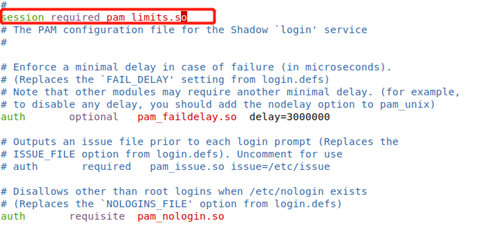

## 安全版单机-通用机部署手册

## 1\. 前期准备

### 1.1 安装包检查

检查确认操作系统版本及cpu架构：  
（1）Redhat系/银河麒麟v10/UOS20系操作系统举例如下：（国产环境可通过“右键我的电脑—属性”查看）

```
# cat /etc/*release
# lscpu
```

（2）银河麒麟v10操作系统可通过nkvers命令确认是否为银河麒麟v10sp1或v10sp2版本；如无输出结果，则为银河麒麟v10版本。  
（3）使用如下命令确认操作系统支持哪种管理器，便于判断使用rpm包还是deb包：

```
# rpm --version
# dpkg --version
```

（4）其他linux系列的操作系统依据实际情况判断即可。

注意：安装前请确保使用的介质与实际环境一致，不同环境之间安装包不通用；如无版本强制要求，应选择符合合约约定的大版本下最新已发布的小版本+最新补丁集作为部署版本。  
如前期已有适配的版本，建议按适配版本实施。

**安装包名称举例如下：**

【瀚高数据库安装包】hgdb4.5.8-see-xxx-xxx64-xxxxxxxx.rpm或hgdb4.5.8-see-xxx-xxx64-xxxxxxx.deb

### 1.2 配置主机名

Redhat系/银河麒麟v10/UOS20系操作系统参考如下：  
设置命令：

```
# hostnamectl set-hostname  <主机名>
```

建议为不同的数据库服务器配置唯一的主机名，并在/etc/hosts文件中添加各节点IP及主机名信息。  
命名方式可参考如下：yyxtdb01（应用系统名称+db+序号）。不得超过16个字符；不包含特殊字符，禁止使用下划线。

举例如下：

```
# cat /etc/hosts
…
192.168.0.11 xxdb01
192.168.0.12 xxdb02
192.168.0.13 xxdb03
```

### 1.3 服务器之间网络检查

确保各节点之间网卡支持千兆及以上网络  
Redhat系/银河麒麟v10/UOS20系操作系统参考命令如下：（将如下网卡名称ens33替换为实际名称）

```
[root@xxdb01 ~]# ethtool ens33
Settings for ens33:
        Supported ports: [ TP ]
        Supported link modes:   10baseT/Half 10baseT/Full 
                                100baseT/Half 100baseT/Full 
                                1000baseT/Full 
        Supported pause frame use: No
        Supports auto-negotiation: Yes
        Supported FEC modes: Not reported
        Advertised link modes:  10baseT/Half 10baseT/Full 
                                100baseT/Half 100baseT/Full 
                                1000baseT/Full 
        Advertised pause frame use: No
        Advertised auto-negotiation: Yes
        Advertised FEC modes: Not reported
        Speed: 1000Mb/s
        Duplex: Full
        Port: Twisted Pair
        PHYAD: 0
        Transceiver: internal
        Auto-negotiation: on
        MDI-X: off (auto)
        Supports Wake-on: d
        Wake-on: d
        Current message level: 0x00000007 (7)
                               drv probe link
        Link detected: yes
```

各节点之间测试网络传输速度，注意要测试双向的网络传输速度，命令如下：  
结果小于50mb/s具有一定风险

```
# scp local_file remote_username@remote_ip:remote_folder
```

### 1.4 数据库服务器文件系统目录要求

建议如下配置，数据库安装目录、数据目录、归档目录、备份目录单独划分，可减少磁盘IO争用、提升性能，亦可防止所有文件放在一起因备份文件较大进而引起空间爆满造成的数据库hang住现象。

| 文件系统名称 | 要求大小 | 用途 |
| --- | --- | --- |
| / | \>50G |  |
| /tmp | \>10G |  |
| /home | \>20G |  |
| swap | \>32G |  |
| /opt | \>100G | 数据库安装目录 |
| /data | 根据应用数据量及增长规划提供。 | 数据存储目录 |
| /hgdbarch | 根据应用业务量评估；建议500G以上 | 归档日志目录 |
| /hgdbbackup | 数据目录的3倍以上 | 数据备份 |
| 如无独立大盘作为数据存储目录，应及时和客户反馈并让其协调存储工程师挂载存储，非必要情况工程师不能擅自挂载存储。 |  |  |

磁盘性能检查：举例如下（测试后将生成的测试文件删除）：  
（1）模拟数据库读写小数据来测试硬盘的IO，命令如下：

```
# dd if=/dev/zero of=/opt/test bs=32k count=20k oflag=dsync
20480+0 records in
20480+0 records out
671088640 bytes (671 MB, 640 MiB) copied, 18.2872 s, 36.7 MB/s
```

如结果低于20MB/s，则说明磁盘性能偏差，需建议客户方协调硬件工程师检查；否则将可能会系统整体性能造成较大的影响。  
（2）模拟大文件写入来测试硬盘的IO，命令如下：

```
[root@db ~]#  dd if=/dev/zero of=/opt/test bs=8192k count=100 oflag=dsync
100+0 records in
100+0 records out
838860800 bytes (839 MB) copied, 8.88575 s, 315 MB/s
```

如结果低于200MB/s，则说明磁盘性能偏差，需建议客户方协调硬件工程师检查；否则将可能会系统整体性能造成较大的影响。  
**注意：务必不要把if和of的值写反，否则有数据清除的风险。**

### 1.5 数据库服务器内存CPU要求

如为测试环境，则无硬性要求。  
如为生产环境，建议内存大于32GB，逻辑CPU个数大于8颗，具体需依据实际业务场景及硬件配置等综合判断。

### 1.6 操作系统rpm包依赖安装

目前HGDB中所需的操作系统依赖包，均已打包在数据库及集群组件的安装包中，无特殊需求无需单独安装。

### 1.7 关闭avahi-daemon及NetworkManager服务

操作系统avahi-daemon可能会影响集群正常通信，建议关闭。  
Redhat系/银河麒麟v10/UOS20系操作系统举例如下：

```
# systemctl stop avahi-daemon
# systemctl disable avahi-daemon
# systemctl stop  NetworkManager.service
# systemctl disable NetworkManager.service
# systemctl status  NetworkManager.service
```

### 1.8 调整limits.conf

每台服务器使用root用户进行操作  
Redhat系/银河麒麟v10/UOS20系操作系统举例如下：  
修改/etc/security/limits.conf 配置文件，增加如下内容：

```
# vi /etc/security/limits.conf
#For HGDB
*               soft    stack     unlimited
*               hard    stack     unlimited
*               soft    nproc     unlimited
*               hard    nproc     unlimited
*               soft    nofile    1048576
*               hard    nofile    1048576
*               soft    memlock   unlimited
*               hard    memlock   unlimited
#End for HGDB
```

编辑vi /etc/pam.d/login 文件，添加一行配置：session required pam\_limits.so，如图，保存退出重启服务。（部分操作系统默认含有此行，可不添加）



修改完成后验证：

```
# ulimit -a
SBWHC_PG1:~ # ulimit -a
core file size          (blocks, -c) unlimited
data seg size           (kbytes, -d) unlimited
scheduling priority             (-e) 0
file size               (blocks, -f) unlimited
pending signals                 (-i) 127575
max locked memory       (kbytes, -l) 64
max memory size         (kbytes, -m) unlimited
open files                      (-n) 131072
pipe size            (512 bytes, -p) 8
POSIX message queues     (bytes, -q) 819200
real-time priority              (-r) 0
stack size              (kbytes, -s) 10240
cpu time               (seconds, -t) unlimited
max user processes              (-u) 131072
virtual memory          (kbytes, -v) unlimited
file locks                      (-x) unlimited
```

### 1.9 防火墙配置

Redhat系/银河麒麟V10操作系统修改方式如下：  
\*关闭防火墙【需经客户同意】

```
# systemctl status firewalld.service
# systemctl stop firewalld.service
# systemctl disable firewalld.service
```

关闭selinux：

```
# sed -i "s/SELINUX=enforcing/SELINUX=disabled/g" /etc/selinux/config
# setenforce 0
# cat /etc/selinux/config | grep SELINUX=disabled
# getenforce
```

如有特殊要求，无法完全关闭防火墙，则开放HAC集群所需的端口（各节点均开），如下：  
开放数据库端口：

```
firewall-cmd --permanent --add-port=5866/tcp
firewall-cmd --add-port=5866/tcp
```

UOS20操作系统使用如下命令禁用防火墙并禁止开机自启：

```
root@highgo:~# systemctl stop ufw.service 
root@highgo:~# systemctl disable ufw.service 
Synchronizing state of ufw.service with SysV service script with /lib/systemd/systemd-sysv-install.
Executing: /lib/systemd/systemd-sysv-install disable ufw
或者
root@highgo:~# ufw disable
Firewall stopped and disabled on system startup
```

### 1.10 配置环境变量

一般数据库节点除配置数据库的环境变量外，还需配置hac及etcd的相关环境变量，示例如下：

```
[root@xxdb01 ~]# vi /opt/highgo/hgdb-see-4.5.8/etc/hgdbenv.sample
export PGDATA=/data/highgo/data  #修改PGDATA变量
[root@xxdb01 ~]# cat  ~/.bash_profile
# .bash_profile

# Get the aliases and functions
if [ -f ~/.bashrc ]; then
    . ~/.bashrc
fi

# User specific environment and startup programs

PATH=$PATH:$HOME/bin

export PATH
source /opt/highgo/hgdb-see-4.5.8/etc/hgdbenv.sample
#如遇到找不到数据库lib问题，可设置LD_LIBRARY_PATH变量
export LD_LIBRARY_PATH=/opt/highgo/hgdb-see-4.5.8/lib:/usr/lib64:$LD_LIBRARY_PATH
```

### 1.11 服务器时间要求

根据客户标准设置OS时区，国内通常为东八区”Asia/Shanghai”.  
Redhat系/银河麒麟V10/UOS20操作系统参考如下：  
使用命令”timedatectl”查看和修改OS时区：  
查看OS时区：

```
# timedatectl status
      Local time: Thu 2022-04-28 10:36:41 CST
  Universal time: Thu 2022-04-28 02:36:41 UTC
        RTC time: Thu 2022-04-28 02:36:41
       Time zone: Asia/Shanghai (CST, +0800)
 Network time on: no
NTP synchronized: yes
 RTC in local TZ: no
```

修改OS时区：

```
# timedatectl set-timezone "Asia/Shanghai"
```

修改OS时间:

```
[root@xxdb01 ~]# date -s '20200928 11:07:00'
```

## 2\. 安装过程

### 2.1 安装软件包

验证安装包MD5值：

```
[root@xxdb01 ~]# md5sum  hgdb4.5.8-see-xxx-x86-64-xxxxxxxx.rpm
```

查看生成的MD5值，若与MD5文件中一致，则可继续进行下面的操作，若不一致则建议重新上传并检验。  
RPM包安装：

```
[root@xxdb01 highgo]# rpm -ivh  hgdb4.5.8-see-xxx-x86-64-xxxxxxxx-ha.rpm

可选项：
--nodeps 忽略依赖包进行安装
--force    强制安装
```

DEB包安装：

```
# dpkg -i XXXX.deb
```

查看安装后的状态：

```
#dpkg -l | grep hgdb
```

**注意：如安装包选择错误或因其他原因需卸载重装，命令参考如下：**  
RPM包卸载

```
# rpm -e XXX.rpm
```

**注意：卸载之前需确认数据库进程是否关闭**

DEB包卸载

```
# dpkg  -r xxx.deb
```

**注意：卸载之前需确认数据库进程是否关闭**

### 2.2 配置数据库

安全版4.5.8提供了一键配置脚本，脚本位置为/opt/highgo/hgdb-see-4.5.8/etc/laststep.sh。执行该脚本默认会初始化一个data目录，生成ssl相关文件并且配置安全模块、审计模块、日志等常见参数及数据库开机自启。可执行该脚本后再按需执行下列步骤配置相关参数。

#### 2.2.1 初始化数据库

```
[root@xxdb01 etcd]# initdb -e sm4 -c "echo 12345678" -D  /data/highgo/data
属于此数据库系统的文件宿主为用户 "root".
此用户也必须为服务器进程的宿主.
数据库簇将使用本地化语言 "zh_CN.UTF-8"进行初始化.
默认的数据库编码已经相应的设置为 "UTF8".
initdb: could not find suitable text search configuration for locale "zh_CN.UTF-8"
缺省的文本搜索配置将会被设置到"simple"
禁止为数据页生成校验和.
Data encryption using sm4 is enabled.
Enter new sysdba password:
再输入一遍:

Enter new syssao password:
再输入一遍:

Enter new syssso password:
再输入一遍:

创建目录 /data/highgo/data... 成功
正在创建子目录 ... 成功
选择动态共享内存实现 ......posix
选择默认最大联接数 (max_connections) ... 100
选择默认共享缓冲区大小 (shared_buffers) ... 128MB
selecting default time zone ... Asia/Shanghai
创建配置文件 ... 成功
正在运行自举脚本 ...2023-02-11 22:35:08.384 CST [9888] 日志:  Switchover the SSHA Role. Current is NONE
成功
正在执行自举后初始化 ...2023-02-11 22:35:08.592 CST [9891] 日志:  data encryption performed by sm4
2023-02-11 22:35:08.594 CST [9891] 日志:  Switchover the SSHA Role. Current is NONE
成功
同步数据到磁盘...成功

initdb: 警告: enabling "sm3" authentication for local connections
你可以通过编辑 pg_hba.conf 更改或你下次
执行 initdb 时使用 -A或者--auth-local和--auth-host选项.

Success. You can now start the database server using:

    hg_sslkeygen.sh /data/highgo/data
    pg_ctl -D /data/highgo/data -l 日志文件 start
```

#### 2.2.2 生成ssl相关文件

```
[root@xxdb01 opt]# hg_sslkeygen.sh /data/highgo/data
Setting the ssl configuration to /data/highgo/data
Generating RSA private key, 2048 bit long modulus
.......................................................................+++
..........+++
e is 65537 (0x10001)
```

#### 2.2.3 数据库参数配置

```
listen_addresses = '*'
max_connections = '800'   --最大连接数，请根据实际情况配置，不可设置过高。
shared_buffers = '16GB'
checkpoint_completion_target = '0.8'
log_destination = 'csvlog'
logging_collector = 'on'
log_directory = '/data/highgo/hgdb_log'
log_filename = 'highgodb_%d.log'
log_rotation_age = '1d'
log_rotation_size = '0'
log_truncate_on_rotation = 'on'
log_statement = 'mod'   --日志等级，mod可记录dml语句，但占用空间较大。
log_connections = 'on'
log_disconnections = 'on'
checkpoint_timeout = '45min'
temp_buffers = '16MB'
work_mem = '8MB'  --数据库会话计算进程内存值，不可设置过高，防止OOM。
maintenance_work_mem = '2GB'
compatible_db = 'oracle'
min_wal_size = '512MB'
max_wal_size = '4096MB'
effective_cache_size = '10GB'
archive_mode = 'on'
archive_timeout = '45min'
archive_command = ' cp %p /hgbakdata/hgbak/archive/%f'
log_line_prefix = '%m [%p] %a %u %d %r %h'
compatible_db = 'oracle' --开启oracle兼容
```

#### 2.2.4 安全审计参数配置

安全审计参数可以提升数据库的安全等级，但会对性能稍有影响，请根据测评要求和现场强制要求酌情开启以下安全参数&审计参数（本小节中红色字体为开启/配置相应功能）。  
**注意：数据库安全参数由数据库安全管理员syssso统一进行管理，进行调整前请登录syssso进行配置。**

```
[root@xxdb01 opt]# psql  highgo syssso  

--数据库用户三权分立。
highgo=> select   set_secure_param('hg_sepofpowers','on');
        set_secure_param
---------------------------------
 set configuration successfully.
(1 行记录)
--行级访问控制。
highgo=> select   set_secure_param('hg_rowsecure','on');
        set_secure_param
---------------------------------
 set configuration successfully.
(1 行记录)

--数据强制访问功能，建议使用‘min’。
highgo=> select set_secure_param('hg_macontrol','min');
        set_secure_param
---------------------------------
 set configuration successfully.
(1 行记录)

--用户、密码设置总开关，为off时其子条件均无法生效。
highgo=> select   set_secure_param('hg_idcheck.enable','on');
        set_secure_param
---------------------------------
 set configuration successfully.
(1 行记录)

--密码错误输入准许的最大次数。
highgo=> select  set_secure_param('hg_idcheck.pwdlock','10');
        set_secure_param
---------------------------------
 set configuration successfully.
(1 行记录)

--用户多次错误密码输入后锁定时间，单位为小时。
highgo=> select  set_secure_param('hg_idcheck.pwdlocktime','8');
        set_secure_param
---------------------------------
 set configuration successfully.
(1 行记录)

--用户密码到期时间，范围0~365，参数‘0’即为不做限制。
highgo=> select   set_secure_param('hg_idcheck.pwdvaliduntil','0');
        set_secure_param
---------------------------------
 set configuration successfully.
(1 行记录)

--密码策略等级，high为最高等级。
highgo=> select  set_secure_param('hg_idcheck.pwdpolicy','high');
        set_secure_param
---------------------------------
 set configuration successfully.
(1 行记录)
```

**注意：数据库审计参数由数据库安全管理员syssao统一进行管理，进行调整前请登录syssao进行配置。**

```
[root@xxdb01 opt]# psql  highgo syssao

--审计日志总开关
highgo=> select  set_audit_param('hg_audit','on');
         set_audit_param
---------------------------------
 set configuration successfully.
(1 行记录)

--审计分析开关，建议为off，打开后会使审计日志急速膨胀。
highgo=> select  set_audit_param('hg_audit_analyze','off');
         set_audit_param
---------------------------------
 set configuration successfully.
(1 行记录)

--审计日志大小限制
highgo=> select  set_audit_param('hg_audit_logsize','60MB');
         set_audit_param
---------------------------------
 set configuration successfully.
(1 行记录)

--审计日志保留日期
highgo=> select  set_audit_param('hg_audit_keep_days','90');
         set_audit_param
---------------------------------
 set configuration successfully.
(1 行记录)

--磁盘无剩余空间时处理策略，建议为‘1’【停止审计】。
highgo=> select  set_audit_param('hg_audit_full_mode','1');
         set_audit_param
---------------------------------
 set configuration successfully.
(1 行记录)

--审计日志归档，建议为off。
highgo=> select  set_audit_param('hg_audit_file_archive_mode','off');
         set_audit_param
---------------------------------
 set configuration successfully.
(1 行记录)

--审计日志归档路径，hg_audit_file_archive_mode为on时生效,需设置绝对路径。
highgo=>select set_audit_param('hg_audit_file_archive_dest','/highgo/audit_archive');
         set_audit_param
---------------------------------
 set configuration successfully.
(1 行记录)
```

#### 2.2.5 修改数据库用户密码有效期及密码

```
[root@xxdb01 opt]# psql  highgo sysdba
注意:
-------------------------------------------
Login User: sysdba
Login time: 2023-02-11 10:56:53.114848+08
Login Address: [local]
Last Login Status: FAILED
Login Failures: 1
Valied Until: infinity
-------------------------------------------

psql (4.5.8)
输入 "help" 来获取帮助信息.

highgo=> select   set_secure_param('hg_idcheck.pwdvaliduntil','0');
        set_secure_param
---------------------------------
 set configuration successfully.
(1 行记录)
highgo=# alter  user  sysdba  password  'Hello****';
ALTER ROLE
highgo=# \c - syssao
highgo=> alter  user  syssao  password  'Hello****';
ALTER ROLE
highgo=# \c - syssso
highgo=> alter  user  syssso  password  'Hello****';
ALTER ROLE
【hg_idcheck.pwdvaliduntil参数设置密码有效期；取值范围为0-365，设置为0表示不限制天数。修改此参数后，需重新设置用户密码才能生效。】
```

配置hba文件

```
vi $PGDATA/pg_hba.conf 
添加以下内容:
host     all  all    0.0.0.0/0   sm3
```

开机自启相关配置

```
systemctl enable  hgdb-see-4.5.8
mv /opt/highgo/hgdb-see-4.5.8/etc/.cluster.mark    /opt/highgo/hgdb-see-4.5.8/etc/.cluster.mark-bak
```

配置完成后使用pg\_ctl 重启数据库

```
[root@xxdb01 opt]# pg_ctl  restart
等待服务器进程关闭 ....2023-02-11 11:00:14.390 CST [13534] 日志:  接收到快速 (fast) 停止请求
2023-02-11 11:00:14.394 CST [13534] 日志:  中断任何激活事务
2023-02-11 11:00:14.420 CST [13534] 日志:  后台工作进程 "logical replication launcher" (PID 13542) 已退出, 退出代码 1
2023-02-11 11:00:14.421 CST [13537] 日志:  正在关闭
2023-02-11 11:00:14.434 CST [13534] 日志:  数据库系统已关闭
 完成
服务器进程已经关闭
服务器进程以启动
```

## 3\. 安装postgis

安全版v4.5.7及之后版本，无特殊要求；postgis安装包作为补丁包（P003\_xxx）单独提供，可单独安装。  
部分特殊要求可与数据库打成整包提供。

### 3.1 安装补丁包

```
[root@node1 tmp]#rpm -ivh   xxxx_P003.rpm
```

### 3.2 关闭三权和审计

```
[root@node1 tmp]# psql -U syssso -d highgo
psql (4.5.8)
Type "help" for help.
highgo=> select set_secure_param('hg_sepofpowers','off');
        set_secure_param         
---------------------------------
 set configuration successfully.
(1 row)

highgo=> \c highgo syssao
You are now connected to database "highgo" as user "syssao".
highgo=> select  set_audit_param('hg_audit','off');
         set_audit_param         
---------------------------------
 set configuration successfully.
(1 row)

highgo=> \q
[root@node1 tmp]# pg_ctl restart
```

### 3.3 创建postgis扩展

```
[root@node1 tmp]# psql -U sysdba -d highgo
psql (4.5.8)
Type "help" for help.

highgo=# create extension postgis;
CREATE EXTENSION
highgo=# \dx
                                                            List of installed extensions
        Name        | Version  |       Schema       |                                          Description                                          
--------------------+----------+--------------------+-----------------------------------------------------------------------------------------------
 hg_mac             | 1.0      | information_schema | hgdb mandatory access control without using selinux
 hg_permission      | 1.0      | information_schema | hg permission
 mysqlface          | 1.0      | public             | administrative functions for PostgreSQL
 orafce             | 3.9      | public             | Functions and operators that emulate a subset of functions and packages from the Oracle RDBMS
 passwordcheck      | 1.0      | information_schema | passwordcheck
 pg_buffercache     | 1.3      | public             | examine the shared buffer cache
 pg_stat_statements | 1.7      | public             | track execution statistics of all SQL statements executed
 plpgsql            | 1.0      | pg_catalog         | PL/pgSQL procedural language
 postgis            | 3.1.0dev | public             | PostGIS geometry and geography spatial types and functions
 zhfts              | 1.1      | public             | RUM index access method
(10 rows)
```

### 3.4 打开三权和审计

```
[root@node1 ~]# psql -U syssso -d highgo
psql (4.5.8)
Type "help" for help.

highgo=> select set_secure_param('hg_sepofpowers','on');
        set_secure_param         
---------------------------------
 set configuration successfully.
(1 row)
highgo=> \c highgo syssao
You are now connected to database "highgo" as user "syssao".
highgo=> select  set_audit_param('hg_audit','on');
         set_audit_param         
---------------------------------
 set configuration successfully.
(1 row)
highgo=> \q
[root@node1 ~]# pg_ctl restart
```

## 4\. 测试开发管理工具

配置完成后需打开开发管理工具进行新建连接测试，确保工具正常使用。  
示例如下：

### 4.1 新建连接

![Image[2].png](https://highgo.com/document/images/way/assets1.1/Image2.png)

![Image[3].png](https://highgo.com/document/images/way/assets1.1/Image3.png)

切记安全版数据库需在创建连接时勾选”是安全版数据库”选项

### 4.2 执行测试sql

![Image[4].png](https://highgo.com/document/images/way/assets1.1/Image4.png)

![Image[5].png](https://highgo.com/document/images/way/assets1.1/Image5.png)

## 5\. license激活

**注意：**  
1\. 激活license之前一定要确认本次实施要求是测试license还是永久license

### 5.1 数据库启动时会显示剩余时间

```
日志:  00000:  This is a trial edition, validate until 2023-03-12 16:09:09, database will not be able to start up after that time,please apply an official license by that time.
```

### 5.2 上传license并复制到etc目录修改名称为hgdb.lic

```
[root@xxdb01 uplaod]# cp hgdb.lic /opt/highgo/hgdb-see-4.5.8/etc/hgdb.lic
```

### 5.3 激活

```
[root@xxdb01 data]$ pg_ctl reload
server signaled
日志:  00000: 接收到 SIGHUP, 重载配置文件
日志:  00000: 注意 :检测到授权文件已更改，该license为试用版授权，有效期截止到2023-02-10 16:09:09
```

### 5.4 检查license，确认激活成功

```
[root@xxdb01 data]$ hg_lic
############## HIGHGODB LICENSE ###################
License status:Normal
License validity:2023-02-11
Database Version:Highgo Database 4.5.8 Trail Edition
###################################################
```

## 6\. 数据库自动备份部署（所有节点均需配置）

备份方式请参考最新版的“瀚高数据库备份手册”。