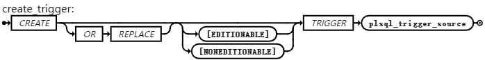
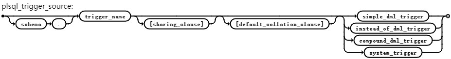
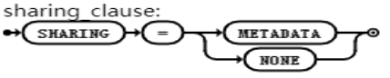
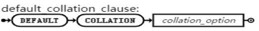
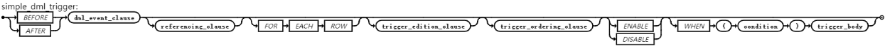
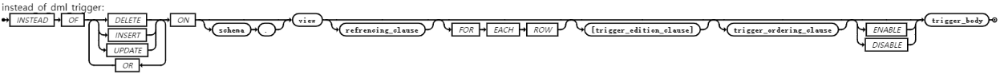
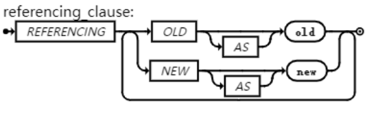
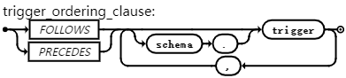
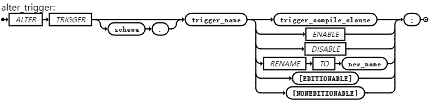
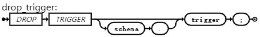

## 触发器

与存储过程类似，触发器是一个命名的 PL/iSQL 单元，存储在数据库中，可以重复调用。但是与存储过程不同的是，我们可以启用和禁用触发器，但不支持显示调用。触发器启用后，数据库会在触发事件发生时自动调用它，即触发器触发。触发器禁用后，触发器不会触发。

用户可通过使用 CREATE TRIGGER 语句创建触发器。可以根据触发语句及其作用的对象指定触发事件。触发器是在对象（可以是表、视图、模式或数据库）上创建或定义的。还可以指定时间点，该时间点决定触发器是在触发语句运行之前还是之后触发，以及是否针对触发语句影响的每一行触发。默认情况下，触发器创建时处于启用状态。

按照触发事件，触发器可以分为DML触发器和系统触发器：

- 如果在表或视图上创建触发器，触发事件由 DML 语句组成，这种触发器称为 DML 触发器。DML 触发器可以是简单的DML触发器，也可以是复合的DML触发器。
- 如果触发器是在模式或数据库上创建的，触发事件由 DDL 或数据库操作语句组成，这种触发器称为系统触发器 。

用户可通过ALL\_TRIGGERS、DBA\_TRIGGERS和USER\_TRIGGERS视图查看创建的触发器信息。

说明：

- 该功能在V9.0.5及以后的版本中支持。
- 兼容Oracle模式下，支持原生PG的触发器定义和使用，但创建触发器要以 ‘/‘为结束符。
- 目前暂不支持复合的DML触发器和系统触发器。
- 目前暂不支持触发器谓词、使用动态SQL创建兼容Oracle的触发器。

## 说明

create\_trigger

 {width=”5.7659722222222225in” height=”0.71875in”}

plsql\_trigger\_source

 {width=”5.764583333333333in”  
height=”0.7590277777777777in”}

sharing\_clause（仅语法支持）

 {width=”2.7930555555555556in”  
height=”0.5611111111111111in”}

default\_collation\_clause（仅语法支持）

 {width=”2.5430555555555556in”  
height=”0.30694444444444446in”}

simple\_dml\_trigger

 {width=”6.543055555555555in”  
height=”0.3472222222222222in”}

instead\_of\_dml\_trigger

 {width=”6.736111111111111in”  
height=”0.5020833333333333in”}

referencing\_clause

 {width=”4.299305555555556in”  
height=”1.3333333333333333in”}

trigger\_edition\_clause（仅语法支持）

 {width=”2.75in”  
height=”0.9479166666666666in”}

trigger\_ordering\_clause

 {width=”4.072916666666667in”  
height=”0.9166666666666666in”}

trigger\_body

 {width=”2.5729166666666665in”  
height=”0.78125in”}

alter\_trigger

 {width=”5.763194444444444in”  
height=”1.3618055555555555in”}

trigger\_compile\_clause

 {width=”5.763194444444444in”  
height=”0.6201388888888889in”}

drop\_trigger

 {width=”4.604166666666667in”  
height=”0.6666666666666666in”}

限制：

- EDITIONABLE / NONEDITIONABLE （仅语法兼容）
- FORWARD/REVERSE （仅语法兼容）
- sharing\_clause、default\_collation\_clause （仅语法兼容）
- HGDB V9暂不支持\[compound\_dml\_trigger和\]{.mark}system\_trigger
- HGDB V9暂不支持触发器谓词、使用动态SQL创建兼容Oracle的触发器。

## CREATE TRIGGER

- OR REPLACE

如果触发器存在，则重新创建它，并重新编译它。

- \[ EDITIONABLE | NONEDITIONABLE \]

仅语法支持，默认是EDITIONABLE。

### plsql\_trigger\_source

- schema

模式名

- trigger\_name

要创建的触发器名称。同一schema中的触发器不能同名。触发器可以与其他对象同名（例如，表和触发器可以同名）。但为了避免混淆，不建议这样做。

### simple\_dml\_trigger

#### 介绍

使用simple\_dml\_trigger子句可以创建一个简单的DML触发器。

简单的 DML 触发器只会在以下某个时间点触发：

- 在触发语句运行之前（该触发器称为语句级 BEFORE 触发器。）
- 在触发语句运行之后（该触发器称为语句级 AFTER 触发器。）
- 在触发语句影响的每一行之前（该触发器称为行级 BEFORE 触发器。）
- 在触发语句影响的每一行之后（该触发器称为行级 AFTER 触发器。）

#### 语法说明

- BEFORE

使数据库在运行触发事件之前触发触发器。对于行触发器，触发器在每个受影响的行发生更改之前触发。

在 BEFORE 语句级触发器中，触发器主体无法读取:NEW 或:OLD。（在BEFORE 行触发器中，触发器主体可以读取和写入:OLD 和:NEW 字段。）

- AFTER

运行触发事件后，导致数据库触发触发器。对于行触发器，触发器在每个受影响的行发生更改后触发。

在 AFTER 语句级触发器中，触发器主体无法读取:NEW 或:OLD。（在AFTER 行触发器中，触发器主体可以读取但不能写入:OLD 和:NEW 字段。）

- FOR EACH ROW

将触发器创建为行级触发器。数据库会为受触发语句影响且满足 WHEN 条件中定义的可选触发器约束的每一行触发一个行触发器。

如果省略此子句，则触发器为语句触发器。仅当触发语句满足可选触发器约束时，数据库才会触发语句触发器。

- \[ ENABLE | DISABLE \]

创建处于启用（默认）或禁用状态的触发器。创建处于禁用状态的触发器可让您确保在启用触发器之前，该触发器的编译不会出现错误。

- WHEN (condition)

指定数据库针对触发语句影响的每一行的 SQL 条件。如果受影响行的条件值为 TRUE，则为该行运行 trigger\_body；否则，不会为该行运行 trigger\_body。无论条件值如何，触发语句都会运行。

condition中可以包含referencing\_clause子句。

如果指定此子句，则还必须指定 FOR EACH ROW。

condition不能包含子查询或 PL/iSQL 表达式（例如，用户自定义函数的调用）。

- trigger\_body

当触发器被激活时要执行的PL/iSQL 块或 CALL 子程序。CALL 子程序是 PL/iSQL 子程序。

如果 trigger\_body 是 PL/iSQL 块并且包含错误，则 CREATE \[OR REPLACE\]语句会失败。

plsql\_block详见 [\[匿名块\]{.underline}](#%E5%8C%BF%E5%90%8D%E5%9D%97) 章节语法图。

routine\_clause详见 CALL调用 章节语法图。

其中，declared\_section 不能声明数据类型为 LONG 或 LONG RAW 的变量。

- trigger\_edition\_clause
	见 trigger\_edition\_clause 。
- trigger\_ordering\_clause
	见 trigger\_ordering\_clause 。

### instead\_of\_dml\_trigger

#### 介绍

使用instead\_of\_dml\_trigger子句可以创建一个INSTEAD OF DML 触发器。

INSTEAD OF 触发器是一种专门用于视图(View) 的特殊类型 DML触发器。当尝试对视图执行 DML 操作（INSERT, UPDATE,DELETE）时，数据库不会执行该操作本身，而是转而执行在这个触发器中定义的代码。

使用INSTEAD OF 触发器需要注意以下几点：

- 如果视图本质上是可更新的并且具有 INSTEAD OF 触发器，则触发器优先：数据库触发触发器而不是在视图上执行 DML。
- INSTEAD OF 触发器始终是行级触发器。INSTEAD OF触发器可以读取 OLD 值和 NEW 值，但不能更改它们。
- 当使用 INSTEAD OF 触发器对视图进行插入或更新时，不会强制执行视图的 WITH CHECK OPTION。INSTEAD OF 触发器主体必须强制执行检查。

#### 语法说明

- DELETE

当 DELETE 语句从视图的表中删除一行时，会触发触发器。

- INSERT

如果触发器是在视图上创建的，则每当 INSERT 语句向定义视图的表中添加一行时，INSERT 都会触发触发器。

- UPDATE

如果触发器是在视图上创建的，则每当 UPDATE 语句更改定义视图的表的列中的值时，UPDATE 都会触发触发器。

- schema

模式名称。

- noneditioning\_view

如果指定 nested\_table\_column，则 noneditioning\_view是包含 nested\_table\_column 的视图的名称。否则，noneditioning\_view 是要在其上创建触发器的视图的名称。

- FOR EACH ROW

仅用于文档，因为 INSTEAD OF 触发器始终是行触发器。

- ENABLE

（默认）创建处于启用状态的触发器。

- DISABLE

创建处于禁用状态的触发器，这可确保在启用触发器之前触发器编译时没有错误。

- trigger\_body

当触发器被激活时要执行的PL/iSQL 块或 CALL 子程序。CALL子程序是 PL/iSQL子程序。

如果 trigger\_body 是 PL/iSQL 块并且包含错误，则 CREATE \[OR REPLACE\]语句会失败。

declared\_section 不能声明数据类型为 LONG 或 LONG RAW 的变量。

限制：

- 只支持视图
- EDITIONABLE / NONEDITIONABLE （语法兼容）
- FORWARD/REVERSE （语法兼容）
- sharing\_clause、default\_collation\_clause （语法兼容）

### dml\_event\_clause

指定 simple\_dml\_trigger 的触发语句。数据库在现有用户事务中触发触发器。

- DELETE

每当 DELETE 语句从 table 或定义 view 的表中删除一行时，都会触发触发器。

- INSERT

每当 INSERT 语句向 table 或定义 view 的表添加一行时，都会触发触发器。

- UPDATE \[ OF column \[, column \] \]

每当 UPDATE 语句更改指定列中的值时，数据库都会触发触发器。默认值： 每当 UPDATE 语句更改 table 或定义 view 的表中的任何列中的值时，数据库都会触发触发器。

- schema
	要创建触发器的数据库对象的schema名称。
- table
	要创建触发器的数据库表或对象表的名称。
- view
	要创建触发器的数据库视图或对象视图的名称。

### referencing\_clause

指定关联名，分别指向当前行的旧值、新值和父值。 默认值： OLD 、 NEW 和PARENT 。

如果您的触发器与名为 OLD 、 NEW 或 PARENT表相关联，则使用此子句指定不同的关联名称，以避免表名和关联名之间的混淆。

### trigger\_edition\_clause

将触发器创建为跨版本触发器，目前仅语法支持。

{ FORWARD | REVERSE } CROSSEDITION

限制：

- 不能在视图上定义跨版本触发器。
- 不能为跨版本触发器指定 NONEDITIONABLE。

选项：

- FORWARD

（默认）将触发器创建为正向交叉版本触发器。

- REVERSE

创建触发器作为反向跨版本触发器。

### trigger\_ordering\_clause

{ FOLLOWS | PRECEDES } \[ schmema.\] trigger \[, \[ schmema.\] trigger  
\]...

- FOLLOWS | PRECEDES

指定具有相同时间点的触发器的相对触发方式。

使用 FOLLOWS 表示正在创建的触发器必须在指定触发器之后触发。

使用 PRECEDES 表示正在创建的触发器必须在指定触发器之前触发。

指定的触发器必须存在，并且必须已成功编译。它们不需要启用。

在下列定义中，A、B、C 和 D 是四个触发器：

- 如果 B 在其 FOLLOWS 子句中指定 A，则 B 直接跟随 A。
- 如果 C 直接跟随 B，且 B 直接跟随 A，则 C 间接跟随 A。
- 如果 D 直接跟随 C，且 C 间接跟随 A，则 D 间接跟随 A。
- 如果 B 直接或间接地遵循 A，则 B 明确遵循 A（即，B 和 A  
	的触发顺序由一个或多个 FOLLOWS 子句明确指定）。
- 如果 A 直接或间接地位于 B 之前，则 A 明确位于 B 之前（即，A 和 B  
	的触发顺序由一个或多个 PRECEDES 子句明确指定）。

### 示例

#### 示例1：简单的DML触发器

\-- 创建表

CREATE TABLE empt (

emp\_id NUMBER PRIMARY KEY,

name VARCHAR2(100),

salary NUMBER,

hire\_date DATE

);

CREATE TABLE empt\_logs (

log\_id NUMBER,

emp\_id NUMBER,

action VARCHAR2(100), -- 'INSERT', 'UPDATE', 'DELETE'

log\_date DATE

);

CREATE TRIGGER trgins1

AFTER INSERT ON empt

FOR EACH ROW

BEGIN

INSERT INTO empt\_logs (log\_id, emp\_id, action, log\_date)

VALUES (5,:NEW.emp\_id, 'trgins1->INSERT (1)',  
to\_date('03-09-2025','dd-mm-yyyy'));

END;

/

CREATE TRIGGER trgins2

AFTER INSERT ON empt

FOR EACH ROW

BEGIN

INSERT INTO empt\_logs (log\_id, emp\_id, action, log\_date)

VALUES (7,:NEW.emp\_id, 'trgins2->INSERT (2)',  
to\_date('03-09-2025','dd-mm-yyyy'));

END;

/

CREATE TRIGGER at1

AFTER INSERT ON empt

FOR EACH ROW FOLLOWS trgins1, trgins2

BEGIN

INSERT INTO empt\_logs (log\_id, emp\_id, action, log\_date)

VALUES (8,:NEW.emp\_id, 'at1->INSERT (3)',  
to\_date('03-09-2025','dd-mm-yyyy'));

END;

/

INSERT INTO empt VALUES (7387, 'TEST FOLLOWS', 900,  
to\_date('24-03-2025','dd-mm-yyyy'));

select \* from empt;

select \* from empt\_logs;

两个表分别输出：

highgo=# select \* from empt;

emp\_id | name | salary | hire\_date

\--------+--------------+--------+------------

highgo=# select \* from empt\_logs;

log\_id | emp\_id | action | log\_date

\--------+--------+---------------------+------------

(3 行记录)

#### 示例2：INSTEAD OF DML 触发器

\--创建表

CREATE TABLE emp(

emp\_no NUMBER,

emp\_name VARCHAR2(50),

salary NUMBER,

manager VARCHAR2(50),

dept\_no NUMBER

);

CREATE TABLE dept(

dept\_no NUMBER,

dept\_name VARCHAR2(50),

location VARCHAR2(50)

);

\--插入数据

INSERT INTO dept VALUES(10,'HR','USA');

INSERT INTO dept VALUES(20,'SALES','UK');

INSERT INTO dept VALUES(30,'FINANCIAL','JAPAN');

INSERT INTO emp VALUES(1000,'XXX5',15000,'AAA',30);

INSERT INTO emp VALUES(1001,'YYY5',18000,'AAA',20);

INSERT INTO emp VALUES(1002,'ZZZ5',20000,'AAA',10);

COMMIT;

\--创建视图

CREATE VIEW guru99\_emp\_view(

employee\_name, dept\_name,location) AS

SELECT emp.emp\_name,dept.dept\_name,dept.location

FROM emp, dept

WHERE emp.dept\_no = dept.dept\_no;

\--创建触发器

CREATE TRIGGER guru99\_view\_modify\_trg

INSTEAD OF UPDATE

ON guru99\_emp\_view

FOR EACH ROW

BEGIN

UPDATE dept

SET location=:new.location

WHERE dept\_name=:old.dept\_name;

END;

/

\--测试

UPDATE guru99\_emp\_view SET location='FRANCE' WHERE  
employee\_name='XXX';

SELECT \* FROM guru99\_emp\_view;

\--输出：

employee\_name | dept\_name | location

\---------------+-----------+----------

ZZZ5 | HR | USA

YYY5 | SALES | UK

XXX5 | FINANCIAL | JAPAN

(3 行记录)

## ALTER TRIGGER

### 介绍

使用 ALTER TRIGGER 语句启用、禁用或编译数据库触发器。

此语句不会更改现有触发器的声明或定义。要重新声明或重新定义触发器，请使用带有 OR REPLACE 关键字的 CREATE TRIGGER 语句。

### 语法说明

- schema

触发器的schema名称。

- trigger\_name

要修改的触发器名称。

- \[ ENABLE | DISABLE \]

启用或者禁用触发器。

- RENAME TO new\_name

重命名触发器而不更改其状态。

重命名触发器时，数据库会在USER\_SOURCE 、 ALL\_SOURCE 和 DBA\_SOURCE 视图中重建记住的触发器源。因此，即使触发器源没有改变，这些视图的 TEXT 列中的注释和格式也可能会发生变化。

- { EDITIONABLE | NONEDITIONABLE }

仅语法支持。默认值：EDITIONABLE。

- trigger\_compile\_clause
	- COMPILE  
		重新编译触发器，无论其是否有效。

### 示例

\--使用上文中创建的trgins1触发器

\--禁用trigger

ALTER TRIGGER trgins1 DISABLE;

\--启用trigger

ALTER TRIGGER trgins1 ENABLE;

\--重命名trigger

ALTER TRIGGER trgins1 RENAME TO trgins1\_rename;

\--重新编译trigger

ALTER TRIGGER trgins1\_rename COMPILE;

\-- 检查触发器的状态

SELECT trigger\_name, status FROM user\_triggers WHERE trigger\_name ='TRGINS1\_RENAME';

## DROP TRIGGER

### 介绍

使用 DROP TRIGGER 语句从数据库中删除数据库触发器。

### 语法说明

- schema

仅语法兼容。

说明：

当创建、修改、删除带scheam的触发器时，系统只检查schema是否存在。如果schema不存在则报错。

在HGDB中，触发器创建在表上，如果创建两个模式 a、b, 然后依次创建两个触发器 a.trg1 on emp, b.trg1 on emp，这种同名同表不同模式的触发器在创建时，b.trg1触发器会覆盖掉之前创建的a.trg1触发器，同名同表上触发器只能有一个。

- trigger

指定要删除的触发器的名称。数据库会将其从数据库中删除，并且不会再次触发它。

### 示例

\--创建表t1和触发器trigger1

drop table t1;

create table t1(id int);

create or replace trigger trigger1

after insert on t1

for each row

BEGIN

dbms\_output.put\_line('t1');

END;

/

\--设置屏幕显示dbms\_output.put\_line内容

set SERVEROUTPUT on;

\--插入数据

insert into t1 values(1);

\--输出内容：

t1

INSERT 0 1

\--删除触发器

drop trigger trigger1;

\--再次插入数据

insert into t1 values(1);

\--输出内容：

INSERT 0 1