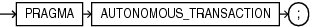
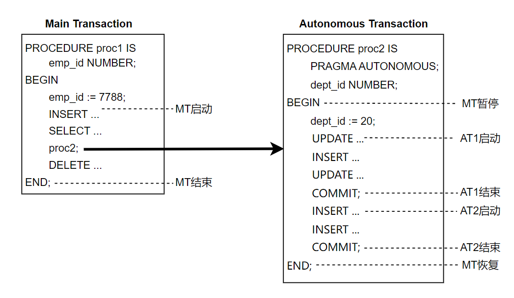
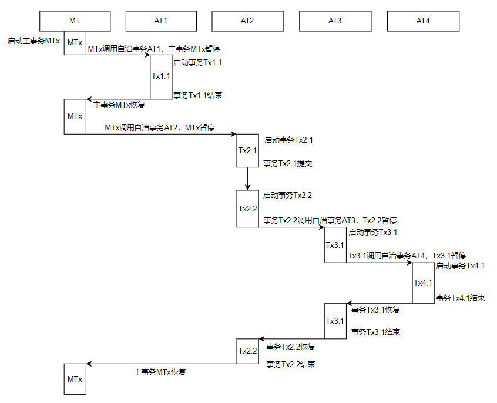

## 自治事务

自治事务是数据库的关键特性，能在一个事务上下文内启动独立事务，且其操作不影响主事务的提交或回滚。在企业级应用中，该特性常用于审计日志记录、错误处理等场景。

说明：

该该功能在V9.0.5及以后的版本中支持。

## 说明

 {width=”3.25in” height=”0.28125in”}

\[CREATE... AS\]

\[DECLARE\]

PRAGMA AUTONOMOUS\_TRANSACTION;

var1 INT;

BEGIN

\-- 执行内容

END;

/

- 自治事务的声明语法只能出现在PLiSQL块的声明部分。
- 在每个PLiSQL块中，自治语法只能声明一次。
- 支持的自治例程如下：
	- 匿名块
		顶级匿名块支持自治事务，嵌套的匿名块不支持。
		- 存储过程
		- 函数
		- 包内子程序
		- 嵌套子程序
		- 触发器

### 示例

示例1：有效声明

\--创建一个简单的测试表

CREATE TABLE employees (

employee\_id NUMBER PRIMARY KEY,

salary NUMBER(10,2)

);

DECLARE

PRAGMA AUTONOMOUS\_TRANSACTION;

BEGIN

UPDATE employees SET salary = salary - 10 WHERE employee\_id = 1;

COMMIT;

END;

/

示例2：重复声明，报错

DECLARE

PRAGMA AUTONOMOUS\_TRANSACTION;

PRAGMA AUTONOMOUS\_TRANSACTION;

BEGIN

UPDATE employees SET salary = salary - 10 WHERE employee\_id = 1;

COMMIT;

END;

/

示例3：非法位置声明，报错

DECLARE

BEGIN

PRAGMA AUTONOMOUS\_TRANSACTION;

UPDATE employees SET salary = salary - 10 WHERE employee\_id = 1;

COMMIT;

END;

/

示例4：自治匿名块

DECLARE

PRAGMA AUTONOMOUS\_TRANSACTION;

BEGIN

UPDATE employees SET salary = salary - 10 WHERE employee\_id = 1;

COMMIT;

END;

/

示例5：嵌套块不支持声明为自治块，报错

BEGIN

DECLARE

PRAGMA AUTONOMOUS\_TRANSACTION;

BEGIN

UPDATE employees SET salary = salary - 1 WHERE employee\_id = 1;

END;

UPDATE employees SET salary = salary - amount WHERE employee\_id =  
emp\_id;

END;

/

示例6：自治存储过程

CREATE OR REPLACE PROCEDURE lower\_salary(emp\_id NUMBER, amount NUMBER)  
AUTHID DEFINER AS

PRAGMA AUTONOMOUS\_TRANSACTION;

BEGIN

UPDATE employees SET salary = salary - amount WHERE employee\_id =  
emp\_id;

COMMIT;

END lower\_salary;

/

示例7：自治函数

CREATE OR REPLACE FUNCTION lower\_salary(emp\_id NUMBER, amount NUMBER)

RETURN NUMBER

AUTHID DEFINER AS

PRAGMA AUTONOMOUS\_TRANSACTION;

BEGIN

UPDATE employees SET salary = salary - amount WHERE employee\_id =  
emp\_id;

COMMIT;

RETURN salary;

END lower\_salary;

/

示例8：自治嵌套子程序

CREATE OR REPLACE PROCEDURE lower\_salary(emp\_id NUMBER, amount NUMBER)  
AUTHID DEFINER AS

PROCEDURE subproc IS

PRAGMA AUTONOMOUS\_TRANSACTION;

BEGIN

UPDATE employees SET salary = salary - amount WHERE employee\_id =  
emp\_id + 1;

DBMS\_OUTPUT.PUT\_LINE('这是嵌套子程序中的输出');

COMMIT;

END subproc;

BEGIN

UPDATE employees SET salary = salary - amount WHERE employee\_id =  
emp\_id;

subproc();

ROLLBACK;

END lower\_salary;

/

示例9：自治触发器

CREATE OR REPLACE TRIGGER log\_sal

BEFORE UPDATE OF salary ON employees FOR EACH ROW

DECLARE

PRAGMA AUTONOMOUS\_TRANSACTION;

BEGIN

INSERT INTO log (log\_id,up\_date,new\_sal,old\_sal) VALUES  
(:old.employee\_id,SYSDATE,:new.salary,:old.salary);

COMMIT;

END;

/

## 控制自治事务

在控制自治事务功能上，提供两个GUC参数：

- ivorysql.max\_autonomous\_transactions参数
	可限制实例中同时运行的自治事务的最大数量。
- ivorysql.autontrans\_nesting\_level参数
	可限制自治事务嵌套调用的级别。

### 自治事务的提交和回滚

COMMIT/ROLLBACK可以结束活动的自治事务，但不退出自治例程。当一个事务结束时，下一个SQL语句开始另一个事务。如果一个自治例程发出多个COMMIT语句，则可以包含多个自治事务。

自治事务结束时如果未显式指定COMMIT/ROLLBACK，自动提交当前自治事务。

下图展示了控制流是如何从主事务（proc1）流转到一个自治例程（proc2），然后再返回主事务的。在控制流返回主事务之前，该自治事务例程提交了两个事务（AT1和AT2）。

 {width=”6.0465277777777775in”  
height=”3.5166666666666666in”}

示例：

CREATE OR REPLACE PROCEDURE lower\_salary(emp\_id NUMBER, amount NUMBER)  
AS

PRAGMA AUTONOMOUS\_TRANSACTION;

BEGIN

UPDATE employees SET salary = salary - amount WHERE employee\_id =  
emp\_id; --事务1

COMMIT;

UPDATE employees SET salary = salary - amount WHERE employee\_id =  
emp\_id; --事务2

COMMIT;

END lower\_salary;

/

### 自治事务的隔离级别

自治事务使用会话默认隔离级别，而不是外层事务的隔离级别。

支持在自治事务设置隔离级别，在所有查询之前执行SET  
TRANSACTION语句设置隔离级别，设置的隔离级别仅对当前事务生效。

示例：

CREATE OR REPLACE PROCEDURE test\_isolevel AS

PROCEDURE subproc AS

PRAGMA AUTONOMOUS\_TRANSACTION;

alevel TEXT;

BEGIN

SHOW TRANSACTION\_ISOLATION INTO alevel;

RAISE NOTICE 'subproc: %', alevel;

END subproc;

PROCEDURE subproc1 AS

PRAGMA AUTONOMOUS\_TRANSACTION;

alevel TEXT;

BEGIN

SET TRANSACTION ISOLATION LEVEL REPEATABLE READ;

SHOW TRANSACTION\_ISOLATION INTO alevel;

RAISE NOTICE 'subproc1: %', alevel;

END subproc1;

mlevel TEXT;

BEGIN

SHOW TRANSACTION\_ISOLATION INTO mlevel;

RAISE NOTICE 'main: %', mlevel;

subproc;

subproc1;

END;

/

BEGIN;

SET TRANSACTION ISOLATION LEVEL SERIALIZABLE;

CALL test\_isolevel();

END;

### 支持嵌套与递归

自治事务支持嵌套调用，嵌套调用的最大层级为autontrans\_nesting\_level参数设置的值。

自治事务支持递归调用，但需谨慎处理事务边界和变量作用域。递归层级受autontrans\_nesting\_level参数的限制。每次递归调用都会创建一个新的独立事务上下文，与调用者事务完全隔离。

示例1：嵌套

\-- 如果表不存在，创建测试表

CREATE TABLE employees (

employee\_id NUMBER PRIMARY KEY,

salary NUMBER

);

\-- 插入测试数据

INSERT INTO employees VALUES (1, 5000);

INSERT INTO employees VALUES (2, 6000);

INSERT INTO employees VALUES (3, 7000);

CREATE OR REPLACE PACKAGE emp\_actions AUTHID DEFINER AS --  
包规范specification

FUNCTION proc(emp\_id NUMBER, sal\_raise NUMBER) RETURN NUMBER;

END emp\_actions;

/

CREATE OR REPLACE PACKAGE BODY emp\_actions AS -- 包体

\-- proc函数的定义

FUNCTION proc (emp\_id NUMBER, sal\_raise NUMBER) RETURN NUMBER IS

PRAGMA AUTONOMOUS\_TRANSACTION;

new\_sal NUMBER;

result NUMBER;

\-- subproc子函数定义

FUNCTION subproc(emp\_id NUMBER, sal\_raise NUMBER) RETURN NUMBER IS

PRAGMA AUTONOMOUS\_TRANSACTION;

BEGIN

\--子自治事务更新emp\_id+1的员工信息

UPDATE employees SET salary = salary + sal\_raise WHERE employee\_id =  
emp\_id+1;

\-- 子自治事务独立提交

COMMIT;

RETURN 1;

END subproc;

BEGIN

result:= subproc(emp\_id, sal\_raise);

\--主自治事务更新emp\_id的员工信息

UPDATE employees SET salary = salary + sal\_raise WHERE employee\_id =  
emp\_id;

SELECT salary INTO new\_sal FROM employees WHERE employee\_id = emp\_id;

\-- 注意：这里使用回滚，用于验证自治事务的独立性

ROLLBACK;

\--返回回滚前id为emp\_id的员工工资

RETURN new\_sal;

END proc;

END emp\_actions;

/

\--调用包中的函数

set serveroutput on;

DECLARE

v\_result NUMBER;

v\_after\_sal1 NUMBER;

v\_after\_sal2 NUMBER;

v\_after\_sal3 NUMBER;

BEGIN

\-- 开始一个外部事务,更新id 为3的员工薪资

UPDATE employees SET salary = salary+1000 WHERE employee\_id = 3;

\-- 调用包含嵌套自治事务的函数

\--子自治事务更新id为2的员工薪资并提交，主自治事务更新id为3的员工薪资并回滚

v\_result:= emp\_actions.proc(1, 1000);

\--输出主自治事务回滚前id为1的员工薪资

DBMS\_OUTPUT.PUT\_LINE('function\_return: ' || v\_result);

\-- 检查最终结果

SELECT salary INTO v\_after\_sal1 FROM employees WHERE employee\_id = 1;

SELECT salary INTO v\_after\_sal2 FROM employees WHERE employee\_id = 2;

SELECT salary INTO v\_after\_sal3 FROM employees WHERE employee\_id = 3;

DBMS\_OUTPUT.PUT\_LINE('after-sal1: ' || v\_after\_sal1 || ',  
after-sal2: ' || v\_after\_sal2|| ',after-sal3: ' ||  
v\_after\_sal3);

END;

/

\--输出：

function\_return: 6000

after-sal1: 5000, after-sal2: 7000,after-sal3: 8000

示例2：递归调用

CREATE OR REPLACE PROCEDURE recursive\_autonomous (p\_level NUMBER) IS

PRAGMA AUTONOMOUS\_TRANSACTION;

BEGIN

\-- 记录当前递归层级

INSERT INTO log\_table (message) VALUES ('Level: ' || p\_level);

\-- 递归终止条件（假设最大层级为10）

IF p\_level < 10 THEN

recursive\_autonomous(p\_level + 1); -- 递归调用

END IF;

END;

/

若递归调用涉及对同一数据的修改，可能导致死锁或阻塞（不同事务独立加锁）。

示例：

CREATE OR REPLACE PROCEDURE recursive\_autonomous IS

PRAGMA AUTONOMOUS\_TRANSACTION;

BEGIN

UPDATE accounts SET balance = balance - 100 WHERE id = 1; -- 事务1加锁

recursive\_autonomous(); -- 事务2尝试更新同一条数据，需等待锁释放

END;

/

### 变量的作用域

自治事务共享主事务变量的作用域，自治事务可以直接读写主事务的变量（包括包变量、局部变量），修改立即生效。

自治事务中内修改的GUC参数，在自治事务提交后生效（与主事务处理方式一致）。

示例：

SET SERVEROUTPUT ON;

CREATE OR REPLACE PROCEDURE main\_proc AS

main\_var NUMBER:= 10;

PROCEDURE autonomous\_proc IS

PRAGMA AUTONOMOUS\_TRANSACTION;

BEGIN

main\_var:= 20; -- 修改主事务变量

COMMIT;

END;

BEGIN

autonomous\_proc();

DBMS\_OUTPUT.PUT\_LINE(main\_var); -- 输出 20（修改已生效）

END;

/

\--调用存储过程，输出20

call main\_proc();

20

即使自治事务回滚，变量的修改仍然保留（因为变量是内存中的状态，不受事务控制）。

SET SERVEROUTPUT ON;

CREATE OR REPLACE PROCEDURE main\_proc AS

main\_var NUMBER:= 10;

PROCEDURE autonomous\_proc IS

PRAGMA AUTONOMOUS\_TRANSACTION;

BEGIN

main\_var:= 20;

ROLLBACK; -- 回滚不影响 main\_var 的值

END;

BEGIN

autonomous\_proc();

DBMS\_OUTPUT.PUT\_LINE(main\_var); -- 输出 20（修改已生效）

END;

/

\--调用存储过程，输出20

call main\_proc();

20

### 操作临时对象

自治事务可以认为是一个与主事务处于同一会话内的独立事务。

对于全局临时对象，如果数据是会话级（ON COMMIT PRESERVE  
ROWS），在当前会话内插入且已提交的数据对于自治事务可见，否则不可见。

对于本地临时对象，如果数据是会话级（ON COMMIT PRESERVE  
ROWS），在当前会话内插入且已提交的数据对于自治事务可见，否则不可见。

如果临时对象是在主事务内创建，在主事务提交之前临时对象对于自治事务不可见（或自治事务直接操作该临时对象报错）。

示例1：全局临时表

SET SERVEROUTPUT ON;

\-- 会话级

CREATE GLOBAL TEMP TABLE gtt(a int) ON COMMIT PRESERVE ROWS;

INSERT INTO gtt VALUES(1);

CREATE OR REPLACE PROCEDURE main\_proc AS

PROCEDURE subproc IS

PRAGMA AUTONOMOUS\_TRANSACTION;

cnt int;

BEGIN

SELECT count(\*) INTO cnt FROM gtt;

DBMS\_OUTPUT.PUT\_LINE('sub: ' || cnt);

END subproc;

mcnt int;

BEGIN

INSERT INTO gtt VALUES(2);

SELECT count(\*) INTO mcnt FROM gtt;

DBMS\_OUTPUT.PUT\_LINE('main: ' || mcnt);

subproc();

END;

/

CALL main\_proc();

\--输出：

\--main: 2

\--sub: 1

DROP TABLE gtt;

\-- 事务级

CREATE GLOBAL TEMP TABLE gtt(a int) ON COMMIT DELETE ROWS;

INSERT INTO gtt VALUES(1);

CALL main\_proc();

\--输出：

\--main: 1

\--sub: 0

示例2：本地临时表

SET SERVEROUTPUT ON;

\-- 会话级

CREATE TEMP TABLE ltt(a int) ON COMMIT PRESERVE ROWS;

INSERT INTO ltt VALUES(1);

CREATE OR REPLACE PROCEDURE main\_proc AS

PROCEDURE subproc IS

PRAGMA AUTONOMOUS\_TRANSACTION;

cnt int;

BEGIN

SELECT count(\*) INTO cnt FROM ltt;

DBMS\_OUTPUT.PUT\_LINE('sub: ' || cnt);

END subproc;

mcnt int;

BEGIN

INSERT INTO ltt VALUES(2);

SELECT count(\*) INTO mcnt FROM ltt;

DBMS\_OUTPUT.PUT\_LINE('main: ' || mcnt);

subproc();

END;

/

CALL main\_proc();

\--输出：

\--main: 2

\--sub: 1

\-- 事务级

DROP TABLE ltt;

CREATE TEMP TABLE ltt(a int) ON COMMIT DELETE ROWS;

INSERT INTO ltt VALUES(1);

CALL main\_proc();

\--输出：

\--main: 1

\--sub: 0

### 游标的可见性

- 游标的声明可见性：如果游标在主事务的块中声明，自治事务共享主事务变量的作用域，因此自治事务可以直接访问游标；若游标定义在包中，主事务和自治事务均可访问，但需注意事务独立性对数据的影响。
- 游标的数据可见性：自治事务可以访问主事务中已经打开的游标，且能读取其打开时包含的未提交数据；若自治事务自行打开游标，则会基于自治事务的快照，此时无法看到主事务未提交的数据。

示例1：自治事务使用主事务的游标

SET SERVEROUTPUT ON;

drop table t;

create table t(id number);

create or replace procedure test\_cursor as

cursor cs is select id from t;

procedure subproc is

pragma autonomous\_transaction;

sid number;

cursor subcs is select id from t;

begin

loop

fetch cs into sid;

exit when cs%NOTFOUND;

dbms\_output.put\_line('subproc: ' || sid);

end loop;

open subcs;

loop

fetch subcs into sid;

exit when subcs%NOTFOUND;

dbms\_output.put\_line('subproc1: ' || sid); -- 输出空

end loop;

close subcs;

end subproc;

begin

insert into t values(1);

open cs;

insert into t values(2);

subproc; -- 输出：1

close cs;

open cs;

subproc; -- 输出：1,2

insert into t values(3);

close cs;

end;

/

\--调用存储过程

call test\_cursor();

\--输出：

subproc: 1

subproc: 1

subproc: 2

示例2：主事务和自治事务使用包内的游标

SET SERVEROUTPUT ON;

drop table t;

create table t(id number);

insert into t values(100);

create or replace package test\_pack as

cursor cs is select id from t;

end test\_pack;

/

create or replace package body test\_pack as

END test\_pack;

/

create or replace procedure test\_cursor as

mid number;

procedure subproc is

pragma autonomous\_transaction;

sid number;

begin

insert into t values(2);

loop

fetch test\_pack.cs into sid;

exit when test\_pack.cs%NOTFOUND;

dbms\_output.put\_line('subproc: ' || sid); -- 输出：100,1

end loop;

commit;

end subproc;

begin

insert into t values(1);

open test\_pack.cs;

subproc;

close test\_pack.cs;

end;

/

\--调用存储过程

call test\_cursor();

\--输出：

subproc: 100

subproc: 1

## 事务管理机制

### 上下文隔离

主事务与嵌套例程共享其上下文，但不与自治事务共享。自治事务会创建一个独立的事务上下文，这个上下文与调用它的主事务完全隔离。

自治事务拥有独立的事务ID，与主事务无关。

当一个自治例程调用另一个自治例程（或递归调用自身）时，这些例程不共享事务上下文；当自治例程调用非自治例程时，这些例程共享相同的事务上下文。

自治事务的提交或回滚不影响主事务，主事务的提交和回滚不影响自治事务。当自治事务提交时，由自治事务所做的更改对其他事务可见。如果主事务的隔离级别设置为READ  
COMMITTED（默认值），则这些更改在它恢复时对主事务可见；如果将主事务的隔离级别设置为  
SERIALIZABLE，则其自治事务所做的更改在主事务恢复时对主事务不可见。

虽然一个自治事务是由另一个事务启动的，但它不是子事务，因为：

- 它不与主事务共享事务资源（如锁）。
- 它不依赖于主事务。例如，如果主事务回滚，子事务也会回滚，但自主事务不会回滚。
- 其提交的更改立即对其他事务可见。在主事务提交之前，子事务的已提交更改对其他事务不可见。
- 自治事务中出现的异常会导致自治事务级回滚，子事务中出现的异常如果未处理则传播到主事务。

示例：

\--创建测试表

\-- 订单表

CREATE TABLE orders (

id NUMBER PRIMARY KEY,

amount NUMBER

);

\-- 审计日志表

CREATE TABLE audit\_table (

id NUMBER GENERATED ALWAYS AS IDENTITY PRIMARY KEY,

event VARCHAR2(100),

created\_date TIMESTAMP DEFAULT CURRENT\_TIMESTAMP

);

\--创建自治存储过程

CREATE OR REPLACE PROCEDURE autonomous\_proc IS

PRAGMA AUTONOMOUS\_TRANSACTION;

BEGIN

INSERT INTO audit\_table (event) VALUES ('Autonomous Event');

COMMIT; -- 仅提交自治事务的操作

END;

/

\--开启一个事务，调用自治存储过程

BEGIN

INSERT INTO orders (id, amount) VALUES (1, 100); -- 主事务操作

autonomous\_proc();

ROLLBACK; -- 回滚主事务，但 audit\_table 的记录仍然保留

END;

/

### 事务的生命周期

当进入自治事务的可执行部分时，外层事务会暂停。当退出该自治事务时，外层事务会恢复执行。

下图展示了自治事务可能遵循的一些执行顺序：

 {width=”5.454166666666667in”  
height=”4.422916666666667in”}

### 锁与资源管理

自治事务与主事务独立获取锁，可能产生死锁。支持死锁检测。

自治事务提交或回滚后，其持有的锁和资源立即释放，不影响主事务。

示例1：死锁检测

DECLARE

PROCEDURE autonomous\_proc IS

PRAGMA AUTONOMOUS\_TRANSACTION;

BEGIN

BEGIN

LOCK TABLE table\_a IN EXCLUSIVE MODE;

DBMS\_OUTPUT.PUT\_LINE('自治事务锁表成功');

COMMIT;

EXCEPTION

WHEN OTHERS THEN

DBMS\_OUTPUT.PUT\_LINE('自治事务错误: ' || SQLERRM);

ROLLBACK;

END;

END;

BEGIN

\-- 主事务锁表

LOCK TABLE table\_a IN EXCLUSIVE MODE;

DBMS\_OUTPUT.PUT\_LINE('主事务锁表成功');

\-- 调用自治事务（预期死锁）

autonomous\_proc;

ROLLBACK;

END;

/

\--输出：

主事务锁表成功

自治事务错误: deadlock detected

### 错误处理与日志

自治事务中的异常不会传播到主事务，需在自治事务内部处理。自治事务的  
Redo日志独立记录，与主事务的日志无关。

示例：

PROCEDURE autonomous\_proc IS

PRAGMA AUTONOMOUS\_TRANSACTION;

BEGIN

RAISE\_APPLICATION\_ERROR(-20001, '自治事务错误'); -- 仅影响自治事务

EXCEPTION

WHEN OTHERS THEN

ROLLBACK; -- 自治事务回滚

END;

BEGIN

autonomous\_proc;

END;

/

### 快照与可见性

事务快照支持自治事务，元组可见性判断也支持自治事务。

示例：获取快照

CREATE TABLE log\_table(message text);

CREATE OR REPLACE PROCEDURE recursive\_autonomous (p\_level NUMBER) IS

PRAGMA AUTONOMOUS\_TRANSACTION;

BEGIN

INSERT INTO log\_table (message) VALUES (pg\_current\_snapshot()::text);

IF p\_level < 10 THEN

recursive\_autonomous(p\_level + 1);

END IF;

END;

/

CALL recursive\_autonomous(8);

SELECT \* FROM log\_table;

## 备份恢复

匿名块是临时代码块，无需备份恢复。其他的自治例程（存储过程、函数、包内子程序、嵌套子程序、触发器函数），支持备份恢复。

示例：备份之后的自治存储过程如下

\--

\-- Name: lower\_salary(number, number); Type: PROCEDURE; Schema: public;  
Owner: highgo

\--

CREATE PROCEDURE public.lower\_salary(IN emp\_id number, IN amount number)

LANGUAGE plisql SECURITY DEFINER

AS $$ PRAGMA AUTONOMOUS\_TRANSACTION;

BEGIN

UPDATE employees SET salary = salary - amount WHERE employee\_id =  
emp\_id; --事务1

COMMIT;

UPDATE employees SET salary = salary - amount WHERE employee\_id =  
emp\_id; --事务2

COMMIT;

END lower\_salary$$;

/

ALTER PROCEDURE public.lower\_salary(IN emp\_id number, IN amount number)  
OWNER TO highgo;

## 限制

- 自治事务仅在Oracle模式下支持。
- 自治事务内不支持并行查询。
- 自治事务内不支持SAVEPOINT。
- 自治事务内不支持语句级回滚。
- 实例中同时运行的自治事务的最大数量为262143。
- 自治事务的嵌套（递归）层级最大为64。
- 在PL/iSQL块末尾若存在未提交事务，自治事务会自动提交。

Oracle和HGDB V9自治事务对比表

---

| 自治事务特性 | Oracle 19c | HGDB V9 |
| --- | --- | --- |
| 嵌套调用层级限制 | 无 | 默认16，最大64 |
| 显式提交/回滚 | 需显式提交/回滚 | 事务结束自动提交 |
| SAVEPOINT | 支持 | 不支持 |
| 语句级回滚 | 支持 | 不支持 |
| 并行查询 | 支持 | 不支持 |
| 自治事务数量限制 | 无 | 默认32，最大262143 |