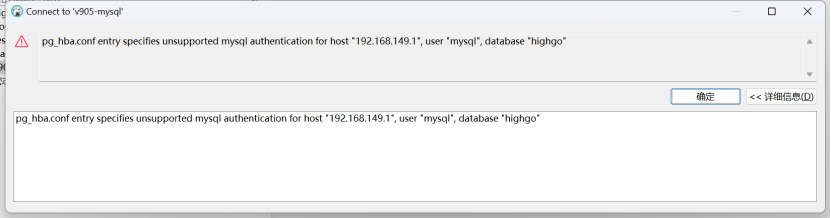
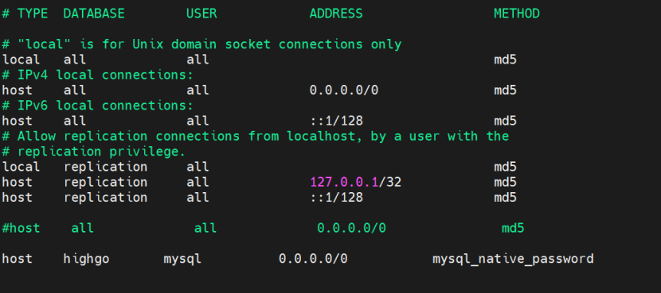
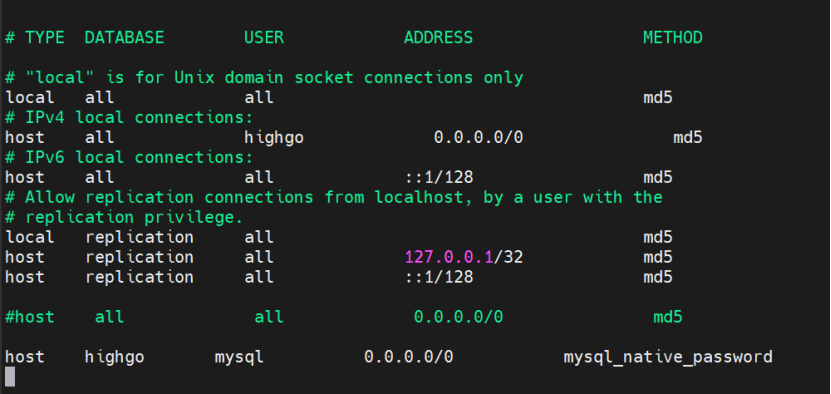
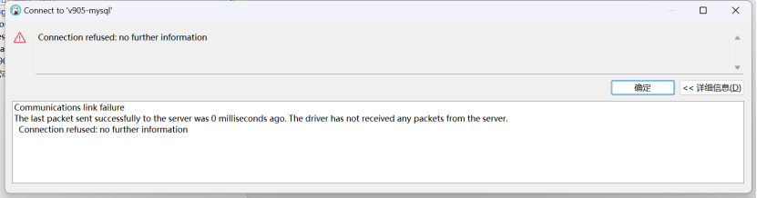
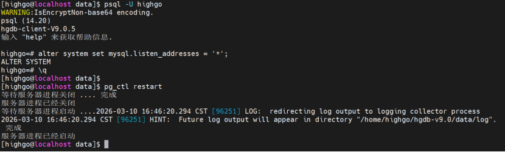

## 问题1：

使用mysql兼容用户，工具连接报错。

pg\_hba文件内容如下。

解决方案：

pg\_hba.conf文件先走了md5的密码方式，调整文件内容，设置highgo用户走md5密码方式，mysql用户走mysql\_native\_password的方式解决。

## 问题2：

工具连接报错。

> Communications link failure
> 
> The last packet sent successfully to the server was 0 milliseconds ago. The driver has not received any packets from the server.
> 
> Connection refused: no further information

解决方案：

MySQL模式监听地址没开放。

开放监听地址。

`alter system set mysql.listen_addresses = '*';`

重启数据库生效参数。

`pg_ctl  restart`

