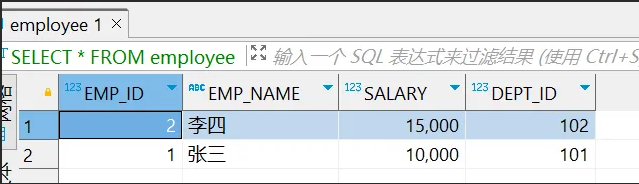
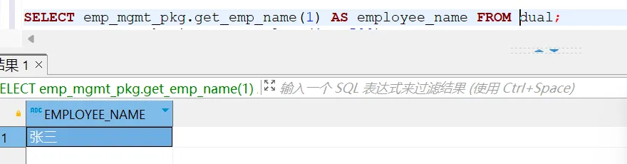
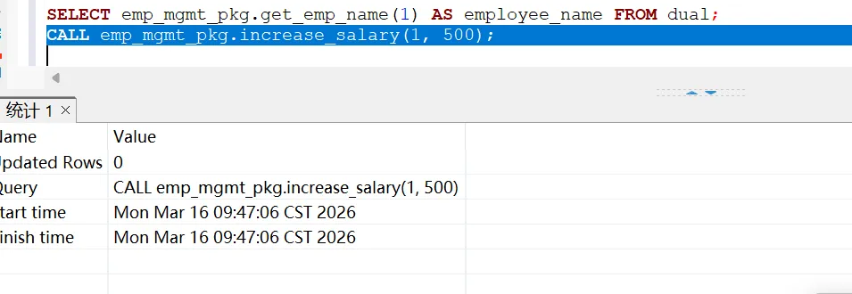
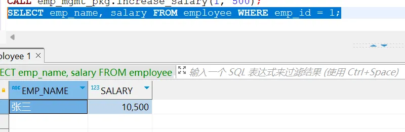

## 1.文档说明

本文档旨在指导开发人员在瀚高数据库V9的Oracle兼容模式下，如何使用PL/SQL的包和包体进行应用开发。包是PL/SQL中一种重要的封装机制，它将相关的存储过程、函数、变量、游标和异常等元素组织成一个独立的单元，从而提高代码的模块化、可维护性和执行效率。

## 2.环境信息

本文档中的示例均在以下环境中验证通过:

操作系统：CentOS Linux release 7.9.2009 (Core) x86架构

数据库版本：hgdbv9-05-0-0-5022-20251223-a09fff4-linux.x86\_64.bin

客户端工具：Manager.exe

## 3.包和包体的介绍

### 3.1 包头与包体

包是一组相关过程、函数、变量、常量、类型和游标等PL/SQL程序设计元素的组合。它具有面向对象设计的特点，是对这些元素的封装 。

包通常由两部分组成：包头（规范）和包体。

### 3.2 包头

包规范是包的“公共接口”或“声明部分”。它列出了包内所有对外可见的元素，如过程、函数、变量、游标的声明。这部分仅为使用者提供了透明的接口，不包含具体的实现代码 。就像C语言的头文件（.h）一样，告诉用户这个包能做什么。

### 3.3 包体

包体是包规范的具体实现。它包含了包规范中定义的游标和子程序的完整代码，同时还可以定义包内部使用的、对外不可见的“私有”对象（如私有变量、私有函数等）

### 3.4 使用包的优势

1. **模块化** ：将相关功能逻辑组合在一起，便于理解和维护。
2. **封装性** ：包规范定义公共接口，包体隐藏实现细节，仅暴露必要部分，提高了数据安全性。
3. **性能提升** ：当首次调用包中的某个元素时，整个包会被加载到内存中。对于后续对包中其他元素的调用，无需再次进行磁盘I/O，执行速度更快。同时，包可以拥有会话级别的全局变量，在会话生命周期内保持状态。
4. **简化依赖管理** ：修改包体的实现（只要不改变包规范中的声明）通常不会使依赖于该包规范的其他对象失效，减少了重新编译的开销。

## 4\. 语法结构

### 4.1 创建包头

```
-- 包规范中只包含声明，不包含实现。
CREATE [ OR REPLACE ] PACKAGE [ schema. ] pkg_name -- 如果包已存在，则重新创建。
IS  
    PROCEDURE SP_NAME1; --存储过程：PROCEDURE 存储过程名
    PROCEDURE SP_NAME2(P_1 IN NUMBER ....) ; ---可以写多个存储过程
 
    FUNCTION FUN_NAME1 --自定义函数: FUNCTION 函数名
        RETURN 数据类型; -- 返回一个数据类型 这一句不要忘了
 
    FUNCTION FUN_NAME2(P_1 IN NUMBER) ---可以写多个函数
        RETURN 数据类型;
END;
```

### 4.2 创建包体

```
-- 包体中的函数/过程头部必须与包规范中的声明严格匹配
CREATE [ OR REPLACE ] PACKAGE BODY [ schema. ] pkg_name 
IS
    PROCEDURE SP_NAME1 --- 跟包头里面定义的 存储过程名 一致
        IS
    BEGIN
        ......
    END ;
 
 
    PROCEDURE SP_NAME2(P_1 IN NUMBER ....)
        IS
    BEGIN
        ......
    END ;
 
    FUNCTION FUN_NAME1
        RETURN 数据类型
        IS
    BEGIN
        ......
    END FUN_NAME1;
 
    FUNCTION FUN_NAME2(P_1 IN NUMBER)
        RETURN 数据类型
        IS
    BEGIN
        ......
    END FUN_NAME2;
END;
```

### 4.3 包内元素调用

```
-- 给公有变量赋值
BEGIN
    pkg_name.public_variable := 100;
END; 
-- 调用公有函数
SELECT pkg_name.FUN_NAME2(parameters) ;

-- 调用公有存储过程
CALL pkg_name.SP_NAME2(parameters);
```

## 5\. 示例

**业务场景** ：需要一组功能来管理公司的员工信息（ `employee` ）。功能包括：根据员工ID获取姓名、给员工加薪。

### 5.1 准备基础数据

```sql
-- 创建员工表
CREATE TABLE employee (
    emp_id INT PRIMARY KEY,
    emp_name VARCHAR2(50),
2
    dept_id INT
);

-- 插入测试数据
INSERT INTO employee VALUES (1, '张三', 10000, 101);
INSERT INTO employee VALUES (2, '李四', 15000, 102);
```



### 5.2 创建包头

```
CREATE OR REPLACE PACKAGE emp_mgmt_pkg IS 
    -- 函数：根据员工ID获取员工姓名
    FUNCTION get_emp_name(p_emp_id INT) RETURN VARCHAR2;
    -- 存储过程：为指定员工加薪
    PROCEDURE increase_salary(p_emp_id INT, p_amount NUMBER);

END emp_mgmt_pkg;
```

### 5.3 创建包体

```
CREATE OR REPLACE PACKAGE BODY emp_mgmt_pkg IS
    
      FUNCTION get_emp_name(p_emp_id INT) RETURN VARCHAR2 IS
         v_name employee.emp_name%TYPE;
    BEGIN
        SELECT emp_name INTO v_name FROM employee WHERE emp_id = p_emp_id;
        RETURN v_name;
    EXCEPTION
        WHEN NO_DATA_FOUND THEN
            RETURN 'Employee Not Found';
    END get_emp_name;

     PROCEDURE increase_salary(p_emp_id INT, p_amount NUMBER) IS
    BEGIN
        UPDATE employee SET salary = salary + p_amount WHERE emp_id = p_emp_id;
         COMMIT;
    END increase_salary; 
END emp_mgmt_pkg;
```

### 5.4 调用函数

```
SELECT emp_mgmt_pkg.get_emp_name(1) AS employee_name FROM dual;
```



### 5.5 调用存储过程

```
CALL emp_mgmt_pkg.increase_salary(1, 500);
```



### 5.6 验证数据

```
SELECT emp_name, salary FROM employee WHERE emp_id = 1;
```

