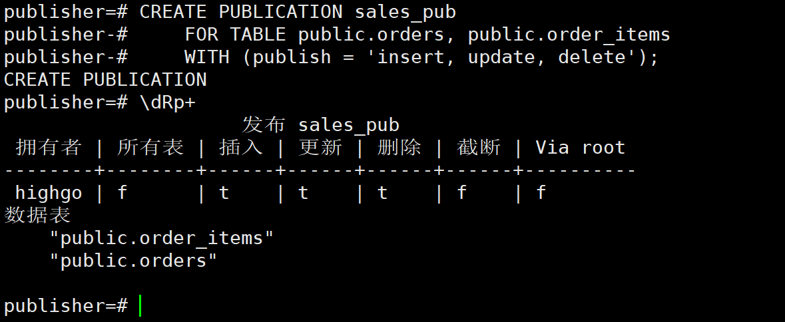
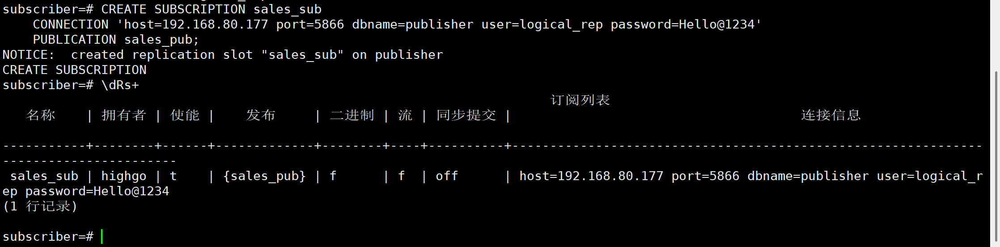
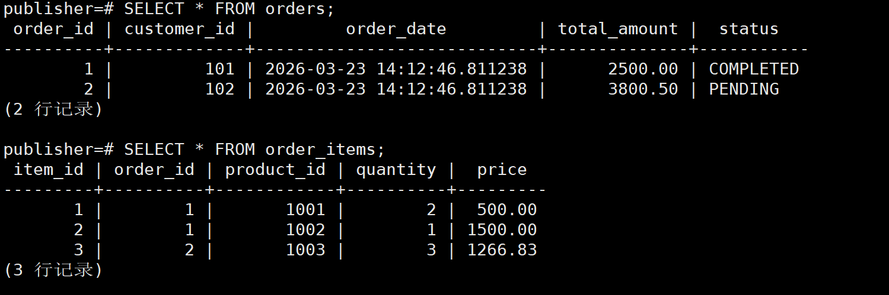
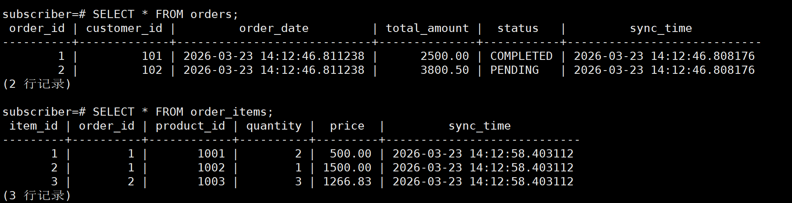
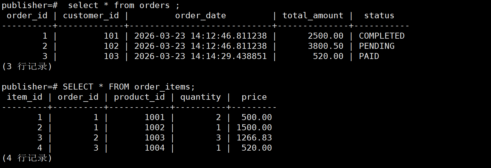
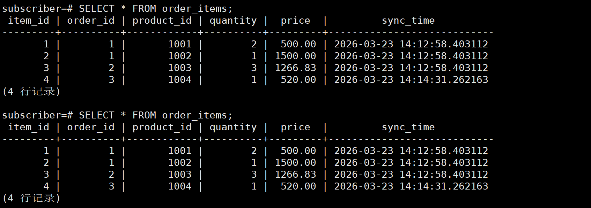
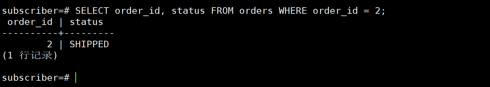
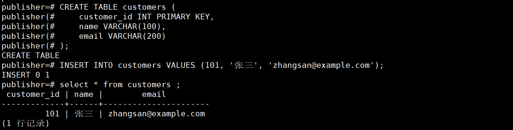
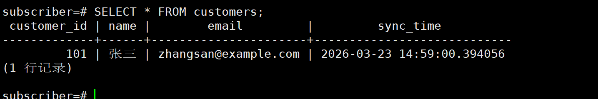

## 1.文档说明

本文档旨在指导数据库管理员和开发人员在瀚高数据库V9中配置和使用逻辑发布/订阅功能。逻辑复制（发布/订阅）是一种基于数据变更捕获的数据同步技术，允许将一台数据库服务器（发布者）上的数据更改实时复制到另一台数据库服务器（订阅者）。与物理复制不同，逻辑复制支持更细粒度的数据复制（如表级别）、跨版本复制以及异构数据库间的数据同步。

## 2.环境信息

本文档中的示例均在以下环境中验证通过:

操作系统：CentOS Linux release 7.9.2009 (Core) x86架构

数据库版本：hgdbv9-05-0-0-5022-20251223-a09fff4-linux.x86\_64.bin

客户端工具：Manager.exe

| 角色 | IP | 端口 | 数据库 | 用户名 |
| --- | --- | --- | --- | --- |
| 发布端 | 192.168.80.177 | 5866 | publisher | logical\_rep |
| 订阅端 | 192.168.80.181 | 5866 | subscriber | logical\_rep |

## 3.逻辑复制

逻辑复制是一种基于 **发布和订阅模型** 的数据复制技术。它允许将一台服务器（发布者）上的表或表的子集的数据更改，实时复制到其他服务器（订阅者）上。其核心思想是：发布者将数据更改（INSERT、UPDATE、DELETE、TRUNCATE）以逻辑变更流的形式输出，订阅者接收到这些变更后，在本地重放，从而实现数据同步.

### 3.1 工作原理

逻辑复制基于流复制技术，通过WAL（Write-Ahead Logging）来记录数据变更。当数据变更发生时，WAL会被记录并传输到订阅者。订阅者接收到WAL后，将其解析为相应的SQL语句并执行，从而实现数据的同步。

### 3.2 使用场景

- **数据备份与恢复** ：可以将一个数据库的数据变更同步到另一个数据库
- **多地数据同步** ：通过订阅可以实现多地间的数据实时同步，确保数据的一致性。
- **数据整合** ：通过订阅可以将不同数据库的数据变更同步到中央数据库，便于数据的整合与分析。
- **读写分离** ：可以将读请求分流到从库，减轻主库的负载。
- **扩展性** ：可以实现数据库的水平扩展，提高系统的整体性能

### 3.3 限制与注意事项

- **DDL不会复制** ：数据库模式的变更（如 `CREATE TABLE` 、 `ALTER TABLE` ）不会被复制，需要手工在订阅者上执行。
- **序列不会被复制** ： `SERIAL` 或 `IDENTITY` 列产生的序列值不会被复制，订阅者上的序列需要手工调整。
- **大对象不支持** ：大对象（ `BLOB` 等）不会被复制。
- **约束冲突** ：如果订阅者上的数据与流入的数据违反约束（如主键冲突），复制将停止，需要人工介入解决。
- **表必须存在** ：被发布的表必须在订阅者上预先存在，并且表结构可以与发布者不同（只要数据类型能隐式转换）。

## 4\. 语法结构

### 4.1 配置发布者

在发布者上，需要调整以下配置参数并重启数据库：

- `wal_level = logical` # 开启逻辑复制所需的WAL级别
- `max_replication_slots` # 至少设置为预期订阅数 + 表同步所需
- `max_wal_senders` # 至少设置为 `max_replication_slots` 的值

**发布者 pg\_hba.conf 配置示例（允许订阅者连接进行复制）** ：

text

```
host replication repl_user 192.168.80.181/24 md5
```

### 4.2 配置订阅者

订阅者需要调整以下参数：

- `max_replication_slots` # 至少设置为预期订阅数
- `max_logical_replication_workers` # 逻辑复制工作进程数
- `max_worker_processes` # 需要足够大以容纳所有工作进程

### 4.3 创建和管理发布

**1\. 创建发布**

```sql
-- 创建一个发布，包含表 public.orders 和 public.products
CREATE PUBLICATION my_publication
    FOR TABLE public.orders, public.products;

-- 创建一个发布，包含所有表
CREATE PUBLICATION all_tables_publication
    FOR ALL TABLES;

-- 创建一个发布，只复制 INSERT 和 UPDATE 操作
CREATE PUBLICATION insert_update_pub
    FOR TABLE public.sales
    WITH (publish = 'insert, update');
```

**2\. 修改发布**

```sql
-- 向发布中添加表
ALTER PUBLICATION my_publication ADD TABLE public.customers;

-- 从发布中移除表
ALTER PUBLICATION my_publication DROP TABLE public.products;
```

**3\. 查看发布信息**

```sql
-- 查看当前数据库中的所有发布
\dRp+

-- 通过系统目录查看
SELECT * FROM pg_publication;
SELECT * FROM pg_publication_tables;
```

**4\. 删除发布**

```sql
DROP PUBLICATION my_publication;
```

### 4.4 创建和管理订阅

**1\. 创建订阅**

```sql
-- 创建一个订阅，连接到发布者并开始同步
CREATE SUBSCRIPTION my_subscription
    CONNECTION 'host=192.168.1.100 port=5432 dbname=mydb user=repl_user password=xxx'
    PUBLICATION my_publication;
```

**2\. 启用/禁用订阅**

```sql
-- 启用订阅（开始接收更改）
ALTER SUBSCRIPTION my_subscription ENABLE;

-- 禁用订阅（停止接收更改，但保留复制槽）
ALTER SUBSCRIPTION my_subscription DISABLE;
```

**3\. 刷新订阅（从发布者获取最新的表信息）**

```sql
-- 在发布者上添加了新表到发布后，需要在订阅者上刷新
ALTER SUBSCRIPTION my_subscription REFRESH PUBLICATION;
```

**4\. 查看订阅信息**

```sql
-- 查看订阅状态
SELECT * FROM pg_stat_subscription;

-- 查看订阅定义
\dRs+
```

**5\. 删除订阅**

```sql
-- 删除订阅（同时会清理发布者上的复制槽）
DROP SUBSCRIPTION my_subscription;

-- 如果发布者不可达，保留复制槽
DROP SUBSCRIPTION my_subscription;
```

## 5.使用示例

本节将通过一个完整的案例——“销售数据实时同步”，演示从环境准备到日常维护的全流程。

**业务场景** ：有一个在线销售系统（发布者），需要将订单表（ `orders` ）和订单明细表（ `order_items` ）实时同步到另一个用于报表查询的数据库（订阅者）中。订阅者上的表结构略有不同，增加了一个 `sync_time` 字段用于记录同步时间戳。

### 5.1 环境准备

#### 5.1.1 发布者配置

**1 修改 postgresql.conf**

```bash
# 以超级用户登录，执行 SQL 查看当前设置
SHOW wal_level;
SHOW max_replication_slots;
SHOW max_wal_senders;

# 如果 wal_level 不是 logical，需要修改配置文件
# wal_level = logical
# max_replication_slots = 10
# max_wal_senders = 10
# 修改后重启数据库服务
pg_ctl restart
```

**2 创建复制用户**

```sql
CREATE USER logical_rep WITH REPLICATION LOGIN PASSWORD 'Hello@1234';
GRANT CONNECT ON DATABASE publisher TO logical_rep;
GRANT SELECT ON public.orders, public.order_items TO logical_rep; 

-- 在发布者数据库中创建基础表
CREATE TABLE public.orders (
    order_id INT PRIMARY KEY,
    customer_id INT NOT NULL,
    order_date TIMESTAMP DEFAULT CURRENT_TIMESTAMP,
    total_amount NUMERIC(10,2),
    status VARCHAR(20)
);

CREATE TABLE public.order_items (
    item_id INT PRIMARY KEY,
    order_id INT REFERENCES orders(order_id),
    product_id INT,
    quantity INT,
    price NUMERIC(10,2)
);
```

**3 配置 pg\_hba.conf**  
在发布者的 `pg_hba.conf` 文件中添加：

```shell
# 允许订阅者主机以复制用户连接
host    replication     logical_rep      192.168.80.181/24        md5
host    subscriber      logical_rep      192.168.80.181/24        md5
```

执行 `pg_ctl reload` 使配置生效。

#### 5.1.2 订阅者配置

**1 修改 postgresql.conf**

```bash
# 确保订阅者有足够的复制工作进程
max_replication_slots = 10
max_logical_replication_workers = 10
max_worker_processes = 20
# 修改后重启数据库服务
pg_ctl restart -D
```

**2 创建目标表**  
在订阅者上创建与发布者结构相似的表。订阅者表上增加一个 `sync_time` 字段。

```sql
-- 在订阅者数据库中执行
CREATE TABLE public.orders (
    order_id INT PRIMARY KEY,
    customer_id INT NOT NULL,
    order_date TIMESTAMP DEFAULT CURRENT_TIMESTAMP,
    total_amount NUMERIC(10,2),
    status VARCHAR(20),
    sync_time TIMESTAMP DEFAULT CURRENT_TIMESTAMP  -- 新增字段，用于记录同步时间
);

CREATE TABLE public.order_items (
    item_id INT PRIMARY KEY,
    order_id INT REFERENCES orders(order_id),
    product_id INT,
    quantity INT,
    price NUMERIC(10,2),
    sync_time TIMESTAMP DEFAULT CURRENT_TIMESTAMP   -- 新增字段
);
```

### 5.2 创建发布

在 **发布者** 数据库上执行：

```sql
-- 创建发布，只包含两个业务表
CREATE PUBLICATION sales_pub
    FOR TABLE public.orders, public.order_items
    WITH (publish = 'insert, update, delete');  -- 复制所有DML操作

-- 验证发布创建成功
\dRp+
```



### 5.3 创建订阅

在 **订阅者** 数据库上执行：

```sql
-- 创建订阅，连接到发布者
CREATE SUBSCRIPTION sales_sub
    CONNECTION 'host=192.168.80.177 port=5866 dbname=publisher user=logical_rep password=Hello@1234'
    PUBLICATION sales_pub;

-- 验证订阅创建成功
\dRs+
SELECT * FROM pg_stat_subscription;
```



### 5.4 验证初始数据同步

#### 5.4.1 在发布者上插入初始数据

```sql
-- 发布者操作
INSERT INTO orders (order_id, customer_id, total_amount, status) VALUES
(1, 101, 2500.00, 'COMPLETED'),
(2, 102, 3800.50, 'PENDING');

INSERT INTO order_items (item_id, order_id, product_id, quantity, price) VALUES
(1, 1, 1001, 2, 500.00),
(2, 1, 1002, 1, 1500.00),
(3, 2, 1003, 3, 1266.83);
```



#### 5.4.2 在订阅者上检查数据

```sql
-- 订阅者查询，数据应已自动同步
SELECT * FROM orders;
SELECT * FROM order_items;

-- 注意：订阅者上的 sync_time 字段会自动填充为当前时间
```



### 5.5 验证增量数据同步

#### 5.5.1 测试 INSERT

```sql
-- 发布者插入新订单
INSERT INTO orders (order_id, customer_id, total_amount, status) VALUES
(3, 103, 520.00, 'PAID');
INSERT INTO order_items (item_id, order_id, product_id, quantity, price) VALUES
(4, 3, 1004, 1, 520.00);

-- 订阅者查询，可以看到新数据
```





#### 5.5.2 测试 UPDATE

```sql
-- 发布者更新订单状态
UPDATE orders SET status = 'SHIPPED' WHERE order_id = 2;

-- 订阅者验证更新是否生效
SELECT order_id, status FROM orders WHERE order_id = 2;  -- 显示 SHIPPED
```



#### 5.5.3 测试 DELETE

```sql
-- 发布者删除已完成的订单（假设order_id=1已完成）
DELETE FROM order_items WHERE order_id = 1;  -- 注意外键约束，先删子表
DELETE FROM orders WHERE order_id = 1;

-- 订阅者验证数据已删除
SELECT * FROM orders WHERE order_id = 1;  -- 应无数据
```


### 5.6 日常维护操作

#### 5.6.1 向已有发布添加新表

现需要同步 `customers` 表。

**1：在发布者和订阅者上创建表**

```sql
-- 发布者
CREATE TABLE customers (
    customer_id INT PRIMARY KEY,
    name VARCHAR(100),
    email VARCHAR(200)
);
INSERT INTO customers VALUES (101, '张三', 'zhangsan@example.com');
GRANT SELECT ON public.customers TO logical_rep; 

-- 订阅者（结构与发布者相同或略有不同）
CREATE TABLE customers (
    customer_id INT PRIMARY KEY,
    name VARCHAR(100),
    email VARCHAR(200),
    sync_time TIMESTAMP DEFAULT CURRENT_TIMESTAMP
);
```



**2 在发布者上将新表加入发布**

```sql
ALTER PUBLICATION sales_pub ADD TABLE public.customers;
```

**3 在订阅者上刷新发布**

```sql
ALTER SUBSCRIPTION sales_sub REFRESH PUBLICATION;
```

**4 验证同步**

```sql
-- 订阅者查询
SELECT * FROM customers;  -- 包含发布的初始数据
```



#### 5.6.2 暂停/恢复复制

```sql
-- 临时暂停复制（例如进行维护）
ALTER SUBSCRIPTION sales_sub DISABLE;

-- 恢复复制
ALTER SUBSCRIPTION sales_sub ENABLE;
```

#### 5.6.3 监控复制状态

```sql
-- 查看订阅工作进程状态
SELECT subname, pid, received_lsn, latest_end_lsn, last_msg_send_time 
FROM pg_stat_subscription;

-- 查看复制槽信息（在发布者上执行）
SELECT slot_name, database, active, restart_lsn 
FROM pg_replication_slots;
```

### 5.7 处理冲突

当订阅者上的数据与流入的更改发生冲突时，复制会停止。常见冲突为主键重复。

**模拟冲突场景** ：

```sql
-- 订阅者手动插入一条与即将同步的数据冲突的记录
INSERT INTO orders (order_id, customer_id, total_amount, status) 
VALUES (4, 104, 100.00, 'NEW');  -- 假设发布者即将插入 order_id=4

-- 发布者尝试插入相同主键的记录
INSERT INTO orders (order_id, customer_id, total_amount, status) 
VALUES (4, 105, 200.00, 'PAID');
```

此时复制进程会报错停止。

**解决方案** ：跳过引起冲突的事务

```sql
-- 1. 查看冲突位置（在订阅者日志或 pg_replication_origin_status 中）
SELECT * FROM pg_replication_origin_status;
-- 2. 跳过该事务（将复制原点前移）
-- 注意：需要根据实际位置计算，通常跳过整个冲突的事务
SELECT pg_replication_origin_advance('sales_sub', '预期的LSN位置');
-- 3. 或者，解决数据冲突（例如删除或修改订阅者上的冲突行）
DELETE FROM orders WHERE order_id = 4;  -- 删除手动插入的行
-- 4. 冲突解决后，复制会自动恢复
```

### 5.8 清理环境

```sql
-- 订阅者删除订阅（同时会清理发布者上的复制槽）
DROP SUBSCRIPTION sales_sub;

-- 发布者删除发布
DROP PUBLICATION sales_pub;

-- 删除测试用户（可选）
DROP USER logical_rep;
```