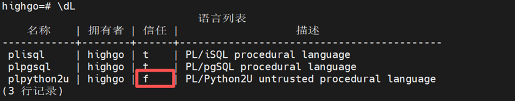
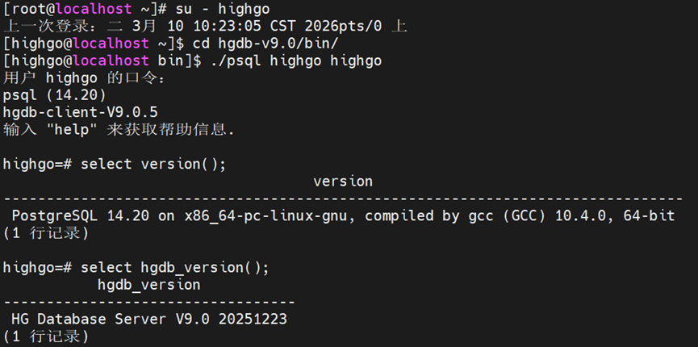
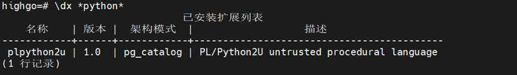
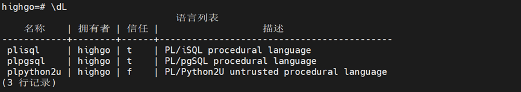
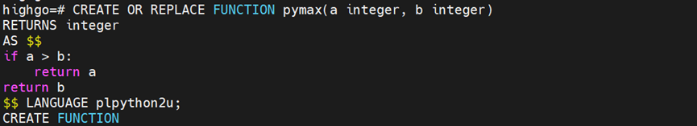
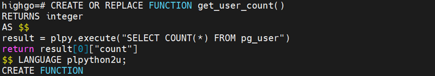
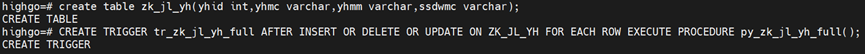
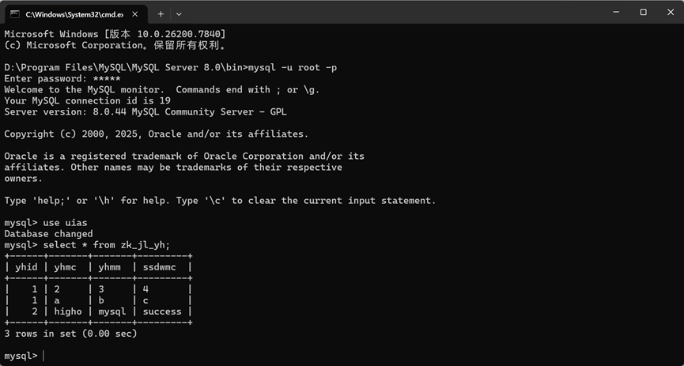

## HGDB数据库使用plpython2u扩展详解

## 一、plpython2u 简介

### 1.1扩展介绍

瀚高数据库V9.0.5的 plpython2u扩展是一个允许在数据库中使用 Python 2 编写存储过程、函数和触发器的语言扩展。它属于 PL/Python 系列与pl/sql、pl/perl、pl/java 类似，是瀚高数据库内置的过程语言之一。

### 1.2核心概念与特点

（1）语言类型  
plpython2u是一个 “不可信”（untrusted）语言，这意味着它在执行时没有内置的安全沙箱限制，可以调用任意 Python 模块和系统命令。因此，只有数据库超级用户才能创建 plpython2u函数。  
  
（2）命名规则

- plpython2u：基于 Python 2 的不可信版本（V9版本）
- plpython3u：基于 Python 3 的不可信版本（V4.5版本）
- plpythonu：默认的 Python 语言扩展（内核PostgreSQL 15 之前默认为 Python 2）  
	（3）主要功能
- 在 SQL 中直接执行 Python 代码
- 访问 Python 丰富的标准库和第三方模块
- 实现复杂的数据处理、科学计算、网络请求等逻辑
- 与数据库类型系统交互（如将 hstore类型映射为 Python 字典）  
	注意：同一会话中不能同时使用 plpython2u和 plpython3u，否则会导致符号冲突

## 二、创建plpython2u扩展（V9.0.5）

### 2.1数据库版本信息：

```
[root@localhost ~]# su - highgo
上一次登录：二 3月 10 10:23:05 CST 2026pts/0 上
[highgo@localhost ~]$ cd hgdb-v9.0/bin/
[highgo@localhost bin]$ ./psql highgo highgo
用户 highgo 的口令：
psql (14.20)
hgdb-client-V9.0.5
输入 "help" 来获取帮助信息.

highgo=# select version();
                                    version
---------------------------------------------------------------------------
 PostgreSQL 14.20 on x86_64-pc-linux-gnu, compiled by gcc (GCC) 10.4.0, 64-bit
(1 行记录)

highgo=# select hgdb_version();
           hgdb_version
----------------------------------
 HG Database Server V9.0 20251223
(1 行记录)
```



### 2.2创建扩展：

```
highgo=# create extension plpython2u;
CREATE EXTENSION
```


查看是否安装成功

```
highgo=# \dx *python*
                               已安装扩展列表
    名称    | 版本 |  架构模式  |                   描述
------------+------+------------+-------------------------------------------
 plpython2u | 1.0  | pg_catalog | PL/Python2U untrusted procedural language
(1 行记录)
```

  
查看是否能使用python语言

```
highgo=# \dL
                                语言列表
    名称    | 拥有者 | 信任 |                   描述
------------+--------+------+-------------------------------------------
 plisql     | highgo | t    | PL/iSQL procedural language
 plpgsql    | highgo | t    | PL/pgSQL procedural language
 plpython2u | highgo | f    | PL/Python2U untrusted procedural language
(3 行记录)
```



## 三、调用plsql调用python程序（V9.0.5）

### 3.1 pl/python语言测试：

```
highgo=# CREATE OR REPLACE FUNCTION pymax(a integer, b integer)
RETURNS integer
AS $$
if a > b:
    return a
return b
$$ LANGUAGE plpython2u;

highgo=# select pymax(1,2);
```



### 3.2访问 Python 丰富的标准库

```
highgo=# CREATE OR REPLACE FUNCTION get_user_count()
RETURNS integer
AS $$
result = plpy.execute("SELECT COUNT(*) FROM pg_user")
return result[0]["count"]
$$ LANGUAGE plpython2u;

highgo=# select get_user_count();
```



### 3.3、访问 Python第三方模块

创建plpython2u扩展后，除了使用最基本的标准库还能使用第三方模块；例如我们引入MYSQL-python后，就行在瀚高数据库里连接上mysql数据库；常见的是使用python创建触发器函数，函数里面定义一个mysql的操作类；实现在瀚高数据库插入数据往mysql数据库同步数据；  
连接mysql数据库前提：

```
sudo yum install MySQL-python
```

创建触发器函数：

```
highgo=# CREATE or replace FUNCTION py_zk_jl_yh_full() RETURNS trigger
    LANGUAGE plpython2u
    AS $$  
import MySQLdb as pymysql

class mysql_ctl(object):
    ''' 定义一个 MySQL 操作类'''

    def __init__(self,host,username,password,database,port):
        '''初始化数据库信息并创建数据库连接'''
        self.host = host
        self.username = username
        self.password = password
        self.database = database
        self.port = port
        self.db = pymysql.connect(self.host,self.username,self.password,self.database,self.port,charset='utf8')

    def insertdb(self,sql):
        ''' 插入数据库操作 '''
        self.cursor = self.db.cursor()
        try:
            # 执行sql
            self.cursor.execute(sql)
            self.db.commit()
        except:
            # 发生错误时回滚
            self.db.rollback()
        finally:
            self.cursor.close()

    def deletedb(self,sql):
        ''' 操作数据库数据删除 '''
        self.cursor = self.db.cursor()
        try:
            # 执行sql
            self.cursor.execute(sql)
            self.db.commit()
        except:
            # 发生错误时回滚
            self.db.rollback()
        finally:
            self.cursor.close()

    def updatedb(self,sql):
        ''' 更新数据库操作 '''
        self.cursor = self.db.cursor()
        try:
            # 执行sql
            self.cursor.execute(sql)
            self.db.commit()
        except:
            # 发生错误时回滚
            self.db.rollback()
        finally:
            self.cursor.close()

    def selectdb(self,sql):
        ''' 数据库查询 '''
        self.cursor = self.db.cursor()
        try:
            self.cursor.execute(sql) # 返回 查询数据 条数 可以根据 返回值 判定处理结果
            data = self.cursor.fetchall() # 返回所有记录列表
            #print(data)
            # 结果遍历
            for row in data:
                sid = row[0]
                name = row[1]
                # 遍历打印结果
                print('sid = %s,  name = %s'%(sid,name))
        except:
            print('Error: unable to fecth data')
        finally:
            self.cursor.close()

    def closedb(self):
        ''' 数据库连接关闭 '''
        self.db.close()

if __name__ == '__main__':
    tr_event=TD["event"]
    if tr_event=='UPDATE':
        tr_old_yhid=TD["old"]['YHID']
        tr_new_yhid=TD["new"]['YHID']
        tr_new_yhmc=TD["new"]['YHMC']
        tr_new_yhmm=TD["new"]['YHMM']
        tr_new_ssdwmc=TD["new"]['SSDWMC']
        mysql_db = mysql_ctl('192.168.11.81','root','mysql','uias',3306)
        mysql_db.updatedb('update uias.zk_jl_yh set yhid = "%s",yhmc = "%s",yhmm = "%s",ssdwmc = "%s" where yhid = "%s"' %(tr_new_yhid,tr_new_yhmc,tr_new_yhmm,tr_new_ssdwmc,tr_old_yhid))
        mysql_db.closedb()
    if tr_event=='DELETE':
        tr_old_yhid=TD["old"]['YHID']
        mysql_db = mysql_ctl('192.168.11.81','root','mysql','uias',3306)
        mysql_db.deletedb('delete from uias.zk_jl_yh where yhid = "%s"' %(tr_old_yhid))
        mysql_db.closedb()
    if tr_event=='INSERT':
        tr_new_yhid=TD["new"]['yhid']
        tr_new_yhmc=TD["new"]['yhmc']
        tr_new_yhmm=TD["new"]['yhmm']
        tr_new_ssdwmc=TD["new"]['ssdwmc']
        mysql_db = mysql_ctl('192.168.11.81','root','mysql','uias',3306)
        mysql_db.insertdb('insert into uias.zk_jl_yh(yhid,yhmc,yhmm,ssdwmc) values ("%s","%s","%s","%s")'%(tr_new_yhid,tr_new_yhmc,tr_new_yhmm,tr_new_ssdwmc))
        mysql_db.closedb()    
$$;

创建表和触发器
highgo=# create table zk_jl_yh(yhid int,yhmc varchar,yhmm varchar,ssdwmc varchar);

highgo=# CREATE TRIGGER tr_zk_jl_yh_full AFTER INSERT OR DELETE OR UPDATE ON ZK_JL_YH FOR EACH ROW EXECUTE PROCEDURE py_zk_jl_yh_full();
```



```
进行验证：
highgo=# insert into zk_jl_yh values (2,'higho','mysql','success');
```


在mysql数据库里面进行验证：  


## 四、plpython2u 迁移到 plpython3u：

plpython2u 和plpython3u 差距比较小一般只需要调整LANGUAGE处的声明就行  
plpython2u：

```
highgo=# CREATE OR REPLACE FUNCTION get_user_count()
RETURNS integer
AS $$
result = plpy.execute("SELECT COUNT(*) FROM pg_user")
return result[0]["count"]
$$ LANGUAGE plpython2u;
```

plpython3u：

```
highgo=# CREATE OR REPLACE FUNCTION get_user_count()
RETURNS integer
AS $$
result = plpy.execute("SELECT COUNT(*) FROM pg_user")
return result[0]["count"]
$$ LANGUAGE plpython3u;  --将plpython2u改为plpython3u
```

## 五、重要限制与注意事项

1. 安全风险：由于是不可信语言，创建时需确保代码不会执行危险操作
2. 版本兼容：plpython2u仅支持 Python 2.x，Python 3 代码需要使用 plpython3u
3. 会话限制：同一会话不能混用 Python 2 和 Python 3 扩展
4. 功能限制：不支持可更新的游标
5. 语言性能：plpython2u在性能不如PL/pgSQL（性能最佳），尽量使用PL/pgSQL