## HGDB数据库使用TimescaleDB插件详解

## 一、插件介绍

### 1.1 什么是TimescaleDB？

TimescaleDB 是一个基于 PostgreSQL 的开源时序数据库扩展，它在完全兼容 PostgreSQL 所有功能的基础上，针对时序数据（如监控指标、传感器数据、金融行情）的存储、查询和分析进行了深度优化；如物联网（IoT）设备数据、系统监控指标、日志事件、金融交易记录等。与其他时序数据库不同，TimescaleDB 的独特之处在于：

- 用户无需切换数据库系统，即可在现有 HGDB 上扩展时序数据处理能力；
- 支持完整的SQL语法，兼容 HGDB 的所有功能（如事务、索引、视图、JSON 支持等）；
- 兼具关系型数据库的灵活性与时序数据库的高性能。

### 1.2 核心特性

| 特性 | 说明 |
| --- | --- |
| Hypertable（超表） | 自动将大表按时间维度拆分为多个“块”（Chunks），实现高效的时间分区管理，提升查询和写入性能。 |
| 自动分区与透明访问 | 数据写入Hypertable后，系统自动路由到对应的时间块，用户仍使用标准SQL操作，无需关心底层分区逻辑。 |
| 压缩（Compression） | 支持对旧数据进行列式压缩，显著降低存储成本（通常可节省50%-90%空间），同时支持压缩后查询。 |
| 连续聚合（Continuous Aggregates） | 预计算并自动更新聚合视图（如每小时平均温度），极大加速高频聚合查询。 |
| 强大的时间窗口函数支持 | 提供丰富的时序分析函数，如 time\_bucket、first()、last() 等，简化复杂时间分析。 |

### 1.3 适用场景

- 实时监控系统（服务器、网络、应用性能）
- 物联网设备数据采集与分析
- 金融行情数据存储与回测
- 日志与事件流处理
- 告警与审计数据平台

### 1.4 与HGDB传统表的区别

| 特性维度 | HGDB | TimescaleDB (作为扩展) |
| --- | --- | --- |
| 核心定位 | 通用关系型数据库 | 时序数据优化 |
| 数据模型 | 普通关系表 | 超表，自动按时间分区 |
| 分区管理 | 需手动设置分区表 | 自动分片，管理后台块 |
| 查询优化 | 通用查询优化 | 内置时序函数（如降采样、时间桶） |
| 压缩 | 基础表压缩 | 高级列式压缩，大幅节省存储空间 |
| 持续聚合 | 需手动刷新物化视图 | 自动增量刷新的持续聚合视图 |

## 二、插件安装（V9.0.5）

以瀚高安全版数据库系统 V9.0.5 + CentOS 7 环境为例，介绍 TimescaleDB 插件的完整安装流程：（V9.0.5跟V4.5不同没有内置timescaledb扩展，需要下载单独的插件包；先安装插件包再创建扩展）

### 2.1安装插件包

```
[highgo@localhost ~]$ tar -zxvf timescaledb-2.19.3-5007-20251218-e863f80-linux.x86_64.tar.gz
```

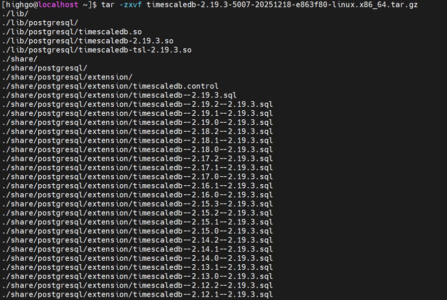  
解压之后，会生成两个文件，一个lib文件夹、一个share文件夹；将这两个文件夹复制到hgdb-v9.0对应的lib和share路径下：

```
[highgo@localhost ~]$ cp share/postgresql/extension/timescaledb* hgdb-v9.0/share/postgresql/extension/
[highgo@localhost ~]$ cp lib/postgresql/timescaledb* hgdb-v9.0/lib/postgresql/
```

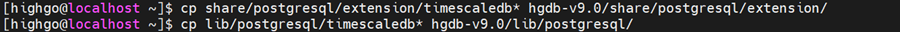

### 2.2 创建TimescaleDB扩展

#### 2.2.1调整shared\_preload\_libraries参数

```
alter system set shared_preload_libraries = timescaledb;
```

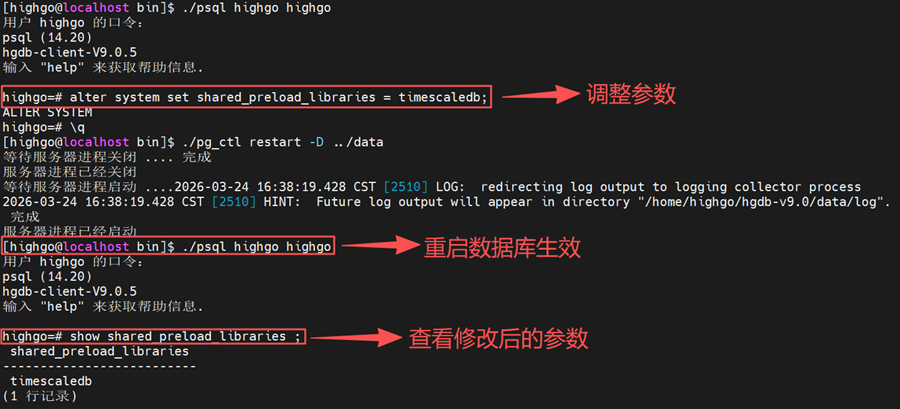

#### 2.2.2、创建扩展

```
create extension timescale;
```

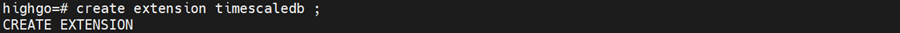

### 2.3 验证安装是否成功

连接 HGDB 并执行以下命令：  
注意与4.5版本不同，V9是2.19.3版本，而4.5是2.10.4版本  
– 查看已安装扩展 /dx  
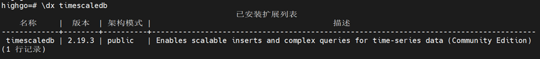

## 三、插件使用（V9.0.5）

### 3.1 创建并使用 Hypertable（超表）

Hypertable 超表是 TimescaleDB 的核心概念，理解超表是使用 TimescaleDB 的关键。你可以将它视为一个虚拟的、自动管理的主表，其背后数据实际按时间（并可附加其他维度）被自动分割成易于管理的块。这种设计带来了两大优势：  
（1）对于新写入的数据，它像操作一张普通表一样简单；  
（2）对于查询，特别是涉及时间范围的查询，数据库引擎可以快速定位到相关的数据块，避免全表扫描，从而极大提升性能

```
--创建普通表
CREATE TABLE sensor_data (
    time TIMESTAMPTZ NOT NULL, -- 必须包含时间戳字段
    sensor_id INTEGER,
    temperature DOUBLE PRECISION,
    location TEXT
);
--创建超表指定分区时间间隔（例如7天）
SELECT create_hypertable('sensor_data', 'time', chunk_time_interval => INTERVAL '7 days', if_not_exists => TRUE);

--正常插入数据，增删改查语法跟HGDB普通表一样
INSERT INTO sensor_data (time, sensor_id, temperature, location)
VALUES(NOW(), 1, 23.5, 'room_a'),
      (NOW(), 2, 18.9, 'room_b');
      
--使用 TimescaleDB 强大的时序函数查询数据。例如，按每5分钟分组计算每个传感器的平均温度
SELECT
    time_bucket('5 minutes', time) AS five_min, -- 时间桶函数
    sensor_id,
    AVG(temperature) as avg_temp,
    location
FROM sensor_data
WHERE time > NOW() - INTERVAL '1 day'
GROUP BY five_min, sensor_id, location
ORDER BY five_min DESC;
```

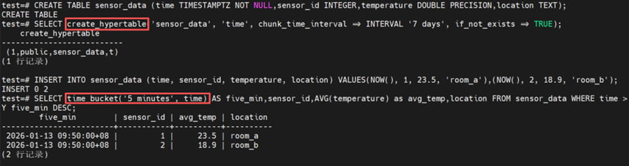

### 3.2空间分片

可以实现多维度并行优化。写入时，数据会同时根据时间和传感器ID哈希值分布到不同的物理块。这允许在查询特定时间范围且特定一组传感器时，数据库可以并行扫描多个分片，大幅提升并发性能。

```
-- 创建表
CREATE TABLE sensor_metrics (
    time TIMESTAMPTZ NOT NULL,
    sensor_id INTEGER NOT NULL,
    temperature DOUBLE PRECISION,
    cpu_usage DOUBLE PRECISION
);

-- 创建超表时指定空间分片,按 sensor_id 进行空间分片
SELECT create_hypertable(
    'sensor_metrics', 
    'time',                          -- 时间分区列
    chunk_time_interval => INTERVAL '7 days',
    partitioning_column => 'sensor_id',  -- 空间分片列
    number_partitions => 4               -- 分区数量
);

--插入数据
INSERT INTO sensor_metrics VALUES('2025-06-01', 1, 23.5, 64.2),('2025-06-08', 2, 18.9, 45.7),('2025-06-08', 2, 18.9, 48.7),('2025-06-08', 2, 18.9, 45.2);

-- 查看超表的分区块 (chunks)
SELECT show_chunks('sensor_metrics');
```

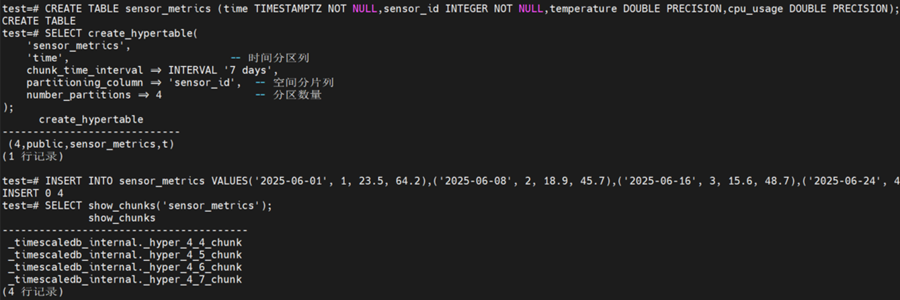

### 3.3自动化数据压缩

这是节省存储成本的关键特性。压缩通常在后台自动进行。压缩后，数据转为列式存储。对于查询 SELECT avg(temperature) FROM sensor\_metrics WHERE time > NOW() - INTERVAL ‘30 days’，数据库只需读取temperature和time 两列，而非整行数据，I/O效率极高。通常可实现 10倍以上的存储节省。

```
-- 1. 首先在表级别启用压缩
ALTER TABLE sensor_metrics SET (
    timescaledb.compress,
    timescaledb.compress_orderby = 'time DESC, sensor_id'
);

-- 2. 设置压缩策略：对7天前的数据块自动启用压缩
SELECT add_compression_policy('sensor_metrics', INTERVAL '7 days');

-- 3. 手动压缩某个时间范围
SELECT compress_chunk(i)
FROM show_chunks('sensor_metrics', older_than => INTERVAL '7 days') i;

-- 4. 查看压缩统计信息
SELECT * FROM timescaledb_information.compression_settings WHERE hypertable_name = 'sensor_metrics';
```

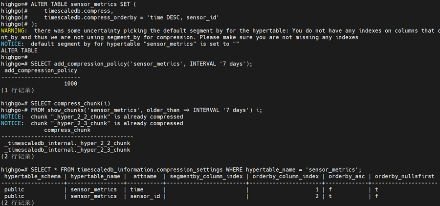

### 3.4 持续聚合与实时聚合

这是实现高性能时序分析的核心。持续聚合物化视图会自动在后台增量刷新。当新的数据写入sensor\_metrics 时，TimescaleDB 只计算新数据对应的聚合，并且与旧结果合并，避免了全量重算。这使得在TB级数据上查询聚合指标也能达到亚秒级响应，非常适合实时仪表盘。

```
-- 创建持续聚合视图：按传感器和1小时粒度预计算
CREATE MATERIALIZED VIEW sensor_hourly
WITH (timescaledb.continuous) AS
SELECT
    sensor_id,
    time_bucket('1 hour', time) AS bucket,
    AVG(temperature) AS avg_temp,
    MAX(cpu_usage) AS max_cpu,
    MIN(cpu_usage) AS min_cpu
FROM sensor_metrics
GROUP BY sensor_id, bucket;

-- 为持续聚合添加刷新策略：每30分钟刷新一次
SELECT add_continuous_aggregate_policy('sensor_hourly',
    start_offset => INTERVAL '3 days', -- 刷新最近3天内的数据
    end_offset => INTERVAL '1 hour',
    schedule_interval => INTERVAL '30 minutes');

-- 查询聚合数据就像查普通视图一样快
SELECT * FROM sensor_hourly
WHERE bucket > NOW() - INTERVAL '1 day'
ORDER BY bucket DESC LIMIT 10;
```

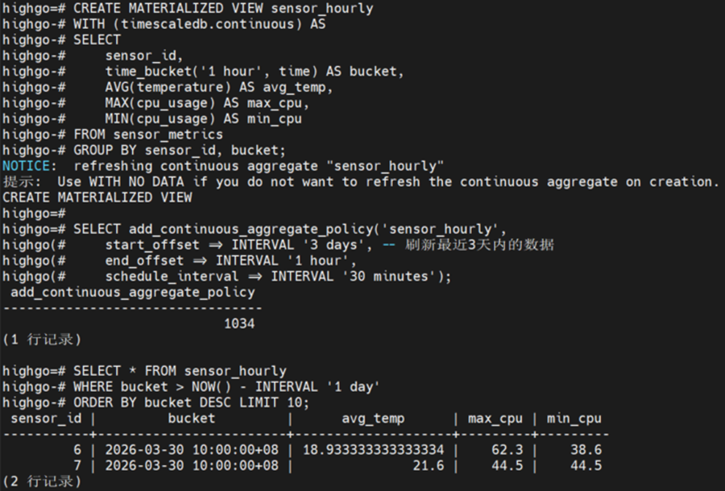

### 3.5 数据保留策略

自动管理数据生命周期，实现“热-温-冷”数据分层。

```
-- 添加数据保留策略：自动删除90天前的原始数据
SELECT add_retention_policy('sensor_metrics', INTERVAL '90 days');

-- 手动删除旧数据
SELECT drop_chunks(
    'sensor_data',
    older_than => INTERVAL '30 days'
);

-- 查看分块信息
SELECT 
    hypertable_name,
    chunk_name,
range_start,
    range_end
FROM timescaledb_information.chunks
WHERE hypertable_name = 'sensor_data';

-- 查看所有策略
SELECT * FROM timescaledb_information.jobs;
```

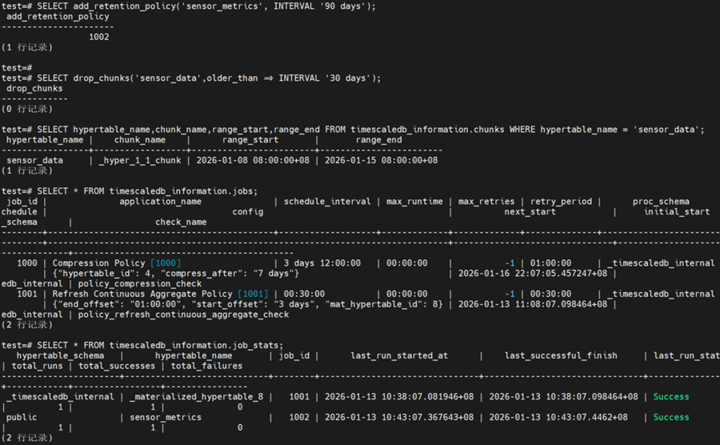

### 3.6高级时序分析函数

TimescaleDB 内置了丰富的时序分析函数，简化复杂查询。

```
-- 计算时段差异：找出每个传感器本次读数与上一次的差值
SELECT
    time,
    sensor_id,
    temperature,
    temperature - LAG(temperature) OVER (PARTITION BY sensor_id ORDER BY time) AS temp_diff
FROM sensor_metrics
WHERE sensor_id = 1
ORDER BY time
LIMIT 10;

 

-- 滚动窗口计算：计算每个传感器温度的4小时滚动平均值
SELECT
    time,
    sensor_id,
    temperature,
    AVG(temperature) OVER (
        PARTITION BY sensor_id
        ORDER BY time
        ROWS BETWEEN 3 PRECEDING AND CURRENT ROW -- 当前行及之前3行（共4小时）
    ) AS rolling_avg_4h
FROM sensor_metrics
WHERE time > NOW() - INTERVAL '1 day';
```

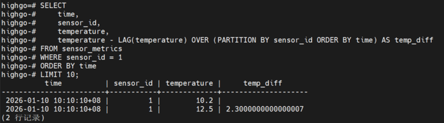