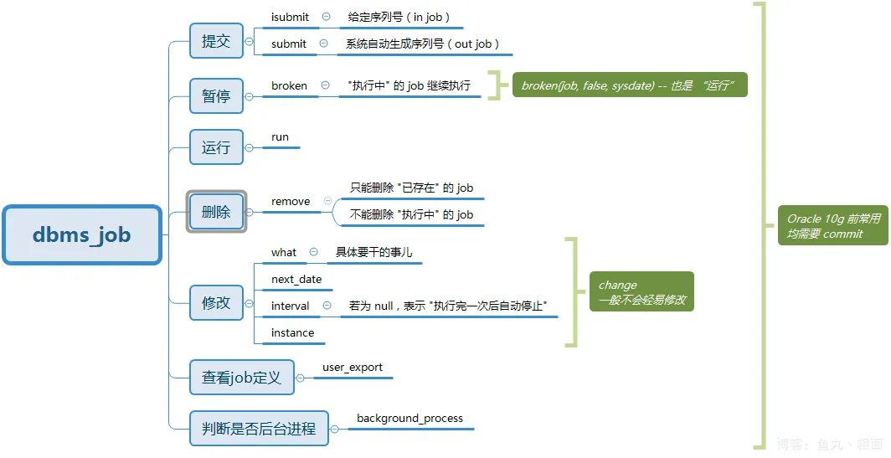

#### 手动启动pgagent定时任务进程

```shell
# 手动启动pgagent服务
[hgadmin@highgo1 hgdb]$ /home/hgadmin/hgdb/bin/pgagent hostaddr=127.0.0.1 dbname=water user=system port=1521 -s /home/hgadmin/hgdb/bin/agent_water.log -t 1

[hgadmin@highgo1 hgdb]$ ps -ef | grep pgagent
hgadmin   11105      1  0 10:54 ?        00:00:00 /home/hgadmin/hgdb/bin/pgagent hostaddr=127.0.0.1 dbname=water user=system port=1521 -s /home/hgadmin/hgdb/bin/agent_water.log -t 1
```

#### 脚本启动pgagent定时任务进程

> 集群环境（每个节点配置）（只会在主节点启动pgagent进程，脚本每三分钟检查集群pgagent进程）

```shell
# 创建定时监控
[hgadmin@highgo1 hgdb]$ crontab -l
*/3 * * * * sh /home/hgadmin/hgdb/pgagent_mintor.sh
```
```shell
[hgadmin@highgo1 hgdb]$ vim /home/hgadmin/hgdb/pgagent_mintor.sh

#!/bin/bash
#数据库Bin目录
bin_dir=/home/hgadmin/hgdb/bin
#数据库名称
dbname=water
#pgagent 数据库集合
pgagent_dbname="water"
#端口号
port=1521
#数据库用户名
username=system
#数据库用户密码
passwd=system
#ip地址
host_ip=127.0.0.1
#pgagent数据库日志目录
agent_dir=/home/hgadmin/hgdb/bin
#网关
gate_way_ip=192.168.239.2
#数据库VIP
vip=192.168.239.130
#监控脚本日志名称
mintor_log=/home/hgadmin/hgdb/hgdb_logpgagent_mintor.log
```

#### system用户为普通用户赋权

```sql
-- wateruser为普通用户
grant execute on package sys.dbms_job to wateruser;
grant usage on schema pgagent to public;
grant all on all sequences in schema pgagent to public;
grant all on all tables in schema pgagent to public;
```

#### dbms\_job



```sql
-- 1.创建job
DECLARE
    jobno integer;
BEGIN
DBMS_JOB.submit( jobno     out binary_integer,--输出变量，是此任务在任务队列中的编号，也可以自定义，一般不传
                 what      in varchar2,--执行的任务的名称及其输入参数
                 next_date in date default sysdate,--任务执行的时间
                 interval  in varchar2 default 'null',--任务执行的时间间隔
                 no_parse  in boolean default false, -- 是否需要解析与 job 相关的过程
                 instance  in binary_integer default 0, -- 指定哪个实例可以运行 job
                 force     in boolean default false); -- 是否强制运行与 job 相关的实例
END;

--说明：参数 no_parse、instance、force 一般不指定

-- 2、删除job: dbms_job.remove(jobno); -- jobno任务号

-- 3、修改要执行的操作: job:dbms_job.what(jobno, what); --指定任务号以及存储过程

-- 4、修改下次执行时间：dbms_job.next_date(jobno, next_date); --指定任务号的时间

-- 5、修改间隔时间：dbms_job.interval(jobno, interval); --指定任务号的间隔时间

-- 6、启动job: dbms_job.run(jobno); --指定任务号启动

-- 7、停止job: dbms.broken(jobno, broken, nextdate); –broken为boolean值 N代表启动，Y代表没启动（STOP）
```

#### 测试用例

##### 用例一

###### 准备数据

```sql
-- 测试数据
DROP TABLE wateruser.student;
CREATE TABLE wateruser.student (id serial,name VARCHAR2(10));
SELECT * FROM wateruser.student;    -- truncate student;
insert INTO student values(1,'孙悟空');

CREATE OR REPLACE PROCEDURE wateruser.test_job()
AUTHID DEFINER
IS
BEGIN 
    INSERT INTO wateruser.student(name) values('孙悟空');
END test_job;
```

###### 创建job

```sql
-- 定时任务 创建job并返回jobid
DECLARE
    jobno integer;
BEGIN
    DBMS_JOB.SUBMIT(
            job => jobno,
            what => 'wateruser.test_job();',
            next_date => SYSDATE, -- 立即开始
            interval => 'SYSDATE + 1/1440' -- 每分钟一次 (1天=1440分钟)
    );
    RAISE NOTICE 'Job number: %', jobno;
END;
--返回jobid

-- 或 
CALL DBMS_JOB.SUBMIT('','wateruser.test_job();',sysdate,'SYSDATE + 1/1440')
--返回jobid
```

###### 查询job

```sql
SELECT * FROM all_jobs;
SELECT * FROM user_jobs;
SELECT * FROM dba_jobs_running;
SELECT * FROM pgagent.PGA_JOBSTEPLOG where jsljstid = 38;
```

###### 修改job

```sql
-- 1、删除job: 
call dbms_job.remove(jobno);
call dbms_job.remove(1);

-- 2、修改要执行的操作: job:
call dbms_job.what(jobno,what);
call dbms_job.what(1,'wateruser.test_job2();');

-- 3、修改下次执行时间：
call dbms_job.next_date(jobno,next_date);
call dbms_job.next_date(1,sysdate + 3/1440);

-- 4、修改间隔时间：
call dbms_job.interval(jobno, interval);
call dbms_job.interval(1, 'SYSDATE + 10/1440');

-- 5、启动job:
call dbms_job.run(jobno);
call dbms_job.run(1);

-- 6、停止job: broken为boolean值
call dbms_job.broken(jobno, broken, nextdate);
call dbms_job.broken(41,true);-- true/false
```

##### 用例二

###### 准备数据

```sql
CREATE OR REPLACE PROCEDURE wateruser.test_job()
AUTHID current_user  
IS
    random_name int;
    sqlstr VARCHAR2;
BEGIN 
    SELECT (RANDOM()*1000)::int INTO random_name;
    RAISE notice'random_name:%',random_name;
    sqlstr := 'CREATE TABLE wateruser.jod_'||random_name||'(id int);';--存储过程中含有创建对象的操作
    RAISE notice'sqlstr:%',sqlstr;
    EXECUTE sqlstr;
END test_job;
```

###### 创建job

```sql
CALL DBMS_JOB.SUBMIT('','set local session authorization wateruser; wateruser.test_job();',sysdate,'SYSDATE + 1/1440')
```

#### 注意

- 当存储过程中含有创建对象且被定义为authid invoker，或使用plpgsql语法时，在定时任务的what中需要添加set local session authorization user\_name；否则定时任务创建的对象的属主将会是system用户，导致普通用户调用无权限。