## 迁移工具420

> 文档使用HgMigration4.2.0-20241218版本编辑

### 工具安装

介质：HgMigration4.2.0-20241218.zip， 该版本瀚高迁移工具以免安装的方式使用，直接解压工具的 zip 介质包即可，包括 windows 平台和 linux 平台（不同平台共用同一个介质包）。以 windows 平台

为例，解压后的目录结构如图所示：

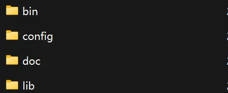

### 工具启动

在 windows 平台下，可以在 cmd 或者 powershell 中进入迁移工具解压后的安装，目录的 bin 目录中，然后执行 startup.bat 脚本，以 CMD 环境为例：

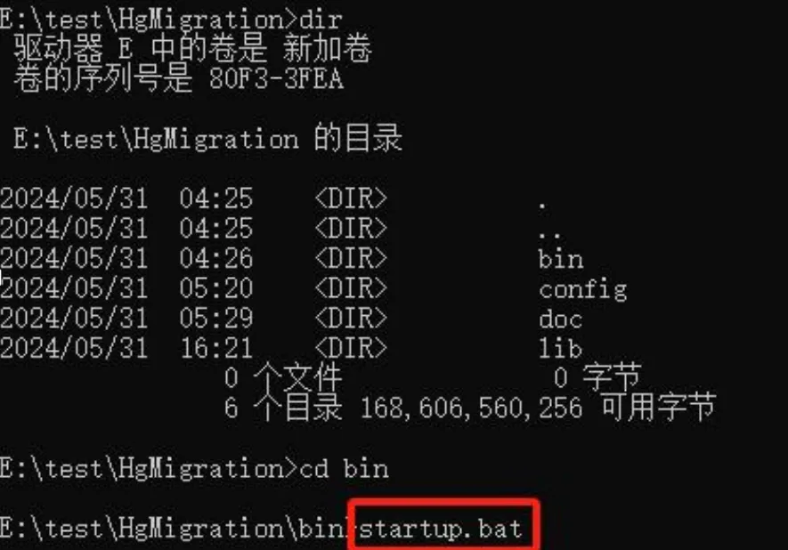

在 linux 平台下，可以在 terminal 中进入迁移工具解压后的安装目录的 bin 目录

中，然后执行./startup.sh 脚本。

### 迁移配置

迁移相关的配置目前主要分为两部分，迁移任务配置及数据源配置，使用不同的配置文件，文件位置在$HG\_MIGRATION\_HOME/config/config 下。

datasource.yml：该文件配置迁移所需要的数据源信息，如数据连接串、用户名 密码等，该文件中包括所有的数据源的配置信息，通过数据源名称进行唯一识别；

migration.yml：该文件配置迁移过程中的参数，如需要迁移的对象、分片配置、线程池配置等；

### 数据源配置

数据源配置对应的配置文件为 datasource.yml：

```sql
hgmigration:
datasources:
- name: oracle-ds
# 源端的数据库类型（可选：TODO）
db-type: oracle
datasource:
# druid 连接池配置（支持所有 Druid 参数配置）
druid:
driverClassName: oracle.jdbc.OracleDriver
url: jdbc:oracle:thin:@192.168.10.197:1521:orcl
username: migrate2
password: aaaaaa
initialSize: 50
maxActive: 200
minIdle: 10
maxWait: -1
# 是否缓存 preparedStatement，也就是 PSCache。PSCache 对支持游标的数据库性能提升巨大，
例如 ORACLE
# 在 Mysql5.5 以下的版本中没有 PSCache 功能，建议关闭掉
poolPreparedStatements: true
#配置间隔多久才进行一次检测，检测需要关闭的空闲连接，单位是毫秒
timeBetweenEvictionRunsMillis: 60000
#配置一个连接在池中最小生存的时间，单位是毫秒
minEvictableIdleTimeMillis: 300000
filters: stat,wall
validationQuery: SELECT 1 FROM dual
```

**name \*\*\*\* ：** 数据源的名称，这个名称会在 migration.yml 文件中使用；

**db-type \*\*\*\* ：** 数据源的类型，目前使用的为 oracle 、 highgov4\_5 、 highgov9 ；

**datasource：** 连接池的配置，该配置项下的子配置项都为 druid 的配置参数，根据数据源情况修改相应的配置项即可；

### 迁移配置

迁移配置文件的整体结构，对应的配置文件为 migration.yml：

```sql
hgmigration:
  migrate:
    task-name: migration-task   # 迁移任务名称
    source:
      # 设置源端数据源别名
      name: oracle-ds
    target:
      # 设置目标端数据源别名
      name: highgov9-o-ds
    thread-pool:
      # 读取元数据使用的线程池
      read:
0
        core-size: 16    # 2 * N(CPU)
        max-size: 16     #
        queue-size: 2000 #
        alive-time: 60   # 单位(秒)
      # 数据迁移连接池
      # 建议该线程池配置为与"write"连接池配置相同
      data:
0
        core-size: 16    # 2 * N(CPU)
        max-size: 16     #
        queue-size: 2000 #
        alive-time: 60   # 单位(秒)
      # 目标端写入对象使用的线程池
      write:
0
        core-size: 16    # 2 * N(CPU)
        max-size: 16     #
        queue-size: 2000 #
        alive-time: 60   # 单位(秒)
    options:
      # 迁移表对象类型选择(可选：all, data, struct, allconstraint, PK, unique, check, FK)
      migrate-table-type: all
      # 迁移对象类型选择(可选：all, dblink, directory, function, index, job, materialized_view, package, package_body,
      # privilege, procedure, schedule, schema, sequence, synonym, table, tablespace, trigger, type, user, view)
      migrate-object-type: user,table,privilege
      # 是否将未兼容的对象的DDL输出到文件中
      export-unsupported-ddl: true
      # 数据迁移模式(可选：copy、insert)
      data-mode: copy
      # 数据迁移模式为Insert时，批量提交行数
      batch-size: 500
      # 读操作一次取多少行数据
      fetch-size: 5000
      # LOB表读操作一次取多少行数据
      lob-fetch-size: 30
      # 读任务缓存大小(B)
      read-buffer-size: 655360
      # copy缓存大小(B)
      copy-buffer-size: 655360
      # copy提交数据大小(B)
      write-task-flush-size: 1024
      # 跳过数据检查
      skip-data-check: true
      # 设置是否保持源库分区表名称
      keep-partition-table-name: false
      # 如果使用本迁移工具迁移的oracle分区表，此时迁移oracle数据时开启此开关
      migrate-partition-data-after-struct: true
      # oracle hint: 查询并行度值
      oracle-parallel-size: 2
      # 向V9-Oracle迁移时：是否将View对象创建为Force view
      oracle-force-view: true
      # 过滤oracle物化视图产生的表
      migrate-mview-reference-table: false
      # 设置是否重命名索引
      rename-index-name: false
      # 分片相关设置
      shard-options:
        # 分片行数阈值
        shard-rows-threshold: 5000000
        # 分片大小阈值（MB）
        shard-size-threshold: 512
        # 单个分片行数
        rows-per-shard: 5000000
        # 单个分片大小 （MB）
        size-per-shard: 512
        # 每个表最大分片数
        max-shards-per-table: 8
      # 是否转义源端数据
      escape-copy-quote: true
      # 设置Copy时使用的分隔符
      delimiter: '\u001f'
      # 设置Copy时使用的引号符
      quote: '\u001e'
      # 数据编码，默认为utf-8
      encoding: utf-8
      # 只对oracle生效，零停库相关设置
      online-migration-options:
        # 是否零停库迁移
        # 开启时需sysdba权限，并以SYSDBA角色登录
        online-migration: false
        # 零停库迁移基于时间或SCN的快照存量数据迁移
        # 可选：timestamp、scn （默认scn）
        online-migration-mode: scn
        # 设置快照SCN。默认为-1，迁移工具将获取最新的SCN值进行迁移
        online-migration-scn: -1
        # 当online-migration-mode 设置为时间戳时，以下参数生效
        # 设置数据快照时间。默认为空，将获取执行迁移时的时间作为快照并进行迁移
        # 有效数据格式如：["2001-01-01 00:00:00"]
        #        online-migration-time: "2024-04-09 00:00:00"
        online-migration-time:
    # 数据库用户对象的迁移设置
    users:
      # 设置在目标端创建用户的默认密码
      default-password: password
      # 用于检查设置在目标端创建用户的默认密码
      default-password-validate: password
      # 单独设置用户的密码，如果不在该map中的用户在创建时将使用默认密码
      user-password-map:
        USERNAME1: password1
        USERNAME2: password2
      # 不执行用户的删除操作，直接进行创建的用户列表
      # 当选项设置为"'*'"时，默认迁移所有的用户
      users-include: USERNAME1,USERNAME2
      # 排除直接进行创建的user列表
      # 当选项设置为"'*'"时，默认不迁移所有的用户
      users-exclude:
      # 先执行用户的删除操作，然后进行创建的用户列表
      # 当用户在users-rebuild-include中以及users-include中同时设置时，该用户将删除重建
      users-rebuild-include: USERNAME2
      # 排除先删除、后创建的用户列表
      users-rebuild-exclude:
    # Oracle directory相关迁移配置
    directories:
      # 设置源端Directory到目标端的定向迁移
      directory-map:
        # 源端的Directory名称，如：
        TEST_DIRECTORY:
          # 目标端的Directory名称
          target-name: TARGET_DIRECTORY
          # 目标端的Directory的路径(需要指定已经存在的路径)
          target-path: /data/testDirectory/targetDirectory
        # 第二个Directory
        DIRECTORY_2:
          target-name: TARGET_DIRECTORY_2
          target-path: /data/testDirectory/targetDirectory2
    # 表空间迁移相关设置
    tablespaces:
      # 设置源端表空间到目标端表空间的定向迁移
      tablespace-map:
        # 源端的表空间名称
        testTablespace:
          # 目标端的表空间名称
          target-name: TARGET_TABLESPACE
          # 目标端的表空间路径(需要指定已经存在的路径)
          target-path: /data/testTablespace/targetTablespace
    # DBLink相关配置
    dblinks:
      dblink-map:
        # dblink的owner，如
        USER1:
          # dblink的名称
          DBLINK1:
            # 目标端dblink的名称
            target-name: TARGET_DBLINK1
            # 设置目标端dblink的密码
            target-password: dblink_password
        # dblink的owner
        PUBLIC:
          # dblink的名称
          DBLINK2:
            # 目标端dblink的名称
            target-name: TARGET_DBLINK2
            # 设置目标端dblink的密码
            target-password: dblink_password
    schemas:
      # 源端模式名对应目标端模式名(可以只配置存在修改的模式，默认为同名模式)
      schema-name-map:
        SCHEMA_NAME: RENAME_SCHEMA_NAME
      # 对于include，列表格式也可以写为：schema1,schema2,schema3
      include:
        - SCHEMA_NAME
      # map
#      objects:
#        SCHEMA_NAME:
#          table:
#            # 是否使用正则
#            use-regex: false
#            # 设置选择要迁移的对象，列表格式；多个对象，使用：table1,table2,table3
#            # include如果设置为空时，将读取默认目录下的table-include.txt文件，用于处理选择对象过多的情况，如果table-include.txt文件为空，将不迁移table对象；当选项设置为“*”时，默认迁移此类型的所有对象
#            include: '*'
#            # 设置选择不迁移的对象（当该对象在include\exclude中同时存在时，将不会执行迁移，主要应用于对正则获取的结果进行部分排除）；如果设置为空时，将读取默认目录下的table-exclude.txt文件，用于处理选择对象过多的情况，如果table-exclude.txt文件为空，将不排除对象；当选项设置为“*”时，默认不迁移此类型的所有对象
#            exclude:
#          index:
#            use-regex: false
#            include: '*'
#            exclude:
#          sequence:
#            use-regex: false
#            include: '*'
#            exclude:
#          view:
#            use-regex: false
#            include: '*'
#            exclude:
#          materialized_view:
#            use-regex: false
#            include: '*'
#            exclude:
#          package:
#            use-regex: false
#            include: '*'
#            exclude:
#          package_body:
#            use-regex: false
#            include: '*'
#            exclude:
#          function:
#            use-regex: false
#            include: '*'
#            exclude:
#          procedure:
#            use-regex: false
#            include: '*'
#            exclude:
#          trigger:
#            use-regex: false
#            include: '*'
#            exclude:
#          job:
#            use-regex: false
#            include: '*'
#            exclude:
#          schedule:
#            use-regex: false
#            include: '*'
#            exclude:
#          type:
#            use-regex: false
#            include: '*'
#            exclude:
#          synonym:
#            use-regex: false
#            include: '*'
#            exclude:
    data-type:
      # 指定自定义的数据类型映射文件
      file: ./config/datatype/sqlserver-highgo-datatype.json
```

#### 参数配置

**task-name \*\*\*\* ：** 指定一个迁移任务名称，该参数无特定要求；

**source：** 源端数据源配置，name 值为本次迁移所使用的源端数据源的名称。

**target：** 目标端数据源配置，name 值为本次迁移所使用的目标端数据源的名称。

**thread-pool：** 迁移过程中使用的线程池的配置，该项配置需要根据迁移工具的运行环境配置进行相应调整，可以优化迁移速度。

**options：** 迁移过程相关的配置项，如需要迁移哪些对象类型，该配置项的参数较多，每个子配置项都有对应的注解说明，可参考使用

> 针对 options 配置，对几个常用的子配置进行说明：
> 
> migrate-table-type ：配置和表相关的迁移配置，比如配置了 struct ，说明只迁移
> 
> 表结构，如果配置了 data ，则只迁移表数据，如果同时迁移可配置多项，中间使用
> 
> 逗号隔开，具体可配置内容参见配置文件注释；
> 
> migrate-object-type ：配置要迁移的对象，如 table ，则表示需要迁移表（表相
> 
> 关的其他内容则与 migrate-table-type 参数配合使用），如果配置为 view ，则需要
> 
> 迁移视图，如果同时迁移可配置多项，中间使用逗号隔开，具体可配置内容参见配
> 
> 置文件注释；
> 
> shard-rows-threshold ：触发分片的行数，当表的行数达到该值时，该表会进行
> 
> 分片迁移；
> 
> shard-size-threshold ：触发分片的大小，当表的大小达到该值时，该表会进
> 
> 行分片迁移；
> 
> rows-per-shard ：进行分片迁移的表，每个分片的行数；
> 
> size-per-shard ：进行分片迁移的表，每个分片的大小；
> 
> max-shards-per-table：单表最大可分的片数；

Users: 进行用户对象的迁移，支持对用户设置默认密码与单独设置密码。

direcotries: 该配置栏用于配置 oracle directory 对象的迁移，将源端的 directory迁移到目标端路径，并指定新的 directory 名称。

tablespaces: 该配置栏用于配置表空间对象的迁移，将源端的表空间迁移到目标端路径，并指定新的表空间名称。

**schemas：** 进行 schema 级别迁移的相关配置，如需要迁移的 schema、表、视图等对象。

如果需要迁移别对象，如索引，则直接在该配置项中添加 index 项即可，保持和 table同级，其中的 include 文 件 也 需 要 改 为 对 应 对 象 类 名 为 前 缀 ，如index-include.txt。其中提到到的 table-include.txt、index-include.txt 等文件需要放到工具根目录下的 config/config/dbobject 目录，如果 dbobject 目录不存在，手动创建一个即可。

对于 table-include/exclude.txt 等文件格式，使用以逗号分隔的对象名组成的字符串，例如：Table-include.txt 内容：

```sql
table-include1,table-include2
```
```sql
table-exclude1,table-exclude2,table-exclude3
```

## 管理工具hgdb-manager-1.0.0

> 文档已hgdb-manager-1.0.0-20250805-7c53811-windows.x86\_64.zip版本编写。

### 工具安装

介质：hgdb-manager-1.0.0-20250805-7c53811-windows.x86\_64.zip， 该版本瀚高管理工具以免安装的方式使用，直接解压工具的 zip 介质包即可。

### 工具启动

在window环境解压后，直接双击“Manager.exe”文件启动执行（若个人本机含有安全杀毒软件，需将该迁移工具解除限制后重新启动）。管理工具目录结构如下

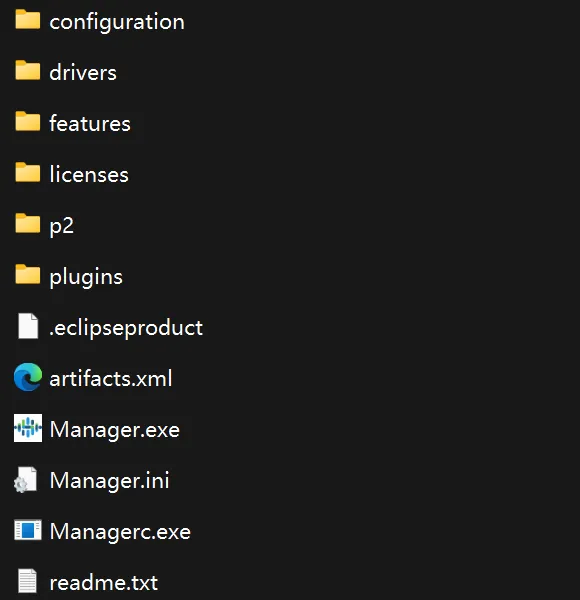

### 新建连接

使用该迁移工具进行瀚高数据库连接时，需选择与数据库当前兼容模式对应的连接，否则无法连接。

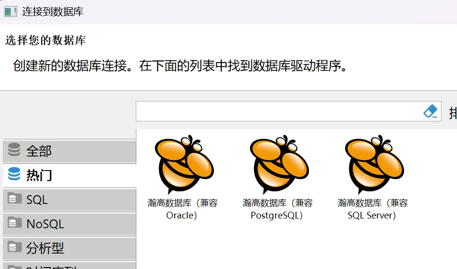

### 快捷键

1. ctrl + d ：删除光标所在行
2. ctrl + c ：复制
3. ctrl + v ：粘贴
4. ctrl + \] ：新建sql编辑器
5. ctrl + enter ：执行命令
6. ctrl + / ：注释单行
7. ctrl + shift + / ：注释多行

### 解决guid格式乱码问题

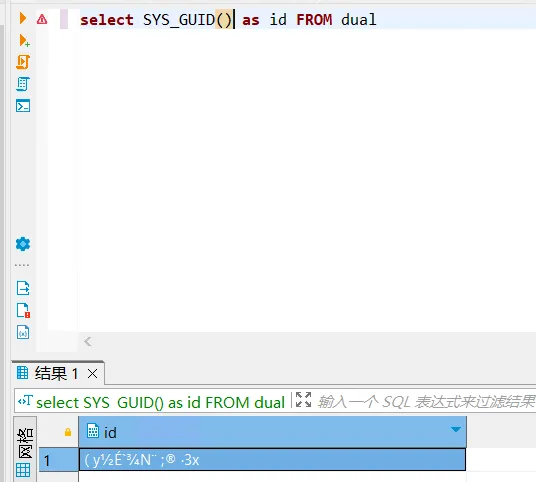

#### 操作步骤

1.右键编辑链接=>数据编辑器（数据格式）=>全局设置=> 二进制编辑器 => 二进制数据格式化程序 =>改为Hex

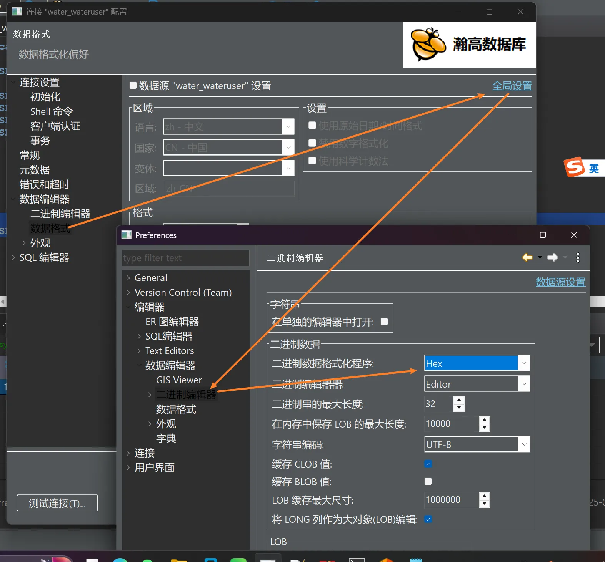

### 多sql语句执行

若同时需要执行多条sql语句，需点击如下执行图标（sql语句需要使用分号进行分割）

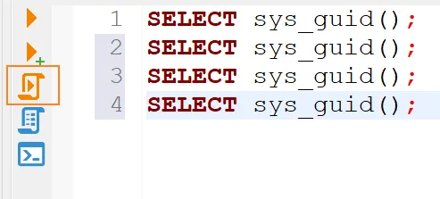

### 会话、锁管理器

用户排查当前活跃会话，并及时排查处理导致死锁进程。

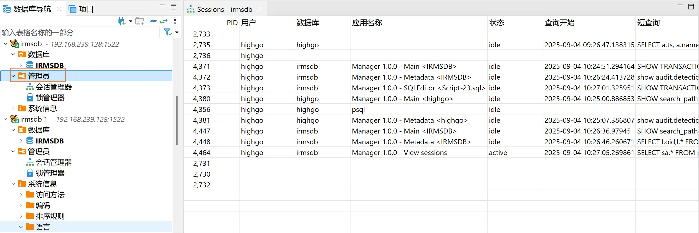

## 评估改写工具assess

> 本文档使用截止版本：assess-1.0.0-win32.win32.x86\_64.zip

### 工具安装

介质：assess-1.0.0-win32.win32.x86\_64.zip， 该版本瀚高评估改写工具以免安装的方式使用，直接解压工具的 zip 介质包即可。

### 工具启动

解压后，目录结构如下：

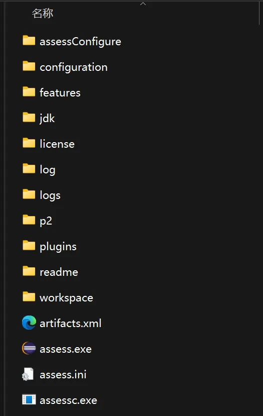

执行assess.exe命令启动工具。

### 申请授权

评估工具作为商业用途的数据库评估工具，具备license管理功能，用户只有在获取到License后才可以使用该产品。

该评估改写工具启动需使用授权文件，点解“获取机器码”自动获取本机机器码，需将该机器码提供给瀚高开源研发同事，由瀚高同事申请.lic格式文件。以下“许可文件”位置选择.lic文件即可打开瀚高评估改写工具。

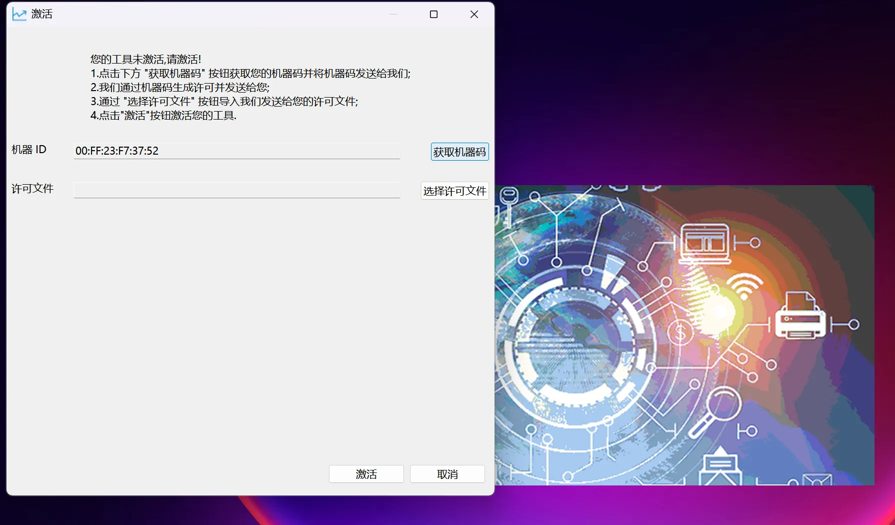

工具启动后的界面如下：

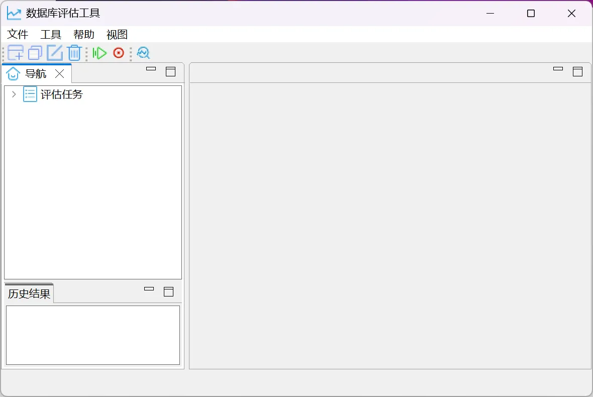

### 新建连接

点击“评估任务”=>创建任务 => 选择需要评估的源库类型=> 输入对应数据库连接信息=>测试连接 => 下一步 => 完成

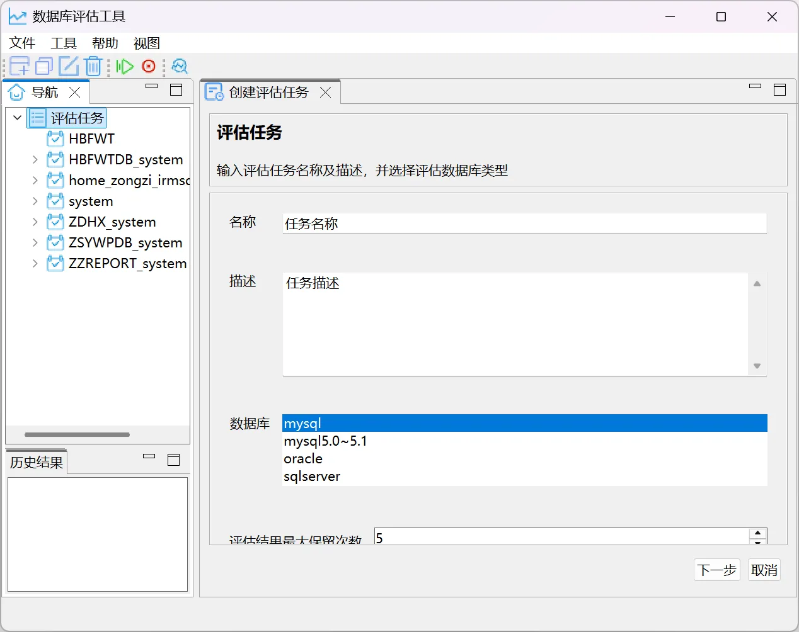

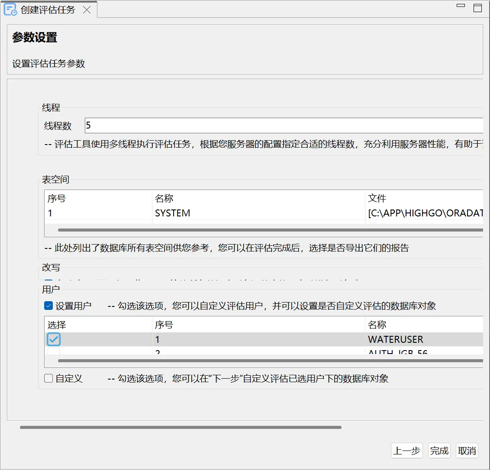

### 执行评估任务

执行评估任务是指评估工具根据评估任务配置，对所配置的数据库进行查询、分许的过程，并最终给出分析、评估结果的功能。工具在执行评估任务时，会实时更新当前正在评估的数据库对象、评估用时、评估开始时间等评估状态信息，评估任务主要包括以下：

| 需求点 | 描述 |
| --- | --- |
| 显示评估进度 | 实时显示评估进度信息 |
| 评估数据库对象 | 显示数据库对象的评估状态、DDL等信息 |
| 评估系统依赖 | 显示评估数据库中数据库对象所依赖的数据库内置/系统对象 |
| 评估数据库特性 | 显示评估数据库中数据库对象所使用到的数据库特性 |
| 评估服务器信息 | 显示数据库所在服务器的基本信息 |
| 评估空间使用 | 显示数据库空间使用情况等信息 |
| 评估数据库基本信息 | 显示评估数据库的基本信息 |
| 迁移评估 | 显示数据库兼容 |

界面原型如下：

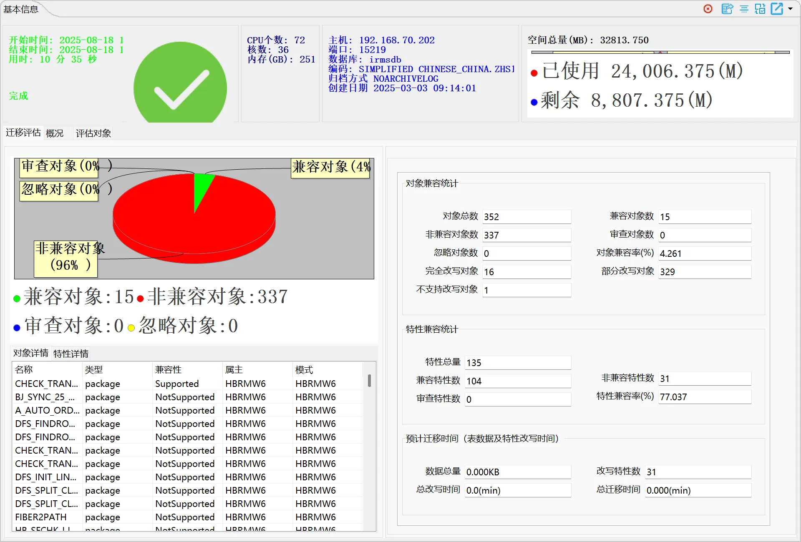

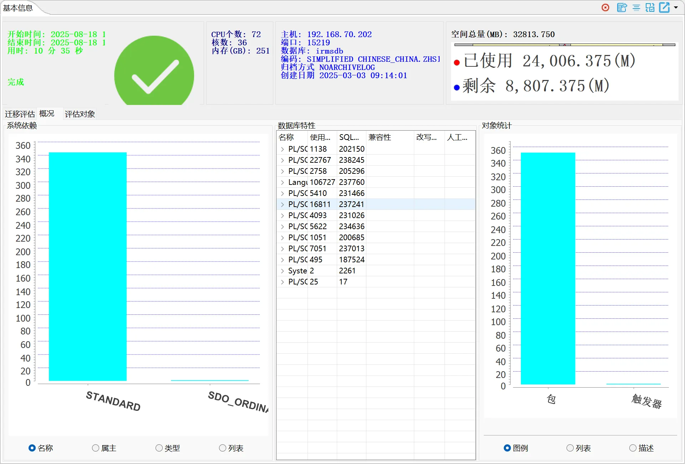

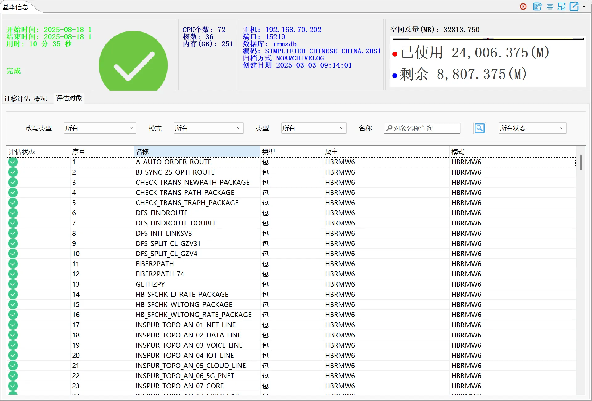

### SQL改写

#### 任务自动改写

任务创建或者任务编辑流程中的参数设置页面，具有自动改写配置项。勾选此选项，在评估任务结束后，会对检测到的可改写对象进行自动化改写。

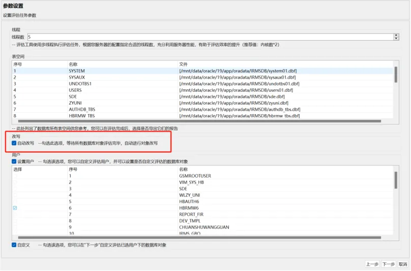

#### SQL一键转换

SQL一键转换是指一段SQL或SQL文件按选定的数据库类型进行分析，自动识别异构数据间的语法差异，生成符合目标数据库规范的SQL语句。

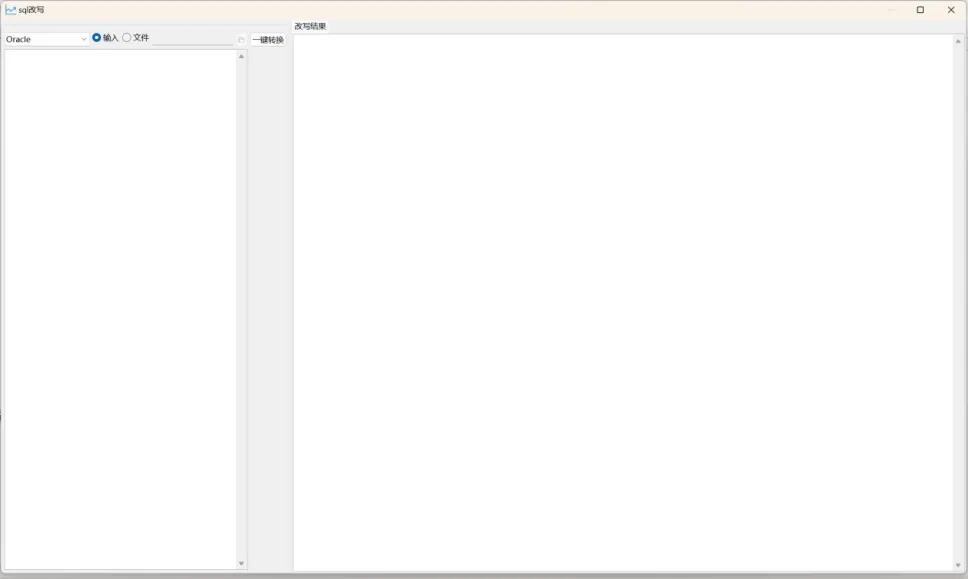

#### 评估结果批量改写

在生成的评估结果上右键单击，将出现“自动改写”选项。选择该功能后，工具会对评估结果中包含的所有对象结构语句进行统一批量改写。若此评估结果当前已在工具中打开，则相关改写指标数据和对象属性将实时更新。

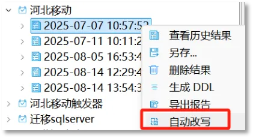  
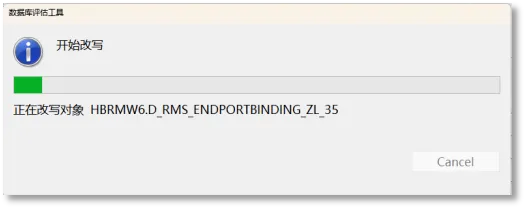

#### 对象列表选中转换

自定义对象改写是指对评估结果列表中所有的数据库对象，进行单个或多个对象改写。

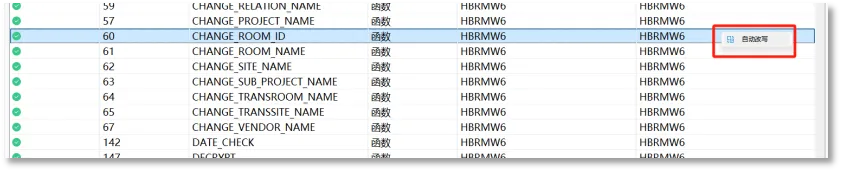

#### 改写对象筛选

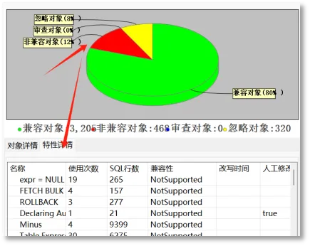  
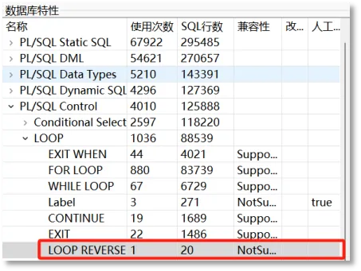  
通过对象列表过滤器中的改写类型以及其他对象属性进行筛选

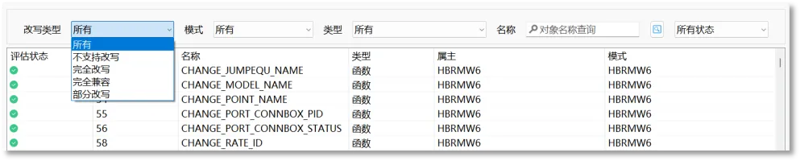

#### 改写DDL导出与批量导出

- 单项导出

右键选择“导出DDL”功能，选择导出本地目录，即可实现对象DDL导出

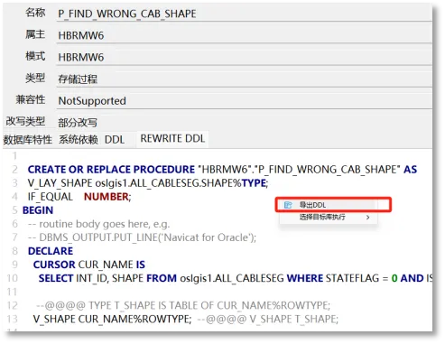

- 批量导出

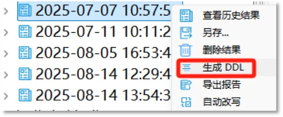  
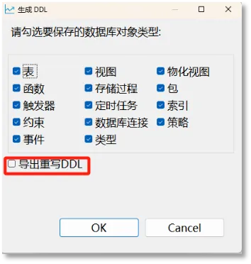

#### SQL目标端执行

SQL目标端执行分为目标端配置与对象DDL执行两个部分。目标端配置是指提供图形化界面，用于配置指向目标数据库的连接。目前支持oracle、sqlserver、mysql以及higodb四种数据库系统。

对象DDL执行是指在对象详情页面的DDL文本上点击右键，通过选择配置好的目标端数据库连接执行，返回执行结果。

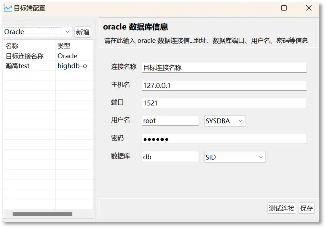  
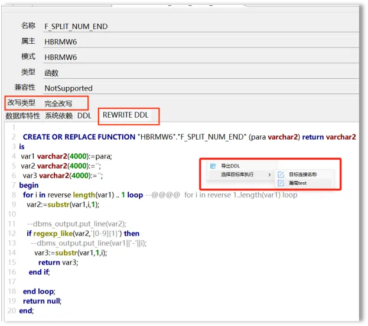