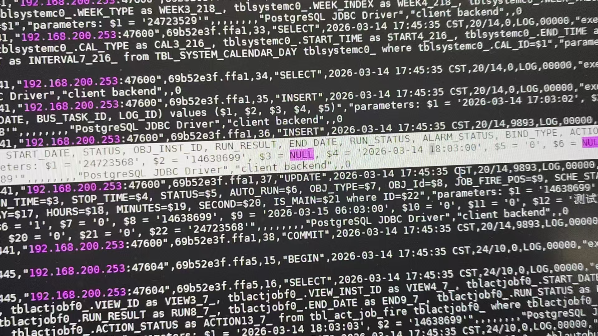

#### 1、问题描述

应用与数据的日期值存在差异  
**具体表现**

#### 2、问题排查

###### 1）数据库日志



###### 2）排查程序

查询历史显示均存在时差  
查询源库数据正常  
查询迁移后数据存在时间差异  
排查数据库参数

```sql
alter system set nls_date_format to 'YYYY-MM-DD HH24:MM:SS';
```

#### 3 解决方案

修改参数

```sql
alter system set nls_date_format to 'YYYY-MM-DD HH24:MI:SS';
```