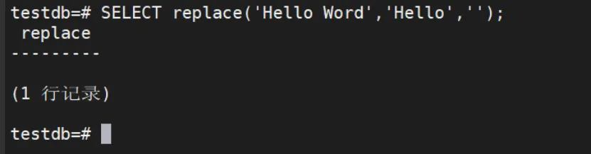
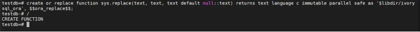
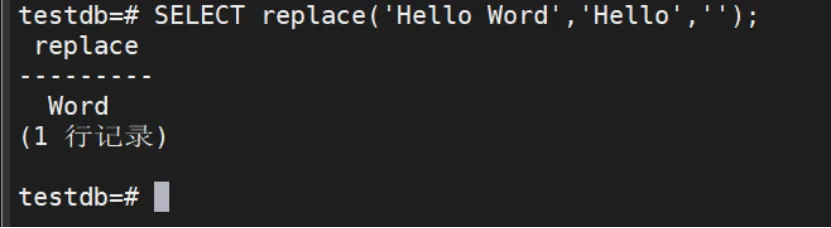

##### 问题现象

在使用replace函数，将字符串中某个值替换成空时，整个字符串被替换成空

```bash
SELECT replace('Hello Word','Hello','');
```



##### 解决方案

创建replace函数

```bash
create or replace function sys.replace(text, text, text default null::text) 
returns text language c immutable parallel safe 
as '$libdir/ivorysql_ora', $$ora_replace$$;
/
```



