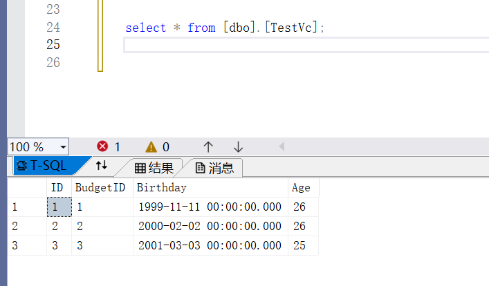
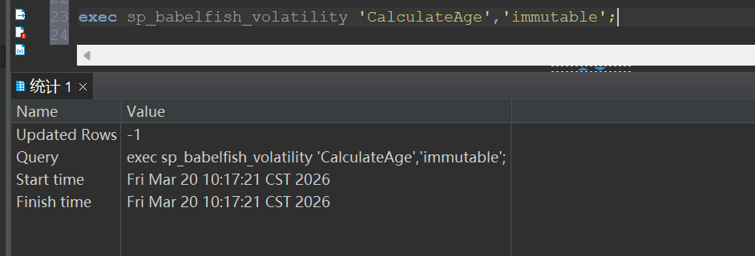
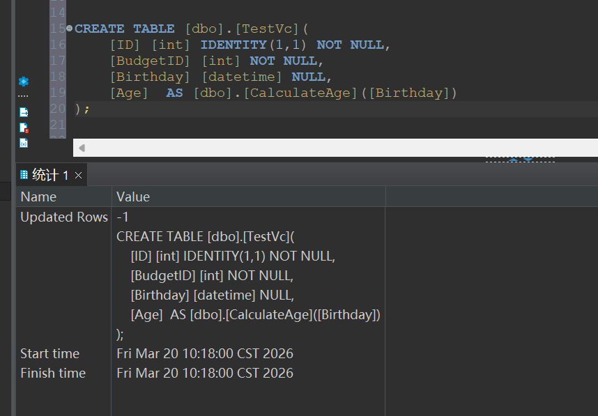
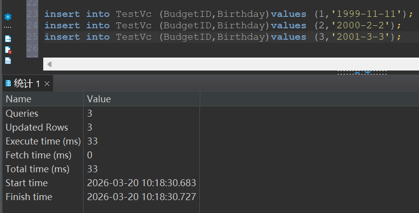
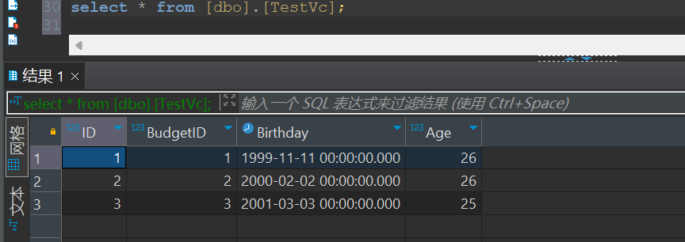

1. 介质名称

hgdbv9(sqlserver-1-1)-232-build2511211459-0bf3082-linux.x86\_64.bin

2. 问题现象

hgdbv9的SQLserver版本，建表时字段是虚拟列，且此列调用了函数，创建时报错：SQL 错误 \[33557097\] \[S0001\]: 生成表达式不是不可变的。

(1).函数

```sql
CREATE FUNCTION [dbo].[CalculateAge] (@Birthday DATETIME) RETURNS INT AS
BEGIN
    DECLARE @Today DATE = GETDATE();
    DECLARE @Age INT;
    SET @Age = DATEDIFF(YEAR, @Birthday, @Today);
    IF DATEADD(YEAR, @Age, @Birthday) > @Today
        SET @Age = @Age - 1;
    RETURN @Age;
END
```

(2).表结构和数据

```sql
CREATE TABLE [dbo].[TestVc](
    [ID] [int] IDENTITY(1,1) NOT NULL,
    [BudgetID] [int] NOT NULL,
    [Birthday] [datetime] NULL,
    [Age]  AS [dbo].[CalculateAge]([Birthday])
);
```

(3).SQLServer创建后查询结果

```sql
select * from [dbo].[TestVc];
```



(4).hgdb无法创建表

建表报错，如图所示


3. 解决方案

(1).修改函数为immutable

```sql
exec sp_babelfish_volatility 'CalculateAge','immutable';
```



(2).再次创建表并插入数据





(3).hgdb查询结果

```sql
select * from [dbo].[TestVc];
```

