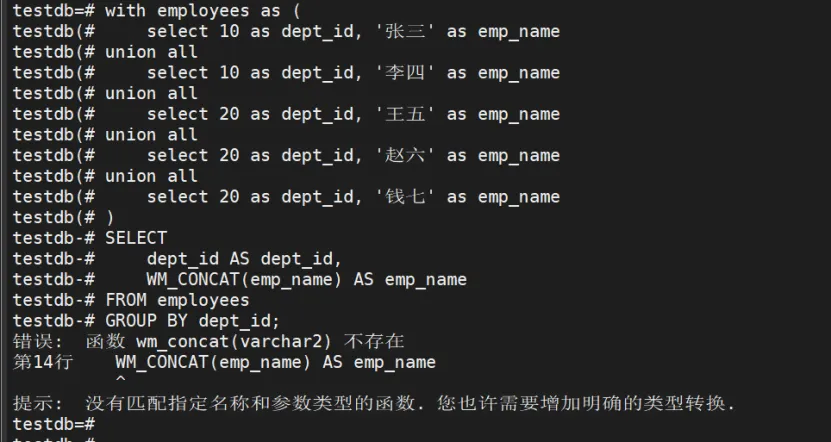
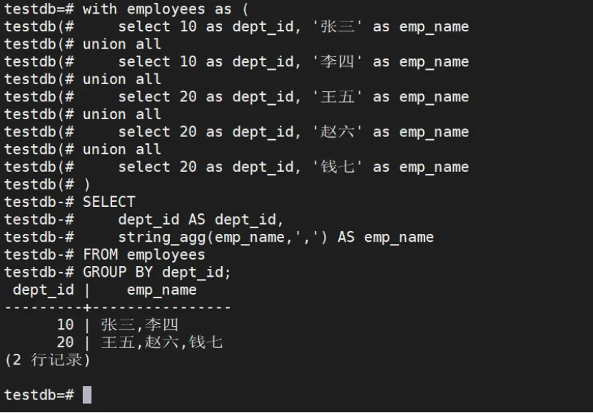
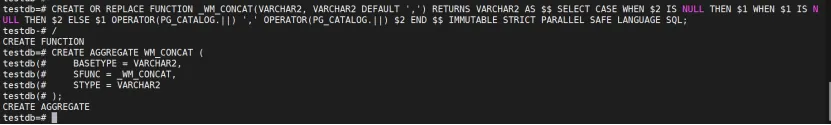
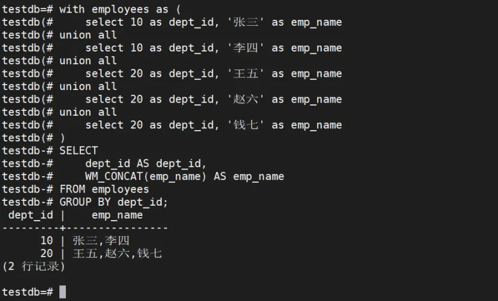

##### 问题现象

在使用WM\_CONCAT函数时报错。

```bash
with employees as (
   select 10 as dept_id, '张三' as emp_name
union all
  select 10 as dept_id, '李四' as emp_name
    union all
  select 20 as dept_id, '王五' as emp_name
    union all
  select 20 as dept_id, '赵六' as emp_name
    union all
  select 20 as dept_id, '钱七' as emp_name
)
SELECT 
  dept_id AS dept_id,
  WM_CONCAT(emp_name) AS emp_name 
FROM employees
GROUP BY dept_id;
```



##### 解决方案

###### 使用string\_agg函数替换

WM\_CONCAT(emp\_name) AS emp\_name 改成 string\_agg(emp\_name,’,’) AS emp\_name



###### 创建WM\_CONCAT函数

```bash
CREATE OR REPLACE FUNCTION _WM_CONCAT(VARCHAR2, VARCHAR2 DEFAULT ',') RETURNS VARCHAR2 AS $$ SELECT CASE WHEN $2 IS NULL THEN $1 WHEN $1 IS NULL THEN $2 ELSE $1 OPERATOR(PG_CATALOG.||) ',' OPERATOR(PG_CATALOG.||) $2 END $$ IMMUTABLE STRICT PARALLEL SAFE LANGUAGE SQL;
/
CREATE AGGREGATE WM_CONCAT (
    BASETYPE = VARCHAR2,
    SFUNC = _WM_CONCAT,
    STYPE = VARCHAR2
);
```



